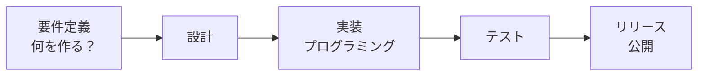
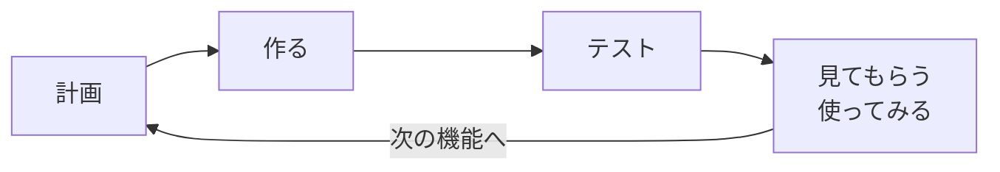
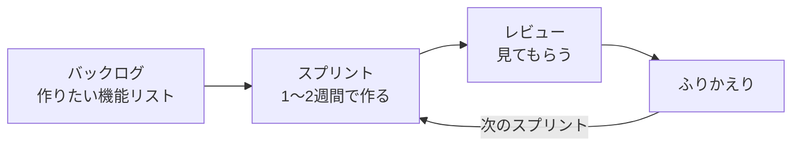

# アジャイル開発について

前回は、まず小さく完成させる **MVP** について学びました。
「小さく作って、使ってみて、少しずつ育てる」という作り方には名前があります。それが **アジャイル開発** です。
ここでは、昔からある **ウォーターフォール開発** と比べながら見ていきます。

[自由制作に戻る](../2026_10_09/2026_10_09_資料1.md)

---

## 1. ひとことで言うと

| 名前 | 読み方 | 進め方 | ひとことで |
|------|-------|-------|-----------|
| **ウォーターフォール開発** | Waterfall（滝） | 全部決めてから、順番に1回で作る | 計画どおりに作る |
| **アジャイル開発** | Agile（すばやい） | 小さく作って、くり返し改善する | 作りながら育てる |

---

## 2. ウォーターフォール開発

**滝の水が上から下へ流れるように**、工程を1つずつ順番に進めます。
前の工程が終わるまで、次の工程には進みません。基本的に、**後もどりしない** 前提です。

| いいところ 👍 | 気をつけるところ ⚠️ |
|------------|-----------------|
| 最初に全部決めるので、**予定やお金が見えやすい** | 途中で「やっぱりこうしたい」が **言いにくい** |
| 工程ごとに担当を分けやすい | 使う人が動くものを見られるのは **最後** |
| 銀行・役所など、**まちがいが許されない** システムに向いている | 最後に「思っていたのとちがう」となると、**やり直しが大変** |

---

## 3. アジャイル開発

**小さな機能ごとに「計画 → 作る → 確認」をくり返して**、アプリを少しずつ育てていきます。
1回のくり返しは、**1〜4週間くらい** の短い期間です。

| いいところ 👍 | 気をつけるところ ⚠️ |
|------------|-----------------|
| **早い段階で動くもの** を見られる | 最終的にどこまで作れるか、**最初は見えにくい** |
| 使った人の意見を、**すぐ次に反映** できる | 「とりあえず作る」になると、**設計がぐちゃぐちゃ** になりやすい |
| 途中で方針を変えやすい | チームで **こまめに話し合う** 必要がある |

> 💡 **MVP はアジャイル開発の「1回目」**
> MVP を作って、使ってみて、こだわりの機能を1つずつ足していく——
> 自由制作の進め方は、まさにアジャイル開発です。

---

## 4. くらべてみよう

**「料理を作る」** でたとえてみます。

| | ウォーターフォール | アジャイル |
|---|---|---|
| 進め方 | コース料理を **全部決めて**、前菜からデザートまで順番に作り、**最後にまとめて出す** | まず1品作って **味見してもらい**、感想を聞いて次の料理を決める |
| 途中の変更 | 「やっぱり魚じゃなくて肉がいい」と言われると大変 | 次の1品で変えればいい |
| 向いている場面 | 結婚式の料理（メニューが最初から決まっている） | 家族のごはん（その日の気分で変わる） |

どちらが正しいということはありません。**作るものによって使い分けます。**

---

## 5. スクラム — アジャイル開発の進め方の1つ

アジャイル開発のやり方で、いちばん有名なのが **スクラム** です。ラグビーでチームが肩を組む「スクラム」が名前の由来です。

| 言葉 | 意味 | 自由制作でいうと |
|-----|------|---------------|
| **スプリント** | 1回のくり返しの期間（1〜4週間） | 授業1回〜2回分 |
| **プロダクトバックログ** | 作りたい機能を、**大事な順** に並べたリスト | MVP の資料で作った「あとで足す機能（作る順）」 |
| **デイリースクラム** | 毎日15分くらいの短い打ち合わせ | 授業のはじめに「今日やること」を決める |
| **スプリントレビュー** | できたものを見せて、意見をもらう | 友だちや先生に使ってもらう |
| **ふりかえり（レトロスペクティブ）** | 進め方をふりかえって、次に活かす | 授業の終わりに「うまくいったこと・困ったこと」を考える |

> 💡 **GitHub でバックログを作れる**
> GitHub の **Issues** に「作りたい機能」を1つずつ登録し、**Projects** で「やること・作業中・完了」に並べると、実際の現場と同じようにバックログを管理できます。

---

## 6. 現場ではどっちが多い？

最近の Webサービスやスマホアプリの開発では、**アジャイル開発** がよく使われています。
使う人の反応を見ながら、毎週・毎日のようにアップデートしていくためです。

一方で、銀行のシステムや、工場の機械を動かすシステムなどでは、今も **ウォーターフォール開発** が使われています。
また、大きな流れはウォーターフォールで決めて、細かい部分はアジャイルで進める、という **組み合わせ** もあります。

> 💡 **面接で話せる**
> 「自由制作では、まず MVP を作り、使ってみて機能を足していく **アジャイルな進め方** をしました」と言えると、開発の進め方を理解していることが伝わります。

---

## 7. まとめ

- **ウォーターフォール開発** ＝ 全部決めてから、順番に1回で作る（後もどりしない）
- **アジャイル開発** ＝ 小さく作って、使ってみて、くり返し改善する
- **スクラム** はアジャイル開発の進め方の1つ。**スプリント**（短い期間）をくり返す
- **MVP → 機能を足していく** 自由制作の進め方は、アジャイル開発そのもの
- どちらが正しいではなく、**作るものによって使い分ける**

[自由制作に戻る](../2026_10_09/2026_10_09_資料1.md)
