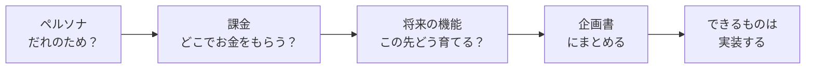
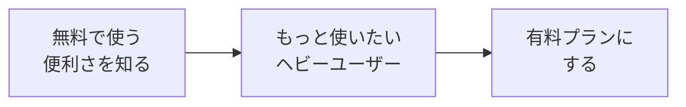
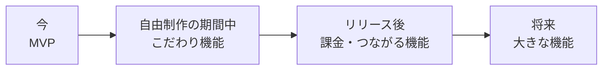
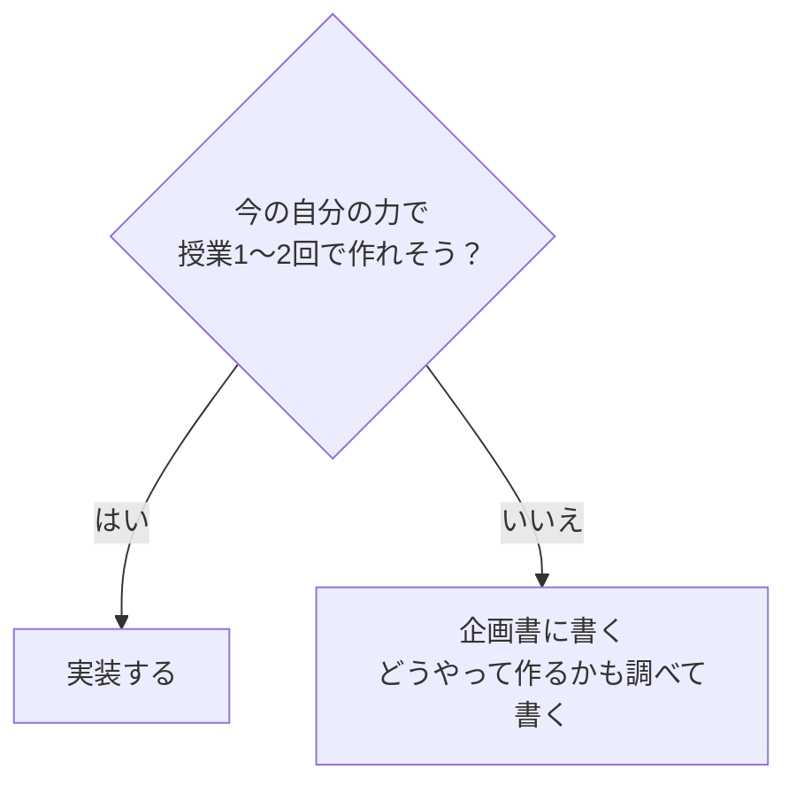

# 自由制作の将来像も考えて作る

自由制作のアプリを、「授業の課題」ではなく **本当にリリースするサービス** だと思って考えてみます。
**だれが使うのか（ペルソナ）**、**どこでお金をもらうのか（課金）**、**この先どんな機能を足していくのか** を考えて、**企画書** にまとめます。

[自由制作に戻る](../2026_10_09/2026_10_09_資料1.md)

---

## 1. なぜ将来像を考えるの？



- **作る機能に迷わなくなる**：「この人（ペルソナ）にとって必要？」で判断できる
- **面接で話せる**：「だれの、どんな困りごとを解決するアプリで、どうやって続けていくサービスか」まで話せると、**考えて作った人** だと伝わる
- **実際の会社と同じ**：会社でアプリを作るときは、作る前に必ず **企画** を考える

> 💡 全部を実装する必要はありません。**考えたことを企画書に書いておく** だけでも、ポートフォリオとして価値があります。

---

## 2. ペルソナを設定する

### ペルソナとは

**ペルソナ** は、アプリを使う人を、**1人の具体的な人物** として細かく決めたものです。
「20代の人」のようなざっくりした分け方ではなく、**実在しそうな1人** をイメージします。

| ✕ ざっくり | ◯ ペルソナ |
|----------|----------|
| 本が好きな人 | 田中 さくら さん（21歳・大学3年生）。通学の電車で月に3〜4冊読む。読んだ本の内容をすぐ忘れてしまい、友だちにおすすめを聞かれても答えられないのが悩み |

> 💡 **なぜ1人にしぼるの？**
> 「みんなのため」に作ると、だれにとっても **ちょっと使いにくい** アプリになりがちです。
> 1人にしぼると、「さくらさんなら、電車の中で **片手で** 記録したいはず」のように、**具体的に考えられます**。

### ペルソナで決めること

| 項目 | 例（読書記録アプリ） |
|-----|-----------------|
| 名前・年齢・職業 | 田中 さくら・21歳・大学3年生 |
| 生活のようす | 通学の電車で毎日30分読書。スマホはいつも持っている |
| ITへのなれ | SNS はよく使う。むずかしい設定は苦手 |
| 困りごと | 読んだ本の内容をすぐ忘れる。おすすめを聞かれても答えられない |
| ゴール（どうなりたい？） | 読んだ本と感想を、あとからすぐ見返せるようにしたい |
| アプリを使う場面 | 電車で読み終わった直後に、**スマホで** 記録する |

> ⚠️ **自分の都合のいい人にしない**
> 「毎日アプリを開いてくれて、全部の機能を使ってくれる人」は、ほとんどいません。
> **いそがしい・めんどくさがり・すぐあきる** くらいの、リアルな人を考えましょう。

---

## 3. どこで課金させるかを考える

### お金のもらい方（収益モデル）

| モデル | しくみ | 例 |
|-------|------|-----|
| **広告** | アプリは無料。画面に広告をのせて、広告主からお金をもらう | YouTube（無料プラン）、ニュースアプリ |
| **買い切り** | 最初に1回だけお金をはらう | 有料のスマホゲーム、ソフト |
| **サブスクリプション**（サブスク） | 毎月・毎年お金をはらう | Netflix、Spotify |
| **フリーミアム** | 基本は **無料**。もっと便利な機能を使いたい人だけ **有料** | Spotify、Notion、LINE スタンプ |

個人で作る Webアプリなら、**フリーミアム** がいちばん考えやすいです。

### 「無料」と「有料」の線を引く

フリーミアムでいちばん大事なのは、**どこまで無料で、どこから有料にするか** です。



| 考え方 | 説明 |
|-------|------|
| **アプリの「目的」は無料にする** | MVP の機能（いちばん大事な機能）が有料だと、だれも使い始めてくれない |
| **たくさん使う人ほど、お金をはらう** | 「〇件まで無料」のように、**量** で線を引く |
| **あると便利だけど、なくても困らないもの** を有料に | 見やすいグラフ、データの書き出し、デザインの変更など |
| **ペルソナがお金をはらう理由** を考える | 「さくらさんは、何にだったら月300円はらう？」 |

**読書記録アプリの例**

| | 無料プラン | 有料プラン（月300円） |
|---|---|---|
| 本の登録 | **50冊まで** | 無制限 |
| 感想を書く | ◯ | ◯ |
| 一覧で見返す | ◯ | ◯ |
| 読んだ冊数のグラフ | ✕ | ◯ |
| 本棚のデザイン変更 | 1種類 | 10種類 |
| 広告 | あり | **なし** |

> 💡 **「さくらさん」で考えると**
> 学生なので、高いお金ははらえません。でも、1年続けて **50冊をこえる** ころには、記録がたまって手放せなくなっています。
> そのタイミングで「無制限＋グラフ」を月300円で出せば、はらってくれるかもしれません。

---

## 4. 将来の機能を考える

### 機能を時期で分ける

[MVP](../2026_10_16/2026_10_16_資料1.md) で「あとで足す機能」を書き出しました。それを、**時期** で分けて並べます。
この「いつ・何を作るか」の計画を **ロードマップ** といいます。



| 時期 | 機能の例（読書記録アプリ） |
|-----|-----------------------|
| **今（MVP）** | 本の登録・感想・一覧 |
| **自由制作の期間中** | 表紙の画像、評価（星）、検索 |
| **リリース後** | ログイン、有料プラン、読んだ冊数のグラフ |
| **将来** | 友だちと本棚をシェア、バーコードを読んで本を登録、AI がおすすめの本を提案 |

### アイデアの出し方

- **ペルソナの1日** を思いうかべて、「ここでも使えたら便利」な場面を探す
- **似ているアプリ** を3つ使ってみて、「いいところ」と「不便なところ」を書き出す
- **データがたまったら** 何ができるか考える（グラフ・ランキング・おすすめ）
- **ほかの人とつながったら** 何ができるか考える（シェア・コメント・ランキング）

---

## 5. 実装するか、企画書に書くか

思いついた機能は、全部作らなくて大丈夫です。
**むずかしくなければ実装する**、**むずかしそうなら企画書に書く**、と分けます。



| 判断のめやす | 例 |
|-----------|-----|
| **実装する**（今の知識の応用でできる） | 列を1つ足す（評価・ジャンル）、検索、並びかえ、「〇件まで」の上限チェック、有料プランの **画面だけ**（料金表のページ） |
| **企画書に書く**（新しい技術や、お金・個人情報が関わる） | 本物の決済（クレジットカード）、バーコード読み取り、AI のおすすめ、スマホアプリ化、たくさんの人が同時に使うしくみ |

> 💡 **「企画書に書く」もりっぱな成果**
> 「決済は **Stripe** というサービスを使えば実装できそう」のように、**どう作るかを調べて書いておく** と、
> 「今は作れないけど、作り方はわかっている」と面接で話せます。

> ⚠️ **本物の決済は実装しない**
> クレジットカードの決済は、まちがえると **本当にお金が動きます**。自由制作では **企画書に書く** までにしましょう。
> 課金のしくみを試したいときは、「有料プランのユーザー」を **データベースの列（`is_premium` など）で切りかえる** ところまでにします。

---

## 6. 企画書を作る

考えたことを、**企画書** にまとめます。
リポジトリの中に `docs/企画書.md` を作って書いておくと、GitHub でそのまま見せられます。README からリンクしておきましょう。

### 企画書のテンプレート

```markdown
# 〇〇（アプリ名）企画書

## 1. ひとことで言うと
〇〇な人が、△△するためのアプリ

## 2. ペルソナ
- 名前・年齢・職業：
- 生活のようす：
- ITへのなれ：
- 困りごと：
- ゴール（どうなりたい？）：
- アプリを使う場面：

## 3. 似ているアプリとのちがい
| アプリ | いいところ | 不便なところ |
|-------|----------|-----------|
|       |          |           |

このアプリならではのこだわり：

## 4. 収益モデル（どこで課金するか）
- モデル：（フリーミアム / 広告 / サブスク / 買い切り）
- 有料プランの値段：

| | 無料プラン | 有料プラン |
|---|---|---|
|   |   |   |

ペルソナがお金をはらう理由：

## 5. ロードマップ（将来の機能）
| 時期 | 機能 | 状態 |
|-----|------|-----|
| 今（MVP） |  | ✅ 実装ずみ |
| 自由制作の期間中 |  | 🚧 作成中 |
| リリース後 |  | 📝 企画のみ |
| 将来 |  | 📝 企画のみ |

## 6. 企画のみの機能の作り方メモ
- 〇〇機能：△△というサービス・技術を使えばできそう
```

### 書くときのポイント

- **ペルソナ → 課金 → ロードマップ** は、すべて **つながっている** ようにする（ペルソナがほしい機能が、有料プランやロードマップに入っている）
- 状態の列（✅ 🚧 📝）で、**どこまで実装したか** がひと目でわかるようにする
- 一度書いて終わりではなく、作りながら **こまめに書き直す**（[アジャイル開発](./アジャイル開発について.md) と同じ考え方）

---

## 7. まとめ

- 自由制作のアプリを、**本当にリリースするサービス** だと思って考える
- **ペルソナ** ＝ 使う人を **1人の具体的な人物** として決める
- 課金は **フリーミアム** が考えやすい。**目的の機能は無料**、**たくさん使う人・あると便利な機能を有料** に
- 将来の機能は、**時期で分けて** ロードマップにする
- **むずかしくなければ実装**、**むずかしければ企画書に書く**（作り方も調べて書く）
- 本物の決済は実装しない。課金は **データベースの列で切りかえる** ところまで
- 企画書は `docs/企画書.md` に書いて、README からリンクする

[自由制作に戻る](../2026_10_09/2026_10_09_資料1.md)
