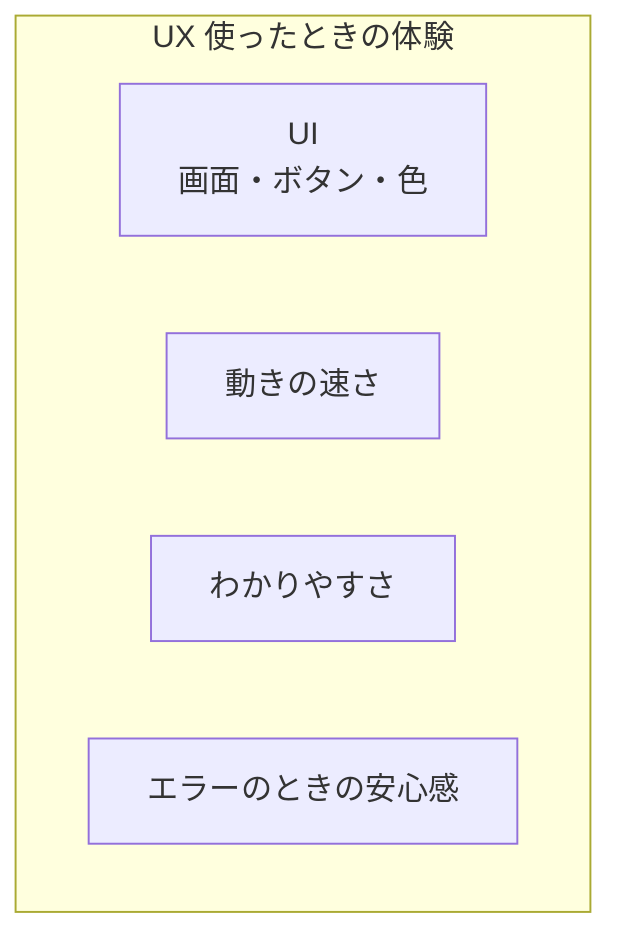
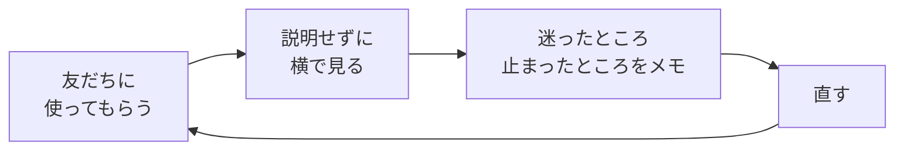

# UI・UXについて

アプリの話をしていると、**UI（ユーアイ）** と **UX（ユーエックス）** という言葉がよく出てきます。
どちらも「使う人」に関係する言葉ですが、意味は少しちがいます。

[自由制作に戻る](../2026_10_09/2026_10_09_資料1.md)

---

## 1. ひとことで言うと

| 名前 | 正式な名前 | 意味 | ひとことで |
|------|----------|------|-----------|
| **UI** | User Interface（ユーザーインターフェース） | 使う人が **見て・さわる部分**（画面・ボタン・文字・色） | 見た目と操作 |
| **UX** | User Experience（ユーザーエクスペリエンス） | 使う人が **使って感じること**（便利・楽しい・わかりやすい） | 使ったときの体験 |

> 💡 **たとえるなら「レストラン」**
> - **UI** ＝ メニュー表・お皿・テーブル・お店の内装
> - **UX** ＝ 「すぐ座れた」「注文しやすかった」「おいしかった」「また来たい」と感じる **体験全体**
>
> メニュー表がおしゃれ（UI がいい）でも、料理が出てくるまで1時間かかったら、体験（UX）はよくありません。

---

## 2. UI と UX の関係

UI は、UX の **一部** です。
いい UX を作るためには、いい UI が必要ですが、**UI だけよくても UX はよくなりません**。

| 例 | UI | UX |
|----|----|----|
| ボタンがかっこいいけど、押しても反応がない | ◯ | ✕ |
| 地味な見た目だけど、ほしい情報にすぐたどり着ける | △ | ◯ |
| 入力したデータが、エラーで全部消えてしまった | — | ✕✕ |

---

## 3. いい UI のポイント

### ① そろえる（一貫性）

同じ意味のものは、**同じ見た目・同じ場所** にします。

| ✕ よくない | ◯ いい |
|----------|-------|
| ページによって「保存」ボタンの色や位置がちがう | 保存ボタンは、どのページでも **同じ色・同じ場所** |
| 「登録」「追加」「作成」と、同じ意味の言葉がバラバラ | 言葉を **1つにそろえる** |

### ② 押せるものは、押せるとわかるようにする

ボタンやリンクは、**ひと目で押せるとわかる** 見た目にします。
マウスを乗せたときに色が変わる（`hover`）と、さらにわかりやすくなります。

### ③ 大事なものを目立たせる

いちばん押してほしいボタン（「保存」など）は **濃い色** に、それ以外（「キャンセル」など）は **うすい色** にします。
全部が目立つと、**どれも目立たなく** なります。

### ④ 読みやすくする

- 文字と背景の色の差（**コントラスト**）をしっかりつける（うすいグレーの文字は読みにくい）
- 文字を小さくしすぎない
- 余白（すき間）をとって、つめこみすぎない

---

## 4. いい UX のポイント

### ① 反応を返す（フィードバック）

ボタンを押したら、**何が起きたかを伝えます**。反応がないと、使う人は「押せたのかな？」と不安になり、何回も押してしまいます。

| 場面 | フィードバックの例 |
|-----|----------------|
| 保存中 | 「保存中…」と表示する・ボタンを押せなくする |
| 保存できた | 「保存しました」と表示する |
| エラー | **何がダメで、どうすればいいか** を表示する |

### ② エラーをやさしくする

| ✕ よくない | ◯ いい |
|----------|-------|
| `Error 422` | 「タイトルを入力してください」 |
| エラーになったら、入力した内容が全部消える | 入力した内容は **残したまま**、エラーの場所を赤くする |

### ③ 取り消せないことは、確認する

**削除** のように元にもどせない操作は、「本当に削除しますか？」と確認します。

### ④ 少ない手順で終わる

よく使う機能ほど、**少ないクリック** でできるようにします。
「記録するたびに3ページ移動する」アプリは、だんだん使われなくなります。

---

## 5. 自分のアプリで確かめる方法

いちばんいい方法は、**ほかの人に使ってもらうこと** です。

- 作った本人は使い方を知っているので、**わかりにくいところに気づけません**
- 使っている人が **止まったところ・迷ったところ** が、直すべきところです
- 口で説明したくなったら、それは **画面で伝わっていない** というサインです

---

## 6. まとめ

- **UI** ＝ 画面・ボタン・色など、**見て・さわる部分**
- **UX** ＝ 使ったときに **感じること・体験全体**
- UI は UX の一部。**見た目だけよくても、いい体験にはならない**
- いい UI：**そろえる・押せるとわかる・大事なものを目立たせる・読みやすく**
- いい UX：**反応を返す・エラーをやさしく・取り消せないことは確認・少ない手順**
- いちばんの確かめ方は、**ほかの人に使ってもらう** こと

[自由制作に戻る](../2026_10_09/2026_10_09_資料1.md)
