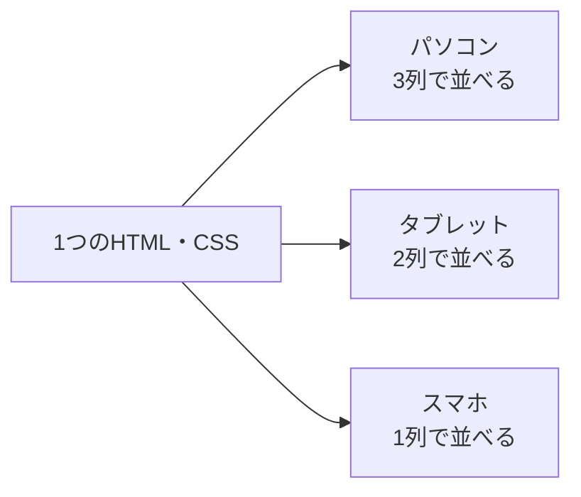
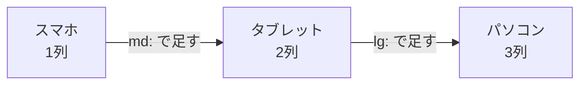
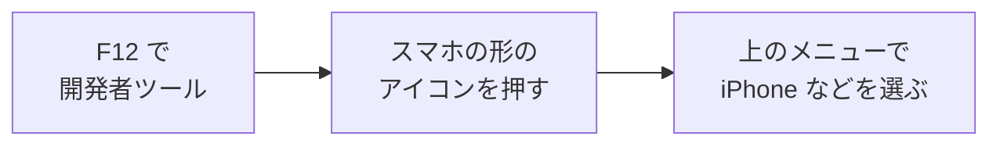

# レスポンシブデザインについて

Webサイトは、パソコン・タブレット・スマホなど、**いろいろな大きさの画面** で見られます。
1つのページを、**どの画面でも見やすく表示する** 作り方を **レスポンシブデザイン** といいます。

[自由制作に戻る](../2026_10_09/2026_10_09_資料1.md)

---

## 1. レスポンシブデザインとは

**Responsive（レスポンシブ）** は、「反応する」という意味です。
画面の **横はば** に反応して、レイアウトを自動で切りかえます。



> 💡 **昔は「スマホ用サイト」を別に作っていた**
> 以前は、パソコン用のページと、スマホ用のページ（`m.〇〇.com` など）を **別々に** 作ることがありました。
> これだと、直すたびに **2つとも直す** 必要があります。レスポンシブデザインなら、**1つ直すだけ** ですみます。

---

## 2. なぜ大切なの？

- 今は、Webサイトを **スマホで見る人がとても多い**
- 会社の人も、ポートフォリオの URL を **スマホで開く** かもしれない
- スマホで見たときに文字が小さすぎたり、横にはみ出したりすると、**それだけで印象が下がる**

---

## 3. しくみ① viewport（ビューポート）

スマホのブラウザは、何も指定しないと、**パソコン用のページを縮小して** 表示します（文字がとても小さくなる）。
それを防ぐのが、HTML の `<head>` に書く **viewport** の設定です。

```html
<meta name="viewport" content="width=device-width, initial-scale=1">
```

| 部分 | 意味 |
|-----|------|
| `width=device-width` | ページの横はばを、**その端末の画面のはば** に合わせる |
| `initial-scale=1` | 最初は **拡大・縮小しない**（等倍）で表示する |

> 📝 **Next.js は自動で入れてくれる**
> Next.js（App Router）では、この viewport の設定が **最初から自動で** 入っています。
> Laravel の Blade で作るときは、レイアウトのファイルに自分で書きましょう（`laravel new` で作ったページには最初から入っています）。

---

## 4. しくみ② メディアクエリ

**メディアクエリ** は、「画面のはばが〇〇px 以上のときだけ、この CSS を使う」と指定する書き方です。

```css
/* ふつう（スマホ）は1列 */
.cards {
  display: grid;
  grid-template-columns: 1fr;
}

/* 画面のはばが 768px 以上なら2列 */
@media (min-width: 768px) {
  .cards {
    grid-template-columns: 1fr 1fr;
  }
}

/* 1024px 以上なら3列 */
@media (min-width: 1024px) {
  .cards {
    grid-template-columns: 1fr 1fr 1fr;
  }
}
```

この、レイアウトを切りかえる **はばの区切り** を **ブレークポイント** といいます。

---

## 5. Tailwind CSS で書くと

Tailwind CSS では、クラス名の前に `md:` や `lg:` をつけるだけで、メディアクエリと同じことができます。

```html
<div class="grid grid-cols-1 md:grid-cols-2 lg:grid-cols-3 gap-4">
  <div>カード1</div>
  <div>カード2</div>
  <div>カード3</div>
</div>
```

| 書き方 | いつ使われる？ |
|-------|------------|
| `grid-cols-1` | **いつでも**（スマホ） |
| `sm:` | はばが **640px 以上** のとき |
| `md:grid-cols-2` | はばが **768px 以上** のとき（タブレットくらい） |
| `lg:grid-cols-3` | はばが **1024px 以上** のとき（パソコンくらい） |

---

## 6. モバイルファースト

上の例は、どちらも **スマホの見た目を先に書き**、画面が大きくなったときの変更を **あとから足して** います。
この考え方を **モバイルファースト** といいます。



- 小さい画面は、表示できるものが少ないので、**本当に必要なものだけ** を考えることになる
- 小さい画面で整ったものを、大きい画面に広げるほうが **かんたん**

> ⚠️ **Tailwind の `md:` は「md 以上」という意味**
> `md:hidden` は「タブレット **だけ** かくす」ではなく、「768px **以上** ならかくす」です。
> スマホのときの見た目は、`md:` などをつけない **ふつうのクラス** に書きます。

---

## 7. スマホでの見た目を確認する

スマホを持っていなくても、**ブラウザの開発者ツール** で確認できます。



| よくある問題 | 直し方 |
|-----------|------|
| 横にスクロールできてしまう（はみ出している） | 横はばを `px` で固定している要素がないか探す。画像には `max-width: 100%` |
| ボタンが小さくて押しにくい | 指で押しやすい大きさ（**44px くらい**）にする |
| 表（テーブル）が横にはみ出す | 表を横スクロールできる箱に入れる、またはスマホではカードの形に変える |
| 文字が小さすぎる | 本文は **16px くらい** を目安にする |

> 💡 デプロイコースの人は、Vercel の URL を **自分のスマホで開いて** 確認してみましょう。

---

## 8. まとめ

- **レスポンシブデザイン** ＝ 1つのページを、**画面のはばに合わせて** 見やすく切りかえる作り方
- **viewport** の設定で、スマホでも **等倍** で表示される（Next.js は自動）
- **メディアクエリ** で、「〇〇px 以上ならこの CSS」と指定する。区切りを **ブレークポイント** という
- Tailwind CSS では `md:` `lg:` をつけるだけ
- **モバイルファースト**：スマホの見た目を先に作って、大きい画面の変更を足す
- 確認は **開発者ツール** と **自分のスマホ** で

[自由制作に戻る](../2026_10_09/2026_10_09_資料1.md)
