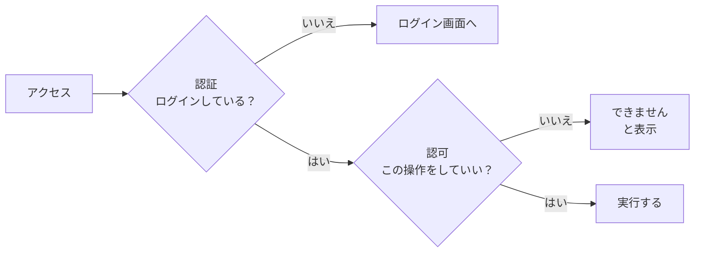
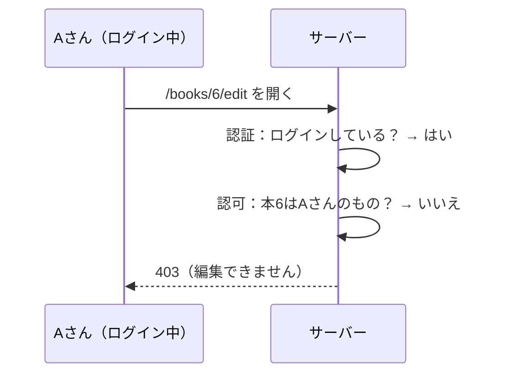
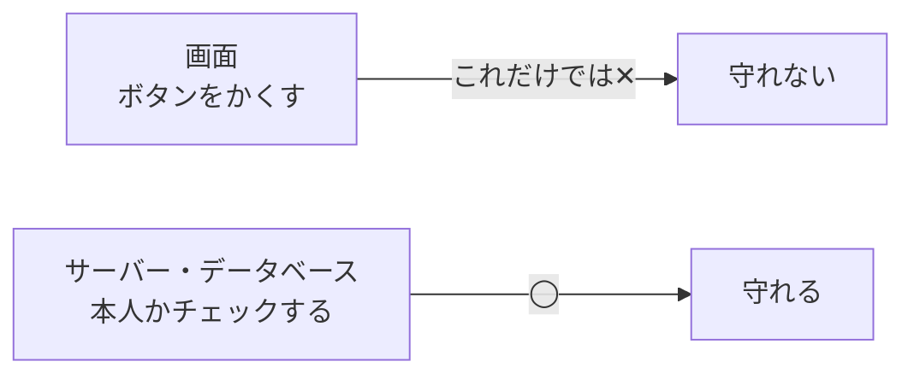

# 認証と認可について

ログイン機能を作ると、**認証（にんしょう）** と **認可（にんか）** という2つの言葉が出てきます。
漢字が1文字ちがうだけですが、やっていることは別です。

[自由制作に戻る](../2026_10_09/2026_10_09_資料1.md)

---

## 1. ひとことで言うと

| 名前 | 英語 | 確かめること | ひとことで |
|------|-----|-----------|-----------|
| **認証** | Authentication（オーセンティケーション）、略して **AuthN** | **あなたはだれ？** | 本人確認 |
| **認可** | Authorization（オーソリゼーション）、略して **AuthZ** | **あなたは何をしていい？** | 許可の確認 |

> 💡 **たとえるなら「コンサート」**
> - **認証** ＝ 入り口で **チケットと身分証** を見せて、本人だと確認してもらう
> - **認可** ＝ チケットの種類によって、**入れる場所が決まる**（一般席の人は、関係者エリアには入れない）
>
> 本人だとわかっても（認証 OK）、どこにでも入れるわけではありません（認可は別）。

---

## 2. 順番は「認証 → 認可」

**だれかがわからないと、何をしていいかも決められません。** だから、必ず認証が先です。



---

## 3. 自分のアプリにあてはめてみよう

**読書記録アプリ** の例で考えます。

| 場面 | 認証？認可？ | 確かめること |
|-----|-----------|-----------|
| メールアドレスとパスワードでログインする | **認証** | 本当にこの人？ |
| ログインしていない人が「本を登録する」ページを開く | **認証** | ログインしている？ → していなければログイン画面へ |
| Aさんが、**Bさんの** 感想を編集しようとする | **認可** | この本を登録したのは自分？ → ちがえばできない |
| 管理者だけが、ほかの人の投稿を削除できる | **認可** | この人は管理者？ |

> ⚠️ **よくあるまちがい：認証だけして、認可を忘れる**
> 「ログインしている人しか編集ページを開けない」だけだと、ログインしている **だれでも**、URL の数字を変えるだけで **ほかの人のデータ** を編集できてしまいます。
>
> ```
> /books/5/edit   ← 自分の本
> /books/6/edit   ← 数字を変えると…ほかの人の本？
> ```
>
> 編集・削除のときは、**「このデータは、ログインしている本人のもの？」** を必ずチェックしましょう。

認可のチェックがあれば、ログインしている人でも、ほかの人のデータは次のように止められます。



---

## 4. HTTP のステータスコード

エラーのときに返すステータスコードも、認証と認可で分かれています。

| コード | 名前 | 意味 |
|-------|-----|------|
| **401** | Unauthorized | **認証** されていない（ログインしていない・だれかわからない） |
| **403** | Forbidden | 認証はされているけど、**認可** されていない（その操作は禁止） |

> 📝 401 の名前は「Unauthorized（認可されていない）」ですが、意味は **認証されていない** です。名前がまぎらわしいので、意味で覚えましょう。

---

## 5. それぞれの技術ではどうする？

### Laravel の場合

| | 使うもの | 例 |
|---|---|---|
| 認証 | `Auth`、ミドルウェア `auth` | ログインしていない人はログイン画面へ移動させる |
| 認可 | **Policy**（ポリシー）、`Gate`（ゲート） | 「本を編集できるのは、登録した本人だけ」というルールを書く |

```php
// routes/web.php：ログインしている人だけ（認証）
Route::middleware('auth')->group(function () {
    Route::get('/books/{book}/edit', [BookController::class, 'edit']);
});
```

```php
// BookController：自分の本かどうか（認可）
public function edit(Book $book)
{
    if ($book->user_id !== Auth::id()) {
        abort(403); // 自分の本でなければ 403
    }

    return view('books.edit', compact('book'));
}
```

### Supabase の場合

| | 使うもの | 例 |
|---|---|---|
| 認証 | **Supabase Auth** | メール・パスワードや、Google アカウントでログイン |
| 認可 | **RLS（Row Level Security / 行レベルセキュリティ）** | 「`user_id` が自分のものの行だけ、見る・変更できる」というルールをデータベースに書く |

> ⚠️ **Supabase では RLS がとても大事**
> Supabase は、ブラウザから **直接データベースにアクセス** します。
> RLS を設定しないと、**だれでもすべてのデータを見たり消したりできる** 状態になってしまうことがあります。
> Supabase の管理画面で、テーブルごとに RLS が **有効（Enabled）** になっているか確認しましょう。

---

## 6. 画面でかくすだけでは、認可にならない

「ほかの人の本には、編集ボタンを表示しない」——これは **UI の工夫** で、**認可ではありません**。
ボタンがなくても、URL を直接打ったり、API を直接呼んだりすれば操作できてしまうからです。



**認可のチェックは、必ずサーバー側（Laravel のコントローラー、Supabase の RLS など）で行います。**

---

## 7. まとめ

- **認証** ＝ **あなたはだれ？**（本人確認・ログイン）
- **認可** ＝ **あなたは何をしていい？**（許可の確認）
- 順番は **認証 → 認可**
- ログインしていない → **401**、ログインしているけど禁止 → **403**
- Laravel は **auth ミドルウェア＋Policy**、Supabase は **Supabase Auth＋RLS**
- ボタンをかくすだけでは守れない。**サーバー側で必ずチェック** する

[自由制作に戻る](../2026_10_09/2026_10_09_資料1.md)
