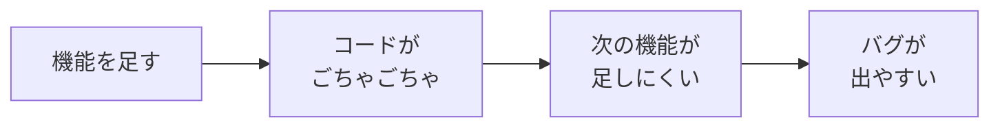
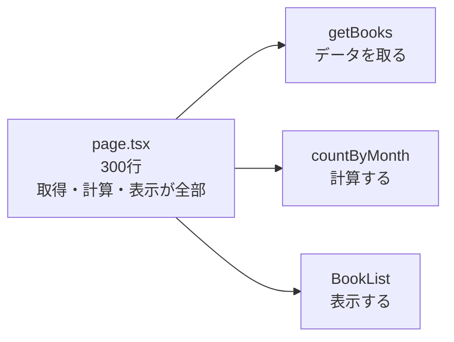
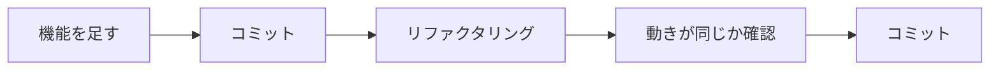

# リファクタリングについて

機能をどんどん足していくと、コードが長くなって、**どこに何が書いてあるかわからなく** なってきます。
そんなときに行うのが **リファクタリング** です。

[自由制作に戻る](../2026_10_09/2026_10_09_資料1.md)

---

## 1. リファクタリングとは

**リファクタリング** は、**アプリの動きは変えずに**、コードの **中身を読みやすく・直しやすく整理する** ことです。

| | 動き（使う人から見たもの） | コードの中身 |
|---|---|---|
| 機能を追加する | **変わる** | 変わる |
| バグを直す | **変わる**（正しくなる） | 変わる |
| **リファクタリング** | **変わらない** | 変わる（きれいになる） |

> 💡 **たとえるなら「部屋の片づけ」**
> 部屋を片づけても、持っている物（できること）は変わりません。
> でも、どこに何があるかがわかるので、**次に何かを探すとき・新しい物を置くときに楽** になります。

---

## 2. なぜリファクタリングするの？



- コードがごちゃごちゃだと、**次の機能を足すのに時間がかかる**
- 同じコードがあちこちにあると、**1か所だけ直し忘れて** バグになる
- 半年後の自分は、今の自分のコードを **ほとんど覚えていない**
- ポートフォリオでは、会社の人が **コードも見ます**。読みやすいコードは評価されます

---

## 3. こんなコードはリファクタリングのサイン

ごちゃごちゃしたコードには、よくあるパターンがあります。これを **コードの においがする（コードスメル）** といいます。

| サイン | 例 |
|-------|-----|
| **同じコードがあちこちにある** | 同じヘッダーを、全ページにコピーして書いている |
| **1つの関数・ファイルが長すぎる** | `page.tsx` が 300行ある |
| **名前がわかりにくい** | `data`、`tmp`、`a`、`flg` |
| **何をしているかわからない数字** | `if (status === 2)`（2って何？） |
| **使っていないコード** | コメントアウトしたままの古いコード |

---

## 4. よくあるリファクタリング

### ① 名前をわかりやすくする

```js
// ✕ 何が入っているかわからない
const d = await getData();
const l = d.filter((x) => x.r >= 4);
```

```js
// ◯ 名前を見ればわかる
const books = await getBooks();
const favoriteBooks = books.filter((book) => book.rating >= 4);
```

いちばんかんたんで、いちばん効果があるリファクタリングです。

### ② 同じコードを1つにまとめる

前期や1年生のときに学んだ **部品（コンポーネント・`@include`）** にするのも、リファクタリングです。

```jsx
// ✕ 同じ見た目のカードを、あちこちのページに書いている
<div className="rounded border p-4">
  <h2 className="font-bold">{book.title}</h2>
  <p>{book.author}</p>
</div>
```

```jsx
// ◯ BookCard という部品にして、どこでも使う
<BookCard book={book} />
```

こうしておけば、カードの見た目を変えたいとき、**1か所直すだけ** ですみます。
同じことをくり返さない、という考え方を **DRY（ドライ）**（Don't Repeat Yourself）といいます。

### ③ 意味のない数字に名前をつける

```js
// ✕ 2 が何を表すかわからない
if (book.status === 2) { ... }
```

```js
// ◯ 名前をつける
const STATUS_FINISHED = 2; // 読み終わった
if (book.status === STATUS_FINISHED) { ... }
```

### ④ 長い関数・ファイルを分ける

1つの関数が **いろいろなことをしている** ときは、仕事ごとに分けます。



---

## 5. リファクタリングのルール

### ルール① 先にコミットしておく

リファクタリングの前に、**動いている状態をコミット** しておきます。
こわしてしまっても、すぐに **元にもどせます**。

### ルール② 機能の追加と同時にやらない

「機能を足しながら整理もする」と、動かなくなったときに **どちらが原因かわからなく** なります。



### ルール③ 少しずつやる

一度に全部直そうとしないで、**1つ直したら確認**、をくり返します。

### ルール④ 終わったら、動きが変わっていないか確かめる

リファクタリングは **動きを変えない** のがルールです。
直したあとは、**前と同じように動くか** を必ず確認します。
この確認を自動でやってくれるのが、次回学ぶ **テスト** です。

---

## 6. AI にリファクタリングを手伝ってもらう

AI に「このコードを読みやすくリファクタリングして」と頼むと、整理したコードを出してくれます。
ただし、次のことに気をつけましょう。

- **動きが変わっていないか**、自分で確認する（AI がまちがえることもある）
- **なぜそう直したのか** を理解してから使う。説明できないコードは、面接で聞かれたときに困る
- 一度にたくさん頼まず、**ファイル1つずつ・関数1つずつ** 頼む

---

## 7. まとめ

- **リファクタリング** ＝ **動きは変えずに**、コードを読みやすく・直しやすく整理すること
- サインは、**同じコードがあちこち・長すぎる・名前がわかりにくい・意味のない数字**
- よくあるのは、**名前を変える・部品にまとめる（DRY）・数字に名前をつける・分ける**
- **先にコミット**・**機能追加と同時にやらない**・**少しずつ**・**動きが同じか確認**
- AI を使うときも、**理解してから** 使う

[自由制作に戻る](../2026_10_09/2026_10_09_資料1.md)
