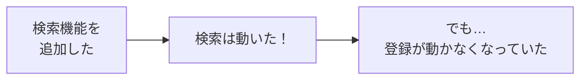
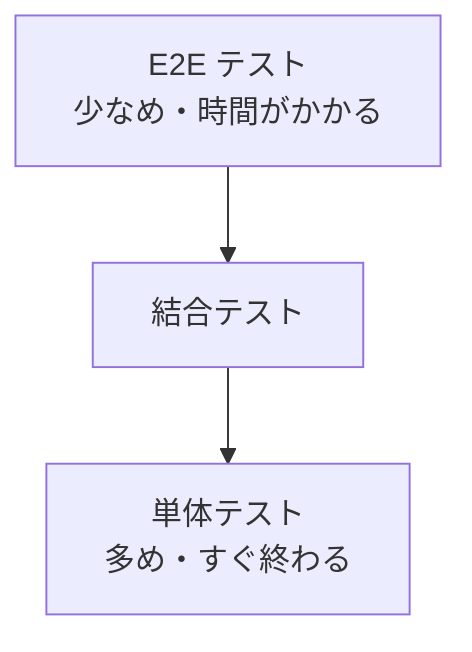

# テストについて

アプリを作ったら、**ちゃんと動くか** を確かめます。これが **テスト** です。
ここでは、テストの種類と、テストを **自動** で行うしくみを見ていきます。

[自由制作に戻る](../2026_10_09/2026_10_09_資料1.md)

---

## 1. テストとは

**テスト** は、プログラムが **思ったとおりに動くか** を確かめることです。

みんなも、コードを書いたあとに **ブラウザで画面を開いて、ボタンを押して** 確かめていますよね。
これも立派なテストです。人の手でやるので **手動テスト** といいます。

| | 手動テスト | 自動テスト |
|---|---|---|
| やり方 | 人が画面をさわって確かめる | **テスト用のプログラム** が確かめる |
| 時間 | 確かめることが増えるほど **時間がかかる** | 何百個でも **数秒〜数分** |
| 確かめ忘れ | ある | **ない**（毎回同じことをする） |

---

## 2. なぜ自動テストが大切なの？

機能を足したり、[リファクタリング](../2026_12_04/リファクタリングについて.md) したりすると、**前は動いていたところが、こわれる** ことがあります。
これを **デグレ**（デグレード・退行）といいます。



機能が増えるたびに、**全部の機能を手で確かめ直す** のは大変です。
自動テストがあれば、コマンド1つで **全部まとめて確かめ直せます**。

> 💡 **たとえるなら「テストの答え合わせ」**
> 「この問題の答えは 〇〇」という **答え（期待する結果）** を先に決めておけば、
> あとは **答えと合っているか** を機械的にチェックするだけです。

---

## 3. テストの種類

テストは、**どれくらいの大きさを確かめるか** で分かれます。

| 種類 | 確かめるもの | 例 |
|-----|-----------|-----|
| **単体テスト**（ユニットテスト） | **関数1つ・部品1つ** が正しく動くか | 「評価の平均を計算する関数」に `[4, 5, 3]` を入れたら `4` になるか |
| **結合テスト** | **いくつかの部品を組み合わせて** 正しく動くか | 「本の登録 API」を呼んだら、データベースに保存されるか |
| **E2E テスト**（End to End） | **使う人と同じように** 最初から最後まで動くか | ブラウザを自動で動かして、ログイン → 本を登録 → 一覧に表示されるか |



小さいテスト（単体テスト）ほど **速くて書きやすい** ので、たくさん書きます。
大きいテスト（E2E テスト）は **時間がかかる** ので、大事な流れだけにしぼります。
この形から、**テストピラミッド** とよばれます。

---

## 4. テストの書き方を見てみよう

### 単体テスト（JavaScript・Vitest の例）

```js
// average.js：評価の平均を計算する関数
export function average(ratings) {
  if (ratings.length === 0) return 0;
  const total = ratings.reduce((sum, r) => sum + r, 0);
  return total / ratings.length;
}
```

```js
// average.test.js：テスト
import { expect, test } from "vitest";
import { average } from "./average";

test("平均を計算できる", () => {
  expect(average([4, 5, 3])).toBe(4);
});

test("1つもないときは 0", () => {
  expect(average([])).toBe(0);
});
```

| 部分 | 意味 |
|-----|------|
| `test("〇〇", ...)` | テストの名前と、確かめる内容 |
| `expect(A).toBe(B)` | **A が B になっているはず**（期待する結果） |

### 結合テスト（Laravel の例）

Laravel には、最初からテストのしくみが入っています。

```php
// tests/Feature/BookTest.php
public function test_本を登録できる(): void
{
    $response = $this->post('/books', [
        'title' => 'こころ',
        'author' => '夏目漱石',
    ]);

    $response->assertRedirect('/books');                      // 一覧にもどる
    $this->assertDatabaseHas('books', ['title' => 'こころ']); // DB に保存されている
}
```

```powershell
php artisan test
```

> 📝 Laravel のテストの書き方には **PHPUnit** と **Pest** の2種類があります。上は PHPUnit の書き方です。プロジェクトを作ったときにどちらを選んだかで書き方が変わるので、`tests` フォルダの中の例を見てみましょう。

---

## 5. テストの結果

テストを実行すると、結果が表示されます。

| 表示 | 意味 |
|-----|------|
| ✅ PASS（緑） | 期待どおりだった |
| ❌ FAIL（赤） | 期待とちがった → どのテストで、何がちがったかが表示される |

> 💡 **CI でテストを自動で動かす**
> [CI/CDについて](../2026_10_09/CICDについて.md) で学んだ **GitHub Actions** にテストのコマンドを入れると、
> **プッシュするたびに自動でテスト** されます。こわれたコードに、すぐ気づけます。

---

## 6. 何をテストすればいいの？

全部をテストする必要はありません。まずは、次のようなところから始めましょう。

- **いちばん大事な機能**（MVP の機能）
- **計算をしているところ**（合計・平均・日付の計算など）
- **まちがえやすいところ**（0件のとき、空の入力のとき、とても長い入力のとき）
- **一度バグが出たところ**（同じバグをくり返さないように）

> 💡 **ポートフォリオでアピールできる**
> 学生のポートフォリオで、テストまで書いている人は多くありません。
> 大事な機能にいくつかテストがあるだけでも、「**品質を意識して作れる人**」と伝わります。

---

## 7. まとめ

- **テスト** ＝ プログラムが **思ったとおりに動くか** 確かめること
- **手動テスト** は人が確かめる、**自動テスト** はプログラムが確かめる
- 自動テストがあると、機能追加やリファクタリングで **こわれていないか（デグレ）** をすぐに確かめられる
- 種類は **単体テスト・結合テスト・E2E テスト**。小さいテストを多めに（**テストピラミッド**）
- `expect(A).toBe(B)` のように、**期待する結果** と比べる
- **GitHub Actions** と組み合わせると、プッシュのたびに自動でテストされる

[自由制作に戻る](../2026_10_09/2026_10_09_資料1.md)
