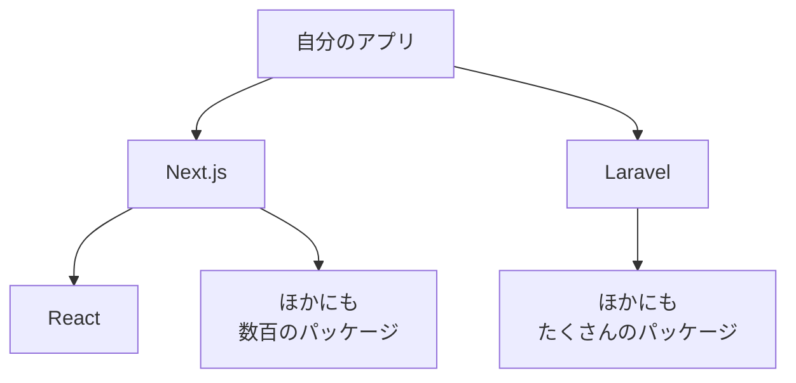
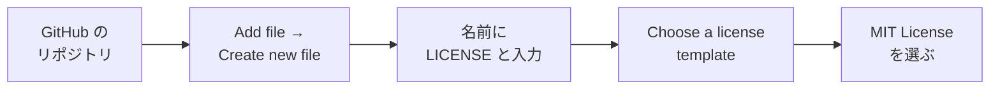

# OSSとライセンスについて

自由制作で使っている Laravel・Next.js・React・Tailwind CSS は、どれも **無料** で使えます。
それは、これらが **OSS（オープンソースソフトウェア）** だからです。
ここでは、OSS と、使うときに守る **ライセンス** について見ていきます。

[自由制作に戻る](../2026_10_09/2026_10_09_資料1.md)

---

## 1. OSSとは

**OSS（Open Source Software / オープンソースソフトウェア）** は、**ソースコード（プログラムの中身）が公開** されていて、
決められたルールを守れば、**だれでも自由に使ったり、改造したり、配ったりできる** ソフトウェアです。

| | OSS | OSS ではないソフトウェア |
|---|---|---|
| ソースコード | **公開されている** | 公開されていない（会社の中だけ） |
| 改造 | ルールを守ればできる | できない |
| 例 | Laravel、Next.js、React、MySQL、Linux、VS Code のもとになっているコード | Windows、Microsoft Office、Photoshop |

> 💡 **たとえるなら「レシピの公開」**
> 料理のレシピをネットに公開して、「自由に作ってね。アレンジもOK。ただし、**元のレシピの作者名は書いてね**」——
> これが OSS の考え方です。この「ただし〇〇」の部分が **ライセンス** です。

---

## 2. 身の回りの OSS

自由制作のアプリも、実は **OSS のかたまり** です。

`npm install` や `composer install` で入れているもの（`node_modules` や `vendor` の中身）は、ほとんどが OSS です。
世界中の人が作った OSS のおかげで、**ゼロから全部作らなくても** アプリが作れています。

---

## 3. ライセンスとは

**ライセンス** は、「このソフトウェアを **どう使っていいか**」を決めた **ルール** です。
OSS は自由に使えますが、**何をしてもいいわけではありません**。ライセンスに書かれたルールを守る必要があります。

### よく見るライセンス

| ライセンス | ゆるさ | ルール（かんたんに） | 使っている例 |
|----------|------|-----------------|-----------|
| **MIT** | とてもゆるい | **著作権とライセンスの文を残せば**、何に使ってもOK（お金をとるアプリでもOK） | Laravel、Next.js、React、Tailwind CSS |
| **Apache 2.0** | ゆるい | MIT とほぼ同じ。**変更したことを書く** などのルールが少し多い | TypeScript、Kubernetes |
| **GPL** | きびしめ | GPL のコードを使ったソフトウェアを **配る** なら、**自分のコードも GPL で公開** しないといけない | Linux、WordPress |

> 📝 **GPL のようなライセンスを「コピーレフト」という**
> 「自由に使っていいけど、それを使って作ったものも、**同じように自由に** してね」という考え方です。
> 会社でアプリを作るときは、使っている OSS のライセンスを **必ず確認** します。

---

## 4. 自分のアプリにライセンスをつける

GitHub に公開した自分のリポジトリにも、ライセンスをつけられます。

> ⚠️ **ライセンスをつけないと、ほかの人は自由に使えない**
> 公開リポジトリでも、ライセンスがなければ、**ほかの人がコードを使う・改造する許可は出ていない** ことになります。
> 「自由に使ってほしい」なら MIT、「見てほしいだけ（使ってほしくない）」ならライセンスなし、と考えましょう。

---

## 5. コード以外にも「権利」がある

アプリに入れる **画像・イラスト・アイコン・フォント・音楽** にも、作った人の **著作権** があります。

| ✕ やってはいけない | ◯ こうする |
|----------------|----------|
| ネットで検索して見つけた画像を、そのまま使う | **フリー素材**（利用規約を確認）や、自分で作った・撮った画像を使う |
| アニメやゲームのキャラクター画像を、アプリにのせて公開する | 公開するアプリでは使わない。使うなら **公式のガイドライン** を確認する |
| フリー素材の利用規約を読まずに使う | 「クレジット（作者名）の表示が必要」などのルールを守る |

> 💡 **アイコンやフォントは OSS のものが便利**
> アイコンは **Heroicons・Lucide**、フォントは **Google Fonts** など、無料で公開されているものがあります。
> ライセンスを確認して使いましょう。

> ⚠️ **ポートフォリオでは特に注意**
> ポートフォリオは **会社の人に見せるもの** です。権利を守っていない画像が入っていると、それだけで **印象がとても悪く** なります。

---

## 6. OSS に「お返し」する

OSS は、世界中の人が **ボランティアや仕事として** 作っています。使うだけでなく、お返しする方法もあります。

| お返しの方法 | 内容 |
|-----------|------|
| ⭐ **スター** | GitHub で、使っている OSS のリポジトリにスターをつける（いちばんかんたん） |
| 🐛 **Issue** | バグを見つけたら、Issue で報告する |
| 📝 **ドキュメントの修正** | 説明のまちがいや誤字を、プルリクエストで直す |
| 🔧 **コードの修正** | バグを直すプルリクエストを送る |

OSS にプルリクエストを送って取りこまれた経験は、就職活動でも **大きなアピール** になります。

---

## 7. まとめ

- **OSS** ＝ ソースコードが公開されていて、ルールを守れば **だれでも使える・改造できる** ソフトウェア
- Laravel・Next.js・React も OSS。自分のアプリは **OSS のかたまり**
- **ライセンス** ＝ どう使っていいかのルール。**MIT**（とてもゆるい）、**GPL**（自分のコードも公開が必要なことがある）など
- 自分のリポジトリにも **LICENSE** ファイルでライセンスをつけられる
- 画像・アイコン・フォント・音楽にも **著作権** がある。ポートフォリオでは特に注意
- 使うだけでなく、**スター・Issue・プルリクエスト** でお返しできる

[自由制作に戻る](../2026_10_09/2026_10_09_資料1.md)
