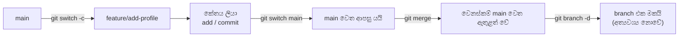
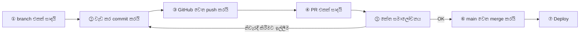
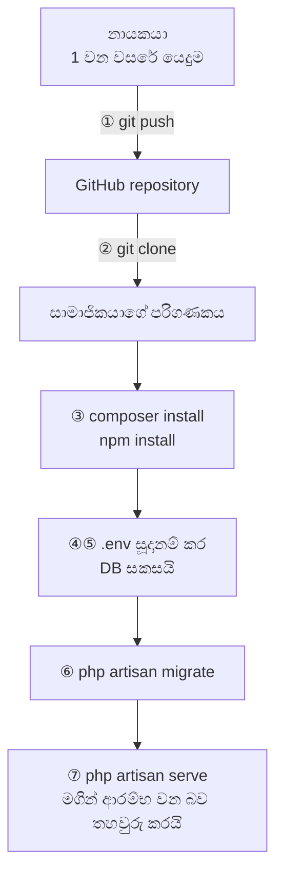

# Git කණ්ඩායම් සංවර්ධනය සඳහා සූදානම

> 🇯🇵 මුල් පිටපත (ජපන් භාෂාවෙන්): [2026_04_30.md](<../../../2年生_システム開発実践/前期/2026_04_30/2026_04_30.md>) <!-- original-ja-link -->

---

## Git පුනරීක්ෂණය + branch / merge

### අද ඉලක්කය
- 1 වන වසරේ ඉගෙනගත් commit/push පුනරීක්ෂණය කිරීම
- Branch සංකල්පය තේරුම් ගෙන භාවිත කිරීමට හැකි වීම
- Merge කරන ආකාරය දැන ගැනීම

---

### Branch යනු කුමක්ද

**Branch = වැඩ කටයුතුවල "අතු බෙදීමක්". ප්‍රධාන කේතය කඩාකප්පල් නොකර නව විශේෂාංග සංවර්ධනය කළ හැකිය**

```
main (production පරිසරයේ branch එක)
  │
  ├── feature/login    ← login විශේෂාංගය සංවර්ධනය වෙමින් පවතී
  ├── feature/search   ← සෙවුම් විශේෂාංගය සංවර්ධනය වෙමින් පවතී
  └── bugfix/404-error ← bug එකක් නිවැරදි කරමින් පවතී
```

```bash
# වත්මන් branch එක පරීක්ෂා කරන්න
git branch
# → * main (* ලකුණ ඇත්තේ වත්මන් branch එකේ)

# නව branch එකක් සාදා එයට මාරු වන්න
git checkout -b feature/add-profile
# නැතහොත් (Git 2.23 සහ ඊට පසු)
git switch -c feature/add-profile

# Branch ලැයිස්තුව පෙන්වන්න
git branch -a   # -a මගින් remote branch ද පෙන්වයි

# main වෙත ආපසු යන්න
git switch main

# Branch එක මකා දමන්න
git branch -d feature/add-profile
```

---

### merge — branch එකතු කිරීම

වැඩ කිරීම සඳහා වූ branch එකේ කළ වෙනස්කම් අවසානයේ main වෙත ඇතුළත් කිරීම merge වේ.



```bash
# ① feature/add-profile branch එකේ වැඩ කර commit කරන්න
git switch feature/add-profile
# ... කේතය ලියන්න ...
git add .
git commit -m "プロフィール画面を追加"

# ② main branch එකට ආපසු යන්න
git switch main

# ③ feature/add-profile හි වෙනස්කම් main වෙත ඇතුළත් කරන්න
git merge feature/add-profile

# ④ Merge කළ පසු branch එක මකා දමන්න (අත්‍යවශ්‍ය නොවේ)
git branch -d feature/add-profile
```

---

### Conflict (ගැටුම්) විසඳීම

```bash
# දෙදෙනෙක් එකම පේළිය වෙනස් කළහොත්, merge කරන විට conflict එකක් ඇතිවේ
# Conflict ඇති ගොනුව විවෘත කළ විට...

<<<<<<< HEAD
  echo "Aさんが書いたコード";
=======
  echo "Bさんが書いたコード";
>>>>>>> feature/b-work

# ↑ මෙය අතින් නිවැරදි කේතය බවට වෙනස් කරන්න
# නිවැරදි කළ පසු:
git add .
git commit -m "コンフリクトを解消"
```

---

## පාඩම 02: GitHub Flow — PR සහ කේත සමාලෝචනය

### GitHub Flow යනු කුමක්ද

කණ්ඩායමක් ලෙස සංවර්ධනය කිරීම සඳහා වූ නීති රීති මාලාවකි.

```
① main වෙතින් වැඩ කිරීමට branch එකක් සාදන්න
      git switch -c feature/xxxx

② Branch එකේ වැඩ කර commit කරන්න
      git add .
      git commit -m "පණිවිඩය"

③ GitHub වෙත push කරන්න
      git push origin feature/xxxx

④ Pull Request (PR) එකක් සාදන්න
      → GitHub මත "මෙම කේතය main වෙත ඇතුළත් කිරීමට කැමතියි" ලෙස ඉල්ලීමක් කරන්න

⑤ කණ්ඩායම් සාමාජිකයන් කේත සමාලෝචනය කරයි
      → අදහස් ලියයි, නිවැරදි කිරීම් ඉල්ලයි

⑥ ගැටලුවක් නොමැති නම් main වෙත merge කරන්න
⑦ Deploy කරන්න (නිෂ්පාදන පරිසරයට යොදන්න)
```

රූප සටහනක් ලෙස දැක්වූ විට, පහත ප්‍රවාහය ලැබේ. සමාලෝචනයේදී නිවැරදි කිරීම් ඉල්ලුවහොත්, ② වෙත ආපසු ගොස් නිවැරදි කර නැවත push කරන්න.



### Pull Request ලියන ආකාරය

```markdown
## වෙනස්කම්
- පැතිකඩ තිරය එකතු කළා
- පරිශීලකයාගේ නම සහ අයිකනය පෙන්විය හැකි කළා

## පරීක්ෂා කර දිය යුතු කරුණු
- `/profile` වෙත පිවිසි විට නිවැරදිව පෙන්වනවාද
- Login වී නොමැති විට `/login` වෙත redirect වනවාද

## Screenshot
(රූපය අමුණන්න)
```

### කේත සමාලෝචනයේ වැදගත් කරුණු

- Bug හෝ තාර්කික දෝෂ නැත්ද
- ආරක්ෂක ගැටලු නැත්ද (XSS, SQL Injection ආදිය)
- කේතය කියවීමට පහසුද
- පරීක්ෂණ (test) ලියා තිබේද (2 වන වසරේදී අත්‍යවශ්‍ය නොවේ)

---

## පාඩම 03: 1 වන වසරේ යෙදුම කණ්ඩායමක් ලෙස ධාවනය කිරීම

### පියවර

නායකයා GitHub වෙත upload කළ යෙදුම, සියලුම සාමාජිකයන් තම පරිගණකවල ධාවනය කරන තෙක් ප්‍රවාහය මෙයයි.



```bash
# ① කණ්ඩායම් නායකයා 1 වන වසරේ යෙදුම GitHub වෙත push කරයි
git init
git remote add origin https://github.com/කණ්ඩායමේ_නම/app.git
git add .
git commit -m "initial commit"
git push -u origin main

# ② කණ්ඩායම් සාමාජිකයන් clone කරයි
git clone https://github.com/කණ්ඩායමේ_නම/app.git
cd app

# ③ Dependency ස්ථාපනය කිරීම
composer install
npm install

# ④ පරිසර සැකසුම්
cp .env.example .env
php artisan key:generate

# ⑤ DB සැකසුම් (.env සංස්කරණය කරන්න)
# DB_DATABASE=app_db
# DB_USERNAME=root
# DB_PASSWORD=

# ⑥ Migration
php artisan migrate

# ⑦ ආරම්භ වන බව තහවුරු කරන්න
php artisan serve
```

---

## සාරාංශය

| Command | අර්ථය |
|---------|------|
| `git switch -c branch_නම` | Branch එකක් සාදා එයට මාරු වේ |
| `git switch main` | main වෙත ආපසු යයි |
| `git merge branch_නම` | Branch එක වත්මන් branch එකට එකතු කරයි |
| `git push origin branch_නම` | Branch එක remote වෙත push කරයි |
| Pull Request (PR) | GitHub මත කේතය merge කිරීමට ඉල්ලීම් කරයි |
| කේත සමාලෝචනය | PR එකට අදහස් දක්වමින් ගැටලු පෙන්වා දෙයි |
