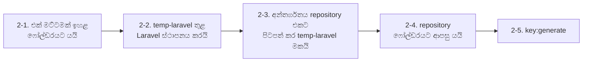
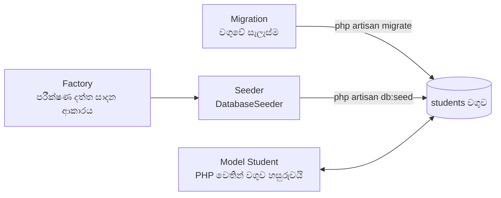

> 🇯🇵 මුල් පිටපත (ජපන් භාෂාවෙන්): [20260506.md](<../../../2年生_システム開発実践/前期/2026_05_06/20260506.md>) <!-- original-ja-link -->

## Laravel ව්‍යාපෘතියේ මූලික සැකසුම

> **අරමුණ:** මෙම පාඩම් මාලාවේ භාවිත කරන Laravel ව්‍යාපෘතිය මුල සිටම සාදා, API සංවර්ධනය ආරම්භ කළ හැකි තත්ත්වයකට ගෙන ඒම.

---

### ආරම්භයේදී: අවශ්‍ය දේ ස්ථාපනය කර ඇත්දැයි පරීක්ෂා කරන්න

වැඩ ආරම්භ කිරීමට පෙර, අවශ්‍ය මෘදුකාංග ස්ථාපනය කර ඇත්දැයි පරීක්ෂා කරමු.  
ටර්මිනලය විවෘත කර, පහත command **එක වරකට එක පේළිය බැගින්** ධාවනය කරන්න.

---

#### PHP පරීක්ෂා කිරීම

```bash
php --version
```

**හරි නම්:**
```
PHP 8.2.x (cli) ...  ← අනුවාදය පෙන්වයි නම් හරි
```

**වැරදි නම් (`command not found` හෝ `'php' は認識されていません` (හඳුනා නොගැනේ) ලෙස පෙන්වයි නම්):**

PHP ස්ථාපනය කර නැත. XAMPP ස්ථාපනය කළ විට PHP සහ MySQL දෙකම එකවර භාවිත කළ හැකි වේ.

**Windows නම්:**
1. `https://www.apachefriends.org/` වෙත පිවිසෙන්න
2. "XAMPP for Windows" බාගත කර ස්ථාපනය කරන්න
3. ස්ථාපනය කළ පසු, `C:\xampp\php` **PATH පරිසර විචල්‍යයට** එකතු කරන්න  
   (Start මෙනුවේ "環境変数" (පරිසර විචල්‍ය) ලෙස සොයන්න → "システム環境変数の編集" (පද්ධති පරිසර විචල්‍ය සංස්කරණය) → "環境変数" (පරිසර විචල්‍ය) → "Path" තෝරා "編集" (සංස්කරණය) → "新規" (නව) මගින් `C:\xampp\php` එකතු කරන්න)
4. ටර්මිනලය **වසා නැවත විවෘත කර**, නැවත `php --version` ධාවනය කරන්න

**Mac නම්:**
1. ටර්මිනලයේ පහත දේ ධාවනය කරන්න (Homebrew තිබේ නම්)
   ```bash
   brew install php
   ```
2. Homebrew ස්ථාපනය කර නැත්නම් පළමුව පහත දේ ධාවනය කරන්න
   ```bash
   /bin/bash -c "$(curl -fsSL https://raw.githubusercontent.com/Homebrew/install/HEAD/install.sh)"
   ```

---

#### Composer පරීක්ෂා කිරීම

```bash
composer --version
```

**හරි නම්:**
```
Composer version 2.x.x ...  ← අනුවාදය පෙන්වයි නම් හරි
```

**වැරදි නම් (`command not found` හෝ `'composer' は認識されていません` (හඳුනා නොගැනේ) ලෙස පෙන්වයි නම්):**

Composer ස්ථාපනය කර නැත. පහත පියවරවලින් ස්ථාපනය කරන්න.

**Windows නම්:**
1. `https://getcomposer.org/download/` වෙත පිවිසෙන්න
2. "Composer-Setup.exe" බාගත කර ධාවනය කරන්න
3. ස්ථාපනය අතරතුර PHP ඇති ස්ථානය ඇසුවොත් `C:\xampp\php\php.exe` ලබාදෙන්න
4. ස්ථාපනය අවසන් වූ පසු, ටර්මිනලය **වසා නැවත විවෘත කර**, `composer --version` ධාවනය කරන්න

**Mac නම්:**
```bash
brew install composer
```

---

#### MySQL පරීක්ෂා කිරීම

```bash
mysql --version
```

**හරි නම්:**
```
mysql  Ver 8.0.x ...  ← අනුවාදය පෙන්වයි නම් හරි
```

අනුවාදය පෙන්වූ පසු, ඊළඟට MySQL **සේවාදායකය** ක්‍රියාත්මක වේදැයි පරීක්ෂා කරන්න.

> **සැලකිය යුතුයි (Mac):** `mysql --version` පෙන්වුවත්, සේවාදායකය ස්ථාපනය කර නොමැති අවස්ථා තිබේ.  
> `mysql-client` (සම්බන්ධ වීමේ මෙවලම පමණි) සහ `mysql` (සේවාදායකය) දෙක වෙනස් දේවල්ය.  
> පහත පියවරවලින් සේවාදායකය ක්‍රියාත්මක වේදැයි අනිවාර්යයෙන්ම පරීක්ෂා කරන්න.

**Mac නම්:**
```bash
brew services list | grep mysql
```

| පෙන්වන දේ | අර්ථය |
|------|------|
| `mysql  started` | සේවාදායකය ක්‍රියාත්මකයි. ඊළඟ පියවරට යන්න |
| `mysql  stopped` | සේවාදායකය නතර වී ඇත. පහත "ආරම්භ කිරීම" පියවරට යන්න |
| mysql පේළිය නොපෙන්වයි | සේවාදායකය ස්ථාපනය කර නැත. පහත "ස්ථාපනය කිරීම" පියවරට යන්න |

**Windows (XAMPP) නම්:**  
XAMPP Control Panel විවෘත කර, MySQL අසල ඇති "Start" බොත්තම ඔබන්න.  
"Running" ලෙස පෙන්වයි නම් එය ආරම්භ වී ඇත.

**MySQL සේවාදායකය stopped නම් (ආරම්භ කිරීම):**

```bash
# Mac නම්
brew services start mysql
```

XAMPP නම් Control Panel හි "Start" බොත්තම ඔබන්න.

**MySQL සේවාදායකය ස්ථාපනය කර නැත්නම් (Mac):**

```bash
brew install mysql
brew services start mysql
```

> **සම්බන්ධ වන විට මුරපදය ගැන**  
> `mysql -u root -p` ධාවනය කළ විට මුරපදය අසයි.  
> Homebrew මගින් අලුතින් ස්ථාපනය කළේ නම් **මුරපදයක් නැති** නිසා කෙලින්ම Enter ඔබන්න.  
> XAMPP හිද මූලික සැකසුම අනුව **මුරපදයක් නැත**.  
> ඔබම මුරපදයක් සැකසූ බව මතක නම් එම මුරපදය ඇතුළත් කරන්න.

---

**වැරදි නම් (`command not found` හෝ `'mysql' は認識されていません` (හඳුනා නොගැනේ) ලෙස පෙන්වයි නම්):**

MySQL ස්ථාපනය කර නැත.

**Windows (XAMPP භාවිත කරන්නේ නම්):**
1. XAMPP ස්ථාපනය කර ඇත්නම්, `C:\xampp\mysql\bin` PATH පරිසර විචල්‍යයට එකතු කරන්න  
   (PHP එකතු කළ පියවරම අනුගමනය කර, මෙවර `C:\xampp\mysql\bin` එකතු කරන්න)
2. ටර්මිනලය **වසා නැවත විවෘත කර**, `mysql --version` ධාවනය කරන්න

**Mac නම්:**
```bash
brew install mysql
brew services start mysql
```

---

> **එසේ කළත් විසඳුනේ නැත්නම් ගුරුවරයාට කියන්න.**  
> අනුවාදය ඉතා පැරණි නම් (PHP 7 ශ්‍රේණිය වැනි) ද ගුරුවරයාගෙන් අසන්න.  
> **PHP 8.1 හෝ ඊට ඉහළ, Composer 2 ශ්‍රේණිය, MySQL 8 ශ්‍රේණිය** නිර්දේශිත අනුවාදයන්ය.

---

### Step 1｜Clone කළ repository එක තුළට යන්න

ඔබ දැනටමත් GitHub වෙතින් clone කළ repository එකක් තිබිය යුතුය.  
ටර්මිනලය විවෘත කර, එම ෆෝල්ඩරය තුළට යන්න.

**Windows නම් (PowerShell හෝ Command Prompt):**
```bash
cd C:\Users\(ඔබේ_පරිශීලක_නාමය)\Documents\(repository_නාමය)
```

**Mac නම්:**
```bash
cd ~/Documents/(repository_නාමය)
```

නිවැරදිව ගියාදැයි පරීක්ෂා කරන්න:
```bash
pwd
```
```
/Users/(ඔබේ_පරිශීලක_නාමය)/Documents/(repository_නාමය)  ← repository එක තුළ සිටී නම් හරි
```

Git repository එකක් ලෙස හඳුනාගෙන ඇත්දැයිද පරීක්ෂා කරමු:
```bash
git status
```
```
On branch main
nothing to commit, working tree clean  ← මේ ආකාරයට පෙන්වයි නම් හරි
```

> **`git status` හිදී දෝෂයක් ආවොත්** (`not a git repository` වැනි)  
> ඔබ repository එක තුළට ගොස් නැත. ෆෝල්ඩරයේ නම පරීක්ෂා කර, නැවත `cd` කරන්න.

---

### Step 2｜Laravel ස්ථාපනය කරන්න

Clone කළ ෆෝල්ඩරයේ `git clone` මගින් ස්වයංක්‍රීයව සෑදෙන `.git` ෆෝල්ඩරය ඇත.  
`composer create-project laravel/laravel .` ධාවනය කළ හැක්කේ ෆෝල්ඩරය සම්පූර්ණයෙන්ම හිස් නම් පමණක් නිසා, දෝෂයක් ඇතිවේ.

```
Project directory "..." is not empty.  ← මෙම දෝෂය ඇතිවේ
```

> **`.git` සැඟවුණු ෆෝල්ඩරයක් නිසා Finder හෝ Explorer හි නොපෙනේ.**  
> ටර්මිනලයේ `ls -a` ධාවනය කළ විට එය දැකිය හැකිය.

එබැවින්, **පළමුව වෙනත් ෆෝල්ඩරයක සාදා පසුව එහි අන්තර්ගතය ගෙන යන** පියවර අනුගමනය කරමු.



#### 2-1. එක් මට්ටමක් ඉහළ ෆෝල්ඩරයට යන්න

```bash
cd ..
```

පරීක්ෂා කරන්න:
```bash
pwd
```
```
/Users/(ඔබේ_පරිශීලක_නාමය)/Documents  ← repository එකට එක් මට්ටමක් ඉහළින් සිටී නම් හරි
```

#### 2-2. තාවකාලික ෆෝල්ඩරයක Laravel ස්ථාපනය කරන්න

```bash
composer create-project laravel/laravel temp-laravel
```

> ධාවනය වීමට **මිනිත්තු 2–5ක්** ගතවේ. තිරය මත අකුරු විශාල ප්‍රමාණයක් ගලා යනු ඇත, ඉවසීමෙන් රැඳී සිටින්න.  
> අවසානයේ `Application ready!` ලෙස පෙන්වයි නම් සාර්ථකයි.

#### 2-3. තාවකාලික ෆෝල්ඩරයේ අන්තර්ගතය repository ෆෝල්ඩරයට ගෙන යන්න

**Mac නම්:**
```bash
cp -r temp-laravel/. (repository_නාමය)/
rm -rf temp-laravel
```

**Windows නම් (PowerShell):**
```powershell
Copy-Item -Path temp-laravel\* -Destination (repository_නාමය)\ -Recurse -Force
Copy-Item -Path temp-laravel\.* -Destination (repository_නාමය)\ -Recurse -Force -ErrorAction SilentlyContinue
Remove-Item -Recurse -Force temp-laravel
```

> **(repository_නාමය)** කොටස ඔබේ repository ෆෝල්ඩරයේ නමින් ප්‍රතිස්ථාපනය කරන්න.

#### 2-4. Repository ෆෝල්ඩරයට ආපසු යන්න

```bash
cd (repository_නාමය)
```

නිවැරදිව ගියාදැයි පරීක්ෂා කරන්න:
```bash
pwd
```
```
/Users/(ඔබේ_පරිශීලක_නාමය)/Documents/(repository_නාමය)  ← repository එක තුළ සිටී නම් හරි
```

`app/` සහ `routes/` වැනි ෆෝල්ඩර සෑදී ඇත්නම් සාර්ථකයි:
```bash
ls
```
```
README.md  app  artisan  bootstrap  composer.json  config  database  ...
```

#### 2-5. Application key එක ජනනය කරන්න

Laravel හට session සහ සංකේතනය (encryption) සඳහා **application key** එකක් (රහස් යතුරක්) අවශ්‍ය වේ.  
මෙය අනිවාර්යයෙන්ම ධාවනය කරන්න.

```bash
php artisan key:generate
```

```
   INFO  Application key set successfully.
```

> මෙම command එක ධාවනය කළ විට, `.env` ගොනුවේ `APP_KEY=` වෙත අගයක් ස්වයංක්‍රීයව සැකසේ.  
> අමතක වුවහොත් `MissingAppKeyException` නම් දෝෂ තිරයක් පෙන්වයි.

**දෝෂයක් ආවොත්: `No APP_KEY variable was found in the .env file`**

`.env` ගොනුවේ `APP_KEY=` පේළිය නැත.  
VSCode මගින් `.env` විවෘත කර, ගොනුවේ අවසානයට පහත පේළිය එකතු කරන්න.

```dotenv
APP_KEY=
```

සුරැකූ පසු, නැවත ධාවනය කරන්න:

```bash
php artisan key:generate
```

`APP_KEY=` ට පසුව දිගු අකුරු පෙළක් ස්වයංක්‍රීයව ඇතුළත් වුවහොත් සාර්ථකයි.

**මෙම අවස්ථාවේ ෆෝල්ඩර ව්‍යුහය (ප්‍රධාන ඒවා පමණි):**

```
(repository_නාමය)/          ← clone කළ ෆෝල්ඩරය (= Git repository)
├── app/
│   ├── Http/
│   │   └── Controllers/   ← Controller තබන ස්ථානය
│   └── Models/            ← Model තබන ස්ථානය
├── database/
│   ├── migrations/        ← වගු අර්ථ දැක්වීම් තබන ස්ථානය
│   ├── factories/         ← පරීක්ෂණ දත්ත ජනනය කිරීමේ සැකසුම්
│   └── seeders/           ← පරීක්ෂණ දත්ත ඇතුළත් කිරීමේ සැකසුම්
├── routes/
│   ├── api.php            ← API routing (මෙවර ප්‍රධාන වශයෙන් භාවිත කරයි)
│   └── web.php            ← Blade routing (1 වන වසරේ භාවිත කළ එක)
└── .env                   ← DB සම්බන්ධතා තොරතුරු වැනි සැකසුම් ගොනුව
```

---

### Step 3｜දත්ත සමුදාය සූදානම් කරන්න

#### phpMyAdmin යනු කුමක්ද?

**phpMyAdmin** යනු MySQL දත්ත සමුදාය බ්‍රවුසරය මත හැසිරවිය හැකි කළමනාකරණ මෙවලමකි.  
Command ටයිප් නොකර, තිරය හැසිරවීමෙන් පමණක් දත්ත සමුදාය සෑදීම, පරීක්ෂා කිරීම, මකා දැමීම කළ හැකිය.

| පරිසරය             | phpMyAdmin විවෘත කරන ආකාරය                                                        |
| -------------- | ---------------------------------------------------------------------- |
| Windows (XAMPP) | XAMPP Control Panel හි "Admin" බොත්තම ඔබන්න → බ්‍රවුසරයේ `http://localhost/phpmyadmin` විවෘත වේ |
| Mac (XAMPP)     | XAMPP Control Panel හි "Admin" බොත්තම ඔබන්න → බ්‍රවුසරයේ `http://localhost/phpmyadmin` විවෘත වේ |
| Mac (Homebrew)  | phpMyAdmin වෙනම ස්ථාපනය කළ යුතුය (පසුව සඳහන් ටර්මිනල් පියවර භාවිත කිරීම පහසුයි)                             |

---

#### 3-1. දත්ත සමුදාය සාදන්න

**Windows නම් (XAMPP + phpMyAdmin):**

1. XAMPP Control Panel හි MySQL "Start" කරන්න
2. බ්‍රවුසරයේ `http://localhost/phpmyadmin` විවෘත කරන්න
3. වම් පස මෙනුවේ "**新規作成**" (New) ක්ලික් කරන්න
4. පහත දේ ඇතුළත් කර "**作成**" (Create) බොත්තම ඔබන්න

   - **දත්ත සමුදායේ නම:** `school_api`
   - **Collation (照合順序):** `utf8mb4_unicode_ci`

**Mac නම් (Homebrew):**

phpMyAdmin සැකසීම අවශ්‍ය නොවන, ටර්මිනලයෙන් සාදන ක්‍රමය අනුගමනය කරමු.  
MySQL ක්‍රියාත්මක වන බව තහවුරු කරගෙන ධාවනය කරන්න.

```bash
mysql -u root
```
```sql
CREATE DATABASE school_api CHARACTER SET utf8mb4 COLLATE utf8mb4_unicode_ci;
EXIT;
```

> මුරපදයක් සකසා ඇත්නම් `mysql -u root -p` ලෙස ඇතුළත් කර, මුරපදය ඇතුළත් කරන්න.

#### 3-2. `.env` ගොනුව සකසන්න

VSCode මගින් ව්‍යාපෘතිය විවෘත කර, root ෆෝල්ඩරයේ ඇති `.env` ගොනුව විවෘත කරන්න.

```
(repository_නාමය)/
└── .env   ← මෙය විවෘත කරන්න
```

> **⚠️ සැලකිය යුතුයි: ගොනුවේ අන්තර්ගතය සම්පූර්ණයෙන්ම මකා නැවත ලියන්න එපා.**  
> `.env` හි දැනටමත් `APP_KEY` වැනි බොහෝ සැකසුම් ලියා ඇත.  
> **DB හා සම්බන්ධ පේළි 5 පමණක් සොයා අගයන් වෙනස් කරන්න. අනෙක් පේළි ස්පර්ශ නොකරන්න.**

ගොනුව තුළ පහළට scroll කළ විට, පහත ආකාරයේ පේළි ඇත.  
මෙම පේළි 5 හි `=` ට දකුණු පස පමණක් වෙනස් කරන්න:

```dotenv
DB_CONNECTION=mysql
DB_HOST=127.0.0.1
DB_PORT=3306
DB_DATABASE=school_api    ← කලින් සෑදූ DB හි නමට වෙනස් කරන්න
DB_USERNAME=root           ← MySQL පරිශීලක නාමය (සාමාන්‍යයෙන් root)
DB_PASSWORD=               ← මුරපදයක් සකසා නැත්නම් හිස්ව තබන්න
```

වෙනස් කළ පසු **Ctrl+S** (Mac හි **Cmd+S**) මගින් සුරකින්න.

> **`.env` යනු මුරපද ලියා ඇති සැකසුම් ගොනුවකි.**  
> එය Git වෙත ස්වයංක්‍රීයව ඇතුළත් නොවන ලෙස සකසා ඇති නිසා, අන් අයට නොපෙන්වන්න.

---

### Step 4｜Model, migration, factory සාදන්න

මෙම පාඩමේදී **සිසුන් (Student)** කළමනාකරණය කරන API එකක් සාදමු.  
පහත එක් command එකකින්, අවශ්‍ය ගොනු සියල්ල එකවර සෑදිය හැකිය.

```bash
php artisan make:model Student -mf
```

| විකල්පය | අර්ථය                  | සෑදෙන ගොනුව                                             |
| ----- | ------------------- | ---------------------------------------------------- |
| (නැත)  | Model එක සාදයි              | `app/Models/Student.php`                             |
| `-m`  | Migration (වගු අර්ථ දැක්වීම) ද සාදයි | `database/migrations/xxxx_create_students_table.php` |
| `-f`  | Factory (පරීක්ෂණ දත්ත ජනනය) ද සාදයි  | `database/factories/StudentFactory.php`              |

සෑදෙන ගොනු 3 සහ පසුව භාවිත කරන seeder එක, පහත ආකාරයට සම්බන්ධ වේ.



ධාවනය කළ පසු පහත ආකාරයට පෙන්වයි නම් සාර්ථකයි:

```
   INFO  Model [app/Models/Student.php] created successfully.
   INFO  Factory [database/factories/StudentFactory.php] created successfully.
   INFO  Migration [database/migrations/2024_xx_xx_create_students_table.php] created successfully.
```

---

### Step 5｜Model එක සංස්කරණය කරන්න (`$fillable` සැකසීම)

සෑදූ `app/Models/Student.php` VSCode මගින් විවෘත කරන්න.

```
school-api/
└── app/
    └── Models/
        └── Student.php   ← මෙය විවෘත කරන්න
```

ගොනුව විවෘත කළ විට පහත ආකාරයේ අන්තර්ගතයක් ඇත. `$fillable` එකතු කරන්න:

```php
<?php
namespace App\Models;

use Illuminate\Database\Eloquent\Factories\HasFactory;
use Illuminate\Database\Eloquent\Model;

class Student extends Model
{
    use HasFactory;

    // ↓ මෙම පේළිය එකතු කරන්න
    protected $fillable = ['name', 'email', 'score'];
}
```

> **`$fillable` යනු කුමක්ද?**  
> Laravel හි ආරක්ෂක විශේෂාංගයකි. මෙහි ලියූ column නාම පමණක් `create()` සහ `update()` මගින් වෙනස් කළ හැකි වේ.  
> මෙය සකසා නොතිබුණොත්, පසුව API හරහා දත්ත සුරකින විට දෝෂයක් ඇතිවේ.

---

### Step 6｜Migration ගොනුව සංස්කරණය කරන්න

`database/migrations/` ෆෝල්ඩරය VSCode හි විවෘත කළ විට, දිනයකින් ආරම්භ වන ගොනු පෙළගැසී ඇත.

```
school-api/
└── database/
    └── migrations/
        ├── 0001_01_01_000000_create_users_table.php    ← Laravel මුල සිටම සපයන ගොනුවකි
        ├── 0001_01_01_000001_create_cache_table.php    ← Laravel මුල සිටම සපයන ගොනුවකි
        ├── 0001_01_01_000002_create_jobs_table.php     ← Laravel මුල සිටම සපයන ගොනුවකි
        └── 2024_xx_xx_xxxxxx_create_students_table.php ← ← Step4 හි සෑදුණු ගොනුව (මෙය සංස්කරණය කරන්න)
```

**පහළින්ම ඇති `create_students_table.php` විවෘත කර**, `up()` method එකේ අන්තර්ගතය වෙනස් කරන්න:

```php
public function up(): void
{
    Schema::create('students', function (Blueprint $table) {
        $table->id();                              // ID (ස්වයංක්‍රීය අනුක්‍රමික අංකය)
        $table->string('name', 100);              // සම්පූර්ණ නම
        $table->string('email')->unique();         // ඊමේල් ලිපිනය (එකම ලිපිනය නැවත භාවිත කළ නොහැක)
        $table->integer('score')->default(0);     // ලකුණු (මූලික අගය 0)
        $table->timestamps();                      // සෑදූ දිනය/වේලාව සහ යාවත්කාලීන කළ දිනය/වේලාව (ස්වයංක්‍රීය)
    });
}
```

---

### Step 7｜Migration ධාවනය කර වගුව සාදන්න

```bash
php artisan migrate
```

සාර්ථක වූ විට පහත ආකාරයට පෙන්වයි:

```
   INFO  Running migrations.

  0001_01_01_000000_create_users_table ................... 21ms DONE
  0001_01_01_000001_create_cache_table ................... 10ms DONE
  0001_01_01_000002_create_jobs_table .................... 10ms DONE
  2024_xx_xx_xxxxxx_create_students_table ............... 15ms DONE
```

වගුව සෑදුණාදැයි පරීක්ෂා කරන්න.

**Windows නම් (phpMyAdmin):**  
බ්‍රවුසරයේ `http://localhost/phpmyadmin` විවෘත කර, වම් පස ඇති `school_api` ක්ලික් කළ විට `students` වගුව පෙන්විය යුතුය.

**Mac නම් (ටර්මිනලය):**
```bash
mysql -u root -e "SHOW TABLES IN school_api;"
```
```
+----------------------+
| Tables_in_school_api |
+----------------------+
| cache                |
| jobs                 |
| migrations           |
| students             |  ← මෙය පෙන්වයි නම් හරි
| users                |
+----------------------+
```

#### නිතර ඇතිවන දෝෂ සහ විසඳුම්

**දෝෂය 1: DB වෙත සම්බන්ධ විය නොහැක**
```
SQLSTATE[HY000] [2002] Connection refused
```
→ MySQL ක්‍රියාත්මක වී නැත.  
→ **Windows:** XAMPP Control Panel හි MySQL "Start" කරන්න.  
→ **Mac:** `brew services start mysql` ධාවනය කරන්න.

**දෝෂය 2: දත්ත සමුදාය හමු නොවේ**
```
SQLSTATE[HY000] [1049] Unknown database 'school_api'
```
→ Step3 හි දත්ත සමුදාය සාදා නැත, නැතහොත් `.env` හි දත්ත සමුදායේ නම වැරදියි.  
→ **Windows:** phpMyAdmin හි දත්ත සමුදායේ නම පරීක්ෂා කරන්න.  
→ **Mac:** `mysql -u root -e "SHOW DATABASES;"` මගින් දත්ත සමුදා ලැයිස්තුව පරීක්ෂා කරන්න.

**දෝෂය 3: මුරපදය වැරදියි**
```
SQLSTATE[HY000] [1045] Access denied for user 'root'@'localhost'
```
→ `.env` හි `DB_PASSWORD` වැරදියි. MySQL මුරපදය පරීක්ෂා කර නැවත ලියන්න.

---

### Step 8｜පරීක්ෂණ දත්ත ඇතුළත් කරන්න

API ක්‍රියාකාරිත්වය පරීක්ෂා කිරීමට භාවිත කරන පරීක්ෂණ දත්ත සූදානම් කරමු.

#### 8-1. Factory එක සංස්කරණය කරන්න

`database/factories/StudentFactory.php` විවෘත කරන්න.

```
school-api/
└── database/
    └── factories/
        └── StudentFactory.php   ← මෙය විවෘත කරන්න
```

`definition()` method එකේ අන්තර්ගතය වෙනස් කරන්න:

```php
public function definition(): array
{
    return [
        'name'  => $this->faker->name(),                      // අහඹු නමක්
        'email' => $this->faker->unique()->safeEmail(),        // අහඹු ඊමේල් ලිපිනයක්
        'score' => $this->faker->numberBetween(0, 100),        // 0–100 අතර අහඹු ලකුණක්
    ];
}
```

#### 8-2. Seeder එක සංස්කරණය කරන්න

`database/seeders/DatabaseSeeder.php` විවෘත කර, `run()` method එකට පේළියක් එකතු කරන්න:

```php
public function run(): void
{
    \App\Models\Student::factory(10)->create(); // සිසුන්ගේ දත්ත 10ක් සාදයි
}
```

#### 8-3. පරීක්ෂණ දත්ත ඇතුළත් කරන්න

```bash
php artisan db:seed
```

```
   INFO  Seeding database.
```

දත්ත ඇතුළත් වූවාදැයි පරීක්ෂා කරන්න.

**Windows නම් (phpMyAdmin):**  
`http://localhost/phpmyadmin` විවෘත කර, `school_api` → `students` ක්ලික් කළ විට දත්ත 10ක් පෙන්වයි.

**Mac නම් (ටර්මිනලය):**
```bash
mysql -u root -e "SELECT COUNT(*) FROM school_api.students;"
```
```
+----------+
| COUNT(*) |
+----------+
|       10 |  ← 10 ලෙස පෙන්වයි නම් හරි
+----------+
```

---

### Step 9｜සංවර්ධන සේවාදායකය ආරම්භ කරන්න

```bash
php artisan serve
```

```
   INFO  Server running on [http://127.0.0.1:8000].

  Press Ctrl+C to stop the server
```

බ්‍රවුසරයේ `http://localhost:8000` වෙත පිවිසි විට "Laravel" ලාංඡනය පෙන්වයි නම් සාර්ථකව ආරම්භ වී ඇත.

> **මෙම මුල් තිරය සේවාදායකය ක්‍රියාත්මක වන බව තහවුරු කිරීමට පමණක් වූ තිරයකි.**  
> Seeder මගින් ඇතුළත් කළ දත්ත දත්ත සමුදාය තුළ ඇති අතර, මෙම තිරයේ නොපෙන්වයි.  
> ඊළඟ පන්තියේදී API endpoint සෑදීමෙන් දත්ත ලබාගෙන පෙන්වීමට හැකි වේ.

> **සේවාදායකය නැවැත්වීමට `Ctrl + C` ඔබන්න.**  
> සේවාදායකය ක්‍රියාත්මක වන අතරතුර ටර්මිනලය වසන්න එපා.

#### Seeder දත්ත නිවැරදිව ඇතුළත් වී ඇත්දැයි පරීක්ෂා කිරීමට අවශ්‍ය නම්

**Mac නම් (ටර්මිනලයෙන් පරීක්ෂා කිරීම):**

```bash
mysql -u root -e "SELECT id, name, score FROM school_api.students LIMIT 5;"
```

```
+----+------------------+-------+
| id | name             | score |
+----+------------------+-------+
|  1 | Tanaka Taro      |    72 |
|  2 | Yamada Hanako    |    88 |
...
+----+------------------+-------+
```

මේ ආකාරයට අහඹු දත්ත පෙන්වයි නම් seeder සාර්ථකයි.

**Windows නම් (phpMyAdmin මගින් පරීක්ෂා කිරීම):**

`http://localhost/phpmyadmin` විවෘත කර, `school_api` → `students` ක්ලික් කළ විට, දත්ත 10 ලැයිස්තුවක් ලෙස පෙන්වයි.

---

### මෙතෙක් පරීක්ෂා කිරීමේ checklist එක

| පරීක්ෂා කළ යුතු අයිතමය | සලකුණ |
|---------|---------|
| `php --version` / `composer --version` මගින් අනුවාදය පෙන්වූවා | □ |
| `composer create-project` මගින් ව්‍යාපෘතිය සෑදුවා | □ |
| `php artisan key:generate` මගින් application key ජනනය කළා | □ |
| `school_api` දත්ත සමුදාය සෑදුවා | □ |
| `.env` හි DB සම්බන්ධතා තොරතුරු සැකසුවා | □ |
| `app/Models/Student.php` වෙත `$fillable` එකතු කළා | □ |
| Migration ගොනුවට column එකතු කළා | □ |
| `php artisan migrate` මගින් `students` වගුව සෑදුවා | □ |
| `php artisan db:seed` මගින් පරීක්ෂණ දත්ත 10ක් ඇතුළත් වුණා | □ |
| `php artisan serve` මගින් සේවාදායකය ආරම්භ වී, බ්‍රවුසරයෙන් තහවුරු කළා | □ |
