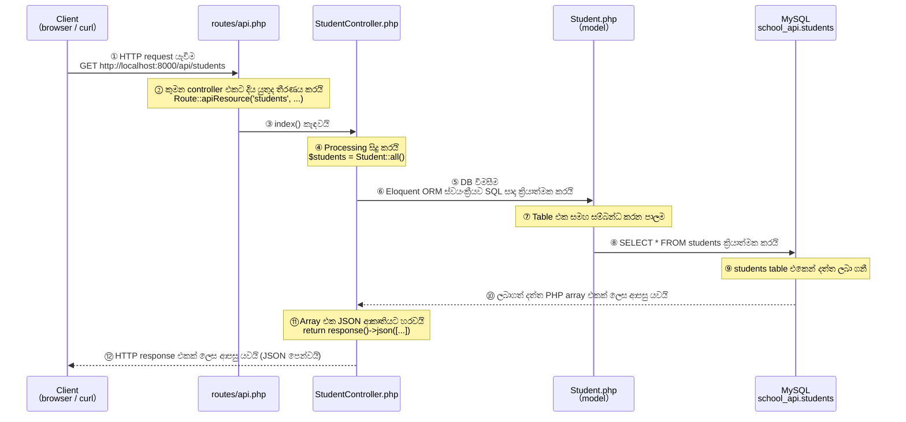
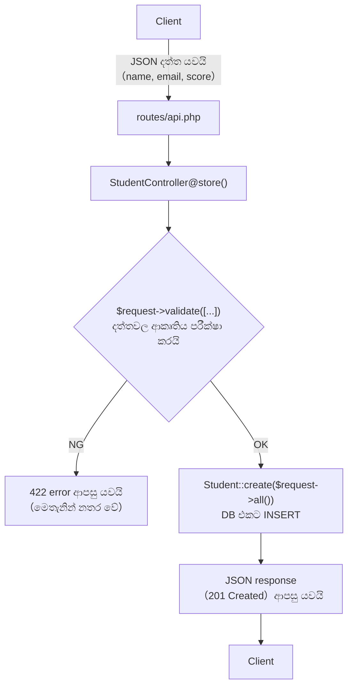

> 🇯🇵 මුල් පිටපත (ජපන් භාෂාවෙන්): [20260514.md](<../../../2年生_システム開発実践/前期/2026_05_14/20260514.md>) <!-- original-ja-link -->


## Blade app එක API එකක් බවට පත් කිරීම

### අද දිනයේ ඉලක්කය
- REST API යනු කුමක්දැයි පැහැදිලි කිරීමට හැකි වීම
- JSON response එකක් ආපසු යවන controller එකක් ලිවීමට හැකි වීම
- `api.php` හි routing තේරුම් ගැනීම

---

### REST API යනු කුමක්ද

#### "API කියන්නේ මොකක්ද?" කියා කෙටියෙන් කිව්වොත්

**API = "දත්ත පමණක් ආපසු ලබා දෙන කවුළුවක්"**

1 වන වසරේදී, browser එකෙන් URL එකකට පිවිසුණු විට HTML (පෙනුම ද ඇතුළත් පිටුවක්) ආපසු ලැබුණා.  
API එකත් එම ක්‍රමයම භාවිතා කරනවා, නමුත් HTML වෙනුවට **දත්ත (JSON) පමණක්** ආපසු යවනවා.

```
【Blade app (1 වන වසරේදී සෑදූ එක)】
Browser → GET /students → Server → HTML පිටුවක් ආපසු යවයි
                                      ↑ වගු, බොත්තම්, design ආදී සියල්ල ඇතුළත්

【REST API (අද සිට සාදන එක)】
Browser හෝ වෙනත් app → GET /api/students → Server → JSON දත්ත පමණක් ආපසු යවයි
                                                      ↑ පෙනුමක් නැත, දත්ත පමණි
```

> **ඇයි JSON පමණක් ආපසු යවන්නේ?**  
> React, Vue වැනි frontend "තමන්ගේම design එක තමන් සාදන" නිසා,  
> server එකෙන් "දත්ත පමණක්" එවනවාට කැමතියි.  
> API එකක් සෑදූ විට "React මත ක්‍රියා කරන app", "smartphone app" වැනි විවිධ තිර වලින් එකම දත්ත නැවත නැවත භාවිතා කළ හැකියි.

---

#### JSON කියන්නේ කොහොම හැඩයක්ද?

**JSON (ජේසන්)** යනු දත්ත නිරූපණය කරන text ආකෘතියකි.  
Browser එකට සහ වෙනත් app වලට පහසුවෙන් කියවිය හැකි වන පරිදි, නියමිත ලිවීමේ ක්‍රමයක් තිබෙනවා.

```json
{
    "status": "ok",
    "data": [
        {
            "id": 1,
            "name": "田中太郎",
            "email": "tanaka@example.com",
            "score": 85
        },
        {
            "id": 2,
            "name": "山田花子",
            "email": "yamada@example.com",
            "score": 72
        }
    ]
}
```

> **කියවන ආකාරයේ වැදගත් කරුණු:**  
> - `{ }` ඇතුළත "key": "value" ආකාරයෙන් ලියනවා  
> - `[ ]` යනු list එකකි (දත්ත කිහිපයක් එකට එකතු කරයි)  
> - String `"` වලින් වට කරනවා. සංඛ්‍යා වට කරන්නේ නැහැ  
> - අවසාන අයිතමයට පසුව comma `,` දමන්නේ නැහැ

---

#### REST හි අදහස: URL සහ HTTP method එකතුව

REST API එකේදී කළ යුතු දේ තීරණය වන්නේ "**URL (කොතැනටද)** × **HTTP method (කුමක් කරනවාද)**" අනුවයි.  
HTTP method යනු request එකේ වර්ගය දක්වන වචනයකි.

| HTTP method | අර්ථය | එදිනෙදා ක්‍රියාවකට උපමා කළොත් |
|-------------|------|-------------------|
| `GET`       | ලබා ගැනීම | පිටුවක් බැලීම, සෙවීම |
| `POST`      | අලුතින් සෑදීම | Form එකක් submit කිරීම |
| `PUT/PATCH` | යාවත්කාලීන කිරීම | අන්තර්ගතය වෙනස් කර ලිවීම |
| `DELETE`    | මකා දැමීම | Delete බොත්තම ඔබීම |

මෙම පාඩමේදී සාදන සිසුන්ගේ API ලැයිස්තුව:

| URL                  | Method      | අර්ථය   | කරන දේ           |
| -------------------- | --------- | ---- | --------------- |
| `/api/students`      | GET       | ලැයිස්තුව ලබා ගැනීම | සියලුම සිසුන්ගේ දත්ත ආපසු යවයි      |
| `/api/students`      | POST      | අලුතින් සෑදීම | අලුත් සිසුවෙකු ලියාපදිංචි කරයි      |
| `/api/students/{id}` | GET       | විස්තර ලබා ගැනීම | තෝරාගත් එක් සිසුවෙකු ආපසු යවයි    |
| `/api/students/{id}` | PUT/PATCH | යාවත්කාලීන කිරීම   | තෝරාගත් සිසුවාගේ තොරතුරු වෙනස් කරයි |
| `/api/students/{id}` | DELETE    | මකා දැමීම   | තෝරාගත් සිසුවා මකා දමයි     |

> `{id}` ස්ථානයට සංඛ්‍යාවක් එනවා. උදාහරණයක් ලෙස `GET /api/students/3` යනු "id එක 3 වන සිසුවා ලබා ගන්න" යන්නයි.

---

### HTTP status code ගැන

API response එකකට සෑම විටම **status code** එකක් (සංඛ්‍යාවක්) එකතු වෙනවා.  
Browser එක හෝ React මෙම සංඛ්‍යාව බලා "සාර්ථකද අසාර්ථකද" කියා තීරණය කරනවා.

| Code | අර්ථය | භාවිතා කරන්නේ කවදාද |
|-------|------|---------|
| `200 OK` | සාර්ථකයි | ලබා ගැනීම, යාවත්කාලීන කිරීම, මකා දැමීම සාර්ථක වූ විට |
| `201 Created` | සෑදීම සාර්ථකයි | POST මගින් අලුතින් සෑදූ විට |
| `404 Not Found` | සොයා ගත නොහැක | දුන් id එක නොපවතින විට |
| `422 Unprocessable Entity` | Validation දෝෂය | ඇතුළත් කළ අගයන් නිවැරදි නොවන විට |
| `500 Internal Server Error` | Server දෝෂය | Program එකේ bug එකක් ඇති විට |

> උදාහරණයක් ලෙස `GET /api/students/999` හිදී id=999 සිසුවා නොපවතී නම්,  
> "404" ආපසු යැවීමෙන් "සොයා ගත නොහැකි විය" කියා දන්වනවා.

---

### Step 10｜API controller එක සෑදීම

#### 10-1. Controller file එක සෑදීම

Terminal එකේ පහත දේ ක්‍රියාත්මක කරන්න (`php artisan serve` ධාවනය වන terminal එකට **වෙනස් tab එකක්** විවෘත කරන්න).

```bash
php artisan make:controller Api/StudentController --api
```

**Command එකේ අර්ථය:**
- `make:controller` → controller file එකක් සාදයි
- `Api/StudentController` → `Api` folder එක ඇතුළත `StudentController.php` සාදයි
- `--api` → API සඳහා අවශ්‍ය method 5 කලින්ම ලියා දෙයි (`index` `store` `show` `update` `destroy`)

ක්‍රියාත්මක කළ පසු පහත දේ පෙන්වන්නේ නම් සාර්ථකයි:

```
   INFO  Controller [app/Http/Controllers/Api/StudentController.php] created successfully.
```

සෑදූ file එක තිබෙන ස්ථානය පරීක්ෂා කරන්න:

```
（Repository එකේ නම）/
└── app/
    └── Http/
        └── Controllers/
            └── Api/                     ← අලුතින් සෑදූ folder එක
                └── StudentController.php  ← මෙය සෑදුණා
```

---

#### 10-2. Controller file එක විවෘත කිරීම

VSCode හි `app/Http/Controllers/Api/StudentController.php` විවෘත කරන්න.  
`--api` option එකෙන් සෑදූ file එකේ මුල සිටම මෙවැනි අන්තර්ගතයක් තිබෙනවා:

```php
<?php

namespace App\Http\Controllers\Api;

use Illuminate\Http\Request;
use App\Http\Controllers\Controller;

class StudentController extends Controller
{
    public function index()
    {
        //
    }

    public function store(Request $request)
    {
        //
    }

    public function show(string $id)
    {
        //
    }

    public function update(Request $request, string $id)
    {
        //
    }

    public function destroy(string $id)
    {
        //
    }
}
```

> **`namespace` සහ `use` කියන්නේ මොනවාද?**  
> - `namespace` යනු මෙම file එකේ "ලිපිනය" වැනි දෙයකි. එය `Api` folder එක ඇතුළත ඇති බව පෙන්වයි.  
> - `use` යනු වෙනත් file "කැඳවීමේ ප්‍රකාශනයකි". `Student` model එක භාවිතා කිරීමට පසුව එකතු කරනවා.

---

#### 10-3. Controller එකේ ක්‍රියාකාරිත්වය සඳහා code ලිවීම

File එකේ අන්තර්ගතය **සම්පූර්ණයෙන්ම** පහත code එකෙන් ප්‍රතිස්ථාපනය කරන්න.  
(Ctrl+A මගින් සියල්ල තෝරා → paste කරන්න, නැතහොත් පවතින අන්තර්ගතය මකා නැවත ලියන්න)

```php
<?php

namespace App\Http\Controllers\Api;

use App\Http\Controllers\Controller;
use App\Models\Student;           // ← Student model එක භාවිතා කළ හැකි කරයි
use Illuminate\Http\Request;

class StudentController extends Controller
{
    // -------------------------------------------------------
    // GET /api/students  → සියලුම සිසුන්ගේ ලැයිස්තුව ආපසු යවයි
    // -------------------------------------------------------
    public function index()
    {
        $students = Student::all();  // Database එකෙන් සියලු records ලබා ගනී

        return response()->json([
            'status' => 'ok',
            'data'   => $students,   // ලබාගත් දත්ත JSON එකට දමා ආපසු යවයි
        ]);
    }

    // -------------------------------------------------------
    // POST /api/students  → අලුත් සිසුවෙකු ලියාපදිංචි කරයි
    // -------------------------------------------------------
    public function store(Request $request)
    {
        // Validation: එවූ දත්තවල ආකෘතිය පරීක්ෂා කරයි
        $request->validate([
            'name'  => 'required|max:100',          // අනිවාර්යයි, අක්ෂර 100 ක් ඇතුළත
            'email' => 'required|email|unique:students', // අනිවාර්යයි, email ආකෘතිය, අනුපිටපත් නොවිය යුතුයි
            'score' => 'required|integer|min:0|max:100', // අනිවාර්යයි, පූර්ණ සංඛ්‍යාවක්, 0〜100
        ]);

        $student = Student::create($request->all()); // DB එකේ save කරයි

        // 201 Created (සෑදීම සාර්ථකයි) status code එක සමඟ ආපසු යවයි
        return response()->json([
            'status' => 'ok',
            'data'   => $student,
        ], 201);
    }

    // -------------------------------------------------------
    // GET /api/students/{id}  → id මගින් තෝරාගත් එක් අයෙකු ආපසු යවයි
    // -------------------------------------------------------
    public function show($id)
    {
        $student = Student::find($id); // id මගින් එක් record එකක් සොයයි

        if (!$student) {
            // සොයා ගත නොහැකි වූ විට → 404 Not Found ආපසු යවයි
            return response()->json([
                'status'  => 'error',
                'message' => 'Student not found',
            ], 404);
        }

        return response()->json([
            'status' => 'ok',
            'data'   => $student,
        ]);
    }

    // -------------------------------------------------------
    // PUT /api/students/{id}  → id මගින් තෝරාගත් සිසුවා යාවත්කාලීන කරයි
    // -------------------------------------------------------
    public function update(Request $request, $id)
    {
        $student = Student::findOrFail($id); // සොයා ගත නොහැකි නම් ස්වයංක්‍රීයව 404 ආපසු යවයි

        $request->validate([
            'name'  => 'sometimes|max:100',          // sometimes = එවා ඇත්නම් පමණක් පරීක්ෂා කරයි
            'score' => 'sometimes|integer|min:0|max:100',
        ]);

        $student->update($request->all()); // DB එක යාවත්කාලීන කරයි

        return response()->json([
            'status' => 'ok',
            'data'   => $student,
        ]);
    }

    // -------------------------------------------------------
    // DELETE /api/students/{id}  → id මගින් තෝරාගත් සිසුවා මකා දමයි
    // -------------------------------------------------------
    public function destroy($id)
    {
        Student::findOrFail($id)->delete(); // සොයාගෙන මකා දමයි

        return response()->json([
            'status'  => 'ok',
            'message' => 'Deleted',
        ]);
    }
}
```

**ලියා අවසන් වූ පසු Ctrl+S (Mac හි Cmd+S) මගින් save කරන්න.**

---

#### එක් එක් method එකේ කාර්යභාරයේ සාරාංශය

| Method නම | අදාළ URL | කරන දේ |
|-----------|------------|---------|
| `index()` | GET /api/students | සියල්ල ලබාගෙන JSON ලෙස ආපසු යවයි |
| `store()` | POST /api/students | Validation → DB එකේ save කිරීම → 201 සමඟ ආපසු යවයි |
| `show($id)` | GET /api/students/{id} | එක් record එකක් සෙවීම → නැත්නම් 404 → JSON ලෙස ආපසු යවයි |
| `update($request, $id)` | PUT /api/students/{id} | එක් record එකක් සෙවීම → Validation → DB යාවත්කාලීන කිරීම |
| `destroy($id)` | DELETE /api/students/{id} | එක් record එකක් සෙවීම → මකා දැමීම |

---

### Step 11｜API routing සක්‍රීය කිරීම

Controller එක සෑදූ පමණින් URL එක සහ controller එක සම්බන්ධ වන්නේ නැහැ.  
"මෙම URL එකට පිවිසුණු විට මෙම method එක කැඳවන්න" යන **routing** සකස් කළ යුතුයි.

#### 11-1. `routes/api.php` සෑදීම

> **⚠️ Laravel 11 සහ ඊට පසු සංස්කරණවල `routes/api.php` මුල සිටම නොපවතී.**  
> පහත command එක ක්‍රියාත්මක කළ විට පමණක් එය සෑදෙනවා.

```bash
php artisan install:api
```

ක්‍රියාත්මක කළ විට, අතරමගදී දෙවරක් තහවුරු කිරීම ඉල්ලා සිටිනවා. දෙකේදීම `yes` (හෝ Enter key) මගින් ඉදිරියට යන්න.

---

**【තහවුරු කිරීම 1】Migration ක්‍රියාත්මක කරනවාද?**

```
   INFO  Published API routes file.

 One new database migration has been published. Would you like to run all pending database migrations? (yes/no) [yes]:
 > yes
```

> `routes/api.php` සෑදූ පසු, migration දැන්ම ක්‍රියාත්මක කරනවාද කියා අසනවා.  
> `yes` හෝ Enter මගින් ඉදිරියට යන්න.

---

**【තහවුරු කිරීම 2】Production පරිසරයේ ක්‍රියාත්මක කිරීම තහවුරු කිරීම**

```
                                                                    
                         APPLICATION IN PRODUCTION.                 
                                                                    

 ┌ Are you sure you want to run this command? ──────────────────┐
 │ Yes                                                          │
 └──────────────────────────────────────────────────────────────┘
```

> **"APPLICATION IN PRODUCTION (මෙය production පරිසරයයි)" කියා පෙන්වන විට ඔබ පුදුම විය හැකියි, නමුත් කරදර විය යුතු නැහැ.**  
> මෙය "ඇත්තටම ක්‍රියාත්මක කරන්නද?" කියා Laravel අසන ආරක්ෂිත තහවුරු කිරීමකි.  
> "Yes" තෝරා ඉදිරියට යන්න.

---

**Migration ක්‍රියාත්මක වෙනවා**

```
   INFO  Running migrations.

  2026_xx_xx_xxxxxx_create_personal_access_tokens_table .......... DONE
```

> `personal_access_tokens` (personal access token) table එක සෑදෙනවා.  
> මෙය **Sanctum විසින් authentication සඳහා token save කිරීමට භාවිතා කරන table එකයි**.  
> පාඩම 07 හි authentication ක්‍රියාකාරිත්වය සාදන විට භාවිතා කරනවා. දැනට "ස්වයංක්‍රීයව සෑදුණා" කියා පමණක් මතක තබා ගත්තාම ඇති.

---

**අවසානයේ මෙම පණිවිඩය පෙන්වන්නේ නම් සාර්ථකයි:**

```
   INFO  API scaffolding installed. Please add the [Laravel\Sanctum\HasApiTokens] trait to your User model.
```

> අවසානයේ ඇති `Please add the [Laravel\Sanctum\HasApiTokens] trait...` යනු  
> "User model එකට සැකසුමක් එකතු කරන්න" යන උපදෙසකි, නමුත් **එය පාඩම 07 හිදී කරනවා. දැනට නොසලකා හැරියාට කමක් නැහැ.**

---

මෙම command එක කළ දේවල්:
- `routes/api.php` file එක සෑදීම
- `bootstrap/app.php` හි API routing ලියාපදිංචි කිරීම
- Laravel Sanctum (පාඩම 07 හි භාවිතා කරන authentication package එක) install කිරීම
- `personal_access_tokens` table එකේ migration ක්‍රියාත්මක කිරීම

ක්‍රියාත්මක කළ පසු folder ව්‍යුහය:

```
（Repository එකේ නම）/
└── routes/
    ├── api.php   ← මෙය සෑදුණා (API සඳහා routing)
    └── web.php   ← මෙය Blade සඳහා (මෙවර අත ගසන්නේ නැහැ)
```

> **`api.php` සහ `web.php` අතර වෙනස**  
> - `web.php` … HTML ආපසු යවන routes ලියනවා  
> - `api.php` … JSON ආපසු යවන API සඳහා. URL එකේ මුලට `/api/` ස්වයංක්‍රීයව එකතු වෙනවා

#### 11-2. Route එකතු කිරීම

VSCode හි `routes/api.php` විවෘත කරන්න. මුලදී එය බොහෝ දුරට හිස්ය. පහත පරිදි වෙනස් කර ලියන්න:

```php
<?php

use Illuminate\Support\Facades\Route;
use App\Http\Controllers\Api\StudentController;  // ← මෙම පේළිය එකතු කරන්න

Route::apiResource('students', StudentController::class);
// ↑ මෙම එක් පේළියෙන් පමණක් route 5 ක් ස්වයංක්‍රීයව ලියාපදිංචි වෙනවා
```

**ලියා අවසන් වූ පසු Ctrl+S (Mac හි Cmd+S) මගින් save කරන්න.**

---

#### `Route::apiResource` ලියාපදිංචි කරන routes පරීක්ෂා කිරීම

`Route::apiResource('students', StudentController::class)` පහත route 5 **එක් පේළියකින්** එකවර ලියාපදිංචි කරනවා.

පරීක්ෂා කරන command එක:

```bash
php artisan route:list --path=api/students
```

```
  GET|HEAD   api/students ............. students.index  › Api\StudentController@index
  POST       api/students ............. students.store  › Api\StudentController@store
  GET|HEAD   api/students/{student} ... students.show   › Api\StudentController@show
  PUT|PATCH  api/students/{student} ... students.update › Api\StudentController@update
  DELETE     api/students/{student} ... students.destroy› Api\StudentController@destroy
```

> මේවා එකින් එක අතින් ලිව්වොත් පේළි 5 ක් වෙනවා, නමුත් `apiResource` භාවිතා කළොත් එක් පේළියක් ඇති.

---

### Step 12｜Browser එකෙන් API එක ක්‍රියා කරන ආකාරය පරීක්ෂා කිරීම

Development server එක ආරම්භ කර නැත්නම්, ආරම්භ කරන්න:

```bash
php artisan serve
```

#### 12-1. ලැයිස්තුව ලබා ගැනීම (GET /api/students) browser එකෙන් පරීක්ෂා කිරීම

Browser එකෙන් පහත URL එකට පිවිසෙන්න:

```
http://localhost:8000/api/students
```

පහත වැනි JSON එකක් පෙන්වන්නේ නම් සාර්ථකයි:

```json
{
    "status": "ok",
    "data": [
        {
            "id": 1,
            "name": "Tanaka Taro",
            "email": "tanaka@example.com",
            "score": 72,
            "created_at": "2024-xx-xx ...",
            "updated_at": "2024-xx-xx ..."
        },
        ...
    ]
}
```

> **JSON පෙන්වන්නේ නැතිව error එකක් ආවොත් පහත දේ පරීක්ෂා කරන්න.**

**නිතර ඇතිවන error සහ ඒවාට විසඳුම්:**

| Error එකේ අන්තර්ගතය | හේතුව | විසඳුම |
|-----------|------|-------|
| `Class "App\Http\Controllers\Api\StudentController" not found` | use ලියා ඇති ආකාරය වැරදියි | `api.php` හි `use` පේළිය පරීක්ෂා කරන්න |
| `SQLSTATE[HY000] [2002] Connection refused` | MySQL ආරම්භ කර නැහැ | MySQL ආරම්භ කරන්න (XAMPP or `brew services start mysql`) |
| හිස් පිටුවක්, 500 error | PHP syntax error | `.storage/logs/laravel.log` විවෘත කර error එක පරීක්ෂා කරන්න |
| `{"message":""}` පමණක් පෙන්වයි | Route එක හමු වුණා, නමුත් processing එකේ error එකක් | Controller එකේ අන්තර්ගතය පරීක්ෂා කරන්න |

---

#### 12-2. එක් record එකක් ලබා ගැනීම (GET /api/students/{id}) browser එකෙන් පරීක්ෂා කිරීම

Browser එකෙන් පහත URL එකට පිවිසෙන්න (id අංකය ඇත්තටම DB එකේ ඇති එකකට ගැළපෙන සේ වෙනස් කරන්න):

```
http://localhost:8000/api/students/1
```

```json
{
    "status": "ok",
    "data": {
        "id": 1,
        "name": "Tanaka Taro",
        "email": "tanaka@example.com",
        "score": 72,
        "created_at": "2024-xx-xx ...",
        "updated_at": "2024-xx-xx ..."
    }
}
```

නොපවතින id එකකින් පිවිසුණොත්:

```
http://localhost:8000/api/students/999
```

```json
{
    "status": "error",
    "message": "Student not found"
}
```

මෙලෙස පෙන්වන්නේ නම් නිවැරදිව ක්‍රියා කරනවා.

---

#### 12-3. POST, PUT, DELETE curl command මගින් පරීක්ෂා කිරීම

Browser එකේ address bar එකෙන් යැවිය හැක්කේ GET request පමණයි.  
POST (අලුතින් සෑදීම), PUT (යාවත්කාලීන කිරීම), DELETE (මකා දැමීම) පරීක්ෂා කිරීමට **curl (කර්ල්)** නම් command එක භාවිතා කරනවා.

> **curl යනු කුමක්ද?**  
> Terminal එකෙන් HTTP request යවන command එකකි. Mac සහ Windows දෙකෙහිම සම්මතයෙන්ම ඇතුළත් වී තිබෙනවා.  
> `php artisan serve` ධාවනය වන terminal එකට **වෙනස් tab එකක** ක්‍රියාත්මක කරන්න.

---

**curl command එකේ option කියවන ආකාරය:**

| Option | අර්ථය |
|-----------|------|
| `-X POST` | HTTP method එක සඳහන් කරයි (POST / PUT / DELETE ආදිය) |
| `-H "Content-Type: application/json"` | "JSON යවනවා" යන ප්‍රකාශනය |
| `-d '{...}'` | යවන දත්ත (JSON ආකෘතියෙන්) |

---

**① අලුතින් සෑදීම (POST /api/students)**

**Mac සඳහා:**
```bash
curl -X POST http://localhost:8000/api/students \
  -H "Content-Type: application/json" \
  -d '{"name": "新しい生徒", "email": "new@example.com", "score": 90}'
```

**Windows (Command Prompt) සඳහා:**
```cmd
curl -X POST http://localhost:8000/api/students -H "Content-Type: application/json" -d "{\"name\": \"新しい生徒\", \"email\": \"new@example.com\", \"score\": 90}"
```

> Windows හිදී `"` යන්න `\"` ලෙස escape කළ යුතුයි.

සාර්ථක වූ විට ලැබෙන response එක (status code `201 Created`):

```json
{"status":"ok","data":{"id":11,"name":"新しい生徒","email":"new@example.com","score":90,...}}
```

---

**② යාවත්කාලීන කිරීම (PUT /api/students/{id})**

id එක `1` වන සිසුවාගේ score එක `95` ලෙස වෙනස් කරන උදාහරණය:

**Mac සඳහා:**
```bash
curl -X PUT http://localhost:8000/api/students/1 \
  -H "Content-Type: application/json" \
  -d '{"score": 95}'
```

**Windows (Command Prompt) සඳහා:**
```cmd
curl -X PUT http://localhost:8000/api/students/1 -H "Content-Type: application/json" -d "{\"score\": 95}"
```

සාර්ථක වූ විට ලැබෙන response එක (status code `200 OK`):

```json
{"status":"ok","data":{"id":1,"name":"Tanaka Taro","email":"tanaka@example.com","score":95,...}}
```

---

**③ මකා දැමීම (DELETE /api/students/{id})**

id එක `1` වන සිසුවා මකා දමන උදාහරණය:

**Mac සඳහා:**
```bash
curl -X DELETE http://localhost:8000/api/students/1
```

**Windows (Command Prompt) සඳහා:**
```cmd
curl -X DELETE http://localhost:8000/api/students/1
```

සාර්ථක වූ විට ලැබෙන response එක (status code `200 OK`):

```json
{"status":"ok","message":"Deleted"}
```

---

**මකා දැමූ පසු ලැයිස්තුව පරීක්ෂා කර, records ගණන අඩු වී ඇත්නම් සාර්ථකයි:**

```bash
curl http://localhost:8000/api/students
```

---

### Request එක ගමන් කරන්නේ කුමන file හරහාද

`GET /api/students` browser එකෙන් හෝ curl මගින් යැවූ විට, ඇතුළතින් කුමන file පිළිවෙළින් ක්‍රියා කරනවාද කියා බලමු.

---

#### සම්පූර්ණ ගලායාමේ රූප සටහන

කාලය ඉහළ සිට පහළට ගලා යනවා. ඝන ඊතල "යන ගමන (request)", තිත් ඊතල "එන ගමන (response)" වේ.



---

#### එක් එක් file එකේ කාර්යභාරයේ සාරාංශය

| File | කාර්යභාරය | භාරව ඇති පියවර |
|---------|------|---------------|
| `routes/api.php` | "කුමන URL → කුමන controller" කියා ගළපයි | ② |
| `app/Http/Controllers/Api/StudentController.php` | Request එක ලබාගෙන, process කර, response එක ආපසු යවයි | ④⑥⑪ |
| `app/Models/Student.php` | DB table එක සහ PHP code අතර පාලම | ⑦ |
| `Database (MySQL)` | දත්ත ඇත්තටම save කර සොයයි | ⑨ |

---

#### Eloquent ORM යනු කුමක්ද (⑥⑦ සඳහා අමතර පැහැදිලි කිරීම)

`Student::all()` කියා ලිවීම පමණක් ප්‍රමාණවත්. Laravel ස්වයංක්‍රීයව `SELECT * FROM students;` යන SQL එක සාදා ක්‍රියාත්මක කරනවා.  
මෙම ක්‍රමය **Eloquent ORM (එලොක්වන්ට්)** ලෙස හැඳින්වෙනවා.

```php
// PHP හි ලියන දේ        →  ඇත්තටම ක්‍රියාත්මක වන SQL
Student::all()           →  SELECT * FROM students;
Student::find(1)         →  SELECT * FROM students WHERE id = 1 LIMIT 1;
Student::create([...])   →  INSERT INTO students (...) VALUES (...);
$student->update([...])  →  UPDATE students SET ... WHERE id = ?;
$student->delete()       →  DELETE FROM students WHERE id = ?;
```

> **SQL කෙලින්ම ලිවීමට අවශ්‍ය නොවීම** ORM හි වාසියයි.  
> Model එකේ class නම (`Student`) ස්වයංක්‍රීයව table නමට (`students`) ගැළපෙනවා.

---

#### POST අවස්ථාවේ ගලායාම සමඟ වෙනස

`POST /api/students` (අලුතින් සෑදීම) අවස්ථාවේදීත් මූලික ගලායාම සමානයි, නමුත් අතරමගදී **validation** එකක් සිදු වෙනවා.



---

### මෙතෙක් කළ දේ පරීක්ෂා කිරීමේ checklist එක

| පරීක්ෂා කළ යුතු කරුණ | Check |
|---------|---------|
| REST API යනු "දත්ත පමණක් ආපසු යවන ක්‍රමයක්" කියා පැහැදිලි කළ හැකියි | □ |
| JSON හි මූලික ලිවීමේ ක්‍රමය (`{}` `[]` `"key": "value"`) තේරෙනවා | □ |
| `php artisan make:controller Api/StudentController --api` ක්‍රියාත්මක කළා | □ |
| `StudentController.php` හි method පහ සඳහා code ලිව්වා | □ |
| `php artisan install:api` ක්‍රියාත්මක කර `routes/api.php` සෑදුවා | □ |
| `routes/api.php` හි `Route::apiResource` එකතු කළා | □ |
| `php artisan route:list` මගින් route 5 පෙන්වුවා | □ |
| Browser එකෙන් `http://localhost:8000/api/students` වෙත පිවිසි විට JSON ආපසු ලැබුණා | □ |
| `http://localhost:8000/api/students/1` මගින් එක් record එකක JSON ආපසු ලැබුණා | □ |
| `http://localhost:8000/api/students/999` මගින් 404 error JSON ආපසු ලැබුණා | □ |
