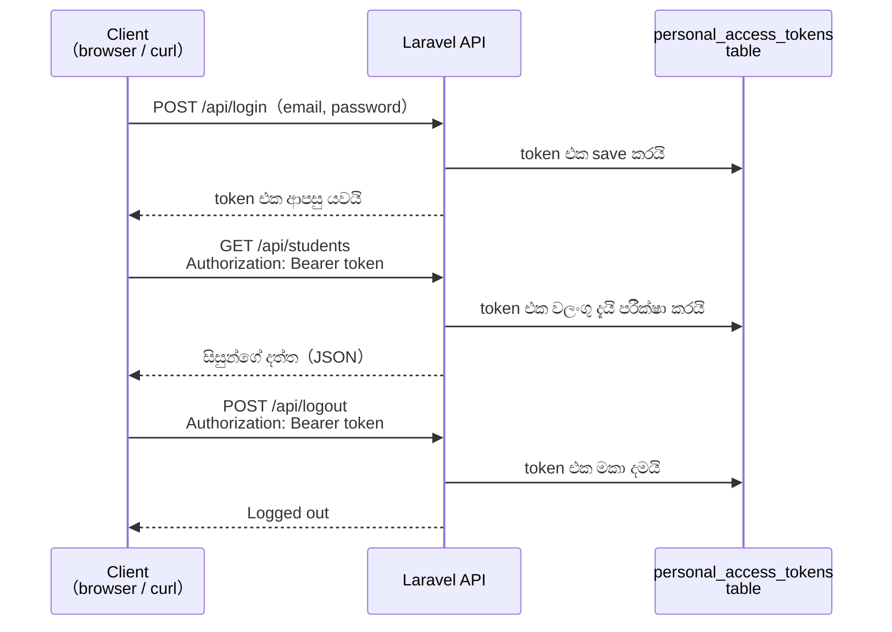
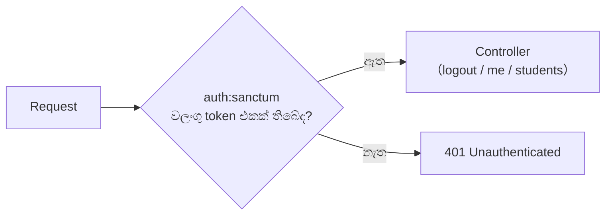

# Laravel REST API බවට පත් කිරීම

> 🇯🇵 මුල් පිටපත (ජපන් භාෂාවෙන්): [20260521.md](<../../../2年生_システム開発実践/前期/2026_05_21/20260521.md>) <!-- original-ja-link -->

---

## පාඩම 05: Resource Controller මගින් CRUD API පිළිවෙළට සකස් කිරීම

### API Resource — response එකේ හැඩය සකස් කිරීම

```bash
php artisan make:resource StudentResource
```

```php
// app/Http/Resources/StudentResource.php
class StudentResource extends JsonResource
{
    public function toArray(Request $request): array
    {
        return [
            'id'         => $this->id,
            'name'       => $this->name,
            'email'      => $this->email,
            'score'      => $this->score,
            'evaluation' => $this->score >= 80 ? 'A' : 'B',  // ගණනය කළ අගයන් ද එකතු කළ හැක
            'created_at' => $this->created_at->format('Y/m/d'),
            // අනවශ්‍ය field (password වැනි) ඇතුළත් නොකරන්න
        ];
    }
}
```

**Controller එකේ භාවිතා කිරීම:**

```php
use App\Http\Resources\StudentResource;
use App\Http\Resources\StudentCollection;

public function index()
{
    $students = Student::all();
    return StudentResource::collection($students);
    // → සියලුම records Resource එකකින් ආවරණය කර ආපසු යවයි
}

public function show($id)
{
    return new StudentResource(Student::findOrFail($id));
}
```

---

## පාඩම 06: API response වල හැඩය ඒකාකාර කිරීම

### API response හැඩය සඳහා හොඳම පිළිවෙත්

```json
// සාර්ථක වූ විට
{
    "status": "ok",
    "data": { ... }
}

// දෝෂයක් ඇති වූ විට
{
    "status": "error",
    "message": "Not found",
    "errors": {
        "email": ["このメールアドレスは既に使われています"]
    }
}
```

---

## පාඩම 07: Sanctum මගින් token authentication

### Sanctum යනු කුමක්ද

Laravel හි **API authentication package** එකකි.  
Token (එක්තරා ආකාරයක රහස් වචනයක්) භාවිතා කරමින් login තත්ත්වය කළමනාකරණය කරයි.

Login වීමේ සිට logout වීම දක්වා සිදුවන හුවමාරුව පහත පරිදි වේ.



```bash
composer require laravel/sanctum
php artisan vendor:publish --provider="Laravel\Sanctum\SanctumServiceProvider"
php artisan migrate
```

**Authentication API ක්‍රියාත්මක කිරීම:**

```php
// app/Http/Controllers/Api/AuthController.php
class AuthController extends Controller
{
    // POST /api/login
    public function login(Request $request)
    {
        $request->validate([
            'email'    => 'required|email',
            'password' => 'required',
        ]);
        
        // email සහ password පරීක්ෂා කරයි
        if (!Auth::attempt($request->only('email', 'password'))) {
            return response()->json([
                'status'  => 'error',
                'message' => 'メールアドレスまたはパスワードが違います',
            ], 401);
        }
        
        $user = Auth::user();
        
        // token එකක් නිකුත් කරයි
        $token = $user->createToken('api-token')->plainTextToken;
        
        return response()->json([
            'status' => 'ok',
            'token'  => $token,
            'user'   => $user,
        ]);
    }
    
    // POST /api/logout
    public function logout(Request $request)
    {
        // වත්මන් token එක මකා දමයි
        $request->user()->currentAccessToken()->delete();
        
        return response()->json(['status' => 'ok', 'message' => 'Logged out']);
    }
    
    // GET /api/me
    public function me(Request $request)
    {
        return response()->json(['status' => 'ok', 'user' => $request->user()]);
    }
}
```

---

## පාඩම 08: Authentication middleware සහ අවසර කළමනාකරණය

`auth:sanctum` middleware යනු controller එකට පෙර "token එකක් තිබේද" කියා පරීක්ෂා කරන දොරටුපාලකයෙකි.



```php
// routes/api.php

// Authentication අවශ්‍ය නොවන routes
Route::post('/login', [AuthController::class, 'login']);
Route::post('/register', [AuthController::class, 'register']);

// Authentication අවශ්‍ය routes（auth:sanctum）
Route::middleware('auth:sanctum')->group(function () {
    Route::post('/logout', [AuthController::class, 'logout']);
    Route::get('/me', [AuthController::class, 'me']);
    Route::apiResource('students', StudentController::class);
});
```

**API පරීක්ෂා කරන ආකාරය (curl command):**

```bash
# Login වීම
curl -X POST http://localhost:8000/api/login \
  -H "Content-Type: application/json" \
  -d '{"email":"test@example.com","password":"password"}'
# → {"token": "1|abc123..."}

# Authentication අවශ්‍ය API එකකට request යැවීම
curl http://localhost:8000/api/students \
  -H "Authorization: Bearer 1|abc123..."
```

---

## සාරාංශය

| සංකල්පය | Blade (1 වන වසර) | API (2 වන වසර) |
|------|-------------|------------|
| Response | HTML（view） | JSON（response()->json()） |
| Routing | routes/web.php | routes/api.php |
| Authentication | Session | Sanctum token |
| තිරය (UI) | Blade මගින් ලබා දෙයි | Frontend එක මගින් සාදයි |
