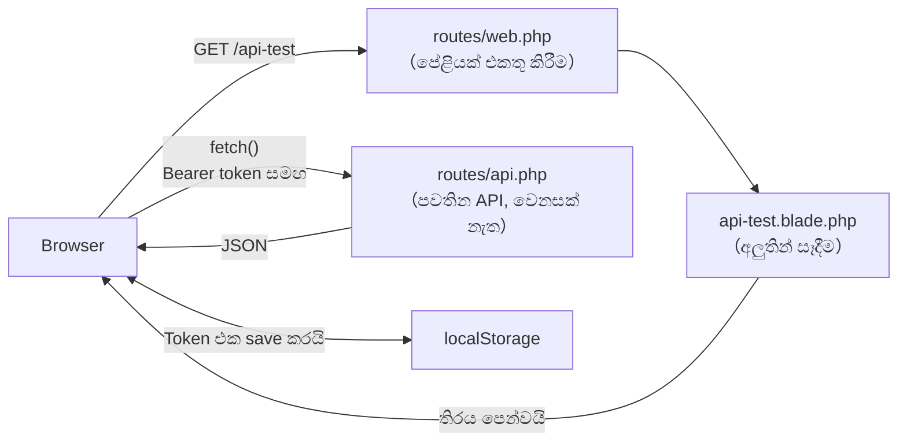

> 🇯🇵 මුල් පිටපත (ජපන් භාෂාවෙන්): [20260528.md](<../../../2年生_システム開発実践/前期/2026_05_28/20260528.md>) <!-- original-ja-link -->

## Browser එකෙන් token authentication පරීක්ෂා කිරීම (අමතර කොටස)

curl පමණක් නොව, browser එක මතම token authentication ක්‍රියා කරන ආකාරය දෘශ්‍යමය වශයෙන් පරීක්ෂා කළ හැකි පිටුවක් සකස් කරමු.

### දළ විශ්ලේෂණය

`/api-test` වෙත පිවිසි විට login තිරය විවෘත වෙනවා.  
Login වූ පසු, API මගින් ලබාගත් සිසුන්ගේ ලැයිස්තුව පෙන්වන අතර, එකතු කිරීම සහ මකා දැමීම ද කළ හැකියි.

```
【Login වීමට පෙර】
┌──────────────────────────────────┐
│  API Token Tester                │
│                                  │
│   Login වූ විට සිසුන්ගේ           │
│   ලැයිස්තුව පෙන්වයි               │
│                                  │
│   [Email ලිපිනය        ]         │
│   [Password            ]         │
│   [Login（POST /api/login）]      │
└──────────────────────────────────┘

【Login වූ පසු】
┌──────────────────────────────────────────────────────────────┐
│  API Token Tester  ● Login වී ඇත: テストユーザー  [Logout]      │
├──────────────────────────────────────────────────────────────┤
│  සිසුන්ගේ ලැයිස්තුව  GET /api/students  HTTP 200              │
│  ┌────┬──────────┬────────────────────┬──────┬──────┐        │
│  │ ID │  නම      │  Email             │ ලකුණු │      │        │
│  ├────┼──────────┼────────────────────┼──────┼──────┤        │
│  │  1 │ 田中太郎 │ tanaka@example.com │  85  │ මකන්න │        │
│  │  2 │ 山田花子 │ yamada@example.com │  72  │ මකන්න │        │
│  └────┴──────────┴────────────────────┴──────┴──────┘        │
│                                                              │
│  අලුතින් එකතු කිරීම（POST /api/students）                       │
│  [නම] [Email ලිපිනය] [ලකුණු] [එකතු කරන්න]                       │
│                                                              │
│  ▶ මෙම පිටුව භාවිතා කරන code (React හිදීත් ලියන්නේ මෙලෙසමයි)   │
└──────────────────────────────────────────────────────────────┘
```

> **පවතින API code කිසිසේත් වෙනස් කරන්නේ නැහැ.**  
> එකතු කරන්නේ `routes/web.php` හි එක් පේළියක් සහ view file එකක් පමණයි.

එකතු කරන file සහ පවතින API අතර සම්බන්ධය පහත පරිදියි. තිරය පෙන්වීම `web.php` මගින් සිදු කරන අතර, දත්ත හුවමාරුව කලින් මෙන්ම `api.php` මගින් සිදු කරනවා.



---

### Step 1｜`routes/web.php` වෙත route එකක් එකතු කිරීම

VSCode හි project එකේ `routes/web.php` විවෘත කරන්න.

```
（Repository එකේ නම）/
└── routes/
    └── web.php   ← මෙය විවෘත කරන්න
```

File එකේ අවසානයට පහත පේළිය එකතු කරන්න:

```php
Route::get('/api-test', fn() => view('api-test'));
```

> **`use` එකතු කිරීම අවශ්‍ය නැහැ.**  
> මෙම route එක closure (නමක් නැති function එකක්) භාවිතා කරන නිසා, controller class එකක් කැඳවන්නේ නැහැ.  
> `use App\Http\Controllers\...` පේළිය එකතු නොකළත් ක්‍රියා කරනවා.

එකතු කළ පසු `routes/web.php` මෙවැනි හැඩයක් ගන්නවා:

```php
<?php

use Illuminate\Support\Facades\Route;

Route::get('/', function () {
    return view('welcome');
});

Route::get('/api-test', fn() => view('api-test'));  // ← මෙම පේළිය එකතු කරන්න
```

**එකතු කළ පසු Ctrl+S (Mac හි Cmd+S) මගින් save කරන්න.**

---

### Step 2｜`resources/views/api-test.blade.php` සෑදීම

`resources/views/` folder එක ඇතුළත `api-test.blade.php` නම් අලුත් file එකක් සාදන්න.

#### 2-1. අලුත් file එකක් සෑදීම

VSCode හි Explorer එකේ `resources/views/` folder එක මත right-click කරන්න  
→ "New File" තෝරන්න → file නම ලෙස `api-test.blade.php` ඇතුළත් කර Enter ඔබන්න.

```
（Repository එකේ නම）/
└── resources/
    └── views/
        ├── welcome.blade.php   ← මුල සිටම ඇති file එක
        └── api-test.blade.php  ← අලුතින් සාදන file එක
```

#### 2-2. පහත code එක සම්පූර්ණයෙන්ම copy කර paste කිරීම

සෑදූ file එක විවෘත කර, පහත code එක **සම්පූර්ණයෙන්ම** copy කර paste කරන්න:

```html
<!DOCTYPE html>
<html lang="ja">
<head>
    <meta charset="UTF-8">
    <title>API トークンテスター</title>
    <style>
        * { box-sizing: border-box; margin: 0; padding: 0; }
        body { font-family: sans-serif; background: #f4f6f8; color: #333; }

        .header {
            background: #1565C0; color: white;
            padding: 16px 32px;
            display: flex; align-items: center; gap: 16px;
        }
        .header h1 { font-size: 1.2em; font-weight: bold; }
        .header .sub { font-size: 0.85em; opacity: 0.85; }

        .layout { display: grid; grid-template-columns: 340px 1fr; gap: 0; min-height: calc(100vh - 56px); }

        /* වම් pane එක */
        .left { background: white; border-right: 1px solid #e0e0e0; padding: 24px; display: flex; flex-direction: column; gap: 24px; }

        .section-title {
            font-size: 0.75em; font-weight: bold; letter-spacing: .05em;
            color: #888; text-transform: uppercase; margin-bottom: 10px;
        }

        /* Login තත්ත්වය පෙන්වන badge එක */
        .status-badge {
            display: flex; align-items: center; gap: 8px;
            padding: 10px 14px; border-radius: 8px; font-size: 0.88em;
        }
        .status-badge.logged-out { background: #fff3e0; color: #e65100; }
        .status-badge.logged-in  { background: #e8f5e9; color: #2e7d32; }
        .dot { width: 9px; height: 9px; border-radius: 50%; flex-shrink: 0; }
        .dot-red   { background: #e53935; }
        .dot-green { background: #43a047; }

        /* Token එක පෙන්වීම */
        .token-box {
            background: #f5f5f5; border: 1px solid #ddd;
            border-radius: 6px; padding: 8px 10px;
            font-family: monospace; font-size: 0.8em;
            word-break: break-all; color: #555;
            max-height: 70px; overflow-y: auto;
        }

        /* Form */
        label { display: block; font-size: 0.85em; font-weight: bold; margin-bottom: 4px; }
        input[type="email"], input[type="password"] {
            width: 100%; padding: 8px 10px;
            border: 1px solid #ccc; border-radius: 6px;
            font-size: 0.95em; margin-bottom: 10px;
        }
        input:focus { outline: 2px solid #1976D2; border-color: transparent; }

        /* බොත්තම් */
        .btn {
            width: 100%; padding: 9px; border: none; border-radius: 6px;
            font-size: 0.95em; cursor: pointer; font-weight: bold;
        }
        .btn-primary { background: #1976D2; color: white; }
        .btn-primary:hover { background: #1565C0; }
        .btn-danger  { background: #D32F2F; color: white; }
        .btn-danger:hover  { background: #B71C1C; }
        .btn:disabled { opacity: 0.45; cursor: not-allowed; }

        /* API පරීක්ෂණ බොත්තම් සමූහය */
        .api-btn-group { display: flex; flex-direction: column; gap: 8px; }
        .api-btn {
            width: 100%; padding: 9px 12px; border-radius: 6px;
            font-size: 0.88em; cursor: pointer; font-weight: bold;
            text-align: left; border: 1.5px solid;
        }
        .api-btn .method { font-size: 0.75em; letter-spacing: .05em; opacity: 0.8; }
        .api-btn .path   { font-family: monospace; }
        .api-btn-noauth  { background: #fff8e1; border-color: #FFA000; color: #E65100; }
        .api-btn-noauth:hover  { background: #fff3e0; }
        .api-btn-auth    { background: #e3f2fd; border-color: #1976D2; color: #0d47a1; }
        .api-btn-auth:hover    { background: #bbdefb; }
        .api-btn-auth:disabled { opacity: 0.45; cursor: not-allowed; }

        /* දකුණු pane එක: response */
        .right { padding: 24px; display: flex; flex-direction: column; gap: 16px; }

        .res-header {
            display: flex; align-items: center; gap: 12px; flex-wrap: wrap;
        }
        .res-title { font-size: 0.75em; font-weight: bold; color: #888; letter-spacing: .05em; text-transform: uppercase; }
        .res-meta  { display: flex; gap: 10px; align-items: center; }

        .status-pill {
            padding: 3px 12px; border-radius: 99px;
            font-weight: bold; font-size: 0.85em;
        }
        .status-200 { background: #e8f5e9; color: #2e7d32; }
        .status-201 { background: #e8f5e9; color: #2e7d32; }
        .status-401 { background: #fff3e0; color: #e65100; }
        .status-422 { background: #fce4ec; color: #880e4f; }
        .status-4xx { background: #fce4ec; color: #880e4f; }
        .status-5xx { background: #fce4ec; color: #880e4f; }
        .status-0   { background: #f5f5f5; color: #888; }

        .endpoint-label {
            font-family: monospace; font-size: 0.85em; color: #555;
            background: #f5f5f5; padding: 3px 10px; border-radius: 4px;
        }

        .res-body {
            flex: 1;
            background: #1e1e1e; color: #d4d4d4;
            border-radius: 8px; padding: 20px;
            font-family: 'Courier New', monospace; font-size: 0.9em;
            line-height: 1.6; white-space: pre-wrap;
            min-height: 300px; overflow: auto;
        }
        .res-body.empty { color: #555; font-style: italic; }

        /* JSON syntax වර්ණ */
        .jk { color: #9cdcfe; }   /* key */
        .js { color: #ce9178; }   /* string value */
        .jn { color: #b5cea8; }   /* number */
        .jb { color: #569cd6; }   /* boolean/null */

        /* පැහැදිලි කිරීමේ ප්‍රදේශය */
        .hint-box {
            background: #e8f5e9; border: 1px solid #a5d6a7;
            border-radius: 6px; padding: 10px 14px;
            font-size: 0.83em; line-height: 1.6; color: #1b5e20;
        }
        .hint-box.warn { background: #fff8e1; border-color: #ffe082; color: #6d4c00; }
        .hint-box.info { background: #e3f2fd; border-color: #90caf9; color: #0d47a1; }

        /* Navigation links */
        .nav { font-size: 0.82em; }
        .nav a { color: #1976D2; text-decoration: none; }
        .nav a:hover { text-decoration: underline; }

        .divider { border: none; border-top: 1px solid #eee; }
    </style>
</head>
<body>

<div class="header">
    <div>
        <div class="header h1">API トークンテスター</div>
        <div class="sub">コマ07〜08 Sanctum トークン認証の動作確認ツール</div>
    </div>
    <div style="margin-left:auto; font-size:0.82em; opacity:0.8;">
        <a href="/students" style="color:white;">← Blade管理画面</a>
    </div>
</div>

<div class="layout">

    <!-- වම් pane එක: මෙහෙයුම් panel එක -->
    <div class="left">

        <!-- ① Authentication තත්ත්වය -->
        <div>
            <div class="section-title">① 認証状態</div>
            <div id="badge-logged-out" class="status-badge logged-out">
                <span class="dot dot-red"></span>
                <span>ログアウト中（トークンなし）</span>
            </div>
            <div id="badge-logged-in" class="status-badge logged-in" style="display:none;">
                <span class="dot dot-green"></span>
                <span id="badge-username">ログイン中</span>
            </div>
            <div id="token-area" style="margin-top:10px; display:none;">
                <div class="section-title" style="margin-bottom:4px;">現在のトークン</div>
                <div id="token-display" class="token-box">—</div>
            </div>
        </div>

        <hr class="divider">

        <!-- ② Login -->
        <div id="login-section">
            <div class="section-title">② ログイン</div>
            <label>メールアドレス</label>
            <input type="email" id="email" value="test@example.com" placeholder="test@example.com">
            <label>パスワード</label>
            <input type="password" id="password" value="password" placeholder="password">
            <button class="btn btn-primary" onclick="doLogin()">POST /api/login</button>
        </div>

        <!-- ② Logout (login වී ඇති විට පෙන්වයි) -->
        <div id="logout-section" style="display:none;">
            <div class="section-title">② ログアウト</div>
            <button class="btn btn-danger" onclick="doLogout()">POST /api/logout</button>
        </div>

        <hr class="divider">

        <!-- ③ API පරීක්ෂණය -->
        <div>
            <div class="section-title">③ API を叩いてみる</div>
            <div class="api-btn-group">
                <button class="api-btn api-btn-noauth" onclick="testNoToken()">
                    <div class="method">⚠ トークンなし</div>
                    <div class="path">GET /api/students</div>
                </button>
                <button class="api-btn api-btn-auth" id="btn-with-token" onclick="testWithToken()" disabled>
                    <div class="method">✓ トークンあり</div>
                    <div class="path">GET /api/students</div>
                </button>
                <button class="api-btn api-btn-auth" id="btn-me" onclick="testMe()" disabled>
                    <div class="method">✓ トークンあり</div>
                    <div class="path">GET /api/me</div>
                </button>
                <button class="api-btn api-btn-noauth" onclick="testBadPassword()">
                    <div class="method">✗ パスワード間違い</div>
                    <div class="path">POST /api/login</div>
                </button>
            </div>
        </div>

        <hr class="divider">

        <div class="nav">
            <a href="/students">Blade 管理画面 (/students)</a><br>
            <a href="/api/students" target="_blank">API JSON (/api/students) ↗</a>
        </div>

    </div>

    <!-- දකුණු pane එක: response පෙන්වීම -->
    <div class="right">

        <div>
            <div class="res-header">
                <div class="res-title">レスポンス</div>
                <div class="res-meta">
                    <span id="res-status" class="status-pill status-0">—</span>
                    <span id="res-endpoint" class="endpoint-label">—</span>
                </div>
            </div>
        </div>

        <div id="hint" class="hint-box info">
            左のパネルでボタンを押すと、ここにレスポンス（サーバーからの返答）が表示されます。<br>
            まず「② ログイン」→ トークンを取得 → 「③ APIを叩いてみる」の順に試してみましょう。
        </div>

        <pre id="res-body" class="res-body empty">// ここにレスポンスが表示されます</pre>

    </div>
</div>

<script>
// ─── තත්ත්ව කළමනාකරණය ───────────────────────────────────────────
let token = localStorage.getItem('api_token') || null;
let userName = localStorage.getItem('api_username') || null;

// ආරම්භයේදී UI එක යාවත්කාලීන කරයි
updateUI();

// ─── UI යාවත්කාලීන කිරීම ─────────────────────────────────────────────
function updateUI() {
    const loggedIn = !!token;

    document.getElementById('badge-logged-out').style.display = loggedIn ? 'none' : 'flex';
    document.getElementById('badge-logged-in').style.display  = loggedIn ? 'flex' : 'none';
    document.getElementById('token-area').style.display       = loggedIn ? 'block' : 'none';
    document.getElementById('login-section').style.display    = loggedIn ? 'none' : 'block';
    document.getElementById('logout-section').style.display   = loggedIn ? 'block' : 'none';

    if (loggedIn) {
        document.getElementById('badge-username').textContent = `ログイン中：${userName || 'ユーザー'}`;
        document.getElementById('token-display').textContent  = token;
    }

    document.getElementById('btn-with-token').disabled = !loggedIn;
    document.getElementById('btn-me').disabled         = !loggedIn;
}

// ─── Response පෙන්වීම ──────────────────────────────────────
function showResult(status, data, endpoint, method = 'GET') {
    // Status badge එක
    const pill = document.getElementById('res-status');
    const statusText = status === 0 ? 'ERROR' : String(status);
    pill.textContent = statusText;
    pill.className = 'status-pill ' + (
        status === 200 ? 'status-200' :
        status === 201 ? 'status-201' :
        status === 401 ? 'status-401' :
        status === 422 ? 'status-422' :
        status >= 400  ? 'status-4xx' :
        status >= 500  ? 'status-5xx' : 'status-0'
    );

    document.getElementById('res-endpoint').textContent = `${method} ${endpoint}`;

    // JSON syntax highlight කිරීම
    const json = JSON.stringify(data, null, 2);
    document.getElementById('res-body').innerHTML = highlight(json);
    document.getElementById('res-body').classList.remove('empty');

    // ඉඟි පණිවිඩය
    const hint = document.getElementById('hint');
    if (status === 401) {
        hint.className = 'hint-box warn';
        hint.innerHTML = '🔒 <strong>401 Unauthenticated</strong><br>トークンがない（または無効な）リクエストは拒否されます。<br>ログインしてトークンを取得してから再度試してください。';
    } else if (status === 200 && data.data) {
        hint.className = 'hint-box';
        hint.innerHTML = '✅ <strong>200 OK</strong><br>有効なトークンを Bearer ヘッダーに付けたリクエストが成功しました。<br>React からも同じヘッダーを付けてデータを取得します。';
    } else if (status === 200 && data.token) {
        hint.className = 'hint-box';
        hint.innerHTML = '✅ <strong>ログイン成功</strong><br>トークンが発行されました。このトークンを <code>Authorization: Bearer &lt;token&gt;</code> ヘッダーに付けてAPIを呼びます。<br>右のパネルの <code>token</code> フィールドをコピーしてcurlでも使えます。';
    } else if (status === 200 && data.message === 'Logged out') {
        hint.className = 'hint-box warn';
        hint.innerHTML = '🔓 <strong>ログアウト成功</strong><br>サーバー側でトークンが削除されました。<br>このトークンは無効になり、以降のリクエストで 401 が返ります。';
    } else {
        hint.className = 'hint-box info';
        hint.innerHTML = `レスポンス受信：HTTP ${status}`;
    }
}

// ─── API කැඳවීම ─────────────────────────────────────────
async function doLogin() {
    const email    = document.getElementById('email').value;
    const password = document.getElementById('password').value;

    const res = await fetch('/api/login', {
        method: 'POST',
        headers: {
            'Content-Type': 'application/json',
            'Accept':       'application/json',
        },
        body: JSON.stringify({ email, password }),
    });
    const data = await res.json();
    showResult(res.status, data, '/api/login', 'POST');

    if (res.ok && data.token) {
        token    = data.token;
        userName = data.user?.name || 'ユーザー';
        localStorage.setItem('api_token',    token);
        localStorage.setItem('api_username', userName);
        updateUI();
    }
}

async function doLogout() {
    const res = await fetch('/api/logout', {
        method: 'POST',
        headers: {
            'Accept':        'application/json',
            'Authorization': `Bearer ${token}`,
        },
    });
    const data = await res.json();
    showResult(res.status, data, '/api/logout', 'POST');

    token    = null;
    userName = null;
    localStorage.removeItem('api_token');
    localStorage.removeItem('api_username');
    updateUI();
}

async function testNoToken() {
    const res  = await fetch('/api/students', {
        headers: { 'Accept': 'application/json' },
    });
    const data = await res.json();
    showResult(res.status, data, '/api/students');
}

async function testWithToken() {
    const res  = await fetch('/api/students', {
        headers: {
            'Accept':        'application/json',
            'Authorization': `Bearer ${token}`,
        },
    });
    const data = await res.json();
    showResult(res.status, data, '/api/students');
}

async function testMe() {
    const res  = await fetch('/api/me', {
        headers: {
            'Accept':        'application/json',
            'Authorization': `Bearer ${token}`,
        },
    });
    const data = await res.json();
    showResult(res.status, data, '/api/me');
}

async function testBadPassword() {
    const email = document.getElementById('email').value || 'test@example.com';
    const res = await fetch('/api/login', {
        method: 'POST',
        headers: {
            'Content-Type': 'application/json',
            'Accept':       'application/json',
        },
        body: JSON.stringify({ email, password: 'wrong_password' }),
    });
    const data = await res.json();
    showResult(res.status, data, '/api/login (パスワード間違い)', 'POST');
}

// ─── JSON syntax highlight කිරීම ──────────────────────────
function highlight(json) {
    return json
        .replace(/&/g, '&amp;').replace(/</g, '&lt;').replace(/>/g, '&gt;')
        .replace(
            /("(\\u[a-zA-Z0-9]{4}|\\[^u]|[^\\"])*"(\s*:)?|\b(true|false|null)\b|-?\d+(?:\.\d*)?(?:[eE][+\-]?\d+)?)/g,
            match => {
                if (/^"/.test(match)) {
                    return /:$/.test(match)
                        ? `<span class="jk">${match}</span>`
                        : `<span class="js">${match}</span>`;
                }
                if (/true|false|null/.test(match)) return `<span class="jb">${match}</span>`;
                return `<span class="jn">${match}</span>`;
            }
        );
}
</script>

</body>
</html>
```

**Paste කළ පසු Ctrl+S (Mac හි Cmd+S) මගින් save කරන්න.**

---

### Step 3｜Browser එකෙන් පරීක්ෂා කිරීම

Development server එක ආරම්භ කර නැත්නම් ආරම්භ කරන්න:

```bash
php artisan serve
```

Browser එකෙන් පහත URL එකට පිවිසෙන්න:

```
http://localhost:8000/api-test
```

「API トークンテスター」(API Token Tester) යන මාතෘකාව පෙන්වා, වම් සහ දකුණු pane 2 ක layout එකක් ඇත්නම් සාර්ථකයි.

**නිතර ඇතිවන error සහ ඒවාට විසඳුම්:**

|Error එකේ අන්තර්ගතය|හේතුව|විසඳුම|
|---|---|---|
|`View [api-test] not found`|File නම හෝ folder එක වැරදියි|`resources/views/api-test.blade.php` පවතීදැයි පරීක්ෂා කරන්න|
|තිරය පෙන්වන්නේ නැහැ (404)|Route එක එකතු කර නැහැ|`routes/web.php` හි අවසානය පරීක්ෂා කරන්න|
|තිරය විවෘත වෙනවා, නමුත් බොත්තම ඔබන විට error එකක් එනවා|Development server එක ආරම්භ කර නැහැ|`php artisan serve` මගින් ආරම්භ කරන්න|

---

### Step 4｜ක්‍රියා කරන ආකාරය පරීක්ෂා කිරීම

#### ① Login වීම

Login තිරයේ account තොරතුරු කලින්ම ඇතුළත් කර තිබෙනවා:

|අයිතමය|අගය|සෑදූ පියවර|
|---|---|---|
|Email ලිපිනය|`test@example.com`|මෙම ලේඛනයේ අවසානයේ ඇති අමතර කොටස|
|Password|`password`|මෙම ලේඛනයේ අවසානයේ ඇති අමතර කොටස|

> **තවමත් account එකක් සාදා නැත්නම්**  
> මෙම ලේඛනයේ අවසානයේ ඇති අමතර කොටස බලා, පහත command ක්‍රියාත්මක කර user කෙනෙකු සාදන්න:
> ```bash
> php artisan tinker
> ```
> ```php
> \App\Models\User::create(['name' => 'テストユーザー', 'email' => 'test@example.com', 'password' => bcrypt('password')]);
> ```
> `exit` මගින් tinker එකෙන් ඉවත් වූ පසු, මෙම පියවරට නැවත එන්න.

1. කලින්ම ඇතුළත් කර ඇති email ලිපිනය සහ password පරීක්ෂා කරන්න
2. 「ログイン（POST /api/login）」(Login) බොත්තම ඔබන්න
3. Header එකේ 「ログイン中：テストユーザー」(Login වී ඇත: Test User) ලෙස පෙන්වා, සිසුන්ගේ ලැයිස්තු table එක පෙන්වන්නේ නම් සාර්ථකයි

Header එකේ දකුණු පැත්තේ නිකුත් කළ token එක කෙටි කර පෙන්වා තිබෙනවා.  
මෙම token එක ඉන්පසු යවන සියලුම request වලට ස්වයංක්‍රීයව එකතු වෙනවා.

> **පිටුව වසා දැමුවත් කමක් නැහැ.**  
> Token එක browser එකේ `localStorage` හි save වන නිසා, නැවත විවෘත කළත් login තත්ත්වය එලෙසම පවතිනවා.

---

#### ② සිසුන්ගේ ලැයිස්තුව පරීක්ෂා කිරීම

Login වූ වහාම සිසුන්ගේ ලැයිස්තුව පෙන්වනවා.  
Table එකට ඉහළින් "`GET /api/students` → `HTTP 200`" ලෙස පෙන්වා ඇති බව පරීක්ෂා කරන්න.

> **Login වී නැත්නම් මෙම දත්ත ලබා ගත නොහැකියි.**  
> Token එකක් නැතිව `GET /api/students` වෙත request එකක් යැවූ විට `401 Unauthenticated` ආපසු ලැබෙනවා.  
> Login වීම → ලැයිස්තුව පෙන්වීම යන ක්‍රියාවලියෙන් token authentication ක්‍රියා කරන ආකාරය දැක්වෙනවා.

---

#### ③ සිසුවෙකු එකතු කිරීම

「新規追加（POST /api/students）」(අලුතින් එකතු කිරීම) form එක පුරවා 「追加」(එකතු කරන්න) බොත්තම ඔබන්න.

| අයිතමය      | ඇතුළත් කිරීමේ උදාහරණය                       |
| ------- | ------------------------- |
| නම      | `新しい生徒`                   |
| Email ලිපිනය | `new-student@example.com` |
| ලකුණු      | `88`                      |

එකතු කිරීම සාර්ථක වූ විට ලැයිස්තුව ස්වයංක්‍රීයව නැවත ලබාගෙන, අලුත් පේළියක් එකතු වෙනවා.

> **Validation error එකක් ආවොත්**  
> එම email ලිපිනයම දැනටමත් ලියාපදිංචි කර තිබෙනවා. වෙනත් ලිපිනයක් භාවිතා කරන්න.

---

#### ④ සිසුවෙකු මකා දැමීම

මකා දැමීමට අවශ්‍ය පේළියේ 「削除」(මකන්න) බොත්තම ඔබන්න.  
තහවුරු කිරීමේ dialog එකක් පෙන්වන නිසා "OK" ඔබන්න. එවිට මකා දමා, ලැයිස්තුව නැවත ලබා ගන්නවා.

---

#### ⑤ Logout වී token එක අවලංගු වන බව පරීක්ෂා කිරීම

1. Header එකේ දකුණු පැත්තේ ඇති 「ログアウト（POST /api/logout）」(Logout) බොත්තම ඔබන්න
2. Login තිරයට ආපසු ගියොත් සාර්ථකයි

> **ලැයිස්තුව නොපෙනී යන්නේ ඇයි?**  
> `POST /api/logout` කැඳවූ විට, server එකේ `personal_access_tokens` table එකෙන්  
> එම token එකේ record එක මකා දමනවා.  
> මකා දැමූ token එක කොතැනට යැව්වත් authentication සිදු නොවන නිසා, ලැයිස්තුවද ලබා ගත නොහැකි වෙනවා.

---

### fetch() යනු කුමක්ද (React සඳහා පෙර සූදානම)

මෙම පිටුව JavaScript හි `fetch()` භාවිතා කර API කැඳවනවා.  
පිටුවේ පහළ ඇති 「▶ このページが使っているコード」(▶ මෙම පිටුව භාවිතා කරන code) click කළ විට සැබෑ code එක බැලිය හැකියි.

```javascript
// Authorization header එකට token එක එකතු කර request එක යවයි
const res = await fetch('/api/students', {
    headers: {
        'Accept':        'application/json',
        'Authorization': `Bearer ${token}`,  // ← මෙම token එක header එකට එකතු කරයි
    },
});
const data = await res.json();
// data.data හි සිසුන්ගේ array එක ඇතුළත් වී ඇත
```

> React ඉගෙනීමේදී (පාඩම 17 සිට) මෙම code එක දුටු විට,  
> "මේ අර පිටුවේ ක්‍රියා කළ එකනේ" කියා ඔබට හඳුනා ගත හැකි වේවි.

---

### පරීක්ෂා කිරීමේ checklist එක (අමතර කොටස)

|පරීක්ෂා කළ යුතු කරුණ|Check|
|---|---|
|`routes/web.php` හි අවසානයට route එක එකතු කළා|□|
|`resources/views/api-test.blade.php` අලුතින් සෑදුවා|□|
|Code එක සම්පූර්ණයෙන්ම paste කර save කළා|□|
|`http://localhost:8000/api-test` වෙත පිවිසි විට login තිරය පෙන්වුවා|□|
|Login වූ පසු සිසුන්ගේ ලැයිස්තු table එක පෙන්වුවා|□|
|Table එකට ඉහළින් "HTTP 200" පෙන්වුවා|□|
|Form එකෙන් සිසුවෙකු එකතු කළ විට ලැයිස්තුවේ පෙන්වුවා|□|
|මකන බොත්තමෙන් සිසුවෙකු මකා දැමූ විට ලැයිස්තුවෙන් ඉවත් වුණා|□|
|Logout වූ පසු login තිරයට ආපසු ගියා|□|

---

### අමතර කොටස: Login සඳහා account එකක් සෑදීම

`/api-test` හි login තිරයේ `test@example.com` / `password` කලින්ම ඇතුළත් කර ඇතත්,  
මෙම account එක සාදන්නේ `php artisan tinker` මගිනුයි.

**තවමත් account එකක් සාදා නැත්නම්, පහත පියවර ක්‍රියාත්මක කරන්න:**

```bash
php artisan tinker
```

```php
\App\Models\User::create(['name' => 'テストユーザー', 'email' => 'test@example.com', 'password' => bcrypt('password')]);
```

`exit` මගින් tinker එකෙන් ඉවත් වූ පසු, Step 3 සිට පියවර නැවත ආරම්භ කරන්න.
