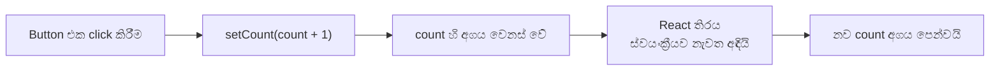
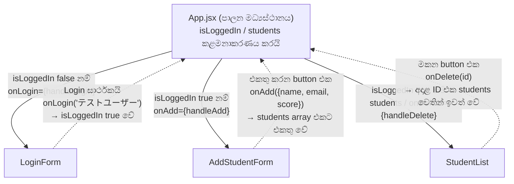

# 16 වන පාඩම｜React මූලික කරුණු — Component・JSX・props・useState

> 🇯🇵 මුල් පිටපත (ජපන් භාෂාවෙන්): [2026_06_11.md](<../../../2年生_システム開発実践/前期/2026_06_11/2026_06_11.md>) <!-- original-ja-link -->

## අද දවසේ ඉලක්ක
- JSX ලියන ආකාරය තේරුම් ගැනීම
- Component හදලා භාවිතා කිරීමට හැකි වීම
- `props` මගින් දත්ත යැවීමට හැකි වීම
- `useState` මගින් state කළමනාකරණය කිරීමට හැකි වීම

> **මෙම පාඩමේ ස්ථානය：** ඊළඟ පාඩමේ Next.js සඳහා "පදනම" ලෙස මෙය ඉගෙන ගනිමු.  
> ඉලක්කය වන්නේ "JSX යනු කුමක්ද, අපි Component වලට බෙදන්නේ ඇයි" යන්න තේරුම් ගැනීමයි.

---

## 0. React පරිසරය සකස් කිරීම (මුලින් එක් වරක් පමණයි!)

### 0-1. Node.js ස්ථාපනය කර ඇත්දැයි පරීක්ෂා කිරීම

මුලින්ම **Node.js** ස්ථාපනය කර තිබේදැයි පරීක්ෂා කරමු.  
Terminal එකේ (VSCode Terminal එකේ) පහත command එක run කරන්න.

```bash
node -v
```

Version එක පෙන්වනවා නම් හරි (උදා: `v20.11.0`).  
`command not found` ලෙස පෙන්වුවහොත්, මුලින්ම Node.js ස්ථාපනය කරන්න.

> **Node.js ස්ථාපනය：** https://nodejs.org/ වෙතින් **LTS version එක** (නිර්දේශිත version එක) download කරගන්න

---

### 0-2. React project එකක් සෑදීම (Vite භාවිතයෙන්)

Terminal එකේ **project එක සෑදීමට අවශ්‍ය folder එකට** ගිහින්, පහත command එක run කරන්න.

```bash
npm create vite@latest my-app -- --template react
```

> `my-app` කොටස project එකේ නමයි. ඔබට කැමති නමකට වෙනස් කළ හැකියි (උදා: `react-practice`)

Run කළ විට පහත පණිවිඩ පෙන්වයි. Enter ඔබලා ඉදිරියට යන්න.

```
✔ Select a framework: › React
✔ Select a variant: › JavaScript
```

---

### 0-3. අවශ්‍ය package ස්ථාපනය කර ආරම්භ කිරීම

Project එක සෑදූ පසු, පහත අනුපිළිවෙළට command run කරන්න.

```bash
# ① සෑදූ folder එකට යන්න
cd my-app

# ② අවශ්‍ය package සියල්ල එකවර ස්ථාපනය කරන්න
npm install

# ③ Development server එක ආරම්භ කරන්න
npm run dev
```

Terminal එකේ පහත ආකාරයේ දෙයක් පෙන්වුවහොත් සාර්ථකයි!

```
  VITE v5.x.x  ready in xxx ms

  ➜  Local:   http://localhost:5173/
```

Browser එකේ `http://localhost:5173/` විවෘත කළ විට React sample තිරය පෙන්වයි.

> **Server එක නවත්වන්න：** Terminal එකේ `Ctrl + C` ඔබන්න

---

### 0-4. Folder ව්‍යුහය බලමු

```
my-app/
├── public/          # රූප වැනි static file තබන ස්ථානය
├── src/             # ← ප්‍රධාන වශයෙන් සංස්කරණය කරන්නේ මෙහියි!
│   ├── App.jsx      # ප්‍රධාන Component එක (මුලින්ම වැඩ කරන file එක)
│   ├── App.css      # App.jsx සඳහා style
│   ├── main.jsx     # App එක ආරම්භ වන ස්ථානය (සාමාන්‍යයෙන් වෙනස් කරන්නේ නැහැ)
│   └── index.css    # සම්පූර්ණ App එකේම style
├── index.html       # App එකේ HTML template එක
└── package.json     # Project සැකසුම් සහ භාවිතා කරන package ලැයිස්තුව
```

**මුලින්ම සංස්කරණය කරන්න අවශ්‍ය වන්නේ `src/App.jsx` පමණයි!**

---

### 0-5. App.jsx වෙනස් කර බලමු

`src/App.jsx` විවෘත කර, ඇතුළත ඇති සියල්ල මකා දමා පහත code එකෙන් ප්‍රතිස්ථාපනය කරන්න.

```jsx
function App() {
  return (
    <div>
      <h1>はじめての React！</h1>
      <p>環境構築できました！</p>
    </div>
  );
}

export default App;
```

Save කළ විට browser එක ස්වයංක්‍රීයව update වේ (Hot Reload).  
「はじめての React！」 (මගේ පළමු React!) ලෙස පෙන්වුවහොත් සූදානම් වීම අවසන්!

---

## 1. React යනු කුමක්ද

**React = UI එක Component (කොටස්) භාවිතයෙන් සාදන JavaScript library එකකි**

```
සාම්ප්‍රදායික HTML + JavaScript：
  <div id="app"></div>
  document.getElementById("app").innerHTML = "...";
  → පිටු වැඩි වන විට කළමනාකරණය අපහසුයි

React：
  <Button label="送信" />  ← නැවත භාවිතා කළ හැකි කොටසක්
  <Card title="タイトル" body="内容" />
  → කොටස් එකතු කර පිටුව සාදයි
```

---

## 2. JSX — JavaScript ඇතුළේ HTML ලිවීම

> **භාවිතා කරන්නේ කවදාද?** HTML පමණක් භාවිතා කරලා variable එකක අගය කෙලින්ම ලියන්න බැහැ. JSX භාවිතා කළොත් `{variable_නම}` ලෙස ලියා අගයන් තත්‍ය කාලීනව ඇතුළත් කළ හැකියි. පරිශීලක නම, දිනය, ගණනය කළ ප්‍රතිඵල වැනි "වෙනස් වන අගයන්" පෙන්වන්න ඕන වෙලාවට මෙය භාවිතා කරනවා.  
> **පරීක්ෂා කළ යුතු දේ：** `namae` ඔබේ නමට වෙනස් කර save කරන්න → තිරය ස්වයංක්‍රීයව update වේදැයි බලන්න. `{1 + 1}` එක `2` ලෙස පෙන්වනවාදැයි බලන්න.

```jsx
// ▼ src/App.jsx හි ලියා බලමු (file එකේ ඇති සියල්ල මකා පහත code එක ලියන්න)

// JSX = JavaScript + XML (HTML වැනි ලිවීමේ ක්‍රමයක්)

// සාමාන්‍ය function එකක් (Component)
function Hello() {
  // JSX return කරයි
  return (
    <div>
      <h1>こんにちは！</h1>
      <p>React を始めよう</p>
    </div>
  );
}

// JavaScript expression {} තුළ ඇතුළත් කරයි
function Greeting() {
  const namae = "田中太郎";
  const today = new Date().toLocaleDateString("ja-JP");
  
  return (
    <div>
      <h1>こんにちは、{namae}さん！</h1>
      <p>今日は {today} です</p>
      <p>1 + 1 = {1 + 1}</p>
    </div>
  );
}

export default Greeting;
```

**JSX හි සැලකිලිමත් විය යුතු කරුණු：**

> **භාවිතා කරන්නේ කවදාද?** JSX ලියන විට error එකක් ආවොත්, බොහෝ විට හේතුව මෙම නීති 3න් එකකි. රතු error එකක් පෙන්වුවොත් මෙතැනට ඇවිත් සසඳා බලන්න.

```jsx
// ▼ ලිවීමේ ක්‍රමය පිළිබඳ සටහනක් (මෙය තනියම run වෙන්නේ නැහැ, කියවා මතක තබාගන්න)

// ① class වෙනුවට className (class යනු JS හි reserved word එකකි)
<div className="container">

// ② සියලු element වසා දැමිය යුතුයි
<input type="text" />  // Self-closing tag

// ③ Element කිහිපයක් එක parent element එකක් තුළ ඔතන්න
return (
  <div>
    <h1>タイトル</h1>
    <p>内容</p>
  </div>
);
// නැතහොත් Fragment (<></>) භාවිතා කරන්න
return (
  <>
    <h1>タイトル</h1>
    <p>内容</p>
  </>
);
```

---

## 3. props — Component එකකට දත්ත යැවීම

> **භාවිතා කරන්නේ කවදාද?** එකම design එකෙන් "දත්ත පමණක් වෙනස්" card හෝ පේළි කිහිපයක් පෙන්වන්න ඕන වෙලාවට. Component එකක් එක් වරක් ලිව්වොත්, යවන දත්ත වෙනස් කිරීමෙන් පමණක් ඕනෑම වාර ගණනක් නැවත භාවිතා කළ හැකියි.  
> **පරීක්ෂා කළ යුතු දේ：** `passed={false}` ඇති StudentCard හි පසුබිම් වර්ණය තැඹිලි පැහැයට හුරු වේදැයි බලන්න. 4 වන `<StudentCard>` එක ඔබම එකතු කර බලන්න.

```jsx
// ▼ src/App.jsx හි ලියා බලමු (file එකේ ඇති සියල්ල මකා පහත code එක ලියන්න)

// props = Component එකට දෙන "argument"

// Component අර්ථ දැක්වීම (props ලබා ගනී)
function StudentCard({ name, score, passed }) {
  return (
    <div style={{
      border: "1px solid #ddd",
      padding: "16px",
      margin: "8px",
      backgroundColor: passed ? "#e3f2fd" : "#fbe9e7"
    }}>
      <h3>{name}</h3>
      <p>点数: {score}点</p>
      <span>{passed ? "✅ 合格" : "❌ 不合格"}</span>
    </div>
  );
}

// භාවිතා කරන ආකාරය (Parent Component)
function App() {
  return (
    <div>
      <StudentCard name="田中太郎" score={85} passed={true} />
      <StudentCard name="鈴木花子" score={45} passed={false} />
      <StudentCard name="山田次郎" score={91} passed={true} />
    </div>
  );
}

export default App;
```

---

## 4. useState — State කළමනාකරණය

> **භාවිතා කරන්නේ කවදාද?** Button click කිරීම, input කිරීම, තේරීම වැනි "පරිශීලක ක්‍රියා නිසා වෙනස් වන අගයන්" එවෙලේම තිරයේ පෙන්වන්න ඕන වෙලාවට. `count` වැනි "වෙනස් වන අගයන්" සැමවිටම `useState` මගින් කළමනාකරණය කරන්න. සාමාන්‍ය variable එකකින් (`let count = 0`) තිරය update වෙන්නේ නැහැ.  
> **පරීක්ෂා කළ යුතු දේ：** `+1` පස් වරක් ඔබා අංකය වැඩි වේදැයි බලන්න. `リセット` (Reset) ඔබා 0 ට නැවත යනවාදැයි බලන්න. පිටුව reload නොවන බවත් බලන්න.

```jsx
// ▼ src/App.jsx හි ලියා බලමු (file එකේ ඇති සියල්ල මකා පහත code එක ලියන්න)
import { useState } from "react";

function Counter() {
  // useState(ආරම්භක අගය) → [වත්මන් අගය, අගය වෙනස් කරන function එක]
  const [count, setCount] = useState(0);
  
  return (
    <div>
      <p>カウント: {count}</p>
      
      {/* Button එක ඔබන සෑම වරකම count වැඩි වේ */}
      <button onClick={() => setCount(count + 1)}>+1</button>
      <button onClick={() => setCount(count - 1)}>-1</button>
      <button onClick={() => setCount(0)}>リセット</button>
    </div>
  );
}

export default Counter;
```

`setCount` call කළ විට React තිරය නැවත අඳින ක්‍රියාවලිය රූප සටහනකින් පෙන්වුවොත් මෙලෙසයි.



---

## 5. List rendering

> **භාවිතා කරන්නේ කවදාද?** නිෂ්පාදන ලැයිස්තුව, සිසුන් ලැයිස්තුව, comment කොටස වැනි "array දත්ත නැවත නැවත පෙන්වන්න" ඕන වෙලාවට නිතරම භාවිතා කරන රටාවකි. දත්ත වැඩි වන විට පෙන්වන දේද ස්වයංක්‍රීයව වැඩි වේ.  
> **පරීක්ෂා කළ යුතු දේ：** `students` array එකට 4 වන සිසුවෙකු එකතු කර බලන්න → `<li>` ස්වයංක්‍රීයව වැඩි වේදැයි බලන්න. `key={student.id}` මකා දැමූ විට browser console එකේ (F12) warning එකක් පෙන්වන බවත් පරීක්ෂා කර බලන්න.

```jsx
// ▼ src/App.jsx හි ලියා බලමු (file එකේ ඇති සියල්ල මකා පහත code එක ලියන්න)
function StudentList() {
  const students = [
    { id: 1, name: "田中太郎", score: 85 },
    { id: 2, name: "鈴木花子", score: 72 },
    { id: 3, name: "山田次郎", score: 91 },
  ];
  
  return (
    <ul>
      {/* Array එකේ map මගින් element සාදයි */}
      {/* key යනු React හට වෙනස්කම් හඳුනා ගැනීමට අවශ්‍ය දෙයකි (loop එක තුළ සැමවිටම දෙන්න) */}
      {students.map((student) => (
        <li key={student.id}>
          {student.name} - {student.score}点
        </li>
      ))}
    </ul>
  );
}

export default StudentList;
```

---

## 6. Form සහ Event

> **භාවිතා කරන්නේ කවදාද?** සෙවීම, login වීම, දත්ත ඇතුළත් කිරීම වැනි "පරිශීලකයා ඇතුළත් කළ අගය ලබාගෙන සකසන්න" ඕන වෙලාවට. `onChange` මගින් input වෙනස් වන සෑම වරකම state update කර, `onSubmit` මගින් button එක එබූ විට කළ යුතු වැඩ කරයි.  
> **පරීක්ෂා කළ යුතු දේ：** යමක් ඇතුළත් කර 「検索」 (සොයන්න) ඔබා ප්‍රතිඵල පාඨය පෙන්වේදැයි බලන්න. `e.preventDefault()` comment out කර (`//` එකතු කර) submit කරන විට පිටුව reload වන බවත් පරීක්ෂා කර බලන්න.

```jsx
// ▼ src/App.jsx හි ලියා බලමු (file එකේ ඇති සියල්ල මකා පහත code එක ලියන්න)
import { useState } from "react";

function SearchForm() {
  const [query, setQuery] = useState("");
  const [result, setResult] = useState(null);
  
  function handleSubmit(e) {
    e.preventDefault();  // පිටුව reload වීම වළක්වයි
    setResult(`"${query}" を検索しました`);
  }
  
  return (
    <form onSubmit={handleSubmit}>
      <input
        type="text"
        value={query}
        onChange={(e) => setQuery(e.target.value)}
        // onChange = input වෙනස් වන සෑම වරකම setQuery මගින් state update කරයි
        placeholder="検索キーワード"
      />
      <button type="submit">検索</button>
      {result && <p>{result}</p>}
    </form>
  );
}

export default SearchForm;
```

---

## 7. ප්‍රායෝගික අභ්‍යාසය — Mock දත්ත භාවිතයෙන් සිසු කළමනාකරණ App එකක් සාදමු

මෙතෙක් ඉගෙනගත් JSX・Component・props・useState සියල්ලම භාවිතා කර,  
**"සිසු කළමනාකරණ App එකක්"** සාදමු.

> **Mock යනු කුමක්ද?**  
> සැබෑ API එක වෙනුවට, code එක තුළම ලියූ දත්ත භාවිතා කිරීමයි.  
> මෙය "API නොමැතිව තිරය සෑදීමේ පුහුණුවකි".  
> ඊළඟ පාඩමේදී (Next.js) මෙම තිරයම සැබෑ API එකට සම්බන්ධ කරනවා.

---

### 7-1. අවසාන ප්‍රතිඵලයේ රූපය

```
【ログイン前】
┌──────────────────────────┐
│  ログイン                 │
│                          │
│  [メールアドレス        ] │
│  [パスワード            ] │
│  [    ログイン          ] │
│                          │
│  ※ test@example.com     │
│     / password           │
└──────────────────────────┘

【ログイン後】
┌──────────────────────────────────────────────────┐
│ 生徒管理アプリ（React Mock版） ● ログイン中  [ログアウト] │
├──────────────────────────────────────────────────┤
│ 新規追加                                          │
│ [名前] [メールアドレス] [点数] [追加]               │
├──────────────────────────────────────────────────┤
│ 生徒一覧（3件）                                    │
│ ID │ 名前     │ メール              │ 点数 │      │
│  1 │ 田中太郎 │ tanaka@example.com │  85  │ 削除 │
│  2 │ 山田花子 │ yamada@example.com │  72  │ 削除 │
└──────────────────────────────────────────────────┘
```

---

### 7-2. File ව්‍යුහය

`src/` තුළ `components/` folder එකක් සාදා, Component වෙන් කරමු.

```
src/
├── App.jsx                      ← ප්‍රධාන file එක (state සියල්ල එක තැනක කළමනාකරණය කරයි)
├── components/
│   ├── LoginForm.jsx            ← Login form එක
│   ├── StudentList.jsx          ← සිසු ලැයිස්තු table එක
│   └── AddStudentForm.jsx       ← සිසුන් එකතු කරන form එක
└── main.jsx                     ← වෙනස් කරන්න එපා
```

VSCode හි `src/` folder එක මත right-click → `New Folder` → `components` ලෙස ටයිප් කර Enter ඔබන්න.

---

### 7-3. Step 1｜LoginForm.jsx සෑදීම

`src/components/LoginForm.jsx` අලුතින් සාදා, පහත code එක copy කර paste කරන්න.

```jsx
import { useState } from "react";

// Mock සඳහා ස්ථාවර login තොරතුරු (සැබෑ API එක වෙනුවට)
const MOCK_EMAIL = "test@example.com";
const MOCK_PASSWORD = "password";
const MOCK_NAME = "テストユーザー";

// onLogin = login සාර්ථක වූ විට call කිරීමට App.jsx මගින් ලබා දෙන function එක
function LoginForm({ onLogin }) {
  const [email, setEmail] = useState("test@example.com");
  const [password, setPassword] = useState("password");
  const [error, setError] = useState("");

  function handleSubmit(e) {
    e.preventDefault(); // පිටුව reload වීම වළක්වයි

    // ඇතුළත් කළ අගයන් mock තොරතුරු සමඟ ගැළපේ නම් login සාර්ථකයි
    if (email === MOCK_EMAIL && password === MOCK_PASSWORD) {
      onLogin(MOCK_NAME); // Parent Component එකට පරිශීලක නම යවයි
    } else {
      setError("メールアドレスまたはパスワードが違います");
    }
  }

  return (
    <div style={{
      maxWidth: "400px", margin: "80px auto",
      background: "white", padding: "32px",
      borderRadius: "8px", boxShadow: "0 2px 8px rgba(0,0,0,0.1)"
    }}>
      <h2 style={{ marginBottom: "24px", textAlign: "center" }}>ログイン</h2>

      <form onSubmit={handleSubmit}>
        <div style={{ marginBottom: "16px" }}>
          <label style={{ display: "block", marginBottom: "6px", fontWeight: "bold" }}>
            メールアドレス
          </label>
          <input
            type="email"
            value={email}
            onChange={(e) => setEmail(e.target.value)}
            style={{ width: "100%", padding: "10px", border: "1px solid #ccc", borderRadius: "6px", fontSize: "1em", boxSizing: "border-box" }}
          />
        </div>

        <div style={{ marginBottom: "16px" }}>
          <label style={{ display: "block", marginBottom: "6px", fontWeight: "bold" }}>
            パスワード
          </label>
          <input
            type="password"
            value={password}
            onChange={(e) => setPassword(e.target.value)}
            style={{ width: "100%", padding: "10px", border: "1px solid #ccc", borderRadius: "6px", fontSize: "1em", boxSizing: "border-box" }}
          />
        </div>

        {/* error හිස් නොවේ නම් පමණක් error එක පෙන්වයි */}
        {error && (
          <p style={{ color: "#D32F2F", fontSize: "0.9em", marginBottom: "12px" }}>
            {error}
          </p>
        )}

        <button
          type="submit"
          style={{ width: "100%", padding: "12px", background: "#1976D2", color: "white", border: "none", borderRadius: "6px", fontSize: "1em", fontWeight: "bold", cursor: "pointer" }}
        >
          ログイン
        </button>
      </form>

      <p style={{ marginTop: "16px", fontSize: "0.85em", color: "#888", textAlign: "center" }}>
        ※ Mock用: test@example.com / password
      </p>
    </div>
  );
}

export default LoginForm;
```

---

### 7-4. Step 2｜StudentList.jsx සෑදීම

`src/components/StudentList.jsx` අලුතින් සාදා, පහත code එක copy කර paste කරන්න.

```jsx
// StudentList：සිසු ලැයිස්තුවේ සම්පූර්ණ table එක
// students = සිසු දත්ත array එක (parent එකෙන් ලැබේ)
// onDelete = මකන button එක එබූ විට call කරන function එක (parent එකෙන් ලැබේ)
function StudentList({ students, onDelete }) {
  return (
    <div style={{ background: "white", borderRadius: "8px", padding: "24px", boxShadow: "0 2px 8px rgba(0,0,0,0.05)" }}>
      <h2 style={{ marginBottom: "16px", fontSize: "1.1em" }}>
        生徒一覧
        <span style={{ color: "#888", fontWeight: "normal", fontSize: "0.85em" }}>
          （{students.length}件）
        </span>
      </h2>

      {/* සිසුන් 0 දෙනෙකු නම් "ලියාපදිංචි කර නැත" පණිවිඩය පෙන්වයි */}
      {students.length === 0 ? (
        <p style={{ color: "#888", textAlign: "center", padding: "24px" }}>
          生徒が登録されていません
        </p>
      ) : (
        <table style={{ width: "100%", borderCollapse: "collapse" }}>
          <thead>
            <tr style={{ background: "#f5f5f5" }}>
              <th style={thStyle}>ID</th>
              <th style={thStyle}>名前</th>
              <th style={thStyle}>メール</th>
              <th style={thStyle}>点数</th>
              <th style={thStyle}></th>
            </tr>
          </thead>
          <tbody>
            {/* Array එකේ සෑම සිසුවෙකුම StudentRow Component එකෙන් පෙන්වයි */}
            {students.map((student) => (
              <StudentRow
                key={student.id}
                student={student}
                onDelete={onDelete}
              />
            ))}
          </tbody>
        </table>
      )}
    </div>
  );
}

// StudentRow：table එකේ එක් පේළියක්
function StudentRow({ student, onDelete }) {
  function handleDelete() {
    // තහවුරු කිරීමේ dialog එක පෙන්වා පසුව මකයි
    if (window.confirm(`${student.name} を削除しますか？`)) {
      onDelete(student.id); // Parent එකට "මෙම ID එක මකන්න" කියා දන්වයි
    }
  }

  return (
    <tr style={{ borderBottom: "1px solid #eee" }}>
      <td style={tdStyle}>{student.id}</td>
      <td style={tdStyle}>{student.name}</td>
      <td style={tdStyle}>{student.email}</td>
      <td style={tdStyle}>{student.score}</td>
      <td style={tdStyle}>
        <button
          onClick={handleDelete}
          style={{ background: "#D32F2F", color: "white", border: "none", borderRadius: "4px", padding: "4px 12px", cursor: "pointer", fontSize: "0.85em" }}
        >
          削除
        </button>
      </td>
    </tr>
  );
}

// Style constant (නැවත නැවත භාවිතා කරන style එක තැනකට එකතු කරයි)
const thStyle = { padding: "10px 16px", textAlign: "left", fontWeight: "bold", fontSize: "0.9em" };
const tdStyle = { padding: "12px 16px", fontSize: "0.95em" };

export default StudentList;
```

---

### 7-5. Step 3｜AddStudentForm.jsx සෑදීම

`src/components/AddStudentForm.jsx` අලුතින් සාදා, පහත code එක copy කර paste කරන්න.

```jsx
import { useState } from "react";

// onAdd = එකතු කරන button එක එබූ විට call කරන function එක (parent එකෙන් ලැබේ)
function AddStudentForm({ onAdd }) {
  const [name, setName] = useState("");
  const [email, setEmail] = useState("");
  const [score, setScore] = useState("");
  const [error, setError] = useState("");

  function handleSubmit(e) {
    e.preventDefault();
    setError(""); // Error එක reset කරයි

    // Validation (ඇතුළත් කළ දත්ත පරීක්ෂාව)
    if (!name || !email || !score) {
      setError("すべての項目を入力してください");
      return;
    }
    if (Number(score) < 0 || Number(score) > 100) {
      setError("点数は0〜100の数値を入力してください");
      return;
    }

    // Parent Component එකට නව සිසු දත්ත යවයි
    onAdd({ name, email, score: Number(score) });

    // Form එක reset කරයි
    setName("");
    setEmail("");
    setScore("");
  }

  return (
    <div style={{ background: "white", borderRadius: "8px", padding: "24px", boxShadow: "0 2px 8px rgba(0,0,0,0.05)", marginBottom: "24px" }}>
      <h2 style={{ marginBottom: "16px", fontSize: "1.1em" }}>新規追加</h2>

      <form onSubmit={handleSubmit} style={{ display: "flex", gap: "12px", alignItems: "flex-end", flexWrap: "wrap" }}>
        <div>
          <label style={labelStyle}>名前</label>
          <input
            type="text"
            value={name}
            onChange={(e) => setName(e.target.value)}
            placeholder="田中太郎"
            style={inputStyle}
          />
        </div>
        <div>
          <label style={labelStyle}>メールアドレス</label>
          <input
            type="email"
            value={email}
            onChange={(e) => setEmail(e.target.value)}
            placeholder="tanaka@example.com"
            style={inputStyle}
          />
        </div>
        <div>
          <label style={labelStyle}>点数</label>
          <input
            type="number"
            value={score}
            onChange={(e) => setScore(e.target.value)}
            placeholder="85"
            min="0"
            max="100"
            style={{ ...inputStyle, width: "80px" }}
          />
        </div>
        <button
          type="submit"
          style={{ padding: "10px 20px", background: "#1976D2", color: "white", border: "none", borderRadius: "6px", fontWeight: "bold", cursor: "pointer", fontSize: "0.95em" }}
        >
          追加
        </button>
      </form>

      {error && (
        <p style={{ color: "#D32F2F", marginTop: "10px", fontSize: "0.9em" }}>{error}</p>
      )}
    </div>
  );
}

const labelStyle = { display: "block", marginBottom: "4px", fontSize: "0.85em", fontWeight: "bold" };
const inputStyle = { padding: "9px 12px", border: "1px solid #ccc", borderRadius: "6px", fontSize: "0.95em", width: "180px" };

export default AddStudentForm;
```

---

### 7-6. Step 4｜App.jsx හි සියල්ල සම්බන්ධ කිරීම

`src/App.jsx` විවෘත කර, **ඇතුළත ඇති සියල්ල මකා** පහත code එකෙන් ප්‍රතිස්ථාපනය කරන්න.

```jsx
import { useState } from "react";
import LoginForm from "./components/LoginForm";
import StudentList from "./components/StudentList";
import AddStudentForm from "./components/AddStudentForm";

// මුල සිටම පෙන්වන mock දත්ත
const INITIAL_STUDENTS = [
  { id: 1, name: "田中太郎", email: "tanaka@example.com", score: 85 },
  { id: 2, name: "山田花子", email: "yamada@example.com", score: 72 },
  { id: 3, name: "山田次郎", email: "jiro@example.com", score: 91 },
];

function App() {
  // Login තත්ත්වය කළමනාකරණය කරයි
  const [isLoggedIn, setIsLoggedIn] = useState(false);
  const [userName, setUserName] = useState("");

  // සිසු ලැයිස්තුව කළමනාකරණය කරයි
  const [students, setStudents] = useState(INITIAL_STUDENTS);
  const [nextId, setNextId] = useState(4); // ඊළඟට එකතු කරන සිසුවාගේ ID එක

  // Login සාර්ථක වූ විට：LoginForm මගින් call කරයි
  function handleLogin(name) {
    setIsLoggedIn(true);
    setUserName(name);
  }

  // Logout වන විට
  function handleLogout() {
    setIsLoggedIn(false);
    setUserName("");
  }

  // සිසුවෙකු එකතු කිරීම：AddStudentForm මගින් call කරයි
  function handleAdd(newStudent) {
    setStudents([...students, { ...newStudent, id: nextId }]);
    setNextId(nextId + 1);
  }

  // සිසුවෙකු මකා දැමීම：StudentList මගින් call කරයි
  function handleDelete(id) {
    setStudents(students.filter((s) => s.id !== id));
  }

  return (
    <div style={{ background: "#f4f6f8", minHeight: "100vh" }}>

      {/* Header එක */}
      <header style={{
        background: "#1565C0", color: "white",
        padding: "16px 32px",
        display: "flex", alignItems: "center"
      }}>
        <h1 style={{ fontSize: "1.2em" }}>生徒管理アプリ（React Mock版）</h1>

        {/* Login වී ඇති විට පමණක් header එකේ දකුණු පැත්තේ පරිශීලක නම සහ logout button එක පෙන්වයි */}
        {isLoggedIn && (
          <div style={{ marginLeft: "auto", display: "flex", alignItems: "center", gap: "12px" }}>
            <span style={{ fontSize: "0.9em" }}>● ログイン中：{userName}</span>
            <button
              onClick={handleLogout}
              style={{ background: "#D32F2F", color: "white", border: "none", borderRadius: "6px", padding: "6px 14px", cursor: "pointer" }}
            >
              ログアウト
            </button>
          </div>
        )}
      </header>

      {/* ප්‍රධාන අන්තර්ගතය */}
      <main style={{ padding: "32px", maxWidth: "900px", margin: "0 auto" }}>
        {/* isLoggedIn true නම් සිසු කළමනාකරණ තිරය, false නම් login තිරය */}
        {isLoggedIn ? (
          <>
            <AddStudentForm onAdd={handleAdd} />
            <StudentList students={students} onDelete={handleDelete} />
          </>
        ) : (
          <LoginForm onLogin={handleLogin} />
        )}
      </main>

    </div>
  );
}

export default App;
```

---

### 7-7. ක්‍රියාකාරිත්වය පරීක්ෂා කිරීම

Development server එක ආරම්භ කර browser එකේ පරීක්ෂා කරන්න.

```bash
npm run dev
```

`http://localhost:5173/` වෙත ගොස්, පහත දේ අනුපිළිවෙළට උත්සාහ කරන්න.

| පරීක්ෂා කරන දේ | ක්‍රියාව | අපේක්ෂිත ප්‍රතිඵලය |
|---------|------|------------|
| Login වීමට පෙර තිරය | පිටුව විවෘත කරන්න | Login form එක පෙන්වයි |
| Login සාර්ථක වීම | `test@example.com` / `password` මගින් login වන්න | Header එකේ 「ログイン中」 (Login වී ඇත) සහ සිසු ලැයිස්තුව පෙන්වයි |
| Login අසාර්ථක වීම | Password එක වෙනස් කර login වන්න | Error පණිවිඩයක් පෙන්වයි |
| සිසුවෙකු එකතු කිරීම | Form එක පුරවා 「追加」 (එකතු කරන්න) ඔබන්න | Table එකට නව පේළියක් එකතු වේ |
| සිසුවෙකු මකා දැමීම | 「削除」 (මකන්න) button එක ඔබන්න | තහවුරු කිරීමේ dialog එක → OK එබූ විට පේළිය මැකේ |
| සිසුන් 0 දෙනෙකු සිටින විට | සියලු දෙනා මකා දමන්න | 「生徒が登録されていません」 (සිසුන් ලියාපදිංචි කර නැත) පෙන්වයි |
| Logout වීම | 「ログアウト」 (Logout) button එක ඔබන්න | Login form එකට නැවත යයි |

---

### 7-8. Code එකේ ගලායාම සංවිධානය කිරීම

පහත රූප සටහනේ ඝන ඊතල මගින් "Parent → Child වෙත props යැවීම" ද, තිත් ඊතල මගින් "Child විසින් Parent එකේ function එක call කර state වෙනස් කිරීම" ද පෙන්වයි.



> **වැදගත් කරුණ：** දත්ත (state) `App.jsx` මගින් එක තැනක කළමනාකරණය කර,  
> Child Component වලට "දත්ත" සහ "ඒවා වෙනස් කරන function" props මගින් යැවීම React හි මූලික රටාවයි.

---

### 7-9. Next.js සමඟ වෙනස (ඊළඟ පාඩම සඳහා පෙර සූදානම)

| | React (මෙම පාඩම) | Next.js (ඊළඟ පාඩම) |
|--|--|--|
| දත්ත ලබා ගැනීම | Code එක තුළ ඇති Mock array එක | `fetch('/api/students')` මගින් Laravel API එකෙන් ලබා ගනී |
| Login | ස්ථාවර අගයන් සමඟ සසඳයි | `POST /api/login` මගින් token එක ලබා ගනී |
| මකා දැමීම | Array එක filter කර update කරයි | `DELETE /api/students/{id}` call කර නැවත දත්ත ලබා ගනී |
| තිරයේ පෙනුම | **සම්පූර්ණයෙන්ම එකමයි** | **සම්පූර්ණයෙන්ම එකමයි** |

ඊළඟ පාඩමේදී **මෙවර සෑදූ තිරයම එලෙසම භාවිතා කර**, දත්ත ලබා ගන්නා කොටස පමණක් API එකට සම්බන්ධ කරනවා.

---

## සාරාංශය

| සංකල්පය | විස්තරය |
|------|------|
| Component | UI හි නැවත භාවිතා කළ හැකි කොටසකි. Function එකක් ලෙස අර්ථ දක්වයි |
| JSX | JavaScript තුළ HTML වැනි ලිවීමේ ක්‍රමයකින් UI ලියයි |
| props | Parent Component එකෙන් Child Component එකට දත්ත යවයි |
| useState | Component එක තුළ state කළමනාකරණය කරයි |
| key | ලැයිස්තුවක් පෙන්වන විට එක් එක් element හඳුනා ගැනීමට භාවිතා කරන attribute එකකි |

---

## ඊළඟ පාඩම (17 වන පාඩම) පිළිබඳ පෙරදසුන

Next.js හැඳින්වීමයි.  
React දැනුම භාවිතා කරමින්, App Router・පිටු ව්‍යුහය・File-based routing ඉගෙන ගනිමු.
