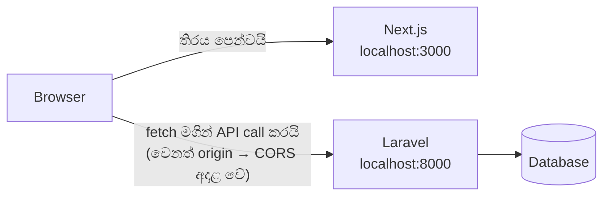
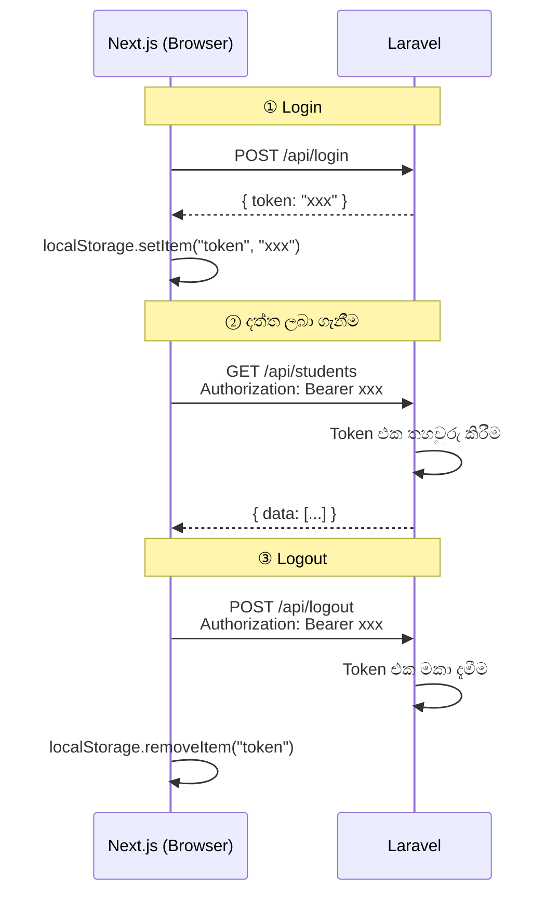

# 17〜22 වන පාඩම｜Next.js හැඳින්වීම → Laravel API එකට සම්බන්ධ කිරීම

> 🇯🇵 මුල් පිටපත (ජපන් භාෂාවෙන්): [2026_07_02.md](<../../../2年生_システム開発実践/前期/2026_07_02/2026_07_02.md>) <!-- original-ja-link -->

---

## 17 වන පාඩම：Mock version එක API එකට සම්බන්ධ කිරීම

### අද දවසේ ඉලක්ක
- Next.js project එකක් සෑදීමට හැකි වීම
- App Router ක්‍රියා කරන ආකාරය තේරුම් ගැනීම
- 16 වන පාඩමේදී සෑදූ Mock version එකේ තිරය, සැබෑ Laravel API එකට සම්බන්ධ කිරීමට හැකි වීම

> **අද දවසේ වැදගත් කරුණ：**  
> 16 වන පාඩමේදී සෑදූ Component (LoginForm・StudentList・AddStudentForm)  
> **බොහෝ දුරට එලෙසම භාවිතා කළ හැකියි.** වෙනස් වන්නේ දත්ත ලබා ගන්නා ආකාරය පමණයි.

---

### 0. Mock version එක සහ API version එක අතර වෙනස බලමු

| | 16 වන පාඩම (Mock version・React) | 17 වන පාඩම (API version・Next.js) |
|--|--|--|
| දත්ත ලබා ගැනීම | Code එක තුළ ඇති ස්ථාවර array එක | `fetch()` මගින් Laravel API එකෙන් ලබා ගනී |
| Login | ස්ථාවර අගයන් සමඟ සසඳයි | `POST /api/login` මගින් token එක ලබා ගනී |
| සිසුවෙකු එකතු කිරීම | Array එකට එකතු කරයි | `POST /api/students` call කරයි |
| සිසුවෙකු මකා දැමීම | Array එකෙන් ඉවත් කරයි | `DELETE /api/students/{id}` call කරයි |
| තිරයේ පෙනුම | **සම්පූර්ණයෙන්ම එකමයි** | **සම්පූර්ණයෙන්ම එකමයි** |

---

### 1. Next.js project එකක් සෑදීම

#### 1-1. ස්ථාපනය

Terminal එකේ පහත command එක run කරන්න (`my-app` එකට **වෙනස් folder එකක** සාදන්න).

```bash
npx create-next-app@latest school-frontend
```

සමහර විට ප්‍රශ්න කිහිපයක් අසනු ඇත. ප්‍රශ්න ආවොත්, පහත ආකාරයට පිළිතුරු දෙන්න.

```
Would you like to use TypeScript?             → Yes  ← TypeScript භාවිතා කරයි
Would you like to use ESLint?                 → Yes
Would you like to use Tailwind CSS?           → Yes  ← ස්ථාපනය කර තබාගනී
Would you like your code inside a src/ dir?   → No   ← app/ folder එක root එකේම තබයි
Would you like to use App Router?             → Yes
Would you like to use Turbopack?              → No
Would you like to customize the import alias? → No
```

> **TypeScript ගැන**  
> File extension එක `.tsx` (TypeScript) වේ. මූලික code එක JavaScript වලට බොහෝ දුරට සමානයි.  
> Type ලිවීමට අවශ්‍ය තැන් ආ විට, එවෙලේම පැහැදිලි කරනවා.
>
> **Tailwind CSS ගැන**  
> ස්ථාපනය කළත්, මෙවර අපි inline style භාවිතා කරනවා. Tailwind ඉදිරි ඉගෙනීමේදී භාවිතා කළ හැකියි.

#### 1-2. ස්ථාපනය කර ආරම්භ කිරීම

```bash
# Project folder එකට යන්න
cd school-frontend

# Development server එක ආරම්භ කරන්න (create-next-app මගින් package ස්වයංක්‍රීයව ස්ථාපනය කර ඇත)
npm run dev
```

`http://localhost:3000` විවෘත කළ විට Next.js sample තිරය පෙන්වුවහොත් සාර්ථකයි.

---

### 2. Folder ව්‍යුහය බලමු

```
school-frontend/
├── app/                         ← පිටු file තබන ස්ථානය (Routing)
│   ├── layout.tsx               ← සියලු පිටු සඳහා පොදු HTML රාමුව
│   ├── page.tsx                 ← / වෙත ගිය විට පෙන්වන පිටුව
│   ├── login/
│   │   └── page.tsx             ← /login පිටුව
│   └── students/
│       └── page.tsx             ← /students පිටුව
├── components/                  ← 16 වන පාඩමේ තිබූ ස්ථානයම
│   ├── LoginForm.tsx
│   ├── StudentList.tsx
│   └── AddStudentForm.tsx
└── package.json
```

**16 වන පාඩම සමඟ වෙනස：**

| 16 වන පාඩම (React + Vite) | 17 වන පාඩම (Next.js) |
|--|--|
| `src/App.jsx` ප්‍රධාන file එකයි | `app/page.tsx` මුල් පිටුවයි |
| පිටුව එකක් පමණයි (SPA) | Folder = URL එක වේ (`login/page.tsx` → `/login`) |
| `index.html` මගින් ආරම්භ වේ | `layout.tsx` HTML රාමුව භාරව සිටී |

---

### 3. 16 වන පාඩමේ Component copy කිරීම

මුලින්ම `src/components/` folder එක සාදා, 16 වන පාඩමේදී සෑදූ file copy කරන්න.

```
school-frontend/components/ වෙත පහත file copy කරන්න：
  ├── LoginForm.tsx      ← 16 වන පාඩමේ LoginForm.jsx copy කරන්න (extension එක .tsx ලෙස වෙනස් කරන්න)
  ├── StudentList.tsx    ← 16 වන පාඩමේ StudentList.jsx copy කරන්න (extension එක .tsx ලෙස වෙනස් කරන්න)
  └── AddStudentForm.tsx ← 16 වන පාඩමේ AddStudentForm.jsx copy කරන්න (extension එක .tsx ලෙස වෙනස් කරන්න)
```

> **Extension ගැන**  
> TypeScript භාවිතා කරන නිසා, file extension එක `.tsx` (JSX අඩංගු file) ලෙස ඒකාකාරී කරනවා.  
> Code අන්තර්ගතය 16 වන පාඩමේ `.jsx` file වලින් බොහෝ දුරට එලෙසම copy කළ හැකියි.

Copy කළ සෑම file එකකම **පළමු පේළියේ** `"use client";` එකතු කරන්න.

```js
"use client";  // ← මෙම පේළිය එකතු කරන්න!
import { useState } from "react";
// ... මෙතැන් සිට 16 වන පාඩමේ code එක එලෙසම
```

> **`"use client"` යනු කුමක්ද?**  
> Next.js සාමාන්‍යයෙන් (default ලෙස) code එක server පැත්තේ run කරයි.  
> `useState` හෝ `onClick` වැනි "browser විශේෂාංග" භාවිතා කරන Component වල  
> මුලින්ම `"use client"` ලියා "මෙය browser එකේ run කරන්න" කියා දන්වනවා.

---

### 4. layout.js වෙනස් කිරීම

`app/layout.tsx` විවෘත කර, ඇතුළත ඇති සියල්ල මකා පහත code එකෙන් ප්‍රතිස්ථාපනය කරන්න.

```tsx
export const metadata = {
  title: "生徒管理アプリ",
};

export default function RootLayout({
  children,
}: {
  children: React.ReactNode;
}) {
  return (
    <html lang="ja">
      <body style={{ margin: 0, fontFamily: "sans-serif", background: "#f4f6f8" }}>
        {children}
      </body>
    </html>
  );
}
```

> **`{ children }: { children: React.ReactNode }` යනු කුමක්ද?**  
> මෙය TypeScript type අර්ථ දැක්වීමකි. "children තුළ React element එකක් ඇතුළත් වේ" කියා දන්වයි.  
> `React.ReactNode` යනු "JSX, string ආදී React හට පෙන්විය හැකි ඕනෑම දෙයක්" යන්නයි.

---

### 5. මුල් පිටුව (/) login පිටුවට redirect කිරීම

`app/page.tsx` විවෘත කර, ඇතුළත ඇති සියල්ල මකා පහත code එකෙන් ප්‍රතිස්ථාපනය කරන්න.

```tsx
import { redirect } from "next/navigation";

// / වෙත ගිය විට ස්වයංක්‍රීයව /login වෙත යවයි
export default function Home() {
  redirect("/login");
}
```

---

### 6. Login පිටුව සෑදීම (/login)

`app/login/` folder එක සාදා, `page.tsx` අලුතින් සාදන්න.

```
app/login/page.tsx  ← අලුතින් සාදන්න
```

පහත code එක copy කර paste කරන්න.

```tsx
"use client";

import { useState } from "react";
import { useRouter } from "next/navigation";

export default function LoginPage() {
  const router = useRouter(); // පිටු මාරු කිරීමට භාවිතා කරයි
  const [email, setEmail] = useState("test@example.com");
  const [password, setPassword] = useState("password");
  const [error, setError] = useState("");
  const [loading, setLoading] = useState(false);

  async function handleSubmit(e) {
    e.preventDefault();
    setError("");
    setLoading(true);

    // ★ 16 වන පාඩම සමඟ වෙනස：ස්ථාවර අගය පරීක්ෂාව → සැබෑ API එක call කරයි
    const res = await fetch("http://localhost:8000/api/login", {
      method: "POST",
      headers: {
        "Content-Type": "application/json",
        "Accept": "application/json",
      },
      body: JSON.stringify({ email, password }),
    });

    const data = await res.json();
    setLoading(false);

    if (res.ok) {
      // ★ Token එක browser එකේ save කර තබයි
      localStorage.setItem("token", data.token);
      localStorage.setItem("userName", data.user?.name || "ユーザー");
      // /students පිටුවට යයි
      router.push("/students");
    } else {
      setError("メールアドレスまたはパスワードが違います");
    }
  }

  return (
    <div style={{
      maxWidth: "400px", margin: "80px auto",
      background: "white", padding: "32px",
      borderRadius: "8px", boxShadow: "0 2px 8px rgba(0,0,0,0.1)"
    }}>
      <h2 style={{ marginBottom: "24px", textAlign: "center" }}>ログイン</h2>

      <form onSubmit={handleSubmit}>
        <div style={{ marginBottom: "16px" }}>
          <label style={{ display: "block", marginBottom: "6px", fontWeight: "bold" }}>
            メールアドレス
          </label>
          <input
            type="email"
            value={email}
            onChange={(e) => setEmail(e.target.value)}
            style={{ width: "100%", padding: "10px", border: "1px solid #ccc", borderRadius: "6px", fontSize: "1em", boxSizing: "border-box" }}
          />
        </div>

        <div style={{ marginBottom: "16px" }}>
          <label style={{ display: "block", marginBottom: "6px", fontWeight: "bold" }}>
            パスワード
          </label>
          <input
            type="password"
            value={password}
            onChange={(e) => setPassword(e.target.value)}
            style={{ width: "100%", padding: "10px", border: "1px solid #ccc", borderRadius: "6px", fontSize: "1em", boxSizing: "border-box" }}
          />
        </div>

        {error && (
          <p style={{ color: "#D32F2F", fontSize: "0.9em", marginBottom: "12px" }}>
            {error}
          </p>
        )}

        <button
          type="submit"
          disabled={loading}
          style={{ width: "100%", padding: "12px", background: loading ? "#aaa" : "#1976D2", color: "white", border: "none", borderRadius: "6px", fontSize: "1em", fontWeight: "bold", cursor: loading ? "not-allowed" : "pointer" }}
        >
          {loading ? "ログイン中..." : "ログイン"}
        </button>
      </form>
    </div>
  );
}
```

**16 වන පාඩමේ `LoginForm.tsx` සමඟ වෙනස：**

| | 16 වන පාඩම (Mock) | 17 වන පාඩම (API) |
|--|--|--|
| සත්‍යාපන ක්‍රමය | ස්ථාවර අගයන් සමඟ සසඳයි | `fetch("http://localhost:8000/api/login")` |
| Login වූ පසු | `setIsLoggedIn(true)` | `localStorage.setItem("token", ...)` + පිටු මාරුව |
| පිටු මාරුව | Condition එකක් මගින් තිරය මාරු කරයි | `router.push("/students")` |

---

### 7. සිසු කළමනාකරණ පිටුව සෑදීම (/students)

`app/students/` folder එක සාදා, `page.tsx` අලුතින් සාදන්න.

```
app/students/page.tsx  ← අලුතින් සාදන්න
```

පහත code එක copy කර paste කරන්න.

```tsx
"use client";

import { useState, useEffect } from "react";
import { useRouter } from "next/navigation";
import StudentList from "@/components/StudentList";
import AddStudentForm from "@/components/AddStudentForm";

export default function StudentsPage() {
  const router = useRouter();
  const [students, setStudents] = useState([]);
  const [userName, setUserName] = useState("");
  const [loading, setLoading] = useState(true);
  const [addError, setAddError] = useState(""); // ← එකතු කිරීමේ error පෙන්වීම සඳහා

  // ★ useEffect：පිටුව පෙන්වූ විට එක් වරක් පමණක් run වේ
  useEffect(() => {
    const token = localStorage.getItem("token");

    // Token එකක් නැත්නම් login පිටුවට ආපසු යවයි
    if (!token) {
      router.push("/login");
      return;
    }

    setUserName(localStorage.getItem("userName") || "ユーザー");
    loadStudents(token);
  }, []); // [] = මුල් වරට එක් වරක් පමණක් run වේ

  // සිසු ලැයිස්තුව API එකෙන් ලබා ගනී
  async function loadStudents(token) {
    setLoading(true);

    const res = await fetch("http://localhost:8000/api/students", {
      headers: {
        "Accept": "application/json",
        "Authorization": `Bearer ${token}`, // ★ Token එක header එකට එකතු කරයි
      },
    });

    // 401 = Token එක වලංගු නැත → login පිටුවට ආපසු යවයි
    if (res.status === 401) {
      router.push("/login");
      return;
    }

    const data = await res.json();
    setStudents(data.data); // Laravel API එක { data: [...] } ආකාරයෙන් දත්ත ලබා දෙයි
    setLoading(false);
  }

  // සිසුවෙකු එකතු කරයි
  async function handleAdd(newStudent) {
    const token = localStorage.getItem("token");
    setAddError(""); // ← Error එක reset කරයි

    const res = await fetch("http://localhost:8000/api/students", {
      method: "POST",
      headers: {
        "Content-Type": "application/json",
        "Accept": "application/json",
        "Authorization": `Bearer ${token}`,
      },
      body: JSON.stringify(newStudent),
    });

    if (res.ok) {
      loadStudents(token); // ★ එකතු කළ පසු ලැයිස්තුව නැවත ලබාගෙන තිරය update කරයි
    } else {
      // ★ අසාර්ථක වූ විට API එකේ error අන්තර්ගතය තිරයේ පෙන්වයි
      const data = await res.json();
      if (data.errors) {
        const messages = Object.values(data.errors).flat().join(" / ");
        setAddError(messages);
      } else {
        setAddError(`エラーが発生しました（HTTP ${res.status}）`);
      }
    }
  }

  // සිසුවෙකු මකා දමයි
  async function handleDelete(id) {
    const token = localStorage.getItem("token");

    const res = await fetch(`http://localhost:8000/api/students/${id}`, {
      method: "DELETE",
      headers: {
        "Accept": "application/json",
        "Authorization": `Bearer ${token}`,
      },
    });

    if (res.ok) {
      loadStudents(token); // ★ මකා දැමූ පසු ලැයිස්තුව නැවත ලබාගෙන තිරය update කරයි
    }
  }

  // Logout
  async function handleLogout() {
    const token = localStorage.getItem("token");

    await fetch("http://localhost:8000/api/logout", {
      method: "POST",
      headers: {
        "Accept": "application/json",
        "Authorization": `Bearer ${token}`,
      },
    });

    localStorage.removeItem("token");
    localStorage.removeItem("userName");
    router.push("/login");
  }

  if (loading) {
    return (
      <div style={{ textAlign: "center", padding: "80px", color: "#888" }}>
        読み込み中...
      </div>
    );
  }

  return (
    <div style={{ background: "#f4f6f8", minHeight: "100vh" }}>

      {/* Header එක (16 වන පාඩමේ පෙනුමම) */}
      <header style={{
        background: "#1565C0", color: "white",
        padding: "16px 32px",
        display: "flex", alignItems: "center"
      }}>
        <h1 style={{ fontSize: "1.2em" }}>生徒管理アプリ（Next.js API版）</h1>
        <div style={{ marginLeft: "auto", display: "flex", alignItems: "center", gap: "12px" }}>
          <span style={{ fontSize: "0.9em" }}>● ログイン中：{userName}</span>
          <button
            onClick={handleLogout}
            style={{ background: "#D32F2F", color: "white", border: "none", borderRadius: "6px", padding: "6px 14px", cursor: "pointer" }}
          >
            ログアウト
          </button>
        </div>
      </header>

      {/* ප්‍රධාන අන්තර්ගතය (16 වන පාඩමේ Component එලෙසම භාවිතා කරයි) */}
      <main style={{ padding: "32px", maxWidth: "900px", margin: "0 auto" }}>
        <AddStudentForm onAdd={handleAdd} />
        {/* ★ එකතු කිරීම අසාර්ථක වූ විට API එකේ error පණිවිඩය පෙන්වයි */}
        {addError && (
          <p style={{ color: "#D32F2F", marginBottom: "16px", fontWeight: "bold" }}>
            ⚠ {addError}
          </p>
        )}
        <StudentList students={students} onDelete={handleDelete} />
      </main>

    </div>
  );
}
```

**16 වන පාඩමේ `App.tsx` සමඟ වෙනස：**

|                            | 16 වන පාඩම (Mock)            | 17 වන පාඩම (API)                         |
| -------------------------- | --------------------- | --------------------------------- |
| ආරම්භක දත්ත                      | `INITIAL_STUDENTS` array එක | `useEffect` → `fetch` මගින් ලබා ගනී         |
| එකතු කිරීම                         | Array එකට push කරයි              | `POST /api/students` → නැවත ලබා ගනී        |
| මකා දැමීම                         | Array එක filter කරයි            | `DELETE /api/students/{id}` → නැවත ලබා ගනී |
| StudentList/AddStudentForm | **සම්පූර්ණයෙන්ම එකමයි**              | **සම්පූර්ණයෙන්ම එකමයි**                          |

---

### 8. CORS සැකසුම (Laravel පැත්තේ)

Next.js (`http://localhost:3000`) සිට Laravel (`http://localhost:8000`) call කරන විට,  
**Browser එකේ ආරක්ෂක විශේෂාංගය (CORS)** නිසා, සාමාන්‍යයෙන් සන්නිවේදනය අවහිර වේ.

තිරය port 3000 හි, API එක port 8000 හි ලෙස, port දෙකක් ඇති server දෙකකට ප්‍රවේශ වන බව තහවුරු කරගනිමු.



**Laravel 13 හි default ලෙස සියලු origin (`*`) වලට අවසර දී ඇති නිසා, development අතරතුර සැකසුම් වෙනස් කිරීමට අවශ්‍ය නැහැ.**

> **CORS යනු කුමක්ද?**  
> Browser එක "වෙනත් server එකකට (port එක පමණක් වෙනස් වුවත් වෙනත් එකක් ලෙස සලකයි) යවන request"  
> ආරක්ෂාව සඳහා අවහිර කරන ක්‍රමයකි.  
> Laravel පැත්තේ "මෙම origin එකෙන් එන ප්‍රවේශය OK" කියා පැහැදිලිව සඳහන් කිරීමෙන් එය ඉවත් කළ හැකියි.

---

#### (අමතර දැනුම) Production පරිසරයේදී සම්බන්ධ වන ස්ථාන සීමා කිරීම

Development අවසන් කර production එකට publish කරන විට, ප්‍රවේශයට අවසර දෙන origin සීමා කරනවා.

මුලින්ම config file එක generate කරන්න：

```bash
php artisan config:publish cors
```

Generate වූ `config/cors.php` විවෘත කර වෙනස් කරන්න：

```php
// වෙනස් කිරීමට පෙර (සියලු origin වලට අවසර)
'allowed_origins' => ['*'],

// වෙනස් කළ පසු (production frontend එකේ URL එකට පමණක් අවසර)
'allowed_origins' => ['https://your-frontend.com'],
```

වෙනස් කළ පසු cache එක clear කරන්න：

```bash
php artisan config:clear
```

---

### 8-2. Route සැකසුමේ නිතර සිදුවන වැරදි (`routes/api.php`)

> **⚠ හිරවෙන තැන：`Route::apiResource` දෙවරක් ලියාපදිංචි කිරීම**  
>
> පහත ආකාරයට `students` route එක දෙවරක් ලිව්වොත්, **පසුව ලියූ එකට ප්‍රමුඛත්වය** ලැබේ.  
> සත්‍යාපනය නැති version එක සහ සත්‍යාපනය ඇති version එක මිශ්‍ර වුවහොත්, අනපේක්ෂිත ලෙස ක්‍රියා කරයි.
>
> ```php
> // ❌ NG：එකම resource එක දෙවරක් ලියාපදිංචි කර ඇත
> Route::apiResource('students', StudentController::class); // ← මෙය මකන්න
>
> Route::middleware('auth:sanctum')->group(function () {
>     Route::apiResource('students', StudentController::class); // ← මෙය පමණක් තබාගන්න
> });
> ```
>
> ```php
> // ✅ OK：auth:sanctum තුළ පමණක් ලියන්න
> Route::post('/login', [AuthController::class, 'login']);
>
> Route::middleware('auth:sanctum')->group(function () {
>     Route::post('/logout', [AuthController::class, 'logout']);
>     Route::get('/me',      [AuthController::class, 'me']);
>     Route::apiResource('students', StudentController::class);
> });
> ```
>
> සැකසූ පසු `php artisan route:list --path=api/students` මගින් route ලැයිස්තුව බැලිය හැකියි.

---

### 9. Server දෙකම ආරම්භ කර ක්‍රියාකාරිත්වය පරීක්ෂා කිරීම

**Terminal දෙකක් විවෘත කර** එක් එක් එකේ ආරම්භ කරන්න.

```bash
# Terminal ① Laravel (Backend)
cd （Laravel project එකේ folder එක）
php artisan serve
# → http://localhost:8000 හි ආරම්භ වේ

# Terminal ② Next.js (Frontend)
cd school-frontend
npm run dev
# → http://localhost:3000 හි ආරම්භ වේ
```

Browser එකේ `http://localhost:3000` වෙත ගිය විට `/login` වෙත redirect වේ.

---

### 10. ක්‍රියාකාරිත්වය පරීක්ෂා කිරීමේ checklist එක

| පරීක්ෂා කරන දේ | ක්‍රියාව | අපේක්ෂිත ප්‍රතිඵලය |
|---------|------|------------|
| Redirect | `http://localhost:3000` විවෘත කරන්න | ස්වයංක්‍රීයව `/login` වෙත යයි |
| Login අසාර්ථක වීම | Password එක වෙනස් කර login වන්න | Error පණිවිඩයක් පෙන්වයි |
| Login සාර්ථක වීම | නිවැරදි තොරතුරු මගින් login වන්න | `/students` වෙත ගොස්, සිසු ලැයිස්තුව පෙන්වයි |
| API එකෙන් දත්ත ලැබීම | සිසු ලැයිස්තුව බලන්න | Laravel DB එකේ සැබෑ දත්ත පෙන්වයි |
| සිසුවෙකු එකතු කිරීම | Form එක පුරවා එකතු කරන්න | Table එකට නව පේළියක් එකතු වේ |
| සිසුවෙකු මකා දැමීම | මකන button එක ඔබන්න | තහවුරු කළ පසු පේළිය මැකේ |
| Logout වීම | Logout button එක ඔබන්න | `/login` වෙත ආපසු යයි |
| සත්‍යාපනය නොකළ ප්‍රවේශය | Logout වූ පසු `/students` කෙලින්ම විවෘත කරන්න | `/login` වෙත redirect වේ |

---

### 11. 16 වන පාඩම→17 වන පාඩම වෙනස්කම් සාරාංශය

```
16 වන පාඩම (Mock version React)          17 වන පාඩම (API version Next.js)
─────────────────────────────────────────────────────────
src/
├── App.jsx                →  app/students/page.tsx
│   (useState මගින් කළමනාකරණය)         (useEffect + fetch මගින් කළමනාකරණය)
│
├── components/
│   ├── LoginForm.jsx      →  app/login/page.tsx
│   │   (ස්ථාවර අගය පරීක්ෂාව)       (fetch POST /api/login)
│   │
│   ├── StudentList.jsx    →  components/StudentList.tsx
│   │                           ("use client" එකතු කිරීම පමණයි)
│   │
│   └── AddStudentForm.jsx →  components/AddStudentForm.tsx
│                               ("use client" එකතු කිරීම පමණයි)
│
└── main.jsx               →  app/layout.tsx
```

> **වැදගත් කරුණ：**  
> `StudentList` සහ `AddStudentForm` හි **අන්තර්ගතය කිසිසේත් වෙනස් කර නැහැ.**  
> `"use client"` පේළිය එකතු කළා පමණයි.  
> Component "පෙන්වීම" පමණක් භාරව සිටින අතර, "දත්ත ලබා ගන්නා ආකාරය" Page එක භාරව සිටී —  
> මෙය React / Next.js හි Component design හි මූලික සිද්ධාන්තයයි.

---

## 18 වන පාඩම：Component design

### අද දවසේ ඉලක්ක
- පොදු Component වෙන් කර සෑදීමට හැකි වීම
- props හි type (කුමන දත්ත ලැබේද) ගැන සැලකිලිමත් වීමට හැකි වීම

---

### නැවත භාවිතා කළ හැකි Component සෑදීම

17 වන පාඩමේදී සෑදූ App එක නැවත බැලුවොත්, "වෙනත් පිටුවලද භාවිතා කළ හැකි කොටස්" කිහිපයක් තිබේ.

```
components/
├── ui/                      ← පොදු UI කොටස්
│   ├── Button.tsx
│   ├── StatusBadge.tsx      ← "○○ වෙමින් පවතී" වැනි badge පෙන්වීම
│   └── LoadingSpinner.tsx
└── students/                ← සිසු කළමනාකරණයට පමණක් අදාළ කොටස්
    ├── StudentList.tsx
    └── AddStudentForm.tsx
```

---

### Button Component උදාහරණය

```tsx
"use client";

// variant = "primary" (නිල්) හෝ "danger" (රතු)
function Button({ children, onClick, variant = "primary", disabled = false }: {
  children: React.ReactNode;
  onClick?: () => void;
  variant?: "primary" | "danger";
  disabled?: boolean;
}) {
  const bgColor = variant === "danger" ? "#D32F2F" : "#1976D2";

  return (
    <button
      onClick={onClick}
      disabled={disabled}
      style={{
        padding: "9px 18px",
        background: disabled ? "#aaa" : bgColor,
        color: "white",
        border: "none",
        borderRadius: "6px",
        fontWeight: "bold",
        cursor: disabled ? "not-allowed" : "pointer",
        fontSize: "0.95em",
      }}
    >
      {children}
    </button>
  );
}

export default Button;

// භාවිතා කරන ආකාරය
// <Button onClick={handleSave}>保存</Button>
// <Button variant="danger" onClick={handleDelete}>削除</Button>
// <Button disabled={loading}>{loading ? "送信中..." : "送信"}</Button>
```

---

### LoadingSpinner Component උදාහරණය

```tsx
function LoadingSpinner({ message = "読み込み中..." }: { message?: string }) {
  return (
    <div style={{ textAlign: "center", padding: "60px", color: "#888" }}>
      <p>{message}</p>
    </div>
  );
}

export default LoadingSpinner;
```

---

## 19 වන පාඩම：useEffect ගැඹුරින් ඉගෙනීම

### අද දවසේ ඉලක්ක
- `useEffect` run වන අවස්ථා පැහැදිලි කිරීමට හැකි වීම
- Dependency array එකේ (දෙවන argument එකේ) අර්ථය තේරුම් ගැනීම

---

### useEffect යනු කුමක්ද

```js
useEffect(() => {
  // මෙහි ලියන කේතය "නිශ්චිත අවස්ථාවක" run වේ
}, [dependency array]);
```

| Dependency array | Run වන අවස්ථාව |
|---------|-------------|
| `[]` | Component එක මුලින්ම පෙන්වූ විට **එක් වරක් පමණයි** |
| `[value]` | `value` වෙනස් වන සෑම වරකම run වේ |
| ඉවත් කළොත් (නැත්නම්) | සෑම rendering එකකටම පසු run වේ (බොහෝ විට භාවිතා කරන්නේ නැහැ) |

---

### නිතර භාවිතා වන ආකාරය：ID එක වෙනස් වූ විට නැවත දත්ත ලබා ගැනීම

```tsx
"use client";

import { useState, useEffect } from "react";

export default function StudentDetailPage({ params }: { params: { id: string } }) {
  const [student, setStudent] = useState<any>(null);

  useEffect(() => {
    const token = localStorage.getItem("token");

    fetch(`http://localhost:8000/api/students/${params.id}`, {
      headers: {
        "Accept": "application/json",
        "Authorization": `Bearer ${token}`,
      },
    })
      .then((res) => res.json())
      .then((data) => setStudent(data.data));

  }, [params.id]); // ← params.id වෙනස් වන සෑම වරකම නැවත ලබා ගනී

  if (!student) return <p>読み込み中...</p>;

  return (
    <div>
      <h1>{student.name}</h1>
      <p>メール: {student.email}</p>
      <p>点数: {student.score}</p>
    </div>
  );
}
```

---

## 20 වන පාඩම：සත්‍යාපන ක්‍රමය සංවිධානය කිරීම

### අද දවසේ ඉලක්ක
- Token සත්‍යාපනයේ ගලායාම රූප සටහනකින් පැහැදිලි කිරීමට හැකි වීම
- Login නොවූ විට redirect කිරීම implement කිරීමට හැකි වීම

---

### Token සත්‍යාපනයේ ගලායාම

Login → දත්ත ලබා ගැනීම → Logout යන අතරතුර token එක හුවමාරු වන ආකාරය අනුපිළිවෙළින් රූප සටහනකින් පෙන්වා ඇත.



---

### Login නොවූ විට redirect කිරීම (Custom Hook)

එකම redirect කේතය පිටු කිහිපයක භාවිතා කරනවා නම්, **Custom Hook** එකක් ලෙස එකතු කරනවා.

```ts
// hooks/useAuth.ts
import { useEffect, useState } from "react";
import { useRouter } from "next/navigation";

export function useAuth() {
  const router = useRouter();
  const [token, setToken] = useState(null);
  const [userName, setUserName] = useState("");

  useEffect(() => {
    const savedToken = localStorage.getItem("token");
    if (!savedToken) {
      router.push("/login");
      return;
    }
    setToken(savedToken);
    setUserName(localStorage.getItem("userName") || "ユーザー");
  }, []);

  return { token, userName };
}

// භාවිතා කරන ආකාරය (එක් එක් පිටුවේ)
// const { token, userName } = useAuth();
// → Token එකක් නැත්නම් ස්වයංක්‍රීයව /login වෙත යයි
```

---

## 21 වන පාඩම：Form validation සංවිධානය කිරීම

### අද දවසේ ඉලක්ක
- Frontend පැත්තේ validation (ඇතුළත් කළ දත්ත පරීක්ෂාව) implement කිරීමට හැකි වීම
- Laravel පැත්තෙන් එන validation error ලබාගෙන පෙන්වීමට හැකි වීම

---

### Laravel වෙතින් validation error ලබා ගැනීම

Laravel, 422 error එකක් ඇති වූ විට, response body එකේ අසාර්ථක වූ field සහ හේතුව ලබා දෙයි.

```json
{
  "message": "The email has already been taken.",
  "errors": {
    "email": ["The email has already been taken."]
  }
}
```

මෙය තිරයේ පෙන්වීමට, `data.errors` loop කර ලබා ගන්නවා.

```tsx
if (res.ok) {
  loadStudents(token);
} else {
  const data = await res.json();
  if (data.errors) {
    // errors හි අගයන් (array) සියල්ල එකතු කර එක string එකක් කරයි
    const messages = Object.values(data.errors).flat().join(" / ");
    setAddError(messages);
  } else {
    setAddError(`エラーが発生しました（HTTP ${res.status}）`);
  }
}
```

> **⚠ 422 ට නිතර බලපාන හේතුව：Email ලිපිනය අනුපිටපත් වීම**  
> Laravel හි `unique:students` නීතිය නිසා, එකම email ලිපිනය එක් වරක් පමණක් ලියාපදිංචි කළ හැකියි.  
> 「The email has already been taken.」 ලෙස පෙන්වුවහොත්, වෙනත් email ලිපිනයක් භාවිතා කරන්න.
>
> | Error පණිවිඩය | හේතුව |
> |--|--|
> | The email has already been taken. | එම email ලිපිනය දැනටමත් DB එකේ තිබේ |
> | The score must be an integer. | ලකුණු සඳහා දශම සංඛ්‍යාවක් (උදා: 80.5) ඇතුළත් කර ඇත |
> | The name field is required. | නම හිස්ව ඇත |

---

## 22 වන පාඩම：මධ්‍ය වාර පැවරුම — Full-stack App එක සම්පූර්ණ කිරීම

**පළමු අර්ධයේ API එක (Laravel) + Next.js තිරය** භාවිතා කර full-stack App එක නිම කරනවා.

### Checklist එක

- [ ] Login තිරය (`/login`)
- [ ] සිසු ලැයිස්තු පිටුව (`/students`) — API එකෙන් දත්ත ලබා ගැනීම
- [ ] සිසුන් එකතු කිරීමේ විශේෂාංගය (Form + Validation)
- [ ] සිසුන් මකා දැමීමේ විශේෂාංගය
- [ ] Login නොවූ විට redirect කිරීම
- [ ] Logout විශේෂාංගය
- [ ] CORS සැකසුම (Laravel පැත්තේ)
- [ ] Server දෙකම එකවර ආරම්භ කර ක්‍රියාකාරිත්වය පරීක්ෂා කිරීම

---

## ඊළඟ පාඩම (23 වන පාඩම) පිළිබඳ පෙරදසුන

අවසන් ව්‍යාපෘතිය (Graduation project) ආරම්භ කරනවා.  
අවශ්‍යතා නිර්වචනය සහ තිර design වලින් පටන් ගෙන, කණ්ඩායමක් ලෙස සම්පූර්ණ Web App එකක් නිර්මාණය කරනවා.
