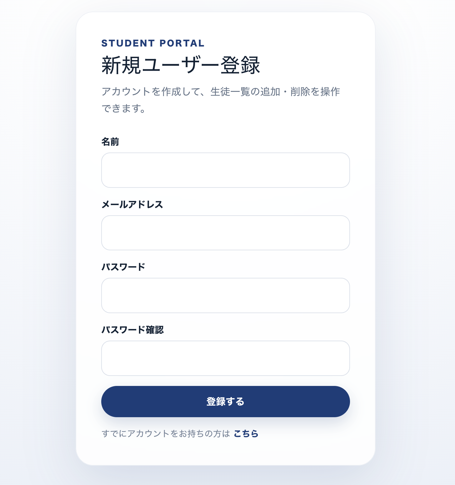
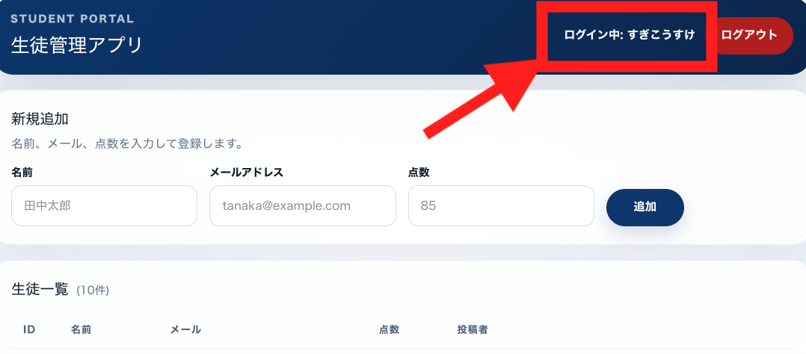
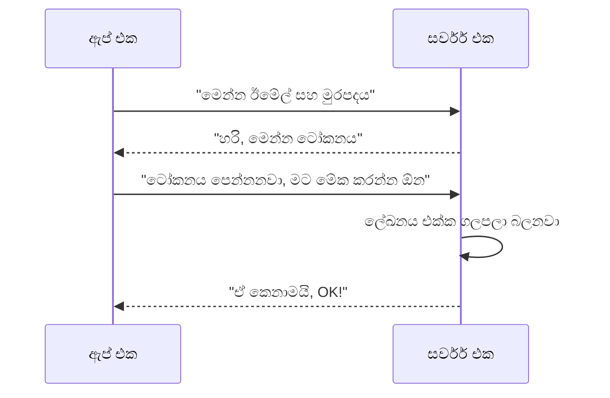
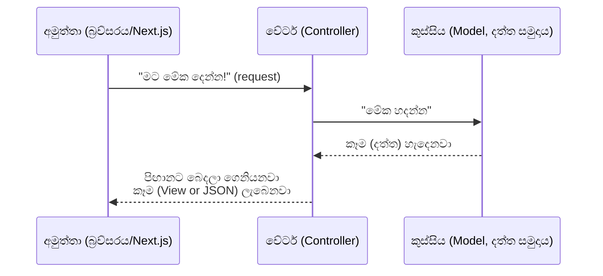

# පාඩම 23｜නව පරිශීලක ලියාපදිංචි කිරීමේ විශේෂාංගය එක් කිරීම සහ මෙතෙක් ඉගෙනගත් දේ පුනරීක්ෂණය

> 🇯🇵 මුල් පිටපත (ජපන් භාෂාවෙන්): [2026_07_09.md](<../../../2年生_システム開発実践/前期/2026_07_09/2026_07_09.md>) <!-- original-ja-link -->

---

# මෙතෙක් කළ අය, ඊළඟට නව පරිශීලක ලියාපදිංචි තිරය හදමු

දැනට ඇත්තේ ලොගින් තිරය පමණයි. ඒ නිසා අලුතින් ශිෂ්‍යයෙක් එක් කරන්න ඕන කෙනෙකුට ඇප් එකට ඇතුළු වෙන්න බැහැ.

## මොනවද හදන්නේ

පහත රූපයේ තියෙන වගේ "නව පරිශීලක ලියාපදිංචිය" තිරයක් හදනවා. අලුතින් ගිණුමක් හදන්න පුළුවන් වුණාම, මුල් වතාවට එන කෙනෙකුටත් තමන්ම ගිණුමක් හදාගෙන ලොගින් වෙන්න පුළුවන් වෙනවා.



අලුතින් ලියාපදිංචි කළ පරිශීලක ගිණුමෙන් ලොගින් වෙන්න පුළුවන් නම් හරි!!!



## තිරයට අවශ්‍ය අංග

- **නම** ඇතුළත් කරන කොටුව
- **ඊමේල් ලිපිනය** ඇතුළත් කරන කොටුව
- **මුරපදය** ඇතුළත් කරන කොටුව
- **මුරපදය තහවුරු කිරීම** සඳහා කොටුව (ටයිප් කිරීමේ වැරදි වළක්වන්න, එකම මුරපදය ආයෙත් ඇතුළත් කරවනවා)
- **ලියාපදිංචි වීමේ බොත්තම**
- "දැනටමත් ගිණුමක් තියෙන අය මෙතනින්" කියන ලොගින් තිරයට යන සබැඳිය

## ක්‍රියාත්මක කිරීමට ඉඟි (මෙතෙක් ඉගෙනගත් දේවල් එක්ක සම්බන්ධයි)

- මේ තිරයෙන් කරන්නේ CRUD වල **Create (අලුත් පරිශීලකයෙක් හදන එක)** කියන කොටස. Laravel පැත්තේ නම් ඒක `store()` එකට අදාළ වැඩේ
- Next.js **ෆෝම් එකේ** පරිශීලකයා ඇතුළත් කරපු නම, ඊමේල් සහ මුරපදය Laravel API එකට යවනවා (POST)
- Laravel පැත්තේ **Controller** එකට ලැබුණු දත්ත validation කරලා (මුරපදය සහ තහවුරු කරපු මුරපදය සමානද, ඊමේල් එක දැනටමත් භාවිතා වෙලාද වගේ දේවල්), **Model** එක හරහා දත්ත සමුදායේ සුරකිනවා
- ලියාපදිංචිය සාර්ථක වුණාම කෙලින්ම ලොගින් තිරයට යවන එක (නැත්නම් එතැනින්ම ලොගින් කරලා **ටෝකනයක්** නිකුත් කරන එක) ස්වාභාවික ක්‍රමයක්

---

# මෙතෙක් ඉගෙනගත් දේ පුනරීක්ෂණය (කළු ලෑල්ලේ ලියලා පැහැදිලි කරනවා!)

## 1. ටෝකනයේ ක්‍රියාකාරිත්වය

ඇප් එකේ සර්වර් එකට ගොඩක් අයගෙන් request (ඉල්ලීම්) එනවා. එතකොට "මේක ඇත්තටම ලොගින් වුණු කෙනාගෙන්මද එන්නේ?" කියලා පරීක්ෂා කරන්න ඕන. ඒ පරීක්ෂාවට පාවිච්චි කරන "රහස් වචන කාඩ්පතක්" වගේ දෙයක් තමයි **ටෝකනය**.

### විනෝද උද්‍යානයක අත් පටියක් ගැන හිතලා බලමු

විනෝද උද්‍යානයකට ඇතුළු වෙද්දී ටිකට් එක පෙන්නුවාම "අත් පටියක්" දෙනවා නේද. ඊට පස්සේ හැම විනෝද ක්‍රීඩාවකටම යන වතාවකදීම ටිකට් එක ආයෙ පෙන්නන්න ඕන නැහැ. **අත් පටිය පෙන්නුවාම විතරක්** "මේ කෙනා ඇතුළු වීමට අවසර ලැබුණු අමුත්තෙක්" කියලා තේරුම් ගන්න පුළුවන්.

ටෝකනයත් කරන්නේ මේ වගේම වැඩක්.

```
   [ටිකට් කවුළුවෙන් ඉල්ලුම් කරනවා]
          ↓
   සේවකයා "හරි, මෙන්න අත් පටිය"
          ↓
   ★ අත් පටිය අතේ දාගන්නවා ★
          ↓
   ඊට පස්සේ හැම ක්‍රීඩාවකටම නගිද්දී
   අත් පටිය පෙන්නුවා විතරක් ඇති!
```

### ඇප් ලෝකයේත් එකම ක්‍රියාවලිය

1. **ලොගින්**: ඊමේල් ලිපිනය සහ මුරපදය යවලා "මේ මමයි" කියලා දන්වනවා
2. **ටෝකනය ලබාගැනීම**: "මේ ඒ කෙනාමයි" කියලා සර්වර් එකට තහවුරු වුණාම, රහස් වචන කාඩ්පත (ටෝකනය) නිකුත් කරනවා
3. **කාඩ්පත තියාගැනීම**: ලැබුණු ටෝකනය ඇප් පැත්තේ සුරක්ෂිතව තියාගන්නවා
4. **කාඩ්පත පෙන්වීම**: මොකක් හරි කරන හැම වතාවකම ඒ ටෝකනයත් එක්කම යවනවා
5. **සර්වර් එක පරීක්ෂා කරනවා**: "මේ ටෝකනය ඇත්තටම ලොගින් වුණු කෙනෙකුගේ" කියලා ගලපලා බලලා OK කියනවා

මේ ක්‍රියාවලිය රූප සටහනකින් පෙන්නුවොත් මෙහෙමයි.



### මතක තියාගන්න ඕන දේවල්

- ටෝකනය රහස් වචනයක් වගේ. **වෙන කෙනෙකුට පෙන්නුවොත් හරි එය සොරකම් කළොත් හරි, වෙන කෙනෙකුට ඔයා ලෙස පෙනී සිටින්න පුළුවන්**, ඒ නිසා ප්‍රවේශමෙන් හසුරුවන්න
- "ලොග් අවුට් වීම" කියන්නේ සර්වර් පැත්තේ ලේඛනයේ "මේ ටෝකනය තවදුරටත් වලංගු නැහැ" කියලා සටහන් කරන එක
- හැම වතාවකම මේ පරීක්ෂාව මිනිසෙක් කරන එක අමාරුයි, ඒ නිසා Laravel වල `auth:sanctum` කියන ක්‍රමය මඟින් ස්වයංක්‍රීයව පරීක්ෂා කරනවා

### ටෝකනය developer tools වලින් බලන්න පුළුවන්

ඇත්තටම, ඔයාගේ ඇප් එකේ දැන් තියෙන්නේ මොන ටෝකනයද කියලා **බ්‍රව්සරයේ developer tools (DevTools) විවෘත කළාම බලන්න පුළුවන්**.

- **Application ටැබ් එක (Chrome නම්)** → `Local Storage` බැලුවාම සුරකින ලද ටෝකන string එක බලන්න පුළුවන්
- **Network ටැබ් එක** → API එකට request එකක් යවපු වෙලාවේ සන්නිවේදනය බැලුවාම, `Authorization: Bearer ○○○` කියන header එකේ ඇත්ත ටෝකනය තියෙනවා බලන්න පුළුවන්

"ටෝකනය හරියට ලැබිලාද", "request එකට හරියට එකතු කරලාද" කියලා තේරෙන්නේ නැති වෙලාවට, මුලින්ම developer tools වලින් බලන පුරුද්දක් හදාගත්තොත් bug එකේ හේතුව හොයාගන්න ලේසි වෙනවා.

### ඇත්ත JavaScript කේතය

පහත කේතය **Laravel පැත්තේ නෙවෙයි, Next.js පැත්තේ (frontend) ලියන කේතය**. වේටර්ගෙන් (Controller) ඉල්ලීම් කරන පැත්ත, ඒ කියන්නේ "අමුත්තාගේ" කේතය කියලා හිතන්න.

#### 1. ලොගින් වෙලා ටෝකනය ලබාගැනීම සහ සුරැකීම

```javascript
async function login(email, password) {
  const response = await fetch('http://localhost:8000/api/login', {
    method: 'POST',
    headers: {
      'Content-Type': 'application/json',
    },
    body: JSON.stringify({ email, password }),
  });

  const data = await response.json();

  // සර්වර් එකෙන් ලැබුණු ටෝකනය බ්‍රව්සරයේ සුරකිනවා
  localStorage.setItem('token', data.token);
}
```

#### 2. සුරකින ලද ටෝකනය එකතු කරලා API එක call කිරීම

```javascript
async function fetchMyProfile() {
  // කලින් සුරකින ලද ටෝකනය ගන්නවා
  const token = localStorage.getItem('token');

  const response = await fetch('http://localhost:8000/api/user', {
    method: 'GET',
    headers: {
      // මෙතන "රහස් වචන කාඩ්පත" පෙන්නන විදිහට ටෝකනය එකතු කරනවා
      Authorization: `Bearer ${token}`,
    },
  });

  const data = await response.json();
  console.log(data);
}
```

#### 3. ලොග් අවුට් වීම (ටෝකනය අවලංගු කිරීම)

```javascript
async function logout() {
  const token = localStorage.getItem('token');

  await fetch('http://localhost:8000/api/logout', {
    method: 'POST',
    headers: {
      Authorization: `Bearer ${token}`,
    },
  });

  // බ්‍රව්සර් පැත්තේ ඉතුරු වෙලා තියෙන ටෝකනයත් මකනවා
  localStorage.removeItem('token');
}
```

`Authorization: Bearer ${token}` කියන කොටස තමයි හරියටම "අත් පටිය පෙන්වීම" කියන ක්‍රියාව. මේ විදිහට header එක එකතු කළේ නැත්නම්, සර්වර් එකට "මේ request එක කාගෙන්ද කියලා තේරෙන්නේ නැහැ", ඒ නිසා 401 error එකක් (සත්‍යාපන දෝෂයක්) එනවා.

## 2. CRUD ගැන

CRUD කියන්නේ ඇප් එකක් දත්ත එක්ක කරන **මූලික ක්‍රියා 4** හි ඉංග්‍රීසි මුල් අකුරු එකතු කරලා හදපු වචනයක්. සටහන් පොතක් ගැන හිතුවොත් තේරුම් ගන්න ලේසියි.

| මුල් අකුර | ක්‍රියාව | සටහන් පොතකට උපමා කළොත් |
|------|------|------------------|
| **C**reate (හදනවා) | අලුත් දත්ත එක් කරනවා | සටහන් පොතේ අලුත් පිටුවක් ලියනවා |
| **R**ead (කියවනවා) | දත්ත බලනවා | ලියපු පිටුව ආයෙ කියවනවා |
| **U**pdate (යාවත්කාලීන කරනවා) | දත්ත වෙනස් කරනවා | ලියපු දේ මකලා ආයෙ ලියනවා |
| **D**elete (මකනවා) | දත්ත මකා දමනවා | පිටුව ඉරලා විසි කරනවා |

```
      ┌─────────── සටහන් පොත (දත්ත සමුදාය) ───────────┐
      │                                             │
 Create│ අලුත් පිටුවක් එක් කරනවා →  [ 1 වන පිටුව ]        │
      │                                             │
  Read │ කියවනවා            →  "හා හා, මේකනේ"    │
      │                                             │
Update │ ආයෙ ලියනවා         →  [ 1 වන පිටුව (සංශෝධිත) ]  │
      │                                             │
Delete │ ඉරලා විසි කරනවා     →  (පිටුව නැති වෙනවා)      │
      └─────────────────────────────────────────────┘
```

### ඇයි මේක වැදගත්?

- දැන්වීම් පුවරු, ඔන්ලයින් සාප්පු, සමාජ මාධ්‍ය, කාර්ය කළමනාකරණ ඇප්ස්... බොහෝ ඇප්ස් හැදිලා තියෙන්නේ "දත්ත හදනවා, බලනවා, වෙනස් කරනවා, මකනවා" කියන ක්‍රියා එකතු කරලා
- Laravel වල `Route::apiResource` කියන පහසු විශේෂාංගයක් තියෙනවා, ඒකෙන් මේ ක්‍රියා 4 (ඇත්තටම 5) එකවර සූදානම් කරලා දෙනවා

```php
Route::apiResource('users', UserController::class);
// මේ එක පේළියෙන් විතරක් "හදනවා, බලනවා, වෙනස් කරනවා, මකනවා" කියන හැම මාර්ගයක්ම සම්බන්ධ වෙනවා
```

CRUD ගැන හිතලා වැඩ කළොත්, "මේ බොත්තම මොකටද" කියන එක කණ්ඩායමේ ඕනම කෙනෙකුට තේරුම් ගන්න ලේසි වෙනවා.

## 3. Laravel වල MVC ආකෘතිය ගැන

Laravel ඇප් එකක් **අවන්හලකට** උපමා කළොත් හිතාගන්න ලේසියි. වැඩ බෙදාගෙන තියෙන විදිහ පැහැදිලි නිසා, ගොඩක් අය එකට වැඩ කළත් අවුල් වෙන්නේ නැහැ.

### අවන්හලේ භූමිකා ගැන හිතමු

- **Controller (කොන්ට්‍රෝලර්) = වේටර්**: අමුත්තාගෙන් (request) ඇණවුම ගන්නවා, කුස්සියට කියනවා, හදපු කෑම අමුත්තාට ගෙනත් දෙනවා
- **Model (මොඩල්) = කුස්සිය, ශීතකරණය**: අමුද්‍රව්‍ය (දත්ත) ගබඩා කරලා තියාගන්න, ඇත්තටම කෑම (දත්ත ලබාගැනීම, සුරැකීම) හදන තැන
- **View (ව්‍යූ) = පිඟානට බෙදපු කෑම**: අමුත්තා ඉස්සරහට එන, අවසාන පෙනුම

ඇණවුම දීලා කෑම ලැබෙනකම් ක්‍රියාවලිය රූප සටහනකින් පෙන්නුවොත් මෙහෙමයි.



### API බවට පත් කළාම මොනවද වෙනස් වෙන්නේ?

API බවට පත් කරන්න කලින්, වේටර් (Controller) කුස්සියෙන් ගත්ත කෑම **අවන්හල ඇතුළේම** පිඟානට බෙදලා අමුත්තා ඉස්සරහට දුන්නා (Blade වලින් තිරය හැදුවා).

API බවට පත් කළාට පස්සේ, වේටර් (Controller) **පිඟානට බෙදන්නේ නැතුව, අමුද්‍රව්‍ය සහ හදන විදිහ (JSON දත්ත) විතරක්** අමුත්තාට දෙනවා. ඊට පස්සේ ඇත්තටම පෙනුම හදන (පිඟානට බෙදන) වැඩේ Next.js පැත්තෙන් භාරගන්නවා.

ඒ කියන්නේ "ඇණවුම ගෙන කුස්සිය එක්ක ගනුදෙනු කරන" වේටර්ගේ මූලික වැඩේ වෙනස් වෙන්නේ නැහැ, **අන්තිමට පිඟානට බෙදන (තිරයේ පෙනුම හදන) වැඩේ විතරක් Next.js පැත්තට මාරු වුණා** කියලා හිතුවොත් තේරුම් ගන්න ලේසියි.

