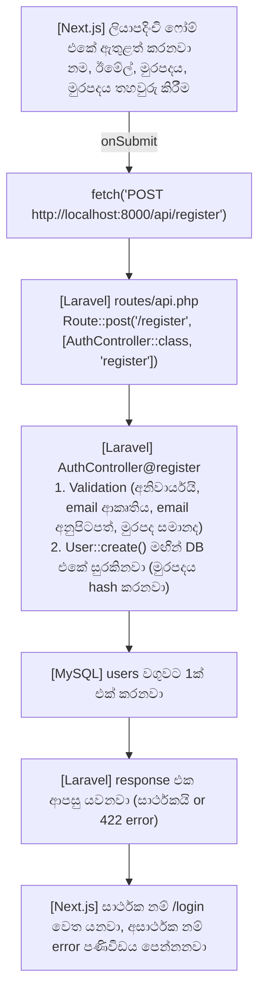

# නව පරිශීලක ලියාපදිංචි තිරය හදන ක්‍රියාවලිය

> 🇯🇵 මුල් පිටපත (ජපන් භාෂාවෙන්): [2026_07_09_2.md](<../../../2年生_システム開発実践/前期/2026_07_09/2026_07_09_2.md>) <!-- original-ja-link -->

මේ ලේඛනය පාඩම 23 හි "නව පරිශීලක ලියාපදිංචි තිරය හදන්න" යන පැවරුම ප්‍රායෝගිකව සම්පූර්ණ කිරීමට අවශ්‍ය පියවර ඇතුළත් මාර්ගෝපදේශයකි.  
`2026_07_09.md` එකේ දීපු පැවරුම, මෙතෙක් පන්තිවල (පාඩම 17-22) හදපු `school-frontend` ව්‍යාපෘතිය තුළ ක්‍රමලේඛනය කරමු.

---

## 0. සමස්ත චිත්‍රය: මොනවා මොනවා එක්කද සම්බන්ධ වෙන්නේ

ලියාපදිංචි තිරය "අලුත් වාර්තාවක් (record) 1ක් හදන" විශේෂාංගයක් නිසා, CRUD වල **Create** කියන කොටසට අයිතියි.  
ක්‍රියාවලිය ලොගින් තිරයට (පාඩම 17) බොහෝදුරට සමානයි, වෙනස් වෙන්නේ යවන URL එක සහ validation අන්තර්ගතය විතරයි.



`routes/api.php` එකේ ඇත්තටම **පාඩම 08 වෙද්දීම ලියාපදිංචිය සඳහා route එක ලියලා තියෙනවා.**

```php
// routes/api.php (දැනටමත් ලියලා තියෙන්න ඕන)
Route::post('/login', [AuthController::class, 'login']);
Route::post('/register', [AuthController::class, 'register']);
```

හැබැයි `AuthController` ඇතුළේ ක්‍රියාත්මක කරලා තියෙන්නේ `login` / `logout` / `me` විතරයි,  
ඒ නිසා **`register()` method එක නැති තත්ත්වයක්** තියෙන්නේ. අද මේක හදන එකෙන් පටන් ගන්නවා.

---

## 1. Laravel පැත්ත: `register()` ක්‍රියාත්මක කිරීම

`app/Http/Controllers/Api/AuthController.php` විවෘත කරලා, `login()` method එක ළඟින් එක් කරන්න.

```php
// app/Http/Controllers/Api/AuthController.php
use App\Models\User;
use Illuminate\Support\Facades\Hash;

// POST /api/register
public function register(Request $request)
{
    // ① ආදාන පරීක්ෂාව
    $validated = $request->validate([
        'name'     => 'required|string|max:255',
        'email'    => 'required|email|unique:users,email',
        'password' => 'required|min:8|confirmed',
    ]);

    // ② පරිශීලකයා හදනවා (මුරපදය අනිවාර්යයෙන්ම hash කරන්න)
    $user = User::create([
        'name'     => $validated['name'],
        'email'    => $validated['email'],
        'password' => Hash::make($validated['password']),
    ]);

    // ③ එතැනින්ම ලොගින් කරවන්න ඕන නිසා, ටෝකනයත් නිකුත් කරලා ආපසු යවනවා
    $token = $user->createToken('api-token')->plainTextToken;

    return response()->json([
        'status' => 'ok',
        'token'  => $token,
        'user'   => $user,
    ], 201); // 201 = අලුතින් හැදීම සාර්ථකයි
}
```

### Validation වල වැදගත් කරුණු

| රීතිය | තේරුම |
|--------|------|
| `required` | ඇතුළත් කරලා නැත්නම් 422 error |
| `email` | ඊමේල් ආකෘතියද කියලා පරීක්ෂා කරනවා |
| `unique:users,email` | `users` වගුවේ එකම ඊමේල් එක නැද්ද කියලා බලනවා (දෙපාරක් ලියාපදිංචි වීම වළක්වනවා) |
| `min:8` | මුරපදයේ අවම වශයෙන් අක්ෂර 8ක් තිබිය යුතුයි |
| `confirmed` | **"එකම නම + `_confirmation`" කියන field එකේ අගය සමානද** කියලා ස්වයංක්‍රීයව පරීක්ෂා කරන විශේෂ රීතියක් |

`confirmed` රීතිය පාවිච්චි කරනවා නම්, frontend එකෙන් යවන key නම් අනිවාර්යයෙන්ම මේ විදිහට තියෙන්න ඕන.

```json
{
  "name": "田中太郎",
  "email": "tanaka@example.com",
  "password": "password123",
  "password_confirmation": "password123"
}
```

`password_confirmation` කියන නමේ එක අකුරක් හරි වැරදුණොත්, `confirmed` රීතිය වැඩ කරන්නේ නැහැ, ඒක "සමාන වුණත් error එකක් එන" bug එකකට හේතු වෙනවා, ඒ නිසා ප්‍රවේශම් වෙන්න.

---

## 2. Next.js පැත්ත: `/register` පිටුව හැදීම

`app/register/` ෆෝල්ඩරය හදලා, `page.tsx` අලුතින් හදන්න.

```
app/register/page.tsx  ← අලුතින් හදනවා
```

ලොගින් පිටුවේ (පාඩම 17) ව්‍යුහයමයි පාවිච්චි කරන්නේ. **වෙනස් වෙන්නේ ඇතුළත් කරන කොටු සහ යවන තැන විතරයි**.

```tsx
"use client";

import { useState } from "react";
import { useRouter } from "next/navigation";

export default function RegisterPage() {
  const router = useRouter();
  const [name, setName] = useState("");
  const [email, setEmail] = useState("");
  const [password, setPassword] = useState("");
  const [passwordConfirmation, setPasswordConfirmation] = useState("");
  const [error, setError] = useState("");
  const [loading, setLoading] = useState(false);

  async function handleSubmit(e) {
    e.preventDefault();
    setError("");
    setLoading(true);

    const res = await fetch("http://localhost:8000/api/register", {
      method: "POST",
      headers: {
        "Content-Type": "application/json",
        "Accept": "application/json",
      },
      // ★ key නම් Laravel පැත්තේ validation එකට ගැළපෙන්න ඕන
      body: JSON.stringify({
        name,
        email,
        password,
        password_confirmation: passwordConfirmation,
      }),
    });

    const data = await res.json();
    setLoading(false);

    if (res.ok) {
      // ★ එතැනින්ම ලොගින් වුණු තත්ත්වයට පත් කරනවා (ටෝකනය සුරකිලා /students වෙත)
      localStorage.setItem("token", data.token);
      localStorage.setItem("userName", data.user?.name || "ユーザー");
      router.push("/students");
    } else if (data.errors) {
      // පාඩම 21 දී ඉගෙනගත්ත විදිහටම, Laravel validation error පෙන්වීම
      const messages = Object.values(data.errors).flat().join(" / ");
      setError(messages);
    } else {
      setError(`エラーが発生しました（HTTP ${res.status}）`);
    }
  }

  return (
    <div style={{
      maxWidth: "400px", margin: "80px auto",
      background: "white", padding: "32px",
      borderRadius: "8px", boxShadow: "0 2px 8px rgba(0,0,0,0.1)"
    }}>
      <h2 style={{ marginBottom: "24px", textAlign: "center" }}>新規ユーザー登録</h2>

      <form onSubmit={handleSubmit}>
        <div style={{ marginBottom: "16px" }}>
          <label style={{ display: "block", marginBottom: "6px", fontWeight: "bold" }}>名前</label>
          <input
            type="text"
            value={name}
            onChange={(e) => setName(e.target.value)}
            style={{ width: "100%", padding: "10px", border: "1px solid #ccc", borderRadius: "6px", fontSize: "1em", boxSizing: "border-box" }}
          />
        </div>

        <div style={{ marginBottom: "16px" }}>
          <label style={{ display: "block", marginBottom: "6px", fontWeight: "bold" }}>メールアドレス</label>
          <input
            type="email"
            value={email}
            onChange={(e) => setEmail(e.target.value)}
            style={{ width: "100%", padding: "10px", border: "1px solid #ccc", borderRadius: "6px", fontSize: "1em", boxSizing: "border-box" }}
          />
        </div>

        <div style={{ marginBottom: "16px" }}>
          <label style={{ display: "block", marginBottom: "6px", fontWeight: "bold" }}>パスワード</label>
          <input
            type="password"
            value={password}
            onChange={(e) => setPassword(e.target.value)}
            style={{ width: "100%", padding: "10px", border: "1px solid #ccc", borderRadius: "6px", fontSize: "1em", boxSizing: "border-box" }}
          />
        </div>

        <div style={{ marginBottom: "16px" }}>
          <label style={{ display: "block", marginBottom: "6px", fontWeight: "bold" }}>パスワード確認</label>
          <input
            type="password"
            value={passwordConfirmation}
            onChange={(e) => setPasswordConfirmation(e.target.value)}
            style={{ width: "100%", padding: "10px", border: "1px solid #ccc", borderRadius: "6px", fontSize: "1em", boxSizing: "border-box" }}
          />
        </div>

        {error && (
          <p style={{ color: "#D32F2F", fontSize: "0.9em", marginBottom: "12px" }}>
            {error}
          </p>
        )}

        <button
          type="submit"
          disabled={loading}
          style={{ width: "100%", padding: "12px", background: loading ? "#aaa" : "#1976D2", color: "white", border: "none", borderRadius: "6px", fontSize: "1em", fontWeight: "bold", cursor: loading ? "not-allowed" : "pointer" }}
        >
          {loading ? "登録中..." : "登録する"}
        </button>

        <p style={{ textAlign: "center", marginTop: "16px", fontSize: "0.9em" }}>
          すでにアカウントをお持ちの方は{" "}
          <a href="/login" style={{ color: "#1976D2", fontWeight: "bold" }}>こちら</a>
        </p>
      </form>
    </div>
  );
}
```

### ලොගින් පිටුවට (පාඩම 17) සාපේක්ෂව වෙනස්කම්

| | `/login` (පාඩම 17) | `/register` (මේ වතාවේ) |
|--|--|--|
| ඇතුළත් කරන කොටු | ඊමේල්, මුරපදය | නම, ඊමේල්, මුරපදය, මුරපදය තහවුරු කිරීම |
| යවන තැන | `POST /api/login` | `POST /api/register` |
| සාර්ථක වූ විට response එක | `{ token, user }` | `{ token, user }` (එකම ආකෘතිය) |
| අසාර්ථක වූ විට පෙන්වන දේ | ස්ථාවර පණිවිඩයක් (401) | Laravel validation පණිවිඩ (422) |
| සාර්ථක වූ පසු යන තැන | `/students` | `/students` (ලියාපදිංචි වෙනකොටම ලොගින් වුණා ලෙස සලකනවා) |

---

## 3. ලොගින් තිරය සහ ලියාපදිංචි තිරය එකිනෙකට සබැඳි කිරීම

පැවරුමේ පිරිවිතරයේ (`2026_07_09.md`) තියෙන විදිහට, ලියාපදිංචි තිරයේ 「すでにアカウントをお持ちの方はこちら」(දැනටමත් ගිණුමක් තියෙන අය මෙතනින්) කියන ලොගින් තිරයට යන සබැඳියක් අවශ්‍යයි (ඉහත කේතයේ අගට දැනටමත් එක් කරලා තියෙනවා).

ඒ එක්කම, ලොගින් තිරයටත් ලියාපදිංචි තිරයට යන සබැඳියක් එක් කළොත්, පරිශීලකයන්ට අතරමං නොවී දෙපැත්තටම යන්න එන්න පුළුවන්.

```tsx
// app/login/page.tsx එකේ <form> එකේ පහළින්ම එක් කරන්න
<p style={{ textAlign: "center", marginTop: "16px", fontSize: "0.9em" }}>
  アカウントをお持ちでない方は{" "}
  <a href="/register" style={{ color: "#1976D2", fontWeight: "bold" }}>こちら</a>
</p>
```

---

## 4. සර්වර් දෙකම ආරම්භ කරලා ක්‍රියාකාරිත්වය පරීක්ෂා කිරීම

```bash
# ටර්මිනලය ① Laravel
cd (Laravel ව්‍යාපෘතියේ ෆෝල්ඩරය)
php artisan serve

# ටර්මිනලය ② Next.js
cd school-frontend
npm run dev
```

### ක්‍රියාකාරිත්ව පරීක්ෂා ලැයිස්තුව

| පරීක්ෂා කරන දේ | කරන දේ | බලාපොරොත්තු වන ප්‍රතිඵලය |
|---------|------|------------|
| තිරය පෙන්වීම | `http://localhost:3000/register` විවෘත කරනවා | නම, ඊමේල්, මුරපදය, මුරපදය තහවුරු කිරීම ඇතුළත් කරන කොටු පෙන්නනවා |
| සාමාන්‍ය ලියාපදිංචිය | හැම දෙයක්ම හරියට ඇතුළත් කරලා 「登録する」(ලියාපදිංචි වෙන්න) ඔබනවා | `/students` වෙත ගිහින්, ලොගින් වුණු තත්ත්වයට පත් වෙනවා |
| ඊමේල් අනුපිටපත | දැනටමත් ලියාපදිංචි කරපු ඊමේල් ලිපිනයකින් ලියාපදිංචි වෙනවා | "The email has already been taken." වගේ error එකක් පෙන්නනවා |
| මුරපද නොගැළපීම | මුරපදය සහ මුරපදය තහවුරු කිරීම සඳහා වෙනස් අගයන් ඇතුළත් කරනවා | "The password confirmation does not match." පෙන්නනවා |
| ඇතුළත් කර නැති විට | කිසිවක් ඇතුළත් නොකර යවනවා | හැම කොටුවකටම "required" error පෙන්නනවා |
| තිර මාරුව (ලියාපදිංචිය→ලොගින්) | 「すでにアカウントをお持ちの方はこちら」(දැනටමත් ගිණුමක් තියෙන අය මෙතනින්) ඔබනවා | `/login` වෙත යනවා |
| තිර මාරුව (ලොගින්→ලියාපදිංචිය) | ලොගින් තිරයේ 「こちら」(මෙතනින්) ඔබනවා | `/register` වෙත යනවා |
| ලොගින් පරීක්ෂාව | අලුතින් ලියාපදිංචි කරපු ඊමේල්, මුරපදයෙන් ආයෙ ලොගින් වෙනවා | ලොගින් වීම සාර්ථකයි |

---

## සාරාංශය: මේ වතාවේ කරපු දේවල් කොතැනටද අයිති

| මෙතෙක් | මේ වතාවේ එක් කරපු කොටස |
|--|--|
| `routes/api.php` එකේ `/register` මාර්ගය දැනටමත් සූදානම් කරලා තිබුණා (පාඩම 08) | `AuthController` එකේ `register()` ඇතුළත (validation + `User::create`) ක්‍රියාත්මක කළා |
| `/login` පිටුව දැනටමත් තිබුණා (පාඩම 17) | එකම ව්‍යුහයෙන් `/register` පිටුව අලුතින් හැදුවා |
| 422 error පෙන්වන විදිහ පාඩම 21 දී දැනටමත් ඉගෙනගෙන තිබුණා | එකම ක්‍රමය ලියාපදිංචි ෆෝම් එකේ error පෙන්වීමට යොදාගත්තා |

අලුත් සංකල්ප බොහෝ දුරට හඳුන්වා නොදී, මෙතෙක් පන්තිවල ඉගෙනගත් **CRUD හි Create, Controller/Model, validation සහ ටෝකන නිකුත් කිරීම** යන කොටස් එකට යොදාගෙන පමණක් මෙය සෑදිය හැකි වීම මෙම පැවරුමේ ප්‍රධාන කරුණයි.
