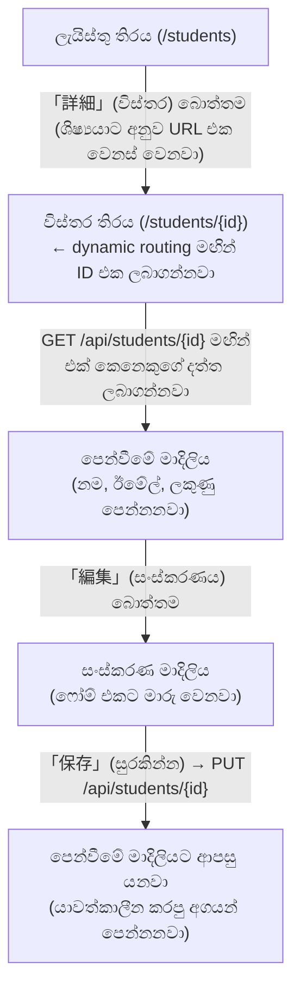
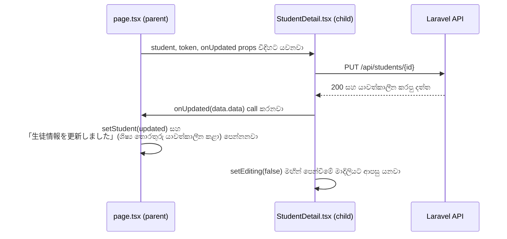

# පාඩම 24｜විස්තර තිරය හැදීම - ක්‍රියාත්මක කිරීමේ පියවර

> 🇯🇵 මුල් පිටපත (ජපන් භාෂාවෙන්): [2026_07_16_実装.md](<../../../2年生_システム開発実践/前期/2026_07_16/2026_07_16_実装.md>) <!-- original-ja-link -->

## අද ඉලක්කය

- ලැයිස්තු තිරයේ 「詳細」(විස්තර) බොත්තමෙන්, ඒ ශිෂ්‍යයාගේ තොරතුරු විතරක් පෙන්වන තිරයකට යන්න පුළුවන් වෙනවා
- විස්තර තිරයේ 「編集」(සංස්කරණය) බොත්තමෙන්, එතැනම ෆෝම් එකකට මාරු වෙලා යාවත්කාලීන කරන්න පුළුවන් වෙනවා
- Laravel පැත්තේ යාවත්කාලීන කිරීමේ API endpoint එකක් (`PUT /api/students/{id}`) සූදානම් කරන්න පුළුවන් වෙනවා

> **මේක කොතැනටද අයිති:** ලැයිස්තු තිරය (`GET /api/students`) "හැමෝගෙම තොරතුරු එකට බලන" තිරයක් වුණා, විස්තර තිරය "ID එකෙන් තෝරපු කෙනාගේ තොරතුරු විතරක් බලන, නිවැරදි කරන" තිරයක්. CRUD වල **Read (එකක් විතරක් බලනවා)** සහ **Update (යාවත්කාලීන කරනවා)** එකම තිරයක් ඇතුළේ මාරු වෙන විදිහට තමයි මේක හදන්නේ.

---

## සමස්ත චිත්‍රය: මොනවද හදන්නේ



### ඇයි මේ පිළිවෙළට හදන්නේ

> 💡 **උපමාවකින් කිව්වොත්… කඩේක "තනි ඇණවුම් කාඩ්පත"**
>
> ලැයිස්තු තිරය "අද වෙන්කිරීම් ලැයිස්තුව" නම්, විස්තර තිරය එක අමුත්තෙකුගේ විතරක් "තනි ඇණවුම් කාඩ්පත". කාඩ්පත කෙලින්ම වෙනස් කරන්න (සංස්කරණය කරන්න) නම්, මුලින්ම "මේ කාඩ්පත එළියට ගන්න" කවුළුව (`GET /api/students/{id}`) සහ "වෙනස් කිරීම් භාරගන්න" කවුළුව (`PUT /api/students/{id}`) කඩේ පැත්තේ (Laravel) තියෙන්න ඕන, නැත්නම් පටන් ගන්න බැහැ.

Backend එකේ යාවත්කාලීන කිරීමේ API එක නැත්නම්, frontend එකේ සංස්කරණ ෆෝම් එක හැදුවත් සුරකින්න තැනක් නැති නිසා ක්‍රියාකාරිත්වය පරීක්ෂා කරන්න බැහැ. ඒ නිසා **Backend (API) → ලැයිස්තුවෙන් යන මාර්ගය → විස්තර තිරය (පෙන්වීම) → සංස්කරණ මාදිලිය** කියන පිළිවෙළට, පොඩි පොඩි කොටස් හදලා හැම වතාවකම run කරලා බලමින් ඉස්සරහට යනවා.

### ගොනු ව්‍යුහය (මේ වතාවේ අත තියන ගොනු)

| සංකේතය | තේරුම |
|---|---|
| 🆕 අලුත් | ගොනුව අලුතින් හදනවා |
| ➕ එක් කිරීම | දැනට තියෙන ගොනුවකට කේතය එකතු කරනවා |
| 👀 පරීක්ෂාව | වෙනස් කරන්න ඕන නැහැ. දැනටමත් හදලාද කියලා බලනවා විතරයි |

```
Laravel/
├── app/Http/Requests/UpdateStudentRequest.php      🆕 අලුත්
├── app/Http/Controllers/Api/StudentController.php  ➕ update() එක් කරනවා
└── routes/api.php                                  👀 පරීක්ෂාව පමණයි

school-frontend/
├── components/students/StudentList.tsx             ➕ විස්තර සබැඳිය එක් කරනවා
├── components/students/StudentDetail.tsx           🆕 අලුත් (පෙන්වීම⇔සංස්කරණය)
└── app/students/[id]/page.tsx                       🆕 අලුත් → දෙවන භාගයේ ➕ එකතු කරනවා (dynamic routing)
```

---

## Step 1｜Backend: යාවත්කාලීන කිරීමේ API එක එක් කිරීම

ලැයිස්තුව, විස්තර ලබාගැනීම, මකා දැමීම සඳහා API දැනටමත් තියෙනවා, ඒත් "එකක් වෙනස් කරන" කවුළුව තවම නැහැ. මුලින්ම මේක හදනවා.


### 1-3. `routes/api.php` පරීක්ෂා කිරීම

**👀 පරීක්ෂාව පමණයි (බොහෝ විට වෙනස් කරන්න ඕන නැහැ)** — `Route::apiResource('students', StudentController::class)` මුල් තත්ත්වයේදීම `update` එකත් ඇතුළත් කරලා තියෙනවා. `->only([...])` පාවිච්චි කරලා සීමා කරලා තියෙනවා නම් **විතරක්** `update` එක් කරන්න.

```php
Route::middleware('auth:sanctum')->group(function () {
    Route::post('/logout', [AuthController::class, 'logout']);
    Route::get('/me', [AuthController::class, 'me']);
    Route::apiResource('students', StudentController::class);
    
    // only වලින් සීමා කරලා නැද්ද කියලා විතරක් බලන්න
    // Route::apiResource('students', StudentController::class)->only(['index', 'show']);
});
```

### 1-4. ක්‍රියාකාරිත්වය පරීක්ෂා කිරීම

```bash
cd Laravel && php artisan serve
```

ලොගින් වෙලා ටෝකනය ලබාගත්තට පස්සේ, `curl` වලින් යාවත්කාලීන කිරීමේ API එකට කෙලින්ම request එකක් යවලා බලමු.

⚠️ Windows (PowerShell) පාවිච්චි කරන අයට අවවාදයයි
PowerShell එකේ curl එහෙමම පාවිච්චි කළොත් error එකක් එනවා. අනිවාර්යයෙන්ම මුලට curl.exe ලියන්න, නැත්නම් ටර්මිනලයේ cmd ටයිප් කරලා "Command Prompt" එකට මාරු වෙලා run කරන්න. ඒ වගේම, දත්ත ඇතුළේ තියෙන double quotes (\") escape කරන්නත් ඕන.
```bash
curl -X PUT http://localhost:8000/api/students/1 \
  -H "Authorization: Bearer <ලබාගත් ටෝකනය>" \
  -H "Content-Type: application/json" \
  -H "Accept: application/json" \
  -d '{"name":"テスト太郎","email":"test-taro@example.com","score":80}'
```

| පරීක්ෂා කරන දේ | කරන දේ | බලාපොරොත්තු වන ප්‍රතිඵලය |
|---|---|---|
| යාවත්කාලීන කිරීම සාර්ථකයි | ඉහත curl එක run කරනවා | 200 එනවා, යාවත්කාලීන කරපු නම, ඊමේල්, ලකුණු JSON එකේ තියෙනවා |
| Validation | `score` එකට `200` දාලා run කරනවා | 422 එනවා |
| සත්‍යාපනය අනිවාර්යයි | `Authorization` header එක අයින් කරලා run කරනවා | 401 එනවා |
| නොපවතින ID | `/api/students/9999` එකට run කරනවා | 404 එනවා |

---

## Step 2｜Frontend: ලැයිස්තුවේ සිට විස්තර තිරයට යන මාර්ගය

`school-frontend/components/students/StudentList.tsx` සංස්කරණය කරනවා.

### ඇයි මේක අවශ්‍ය

ලැයිස්තුවේ හැම පේළියකින්ම "මේ ශිෂ්‍යයාට විතරක් අදාළ URL එකට" යන්න බැරි නම්, විස්තර තිරය හැදුවත් එතැනට යන්න ක්‍රමයක් නැහැ. **ශිෂ්‍යයාගේ ID එක එහෙමම URL එකේ කොටසක් විදිහට දාන එක** තමයි වැදගත්ම කරුණ.

**➕ එක් කිරීම (දැනට තියෙන ගොනුවේ ඉහළින්ම)** — `import` එක් කරන්න.

```tsx
// ▼ StudentList.tsx එකේ ඉහළින්ම එක් කරන්න
"use client";

import Link from "next/link";
```

**➕ එක් කිරීම (දැනට තියෙන ගොනුව)** — `bodyCell` එකට පහළින් ආසන්න තැනක, විස්තර සබැඳියේ style එක එක් කරන්න.

```tsx
// Style නියත (නැවත නැවත පාවිච්චි කරන style එකට එකතු කරලා තියාගන්නවා)
const thStyle = { padding: "10px 16px", textAlign: "left", fontWeight: "bold", fontSize: "0.9em" };
const tdStyle = { padding: "12px 16px", fontSize: "0.95em" };

// ▼ පහළින් ආසන්න තැනක එක් කරන්න (විස්තර සබැඳියේ style එක)
const detailLinkStyle = {
  display: "inline-flex",
  alignItems: "center",
  justifyContent: "center",
  minWidth: 104,
  padding: "0.85rem 1.25rem",
  borderRadius: 999,
  background: "#163D7A",
  color: "#fff",
  fontWeight: 700,
  fontSize: "0.95rem",
  letterSpacing: "0.01em",
  boxShadow: "0 10px 24px rgba(22, 61, 122, 0.18)",
};
```

**🔁 ප්‍රතිස්ථාපනය (දැනට තියෙන ගොනුව)** — `StudentRow` එකේ අන්තිම `<td>` එක (ක්‍රියා බොත්තම් තියෙන cell එක) පහත කේතයෙන් ප්‍රතිස්ථාපනය කරන්න.

```tsx
// StudentRow: වගුවේ එක පේළියක්
function StudentRow({ student, onDelete }) {
  function handleDelete() {
    // තහවුරු කිරීමේ dialog එක පෙන්නලා ඊට පස්සේ මකනවා
    if (window.confirm(`${student.name} を削除しますか？`)) {
      onDelete(student.id); // දෙමාපිය component එකට "මේ ID එක මකන්න" කියලා දන්වනවා
    }
  }

  return (
    <tr style={{ borderBottom: "1px solid #eee" }}>
      <td style={tdStyle}>{student.id}</td>
      <td style={tdStyle}>{student.name}</td>
      <td style={tdStyle}>{student.email}</td>
      <td style={tdStyle}>{student.score}</td>
      <td style={tdStyle}>
      <div style={{ display: "flex", gap: "0.5rem", flexWrap: "wrap" }}>
        <Link href={`/students/${student.id}`} style={detailLinkStyle}>
          詳細
        </Link>
        <button
          onClick={handleDelete}
          style={{ background: "#D32F2F", color: "white", border: "none", borderRadius: "4px", padding: "4px 12px", cursor: "pointer", fontSize: "0.85em" }}
        >
          削除
        </button>
        </div >
      </td>
    </tr>
  );
}
```

### ක්‍රියාකාරිත්වය පරීක්ෂා කිරීම

```bash
cd school-frontend && npm run dev
```

| පරීක්ෂා කරන දේ | කරන දේ | බලාපොරොත්තු වන ප්‍රතිඵලය |
|---|---|---|
| මාර්ගය පෙන්වීම | `/students` විවෘත කරනවා | හැම පේළියකම 「詳細」(විස්තර) බොත්තම පෙන්නනවා |
| තිර මාරුව | 「詳細」(විස්තර) බොත්තම ක්ලික් කරනවා | `/students/{ඒ පේළියේ ID එක}` වෙත යනවා (මේ වෙලාවේ 404 ආවත් කමක් නැහැ. Step 3 දී හදනවා) |

---

## Step 3｜Frontend: විස්තර තිරය (පෙන්වීමේ මාදිලිය)

**🆕 අලුත් ගොනුව** — `school-frontend/app/students/[id]/page.tsx` අලුතින් හදන්න (`[id]` කියන නමින් ෆෝල්ඩරයකුත් අලුතින් හදන්න).

### ඇයි `[id]` කියන ෆෝල්ඩර නම දාන්නේ

Next.js වල ෆෝල්ඩර නම `[id]` වගේ හතරැස් වරහන් ඇතුළේ ලිව්වොත්, URL එකේ ඒ කොටස (`/students/3` හි `3`) පිටුව ඇතුළේ ලබාගන්න පුළුවන් **dynamic routing** එකක් වෙනවා.

```tsx
"use client";

import { useState, useEffect } from "react";
import { useRouter, useParams } from "next/navigation";
import Link from "next/link";


export default function StudentDetailPage() {
  const router = useRouter();
  const params = useParams(); // URL එකේ {id} කොටස ලබාගන්නවා
  const [student, setStudent] = useState(null);
  const [userName, setUserName] = useState("");
  const [loading, setLoading] = useState(true);
  const [notFound, setNotFound] = useState(false);
  const [token, setToken] = useState(null); // ★ error එකට හේතුව වුණු "token" පෙට්ටිය මෙතනට එක් කළා!

  // ★ useEffect: පිටුව පෙන්වන වෙලාවේ එක වතාවක් විතරක් run වෙනවා
  useEffect(() => {
    const savedToken = localStorage.getItem("token");

    // ටෝකනයක් නැත්නම් ලොගින් පිටුවට ආපසු යවනවා
    if (!savedToken) {
      router.push("/login");
      return;
    }

    setToken(savedToken); // ★ ලබාගත් ටෝකනය state එකේ හරියට සුරකිනවා
    setUserName(localStorage.getItem("userName") || "ユーザー");
    loadStudent(savedToken);
  }, []); // [] = මුල් වතාවේ විතරක් run වෙනවා

  // එක් ශිෂ්‍යයෙකුගේ දත්ත API එකෙන් ලබාගන්නවා
  async function loadStudent(currentToken) {
    setLoading(true);
    setNotFound(false);
  
    try {
      // URL parameter එකේ params.id පාවිච්චි කරලා Laravel API එකෙන් අහනවා
      const res = await fetch(`http://localhost:8000/api/students/${params.id}`, {
        headers: {
          "Accept": "application/json",
          "Authorization": `Bearer ${currentToken}`, // ★ ටෝකනය header එකට එකතු කරනවා
        },
      });

      // 401 = ටෝකනය වලංගු නැහැ → ලොගින් පිටුවට ආපසු යවනවා
      if (res.status === 401) {
        router.push("/login");
        return;
      }

      // 404 = ශිෂ්‍යයා හම්බ වුණේ නැහැ
      if (res.status === 404) {
        setStudent(null);
        setNotFound(true);
        return;
      }

      const data = await res.json();
      setStudent(data.data); // Laravel API එක { data: {...} } ආකාරයෙන් ආපසු එවනවා
    } catch (error) {
      console.error("データの取得に失敗しました", error);
    } finally {
      setLoading(false);
    }
  }

  // ලොග් අවුට්
  async function handleLogout() {
    const currentToken = localStorage.getItem("token");

    await fetch("http://localhost:8000/api/logout", {
      method: "POST",
      headers: {
        "Accept": "application/json",
        "Authorization": `Bearer ${currentToken}`,
      },
    });

    localStorage.removeItem("token");
    localStorage.removeItem("userName");
    router.push("/login");
  }

  // ★ ටෝකනය සූදානම් වෙනකම්, නැත්නම් load වෙලා ඉවර වෙනකම් ඉන්නවා
  if (!token || loading) {
    return (
      <div style={{ textAlign: "center", padding: "80px", color: "#888" }}>
        生徒データを読み込んでいます...
      </div>
    );
  }

  return (
    <div style={{ background: "#f4f6f8", minHeight: "100vh" }}>

      {/* Header එක (ලැයිස්තු තිරයේ තියෙන පොදු පෙනුමමයි) */}
      <header style={{
        background: "#1565C0", color: "white",
        padding: "16px 32px",
        display: "flex", alignItems: "center"
      }}>
        <h1 style={{ fontSize: "1.2em" }}>生徒管理アプリ（Next.js API版）</h1>
        <div style={{ marginLeft: "auto", display: "flex", alignItems: "center", gap: "12px" }}>
          <span style={{ fontSize: "0.9em" }}>● ログイン中：{userName}</span>
          <button
            onClick={handleLogout}
            style={{ background: "#D32F2F", color: "white", border: "none", borderRadius: "6px", padding: "6px 14px", cursor: "pointer" }}
          >
            ログアウト
          </button>
        </div>
      </header>

      {/* ප්‍රධාන අන්තර්ගතය */}
      <main style={{ padding: "32px", maxWidth: "640px", margin: "0 auto", display: "grid", gap: "20px" }}>
        
        <Link href="/students" style={{ color: "#1565C0", fontWeight: "bold", textDecoration: "none" }}>
          ← 一覧に戻る
        </Link>


        {/* ★ ශිෂ්‍යයා හම්බ නොවුණු විට, නැත්නම් දත්ත හිස් විට පෙන්වන දේ */}
        {notFound || !student ? (
          <div style={{
            borderRadius: "8px",
            padding: "40px 24px",
            textAlign: "center",
            background: "white",
            border: "1px solid #ddd",
          }}>
            <p style={{ margin: 0, color: "#888" }}>生徒が見つかりません</p>
          </div>
        ) : (
          /* ★ දැන් token එක child component එකට හරියට යවන්න පුළුවන් */
          <section style={{
              background: "white", border: "1px solid #ddd", borderRadius: "8px",
              padding: "24px", boxShadow: "0 4px 12px rgba(0,0,0,0.05)"
            }}>
              <h2 style={{ margin: "0 0 20px 0", fontSize: "1.4em", borderBottom: "2px solid #1565C0", paddingBottom: "8px" }}>
                {student.name}
              </h2>
              
              <dl style={{ display: "grid", gap: "16px", margin: 0 }}>
                <div>
                  <dt style={{ fontSize: "0.9em", color: "#666", marginBottom: "4px" }}>メールアドレス</dt>
                  <dd style={{ margin: 0, fontWeight: "bold", fontSize: "1.1em" }}>{student.email}</dd>
                </div>
                <div>
                  <dt style={{ fontSize: "0.9em", color: "#666", marginBottom: "4px" }}>点数</dt>
                  <dd style={{ margin: 0, fontWeight: "bold", fontSize: "1.1em" }}>{student.score} 点</dd>
                </div>
              </dl>
            </section>
        )}

      </main>

    </div>
  );
}
```

### ක්‍රියාකාරිත්වය පරීක්ෂා කිරීම

| පරීක්ෂා කරන දේ | කරන දේ | බලාපොරොත්තු වන ප්‍රතිඵලය |
|---|---|---|
| පෙන්වීම | ලොගින් වුණාට පස්සේ, ලැයිස්තුවේ 「詳細」(විස්තර) එකෙන් යනවා | ඒ ශිෂ්‍යයාගේ නම, ඊමේල්, ලකුණු විතරක් පෙන්නනවා |
| නොපවතින ID | `/students/99999` කෙලින්ම විවෘත කරනවා | 「生徒が見つかりません」(ශිෂ්‍යයා හම්බ වුණේ නැහැ) කියලා පෙන්නනවා |
| සත්‍යාපනය නොකළ | ලොග් අවුට් වෙලා ඉන්න තත්ත්වයේ `/students/1` විවෘත කරනවා | `/login` වෙත redirect වෙනවා |

---

## Step 4｜Frontend: සංස්කරණ මාදිලිය එක් කිරීම

පෙන්වීමට විතරක් තිබුණු විස්තර තිරයට, 「編集」(සංස්කරණය) බොත්තමෙන් මාරු වෙන ෆෝම් එකක් එක් කරනවා. පාඩම 17-21 දී හදපු "ෆෝම් එකෙන් ආදාන ලබාගෙන යවන" අදහසම එහෙමම පාවිච්චි කරන්න පුළුවන්.

### 4-1. `school-frontend/components/students/StudentDetail.tsx` අලුතින් හැදීම

**🆕 අලුත් ගොනුව** — `editing` එක `useState` වලින් තියාගෙන, "දැන් තියෙන්නේ පෙන්වීමේ මාදිලියද, සංස්කරණ මාදිලියද" කියලා මාරු කරනවා.

```tsx
"use client";

import { useState } from "react";

// ආදාන ෆෝම් එකේ පොදු style එක
const inputStyle = {
  width: "100%",
  borderRadius: "6px",
  border: "1px solid #ddd",
  padding: "10px 12px",
  fontSize: "1rem",
  outline: "none",
  background: "#fff",
  boxSizing: "border-box", // මායිම් රේඛාව එළියට පනින්නේ නැති වෙන්න ස්ථාවර කරනවා
};

export default function StudentDetail({ student, token, onUpdated }) {
  const [editing, setEditing] = useState(false); // false = පෙන්වීමේ මාදිලිය, true = සංස්කරණ මාදිලිය
  const [name, setName] = useState(student.name);
  const [email, setEmail] = useState(student.email);
  const [score, setScore] = useState(String(student.score));
  const [error, setError] = useState("");
  const [saving, setSaving] = useState(false);

  function startEditing() {
    // දැනට තියෙන අගයන්ගෙන් ෆෝම් එක ආරම්භ කරලා සංස්කරණ මාදිලියට යනවා
    setName(student.name);
    setEmail(student.email);
    setScore(String(student.score));
    setError("");
    setEditing(true);
  }

  function cancelEditing() {
    setError("");
    setEditing(false); // ඇතුළත් කරපු දේ ඉවත දාලා පෙන්වීමේ මාදිලියට ආපසු යනවා
  }

  async function handleSubmit(e) {
    e.preventDefault();
    setError("");

    if (!name || !email || !score) {
      setError("すべての項目を入力してください");
      return;
    }

    const scoreNumber = Number(score);
    if (Number.isNaN(scoreNumber) || scoreNumber < 0 || scoreNumber > 100) {
      setError("点数は0〜100の数値を入力してください");
      return;
    }

    setSaving(true);

    try {
      const res = await fetch(`http://localhost:8000/api/students/${student.id}`, {
        method: "PUT",
        headers: {
          "Content-Type": "application/json",
          "Accept": "application/json",
          "Authorization": `Bearer ${token}`,
        },
        body: JSON.stringify({ name, email, score: scoreNumber }),
      });

      if (res.status === 401) {
        window.location.href = "/login";
        return;
      }

      if (res.ok) {
        const data = await res.json();
        onUpdated(data.data); // දෙමාපිය component එකට (page.tsx) අලුත්ම දත්ත දීලා යාවත්කාලීන කරනවා
        setEditing(false);
        return;
      }

      if (res.status === 422) {
        const data = await res.json();
        const details = Object.values(data.errors ?? {}).flat().join(" / ");
        setError(details || "入力内容をご確認ください");
        return;
      }

      setError("更新に失敗しました");
    } catch (err) {
      setError("更新に失敗しました");
    } finally {
      setSaving(false);
    }
  }

  // [1] පෙන්වීමේ මාදිලිය (සංස්කරණ බොත්තම ඔබලා නැති විට)
  if (!editing) {
    return (
      <section style={{
        background: "white", border: "1px solid #ddd", borderRadius: "8px",
        padding: "24px", boxShadow: "0 4px 12px rgba(0,0,0,0.05)"
      }}>
        <h2 style={{ margin: "0 0 20px 0", fontSize: "1.4em", borderBottom: "2px solid #1565C0", paddingBottom: "8px" }}>
          {student.name}
        </h2>
        
        <dl style={{ display: "grid", gap: "16px", margin: 0 }}>
          <div>
            <dt style={{ fontSize: "0.9em", color: "#666", marginBottom: "4px" }}>メールアドレス</dt>
            <dd style={{ margin: 0, fontWeight: "bold", fontSize: "1.1em" }}>{student.email}</dd>
          </div>
          <div>
            <dt style={{ fontSize: "0.9em", color: "#666", marginBottom: "4px" }}>点数</dt>
            <dd style={{ margin: 0, fontWeight: "bold", fontSize: "1.1em" }}>{student.score} 点</dd>
          </div>
        </dl>

        <div style={{ marginTop: "20px" }}>
          <button 
            onClick={startEditing}
            style={{
              background: "#1565C0", color: "white", border: "none", 
              borderRadius: "6px", padding: "8px 20px", cursor: "pointer", fontWeight: "bold"
            }}
          >
            編集する
          </button>
        </div>
      </section>
    );
  }

  // [2] සංස්කරණ මාදිලිය (සංස්කරණ බොත්තම ඔබපු විට)
  return (
    <section style={{
      background: "white", border: "1px solid #ddd", borderRadius: "8px",
      padding: "24px", boxShadow: "0 4px 12px rgba(0,0,0,0.05)"
    }}>
      <h2 style={{ margin: "0 0 20px 0", fontSize: "1.3rem", color: "#1565C0", fontWeight: "bold" }}>
        生徒情報を編集
      </h2>

      <form onSubmit={handleSubmit} style={{ display: "grid", gap: "16px" }}>
        <label style={{ display: "grid", gap: "6px" }}>
          <span style={{ fontSize: "0.9em", fontWeight: "bold", color: "#444" }}>名前</span>
          <input
            type="text"
            value={name}
            onChange={(event) => setName(event.target.value)}
            style={inputStyle}
          />
        </label>

        <label style={{ display: "grid", gap: "6px" }}>
          <span style={{ fontSize: "0.9em", fontWeight: "bold", color: "#444" }}>メールアドレス</span>
          <input
            type="email"
            value={email}
            onChange={(event) => setEmail(event.target.value)}
            style={inputStyle}
          />
        </label>

        <label style={{ display: "grid", gap: "6px" }}>
          <span style={{ fontSize: "0.9em", fontWeight: "bold", color: "#444" }}>点数</span>
          <input
            type="number"
            value={score}
            onChange={(event) => setScore(event.target.value)}
            min="0"
            max="100"
            style={inputStyle}
          />
        </label>

        <div style={{ display: "flex", gap: "12px", marginTop: "8px" }}>
          <button
            type="submit"
            disabled={saving}
            style={{
              background: saving ? "#aaa" : "#2E7D32", color: "white", border: "none",
              borderRadius: "6px", padding: "8px 20px", cursor: saving ? "default" : "pointer", fontWeight: "bold"
            }}
          >
            {saving ? "保存中..." : "保存"}
          </button>
          
          <button
            type="button"
            onClick={cancelEditing}
            disabled={saving}
            style={{
              background: "#757575", color: "white", border: "none",
              borderRadius: "6px", padding: "8px 20px", cursor: saving ? "default" : "pointer", fontWeight: "bold"
            }}
          >
            キャンセル
          </button>
        </div>
      </form>

      {/* Error පණිවිඩය පෙන්වීම */}
      {error && (
        <p style={{
          margin: "16px 0 0 0", color: "#D32F2F", fontWeight: "bold",
          background: "#FFEBEE", borderRadius: "6px", padding: "10px 12px", fontSize: "0.9em"
        }}>
          ⚠ {error}
        </p>
      )}
    </section>
  );
}
```

### 4-2. app/students/[id]/page.tsx සංස්කරණය කරලා StudentDetail ඇතුළු කිරීම

Step 3 දී හදපු මේ ගොනුවේ, පහත තැන් 4ක එකතු කිරීම්, ප්‍රතිස්ථාපන කරන්න.

**➕ එක් කිරීම (import)**

```tsx
import StudentDetail from "@/components/students/StudentDetail";
```

**➕ එක් කිරීම (notFound state එකට පහළින් පේළියක් එක් කරන්න)** — යාවත්කාලීන කළාට පස්සේ පණිවිඩය පෙන්වන්න පාවිච්චි කරන state එක.

```tsx
  const [message, setMessage] = useState("");
```

**➕ එක් කිරීම (loadStudent ඇතුළේ, setNotFound(false); එකට පස්සේම පේළියක් එක් කරන්න)**

```tsx
      setLoading(true);
      setNotFound(false);
      // මේක විතරක් එක් කරන්න↓↓
      setMessage("");
```

**➕ එක් කිරීම (`<Link href="/students" ...>` එකට පස්සේම)** — පණිවිඩය පෙන්වන block එක එක් කරන්න.

```tsx
        {message ? (
          <div
            style={{
              borderRadius: 18,
              padding: "0.9rem 1rem",
              background: "rgba(255, 255, 255, 0.82)",
              border: "1px solid rgba(22, 61, 122, 0.08)",
              color: "#163D7A",
              fontWeight: 700,
            }}
          >
            {message}
          </div>
        ) : null}
```

**🔁 ප්‍රතිස්ථාපනය** — Step 3 දී හදපු පෙන්වීමට විතරක් තියෙන `<section>...</section>` එක, `StudentDetail` call කරන කේතයෙන් ප්‍රතිස්ථාපනය කරන්න.

```tsx
        {/* ★ ශිෂ්‍යයා හම්බ නොවුණු විට, නැත්නම් දත්ත හිස් විට පෙන්වන දේ */}
        {notFound || !student ? (
          <div style={{
            borderRadius: "8px",
            padding: "40px 24px",
            textAlign: "center",
            background: "white",
            border: "1px solid #ddd",
          }}>
            <p style={{ margin: 0, color: "#888" }}>生徒が見つかりません</p>
          </div>
        ) : (
          /* ★ දැන් token එක child component එකට හරියට යවන්න පුළුවන් */
          <StudentDetail
            student={student}
            token={token}
            onUpdated={(updated) => {
              setStudent(updated);
              setMessage("生徒情報を更新しました");
            }}
          />
        )}
```

「保存」(සුරකින්න) ඔබපු වෙලාවේ, child component එක (`StudentDetail.tsx`), parent component එක (`page.tsx`) සහ Laravel අතර දත්ත ගලන්නේ කොහොමද කියලා රූප සටහනකින් පෙන්නුවොත් මෙහෙමයි.



### ක්‍රියාකාරිත්වය පරීක්ෂා කිරීම

```bash
cd school-frontend && npm run dev
```

| පරීක්ෂා කරන දේ | කරන දේ | බලාපොරොත්තු වන ප්‍රතිඵලය |
|---|---|---|
| සංස්කරණ මාදිලියට මාරු වීම | 「編集する」(සංස්කරණය කරන්න) බොත්තම ඔබනවා | දැනට තියෙන අගයන් පුරවපු ෆෝම් එකට මාරු වෙනවා |
| සුරැකීම | අගයන් වෙනස් කරලා 「保存」(සුරකින්න) ඔබනවා | පෙන්වීමේ මාදිලියට ආපසු ගිහින්, යාවත්කාලීන කරපු අගයන් සහ 「生徒情報を更新しました」(ශිෂ්‍ය තොරතුරු යාවත්කාලීන කළා) පෙන්නනවා |
| අවලංගු කිරීම | අගයන් වෙනස් කරලා 「キャンセル」(අවලංගු කරන්න) ඔබනවා | වෙනස්කම් ඉවත දාලා, මුල් අගයන් එක්කම පෙන්වීමේ මාදිලියට ආපසු යනවා |
| ලකුණු validation | ලකුණු වලට `200` දාලා සුරකිනවා | Error පණිවිඩයක් පෙන්නනවා, සංස්කරණ මාදිලියේම ඉන්නවා |
| ඊමේල් අනුපිටපත | වෙන ශිෂ්‍යයෙක් පාවිච්චි කරන ඊමේල් එකක් දාලා සුරකිනවා | Backend එකේ 422 error පණිවිඩය පෙන්නනවා |

---

## සාරාංශය

| සංකල්පය | මේ වතාවේ අදාළ තැන |
|---|---|
| Read (එකක් විතරක් බලනවා) | `GET /api/students/{id}`, `app/students/[id]/page.tsx` |
| Update (යාවත්කාලීන කරනවා) | `PUT /api/students/{id}`, `StudentDetail.tsx` එකේ සුරැකීමේ කොටස |
| Dynamic routing | `app/students/[id]/page.tsx`, `useParams()` |
| පෙන්වීම⇔සංස්කරණය මාරු කිරීම | `StudentDetail.tsx` එකේ `editing` state |

## සම්පූර්ණ කිරීමේ පරීක්ෂා ලැයිස්තුව (Definition of Done)

- [ ] `/students` එකේ හැම පේළියකම 「詳細」(විස්තර) බොත්තම තියෙනවා, ක්ලික් කළාම `/students/{id}` වෙත යනවා
- [ ] `/students/{id}` එකේ නම, ඊමේල්, ලකුණු පෙන්නනවා
- [ ] 「編集」(සංස්කරණය) බොත්තමෙන් ෆෝම් එකට මාරු වෙනවා, අගයන් වෙනස් කරලා සුරැකුවාම DB එකේ යාවත්කාලීන වෙලා තිරයේත් පෙන්නනවා
- [ ] Validation errors (අනිවාර්ය කොටු, ලකුණු පරාසය, ඊමේල් අනුපිටපත) තිරයේ පෙන්නනවා
- [ ] නොපවතින ID එකකට ගියාම 「生徒が見つかりません」(ශිෂ්‍යයා හම්බ වුණේ නැහැ) කියලා පෙන්නනවා
- [ ] සත්‍යාපනය නොකළ ප්‍රවේශයන් `/login` වෙත redirect වෙනවා

## ආරම්භ කිරීමේ විධාන

```bash
# Backend
cd Laravel && php artisan serve   # http://localhost:8000

# Frontend
cd school-frontend && npm run dev # http://localhost:3000
```

පරීක්ෂණ ගිණුම: `test@example.com` / `password`
