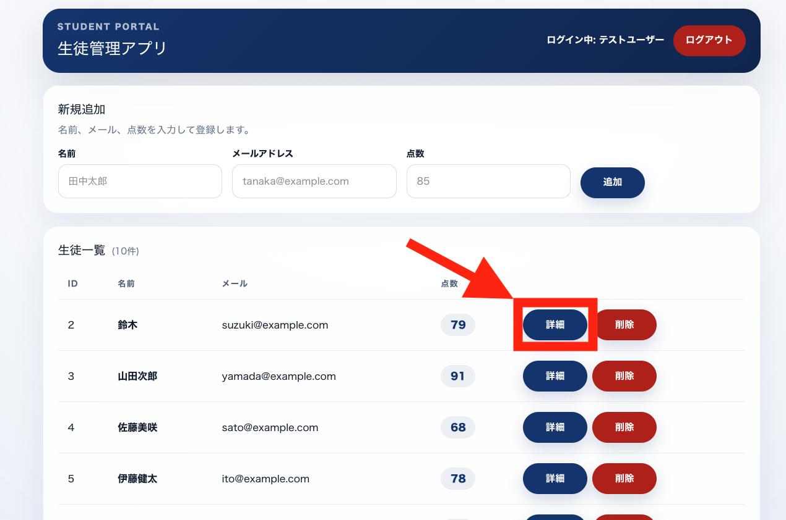
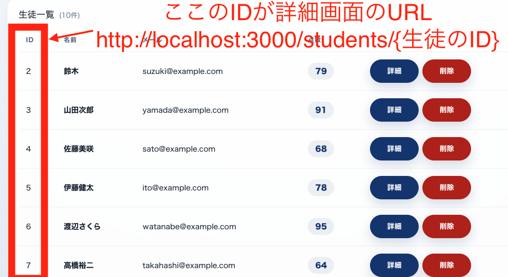
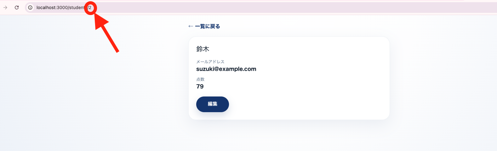
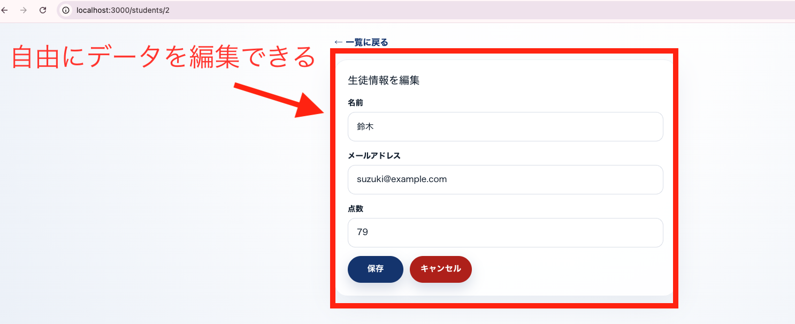
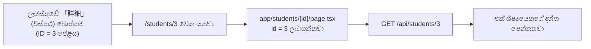

# පාඩම 24｜විස්තර තිරය හැදීම

> 🇯🇵 මුල් පිටපත (ජපන් භාෂාවෙන්): [2026_07_16_課題.md](<../../../2年生_システム開発実践/前期/2026_07_16/2026_07_16_課題.md>) <!-- original-ja-link -->

---

# මෙතෙක් කළ අය, ඊළඟට විස්තර තිරය හදමු

දැනට ලැයිස්තු තිරයේ නම, ඊමේල්, ලකුණු එක බැල්මකින් පේනවා, ඒත් එක් එක් ශිෂ්‍යයාගේ තොරතුරු සන්සුන්ව බලන්න හරි, එතැනින් සංස්කරණය කරන්න හරි තිරයක් නැහැ. ලැයිස්තුවේ 「詳細」(විස්තර) බොත්තම ඔබපු වෙලාවට, ඒ ශිෂ්‍යයාගේ තොරතුරු විතරක් පෙන්වන තිරයක් හදනවා.

## මොනවද හදන්නේ

ලැයිස්තු තිරයේ හැම පේළියකම තියෙන 「詳細」(විස්තර) බොත්තම ඔබපුවාම, ඒ ශිෂ්‍යයාගේ තොරතුරු විතරක් පෙන්වන තිරයකට යන විදිහට හදනවා.

වැදගත්ම කරුණ තමයි, **ලැයිස්තුවේ මොන පේළියේ 「詳細」(විස්තර) ඔබනවද කියන එක අනුව, යන තැනේ URL එක වෙනස් වෙන එක**. ශිෂ්‍යයාගේ ID එක එහෙමම URL එකේ කොටසක් වෙනවා.

බොත්තම ඔබපුවාම, පහත රූපයේ තියෙන වගේ ඒ ශිෂ්‍යයාගේ නම, ඊමේල් ලිපිනය, ලකුණු විතරක් පෙන්වන තිරයකට යන්න පුළුවන් නම් හරි.

ඒ වගේම, විස්තර තිරයේ 「編集」(සංස්කරණය) බොත්තම ඔබපුවාම, එතැනම ෆෝම් එකකට මාරු වෙලා අන්තර්ගතය වෙනස් කරන්න පුළුවන් විදිහට හදනවා (පාඩම 21 දී හදපු යාවත්කාලීන කිරීමේ කොටසේ අදහසමයි).

## විස්තර තිරය කියන්නේ මොකක්ද?

විස්තර තිරය CRUD වල **Read (එකක් විතරක් බලනවා)** කියන කොටසට අයිතියි. ලැයිස්තු තිරය "හැමෝගෙම තොරතුරු එකට බලන" තිරයක් වුණා, විස්තර තිරය "ID එකෙන් තෝරපු එක් කෙනෙකුගේ තොරතුරු විතරක් බලන" තිරයක්.

- ලැයිස්තු තිරය: `GET /api/students` → හැමෝගෙම දත්ත ලැබෙනවා
- විස්තර තිරය: `GET /api/students/{id}` → තෝරපු ID එකට අදාළ ශිෂ්‍යයාගේ දත්ත විතරක් ලැබෙනවා

උදාහරණයක් විදිහට ID එක 3 වන ශිෂ්‍යයාගේ 「詳細」(විස්තර) ඔබපුවාම, URL එකේ ID එක යන්නේ කොහොමද කියලා රූප සටහනකින් පෙන්නුවොත් මෙහෙමයි.

තවද, විස්තර තිරයෙන් සංස්කරණය කරලා සුරකින කොටස CRUD වල **Update (යාවත්කාලීන කරනවා)** කියන කොටසට අයිතියි. පෙන්වීම (Read) සහ යාවත්කාලීන කිරීම (Update) එකම තිරයක් ඇතුළේ මාරු වෙන විදිහට තමයි හදන්නේ.

## තිරයට අවශ්‍ය අංග

- ශිෂ්‍යයාගේ **නම** පෙන්වීම
- ශිෂ්‍යයාගේ **ඊමේල් ලිපිනය** පෙන්වීම
- ශිෂ්‍යයාගේ **ලකුණු** පෙන්වීම
- 「**編集**」(සංස්කරණය) බොත්තම (ඔබපුවාම ෆෝම් එකට මාරු වෙනවා)
- සංස්කරණ ෆෝම් එකේ, නම, ඊමේල් ලිපිනය, ලකුණු ඇතුළත් කරන කොටු සහ 「**保存**」(සුරකින්න) 「**キャンセル**」(අවලංගු කරන්න) බොත්තම්
- 「**一覧に戻る**」(ලැයිස්තුවට ආපසු යන්න) සබැඳිය

## ක්‍රියාත්මක කිරීමට ඉඟි (මෙතෙක් ඉගෙනගත් දේවල් එක්ක සම්බන්ධයි)

- ලැයිස්තු තිරයේ 「詳細」(විස්තර) බොත්තම, හැම ශිෂ්‍යයෙකුටම `/students/{ශිෂ්‍යයාගේ ID එක}` කියන සබැඳියක් වෙන විදිහට හදන්න (`` <Link href={`/students/${student.id}`}> `` වගේ, ID එක ඇතුළත් කරපු URL එකක් හදනවා)
- Next.js වල, URL එකේ කොටසක් (ID එක) ලබාගන්න පුළුවන් **dynamic routing** පාවිච්චි කරනවා. `app/students/[id]/page.tsx` වගේ ෆෝල්ඩර, ගොනු ව්‍යුහයක් හැදුවොත්, URL එකේ `{id}` කොටසේ අගය පිටුව ඇතුළේ ලබාගන්න පුළුවන්
- පිටුව පෙන්නුවාම, ලැබුණු ID එක පාවිච්චි කරලා `` fetch(`http://localhost:8000/api/students/${id}`) `` වගේ Laravel API එකට request එකක් යවලා, ඒ ශිෂ්‍යයාගේ දත්ත විතරක් ලබාගන්නවා
- Laravel පැත්තේ, `routes/api.php` එකේ `Route::apiResource('students', StudentController::class)` නිසා, ඇත්තටම `show($id)` (එකක් ලබාගැනීම) සහ `update($id)` (යාවත්කාලීන කිරීම) route දෙකත් දැනටමත් සූදානම් කරලා තියෙනවා. `StudentController` එකේ මේ method දෙක ක්‍රියාත්මක කරලා තියෙනවද කියලා බලන්න
- 「編集」(සංස්කරණය) බොත්තම ඔබපුවාම පෙන්වීම මාරු කරන්න ඕන නිසා, `useState` වලින් "දැන් තියෙන්නේ පෙන්වීමේ මාදිලියද, සංස්කරණ මාදිලියද" කියන එක තියාගත්තොත්, පාඩම 17-21 දී හදපු ෆෝම් අදහසම එහෙමම පාවිච්චි කරන්න පුළුවන්
- 「保存」(සුරකින්න) බොත්තම ඔබපුවාම, `fetch` එකෙන් `PUT` (නැත්නම් `PATCH`) පාවිච්චි කරලා `http://localhost:8000/api/students/{id}` එකට යවනවා. ටෝකනය `Authorization: Bearer ${token}` විදිහට එකතු කරන්න අමතක කරන්න එපා
