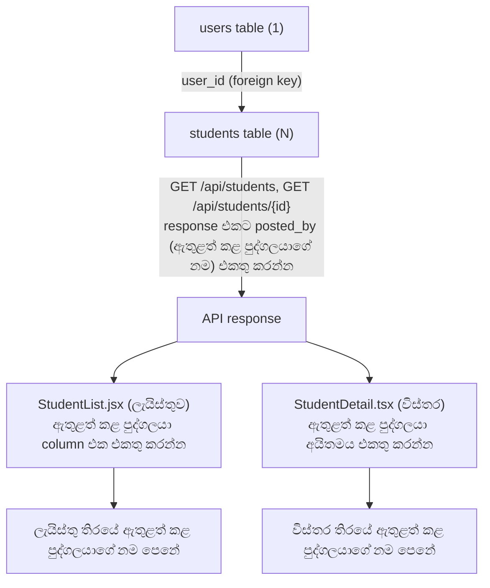
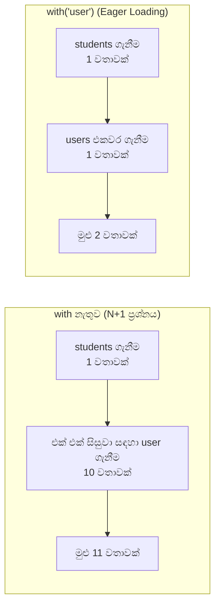

# පාඩම 25｜Users ⇔ Students relation එකකින් සම්බන්ධ කර, ඇතුළත් කළ පුද්ගලයා පෙන්වීම - ක්‍රියාත්මක කිරීමේ පියවර

> 🇯🇵 මුල් පිටපත (ජපන් භාෂාවෙන්): [2026_07_23_実装 .md](<../../../2年生_システム開発実践/前期/2026_07_23/2026_07_23_実装 .md>) <!-- original-ja-link -->

## අද දවසේ ඉලක්කය

- `students` table එකට "මේ දත්ත ලියාපදිංචි කළේ කවුද" යන්න පෙන්වන `user_id` එකක් එකතු කිරීම
- `User` සහ `Student`, Eloquent relation එකකින් සම්බන්ධ කිරීම (එක් user කෙනෙකුට සිසුන් කිහිප දෙනෙක් සිටිය හැක)
- සිසුන්ගේ ලැයිස්තුව සහ විස්තර API වල response එකට "ඇතුළත් කළ පුද්ගලයාගේ නම (`posted_by`)" ඇතුළත් කිරීම
- අලුත් සිසුවෙක් ලියාපදිංචි කරන විට, login වී සිටින user ට ස්වයංක්‍රීයව සම්බන්ධ කර save කිරීම
- ලැයිස්තු තිරය සහ විස්තර තිරය යන දෙකෙහිම "ඇතුළත් කළ පුද්ගලයා" පෙන්වීම

> **මෙම පාඩමේ ස්ථානය:** මෙතෙක් තිබූ `students` table එකේ "ලියාපදිංචි කළේ කවුද" යන තොරතුර තිබුණේ නැහැ. `users` table එක සමඟ foreign key relation එකක් එකතු කර, ඒ තොරතුර API හරහා frontend එකට යවා තිරයේ පෙන්වන සම්පූර්ණ ක්‍රියාවලිය අපි හදනවා.

---

## සමස්ත චිත්‍රය: අපි හදන්නේ මොකක්ද



> 💡 **උදාහරණයක් ලෙස… පුස්තකාලයේ පොත් ණයට දෙන කාඩ්පත**
>
> `students` table එකේ එක් එක් record එක "පොතක්" කියලා හිතුවොත්, `user_id` කියන්නේ "මේ පොත ණයට ගත්තේ (ලියාපදිංචි කළේ) කවුද" කියලා ලියපු ණය කාඩ්පතයි. කාඩ්පත නැත්නම්, පොත දැක්කත් "මේක කාගේ වගකීමද" කියලා දැනගන්න බැහැ. මුලින්ම පොතේ (`students`) කාඩ්පත තියන තැනක් (`user_id` column එක) හදනවා, ඊළඟට "එක් පාඨකයෙකුට පොත් කිහිපයක් ණයට ගන්න පුළුවන්" කියන සම්බන්ධය code එකෙන් (Eloquent) ප්‍රකාශ කරනවා, අන්තිමට ඒ තොරතුර තිරයේ පෙන්වනවා.

Eloquent වලදී මෙය පහත පරිදි ගැළපේ.

| Class | Method | අර්ථය |
|---|---|---|
| `User` | `students()` | එක් user කෙනෙකුට සිසුන් කිහිප දෙනෙක් සිටී (`hasMany`) |
| `Student` | `user()` | එක් සිසුවෙක් එක් user කෙනෙකුට අයිති වේ (`belongsTo`) |

### මේ පිළිවෙළට හදන්නේ ඇයි

Backend එකේ `user_id` සහ relation එක සූදානම් කරලා, API එකට `posted_by` return කරන්න පුළුවන් වෙනකම්, frontend එකට පෙන්වන්න දත්තම නැහැ. ඒ නිසා **backend (migration → model → Controller/Seeder) → frontend (ලැයිස්තුව → විස්තර)** යන පිළිවෙළට, කුඩා කොටස් වශයෙන් හදමින්, හැම වතාවෙම run කරලා බලමින් ඉදිරියට යනවා.

### File ව්‍යුහය (මෙවර වෙනස් කරන ඒවා)

| සංකේතය | අර්ථය |
|---|---|
| 🆕 අලුත් | අලුත් file එකක් හදනවා |
| ➕ එකතු කිරීම | තියෙන file එකකට code එකතු කරනවා |
| 🔁 ප්‍රතිස්ථාපනය | තියෙන process එක නැවත ලියනවා |
| 👀 පරීක්ෂාව | වෙනසක් අවශ්‍ය නැහැ. දැනටමත් හදලා තියෙනවද කියලා බලනවා විතරයි |

```
Laravel/
├── database/migrations/xxxx_add_user_id_to_students_table.php  🆕 අලුත් (user_id column එක එකතු කිරීම)
├── app/Models/User.php                                     ➕ students() relation එක එකතු කිරීම
├── app/Models/Student.php                                  ➕ user() relation එක එකතු කිරීම
├── app/Http/Controllers/Api/StudentController.php          🔁 index(), store() වෙනස් කිරීම
├── app/Http/Resources/StudentResource.php                  ➕ posted_by එකතු කිරීම
└── database/seeders/StudentSeeder.php                       🔁 user හරහා සිසුන් හැදීම

school-frontend/
├── components/students/StudentList.tsx     ➕ ඇතුළත් කළ පුද්ගලයා column එක එකතු කිරීම (header, cell)
└── components/students/StudentDetail.tsx   ➕ ඇතුළත් කළ පුද්ගලයා අයිතමය එකතු කිරීම
```

---

## Step 1｜Backend: migration එකකින් `user_id` එකතු කිරීම

**🆕 අලුත් file එක** — දැනට තියෙන `create_students_table` migration එක කෙලින්ම edit කරන්නේ නැහැ. දැනටමත් එක පාරක් run කරපු migration එකක් නැවත ලිවීම ප්‍රශ්න ඇති කරන නිසා, `user_id` column එක එකතු කරන්නම වෙනම අලුත් migration එකක් හදනවා.

```bash
cd Laravel
php artisan make:migration add_user_id_to_students_table --table=students
```

`Laravel/database/migrations/` තුළ, පහත වගේ නමකින් file එකක් හැදෙනවා (මුලින්ම තියෙන්නේ හැදූ දිනය හා වේලාව).

```
2026_07_16_000001_add_user_id_to_students_table.php
```

හැදුණු file එකේ අන්තර්ගතය පහත පරිදි ලියන්න.

```php
<?php
// ▼ database/migrations/2026_07_16_000001_add_user_id_to_students_table.php

use Illuminate\Database\Migrations\Migration;
use Illuminate\Database\Schema\Blueprint;
use Illuminate\Support\Facades\Schema;

return new class extends Migration
{
    public function up(): void
    {
        // දැනට තියෙන students table එකට user_id column එක එකතු කරනවා
        Schema::table('students', function (Blueprint $table) {
            $table->foreignId('user_id') // users.id refer කරන foreign key column එකක් හදනවා
                ->after('id')             // id column එකට පස්සෙන්ම තියනවා (කියවීමට පහසු වෙන්න)
                ->constrained()           // refer කරන තැන (users table එකේ id) ස්වයංක්‍රීයව අනුමාන කරලා foreign key constraint එක දානවා
                ->cascadeOnDelete();      // user කෙනෙක් delete කළොත්, ඒ user ගේ සිසුන්ගේ දත්තත් එකටම delete කරනවා
        });
    }

    public function down(): void
    {
        // migrate:rollback කළාම, එකතු කරපු foreign key එකයි column එකයි කලින් තිබුණු විදිහට හරවනවා
        Schema::table('students', function (Blueprint $table) {
            $table->dropForeign(['user_id']); // මුලින්ම foreign key constraint එක ඉවත් කරනවා
            $table->dropColumn('user_id');    // column එකම delete කරනවා
        });
    }
};
```

- `Schema::table('students', ...)` … තියෙන table එකකට "column එකක් එකතු කරන" වෙනසක් නිසා, `create` නෙවෙයි `table` පාවිච්චි කරනවා
- `foreignId('user_id')` … `users.id` refer කරන foreign key column එකක් හදනවා
- `->after('id')` … `id` ට පස්සෙන්ම `user_id` column එක තියනවා (කියවීමට පහසු වෙන්න)
- `->constrained()` … refer කරන තැන ස්වයංක්‍රීයව අනුමාන කරලා (`users` table එකේ `id`) foreign key constraint එක දානවා
- `->cascadeOnDelete()` … user කෙනෙක් delete කළොත්, ඒ user ට අයිති සිසුන්ගේ දත්තත් එකටම delete කරනවා
- `down()` … `migrate:rollback` කළාම, එකතු කරපු foreign key එකයි column එකයි කලින් තිබුණු විදිහට හරවන්න පුළුවන් වෙන්න හදලා තියනවා

> ⚠️ මැදදී `user_id` එකතු කරනවා නම්, දැනට තියෙන දත්ත වලට සම්බන්ධ කරන්න user කෙනෙක් නැහැ. Development කාලයේදී නම් `php artisan migrate:fresh --seed` එකෙන් table එක නැවත හදලා, seeder එකෙන් මුල ඉඳන්ම user සමඟ දත්ත ඇතුළත් කරන එක පහසුයි (production වගේ දත්ත තියාගන්න ඕන නම්, මුලින් `nullable()` විදිහට එකතු කරලා backfill කරන්න, ඊළඟ migration එකකින් `NOT NULL` constraint එක දාන්න කියන අදියර දෙකක ක්‍රමයක් අවශ්‍ය වෙනවා).

---

## Step 2｜Backend: model එකේ relation එක define කිරීම

### 2-1. `app/Models/User.php`

**➕ එකතු කිරීම** — `HasMany` සඳහා `use` statement එකයි `students()` method එකයි එකතු කරන්න.

```php
use Illuminate\Database\Eloquent\Relations\HasMany; // ← relation වර්ගය (HasMany) පාවිච්චි කරන්න පුළුවන් කරනවා

// ...

// එක් user කෙනෙකුට සිසුන් කිහිප දෙනෙක් සිටින සම්බන්ධය (එකට-බොහෝ) පෙන්වන method එක
// මේක define කළාම $user->students එකෙන් "මේ user ලියාපදිංචි කරපු සිසුන්ගේ ලැයිස්තුව" ගන්න පුළුවන්
public function students(): HasMany
{
    // hasMany(Student::class) … "Student model එකේ records ගොඩක් එක්ක සම්බන්ධයි" කියන අර්ථය
    return $this->hasMany(Student::class);
}
```

### 2-2. `app/Models/Student.php`

**➕ එකතු කිරීම** — `BelongsTo` සඳහා `use` statement එකයි `user()` method එකයි එකතු කරන්න.

```php
use Illuminate\Database\Eloquent\Relations\BelongsTo; // ← relation වර්ගය (BelongsTo) පාවිච්චි කරන්න පුළුවන් කරනවා

// ...

// එක් සිසුවෙක් එක් user කෙනෙකුට අයිති වෙන සම්බන්ධය (බොහෝ-එකට) පෙන්වන method එක
// මේක define කළාම $student->user එකෙන් "මේ සිසුවා ලියාපදිංචි කරපු user" ගන්න පුළුවන්
public function user(): BelongsTo
{
    // belongsTo(User::class) … "User model එකට අයිතියි" කියන අර්ථය
    // ※ මේ table එකේ user_id column එක බලලා, ඊට ගැළපෙන users record එක හොයාගෙන යනවා
    return $this->belongsTo(User::class);
}
```

දැන් `$user->students` (සිසුන් කිහිප දෙනෙක් ගැනීම) සහ `$student->user` (ඒ සිසුවා ඇතුළත් කළ පුද්ගලයා ගැනීම) කියන දෙපැත්තෙන්ම access කරන්න පුළුවන්.

---

## Step 3｜Backend: Controller එකෙන් ඇතුළත් කළ පුද්ගලයාගේ නම return කිරීම

### 3-1. `index()` වෙනස් කිරීම

**🔁 ප්‍රතිස්ථාපනය** — `Student::all()` වගේ සරලව ගන්නවා වෙනුවට, `with('user')` එකෙන් relation එකේ දත්තත් එකටම load කරලා (Eager Loading), `StudentResource` හරහා response එකට හරවනවා. `show()` දැනටමත් `StudentResource` පාවිච්චි කරන නිසා, `index()` එකත් ඒ විදිහටම හැදුවොත්, ඇතුළත් කළ පුද්ගලයා පෙන්වන ක්‍රමය එක තැනකට (`StudentResource`) එකතු කරන්න පුළුවන්.

```php
public function index()
{
    // සිසුන්ගේ දත්ත ගන්න වෙලාවේදීම, ඇතුළත් කළ පුද්ගලයාගේ (user) තොරතුරුත් එකටම load කරලා තියනවා
    // → මෙහෙම නොකළොත්, සිසුන් ගණනට සමාන වාර ගණනක් "ඇතුළත් කළ පුද්ගලයාගේ නම ගන්න" SQL යැවෙනවා (N+1 ප්‍රශ්නය)
    $students = Student::with('user')->get();

    // ගත්ත සිසුන්ගේ දත්ත, response එකට ගැළපෙන ආකාරයට (StudentResource) හරවලා return කරනවා
    return StudentResource::collection($students);
}
```

> 💡 **N+1 ප්‍රශ්නය කියන්නේ මොකක්ද?**
>
> `with('user')` නැතුව `Student::all()` හෝ `Student::get()` කියලා ලිව්වොත්, පහත වගේ SQL යැවෙනවා.
>
> 1. `students` table එකෙන් සියලුම සිසුන් ගන්න SQL (1 වතාවක්)
> 2. තිරයේ හෝ response එකේ **එක් එක් සිසුවා සඳහා** `$student->user->name` access කරන හැම වතාවකම, "මේ සිසුවා ඇතුළත් කළ පුද්ගලයා (user) 1 දෙනෙක් ගන්න" SQL (සිසුන් ගණනට සමානව = N වතාවක්)
>
> ඒ කියන්නේ, සිසුන් 10 දෙනෙක් ඉන්නවා නම් "සිසුන්ගේ ලැයිස්තුව ගන්න 1 වතාවක්" + "ඇතුළත් කළ පුද්ගලයා ගන්න 10 වතාවක්" = **මුළු 11 වතාවක්** SQL යැවෙනවා. සිසුන් 100, 1000 වගේ වැඩි වෙන්න වැඩි වෙන්න, SQL ගණනත් ඒ අනුපාතයටම වැඩි වෙලා, API එක ටිකෙන් ටික slow වෙනවා. මේක තමයි **N+1 ප්‍රශ්නය** (1 වතාවකින් ඉවර කරන්න පුළුවන් දේට, දත්ත N ප්‍රමාණයක් සඳහා අමතර query N ප්‍රමාණයක් run වෙන ප්‍රශ්නය).
>
> මුලින්ම `with('user')` දාලා තිබුණොත්, Laravel
>
> 1. `students` table එක ගන්න SQL (1 වතාවක්)
> 2. එහි තියෙන `user_id` ටික එකතු කරලා, ඊට ගැළපෙන `users` එකවර ගන්න SQL (1 වතාවක්)
>
> කියලා **මුළු 2 වතාවකින්** වැඩේ ඉවර කරනවා (මේකට **Eager Loading** = කලින්ම එකවර load කිරීම කියලා කියනවා). සිසුන් කී දෙනෙක් වැඩි වුණත්, SQL යවන ගණන හැම වෙලේම 2 ම යි. "පස්සේ එකින් එක ගන්න යනවා (N+1)" නෙවෙයි, "මුලින්ම එකවර ගෙනත් තියාගන්නවා (Eager Loading)" කියන එක තමයි වැදගත් කාරණය.
>
> සිසුන් 10 දෙනෙක් ඉන්න අවස්ථාවක SQL ගණන සසඳලා බැලුවොත් මෙහෙමයි.



> ⚠️ Return type එක `: JsonResponse` කියලා ලියන්න හිතෙන්න පුළුවන්, නමුත් එහෙම කරනවා නම් `use Illuminate\Http\JsonResponse;` import එක අවශ්‍යයි. අනෙක් `store()`/`show()`/`update()`/`destroy()` වලත් type ලියලා නැති නිසා, ඒවාට ගැළපෙන්න type නැතුවම තියනවා.

### 3-2. `app/Http/Resources/StudentResource.php` එකට `posted_by` එකතු කිරීම

**➕ එකතු කිරීම** — `index()` විතරක් හැදුවාට, response එකේ `posted_by` තාම පෙන්නන්නේ නැහැ. ඇත්තටම JSON එකට හරවන්නේ `StudentResource` නිසා, මෙතනට එකතු කරනවා. `show()` (විස්තර API) එකත් මේ `StudentResource` හරහාම යන නිසා, එක වෙනසකින් ලැයිස්තුව සහ විස්තර යන දෙකටම බලපානවා.

```php
public function toArray($request): array
{
    // මේ සිසුවාගේ දත්ත ලියාපදිංචි කරපු පුද්ගලයාගේ (user) නම, කලින්ම variable එකකට ගන්නවා
    $postedByName = $this->user->name;

    return [
        'id'         => $this->id,
        'name'       => $this->name,
        'email'      => $this->email,
        'score'      => $this->score,
        'evaluation' => $this->score >= 80 ? 'A' : 'B',
        'created_at' => $this->created_at->format('Y/m/d'),
        'posted_by'  => $postedByName, // ★ එකතු කළා: ඇතුළත් කළ පුද්ගලයාගේ නම
    ];
}
```

### 3-3. `store()` වෙනස් කිරීම

**🔁 ප්‍රතිස්ථාපනය** — `Student::create()` වෙනුවට, login වී සිටින user හරහා හදන නිසා, `user_id` ස්වයංක්‍රීයව set වෙනවා. Validation එක කලින් වගේම `$request->validate(...)` පාවිච්චි කරලා, ඒකේ ප්‍රතිඵලය (`$validated`) කෙලින්ම සිසුවා හදන්න යවනවා.

```php
public function store(Request $request)
{
    // Validation: එවපු දත්ත වල ආකෘතිය පරීක්ෂා කරනවා
    $validated = $request->validate([
        'name'  => 'required|max:100',          // අනිවාර්යයි, අකුරු 100ක් හෝ ඊට අඩු
        'email' => 'required|email|unique:students', // අනිවාර්යයි, email ආකෘතිය, duplicate බැහැ
        'score' => 'required|integer|min:0|max:100', // අනිවාර්යයි, පූර්ණ සංඛ්‍යාවක්, 0〜100
    ]);

    // $request->user() … දැන් login වී සිටින user (Sanctum විසින් authenticate කරලා තියෙන්නේ)
    // ->students()->create(...) … ඒ user ගේ සිසුවෙක් විදිහට අලුතින් හදනවා
    //   → Eloquent ස්වයංක්‍රීයව user_id එකට login user ගේ ID එක දානවා
    $student = $request->user()->students()->create($validated);

    // 201 Created (සාර්ථකව හැදුවා) status code එකත් එක්ක return කරනවා
    return response()->json([
        'status' => 'ok',
        'data'   => $student,
    ], 201);
}
```

`$request->user()` කියන්නේ Sanctum එකෙන් authenticate කරපු user (= දැන් login වී සිටින උපදේශකයා). `->students()->create(...)` කියලා ලියන නිසා, Eloquent ස්වයංක්‍රීයව `user_id` එකට ඒ user ගේ ID එක පුරවනවා. `Student::create($request->all())` වගේ "සියලුම parameters" යවනවා වෙනුවට, validation කරපු `$validated` විතරක් යවන එකත් සැලකිල්ලට ගන්න.

---

## Step 4｜Backend: seeder එකත් user හරහා වැඩ කරන්න වෙනස් කිරීම

මේ project එකේ `StudentSeeder.php` කියලා file එකක් නැහැ. ඒ වෙනුවට `database/seeders/DatabaseSeeder.php` ඇතුළේ කෙලින්ම `Student::factory(10)->create()` කියලා සිසුන්ගේ දත්ත හදනවා.

```php
// database/seeders/DatabaseSeeder.php (දැනට තියෙන අන්තර්ගතය)
public function run(): void
{
    \App\Models\Student::factory(10)->create(); // සිසුන්ගේ දත්ත 10ක් හදනවා
}
```

මෙහෙම තිබුණොත් සිසුන්ගේ දත්ත වලට `user_id` එක වැටෙන්නේ නැහැ (සම්බන්ධ කරන්න user කෙනෙක්ම නැහැ). ඒ නිසා **① මුලින්ම test user කෙනෙක් හදනවා → ② ඒ user හරහා සිසුන් හදනවා** කියන අදියර දෙකකට නැවත ලියනවා. අලුත් file එකක් හදන්න අවශ්‍ය නැහැ, `DatabaseSeeder.php` කෙලින්ම වෙනස් කළාම ඇති.

**🔁 ප්‍රතිස්ථාපනය**

```php
// database/seeders/DatabaseSeeder.php (වෙනස් කළාට පස්සේ)
public function run(): void
{
    // ① login වෙන්න test user කෙනෙක් හදනවා
    // User::factory() … UserFactory එකේ define කරපු dummy දත්ත වලින් හදනවා
    //   password එක UserFactory පැත්තේ දැනටමත් "password" hash කරපු අගයක් නිසා,
    //   මෙතන name සහ email විතරක් override කළාම test@example.com / password එකෙන් login වෙන්න පුළුවන්
    $user = \App\Models\User::factory()->create([
        'name'  => 'テストユーザー',
        'email' => 'test@example.com',
    ]);

    // ② සිසුන්ගේ දත්ත හදන වෙලාවේ ->for($user) දැම්මොත්,
    //   Student::user() relation එක (belongsTo) හරහා ස්වයංක්‍රීයව user_id එකට $user->id වැටෙනවා
    \App\Models\Student::factory(10)->for($user)->create();
}
```

`Student::factory(10)->for($user)` එකේ `for()` කියන්නේ "මේ model එකට ($user) සම්බන්ධ කරලා හදන්න" කියන අර්ථය තියෙන Factory එකේ feature එකක්. `Student` model එකේ `user()` (`belongsTo(User::class)`) දැනටමත් define කරලා තියෙන නිසා, Laravel ස්වයංක්‍රීයව `user_id` එක `$user->id` ලෙස set කරනවා. `$user->students()->create(...)` එකින් එක call කරනවා වගේම ප්‍රතිඵලය, Factory එකෙන් එකවර ලබාගන්නවා කියලා හිතන්න.

### ක්‍රියාකාරිත්වය පරීක්ෂා කිරීම (backend)

```bash
cd Laravel
php artisan migrate:fresh --seed
php artisan serve
```

Login වෙලා token එක ගත්තට පස්සේ, ලැයිස්තු API එක call කරලා `posted_by` ඇතුළත් වෙලා තියෙනවද බලන්න.

```bash
curl http://localhost:8000/api/students \
  -H "Authorization: Bearer <ගත්ත token එක>" \
  -H "Accept: application/json"
```

| පරීක්ෂා කරන දේ | කරන දේ | බලාපොරොත්තු වන ප්‍රතිඵලය |
|---|---|---|
| Relation | ලැයිස්තු API එක run කරන්න | හැම සිසුවෙකුගේම JSON එකේ `posted_by` (ලියාපදිංචි කළ user ගේ නම) තියෙනවා |
| අලුත් ලියාපදිංචිය | `POST /api/students` එකෙන් සිසුවෙක් එකතු කරන්න | DB එකේ `students.user_id` එකට login වී සිටින user ගේ ID එක වැටෙනවා |
| Cascade delete | අදාළ user DB එකෙන් delete කරන්න (development DB එකේ පරීක්ෂා කරන්න) | ඒ user ලියාපදිංචි කරපු සිසුන්ගේ දත්තත් ඒ සමඟම delete වෙනවා |
| N+1 වැළැක්වීම | `index()` එකට query log එකක් දාලා පරීක්ෂා කරන්න | `students` ගැනීම 1 වතාවක් + `users` ගැනීම 1 වතාවක් පමණින් ඉවර වෙනවා (සිසුන් ගණනට query යැවෙන්නේ නැහැ) |

---

## Step 5｜Frontend: ලැයිස්තු තිරයට ඇතුළත් කළ පුද්ගලයා column එක එකතු කිරීම

`school-frontend/components/StudentList.jsx` edit කරන්න. මේ project එක TypeScript types පාවිච්චි නොකරන සාමාන්‍ය JSX (`.jsx`) වලින් ලියලා තියෙන නිසා, `type Student` වගේ type definition එකක් කොහෙවත් නැහැ. Backend එක `posted_by` return කරන නිසා, frontend පැත්තේ `student.posted_by` කියලා කෙලින්ම ලිව්වාම අගය ගන්න පුළුවන්. Type පරීක්ෂා කරන හෝ වෙනස් කරන පියවරක් අවශ්‍ය නැහැ.

**➕ එකතු කිරීම (table header)** — `点数` (ලකුණු) column එකට පස්සේ "投稿者" (ඇතුළත් කළ පුද්ගලයා) header එක එකතු කරන්න.

```jsx
<thead>
  <tr style={{ background: "#f5f5f5" }}>
    <th style={thStyle}>ID</th>
    <th style={thStyle}>名前</th>
    <th style={thStyle}>メール</th>
    <th style={thStyle}>点数</th>
    <th style={thStyle}>投稿者</th> {/* ★ එකතු කළා: මේ සිසුවා ලියාපදිංචි කළ user ගේ නම පෙන්වන column එක */}
    <th style={thStyle}></th>
  </tr>
</thead>
```

**➕ එකතු කිරීම (`StudentRow` ඇතුළේ)** — ලකුණු cell එකට පස්සේ, ඇතුළත් කළ පුද්ගලයාගේ නම පෙන්වන cell එක එකතු කරන්න.

```jsx
<td style={tdStyle}>{student.score}</td>
{/* ★ එකතු කළා: header එකේ හදපු "投稿者" column එකට ගැළපෙන cell එක. ඇතුළේ ඇතුළත් කළ පුද්ගලයාගේ නම පමණක් තිබුණාම ඇති */}
<td style={tdStyle}>{student.posted_by}</td>
<td style={tdStyle}>
  <div style={{ display: "flex", gap: "0.5rem", flexWrap: "wrap" }}>
    {/* විස්තර, delete බොත්තම් (කලින් තිබුණු විදිහටම) */}
  </div>
</td>
```

Header එකේයි cell වලයි column ගණන නොගැළපී යන්නේ නැති වෙන්න, දෙකම එකට එකතු කරන එක තමයි වැදගත්.

---

## Step 6｜Frontend: විස්තර තිරයට ඇතුළත් කළ පුද්ගලයා අයිතමය එකතු කිරීම

`school-frontend/components/students/StudentDetail.tsx` edit කරන්න. මේ file එකේ extension එක `.tsx` වුණත්, `props` වලට type annotation දාලා නැහැ (`export default function StudentDetail({ student, token, onUpdated })` වගේ ලියලා තියෙන්නේ), ඒ නිසා type පරීක්ෂා කරන හෝ වෙනස් කරන පියවරක් අවශ්‍ය නැහැ. Backend එක `posted_by` return කරනවා නම්, කෙලින්ම `student.posted_by` කියලා refer කරන්න පුළුවන්.

**➕ එකතු කිරීම (display mode එකේ `<dl>` ඇතුළේ)** — "点数" (ලකුණු) අයිතමයට පස්සේ "投稿者" (ඇතුළත් කළ පුද්ගලයා) අයිතමය එකතු කරන්න. දැනට තියෙන `<dt>`/`<dd>` වල style එකටම ගැළපෙන්න හදන්න.

```tsx
<dl style={{ display: "grid", gap: "16px", margin: 0 }}>
  <div>
    <dt style={{ fontSize: "0.9em", color: "#666", marginBottom: "4px" }}>メールアドレス</dt>
    <dd style={{ margin: 0, fontWeight: "bold", fontSize: "1.1em" }}>{student.email}</dd>
  </div>
  <div>
    <dt style={{ fontSize: "0.9em", color: "#666", marginBottom: "4px" }}>点数</dt>
    <dd style={{ margin: 0, fontWeight: "bold", fontSize: "1.1em" }}>{student.score} 点</dd>
  </div>
  <div>
    {/* ★ එකතු කළා: මේ සිසුවාගේ දත්ත ලියාපදිංචි කළේ කවුද කියලා පෙන්වන අයිතමය (පෙන්වීමට පමණයි, edit form එකට එකතු කරන්නේ නැහැ) */}
    <dt style={{ fontSize: "0.9em", color: "#666", marginBottom: "4px" }}>投稿者</dt>
    <dd style={{ margin: 0, fontWeight: "bold", fontSize: "1.1em" }}>{student.posted_by}</dd>
  </div>
</dl>
```

Edit mode (form) පැත්තේ නම, email සහ ලකුණු පමණක් edit කරන විදිහටම තිබුණාට ප්‍රශ්නයක් නැහැ. "ඇතුළත් කළ පුද්ගලයා" කියන්නේ ලියාපදිංචි කළේ කවුද කියලා පෙන්වන, පෙන්වීමට පමණක් තියෙන තොරතුරක් නිසා, edit form එකට එකතු කරන්නේ නැහැ.

### ක්‍රියාකාරිත්වය පරීක්ෂා කිරීම (frontend)

```bash
cd school-frontend && npm run dev
```

මුලින්ම backend එක (`php artisan serve`) start කරලා, login වී සිටින තත්ත්වයේදී පරීක්ෂා කරන්න.

| පරීක්ෂා කරන දේ | කරන දේ | බලාපොරොත්තු වන ප්‍රතිඵලය |
|---|---|---|
| ලැයිස්තුව පෙන්වීම | `/students` open කරන්න | හැම පේළියකම "点数" (ලකුණු) column එකේ දකුණු පැත්තේ "投稿者" (ඇතුළත් කළ පුද්ගලයා) column එකක් තියෙනවා, ලියාපදිංචි කළ user ගේ නම පෙනෙනවා |
| විස්තර පෙන්වීම | ඕනෑම පේළියක "詳細" (විස්තර) open කරන්න | නම, email සහ ලකුණු වලට අමතරව "投稿者" (ඇතුළත් කළ පුද්ගලයා) පෙනෙනවා |
| Type error නැහැ | `npx tsc --noEmit` run කරන්න | Error එකක් එන්නේ නැහැ (`posted_by` දැනට තියෙන type එකේ ඇතුළත් නිසා) |
| Layout කැඩිලා නැහැ | ලැයිස්තුවේ header එකේයි cell වලයි column ගණන සසඳන්න | Header ගණනයි cell ගණනයි සමානයි, table එක නොගැළපී ගිහින් නැහැ |

---

## සාරාංශය

| සංකල්පය | මෙවර අදාළ වූ තැන |
|---|---|
| එකට-බොහෝ relation | `students.user_id`, `User::students()`, `Student::user()` |
| Eager Loading (N+1 වැළැක්වීම) | `StudentController@index` හි `Student::with('user')` |
| Login user සමඟ ස්වයංක්‍රීය සම්බන්ධය | `StudentController@store` හි `$request->user()->students()->create(...)` |
| API response එකට ඇතුළත් කළ පුද්ගලයාගේ තොරතුරු එකතු කිරීම | `posted_by` field එක |
| Frontend එකේ පෙන්වීම | `StudentList.tsx`／`StudentDetail.tsx` |

## අවසන් කිරීමේ checklist එක (Definition of Done)

- [ ] `students` table එකේ `user_id` column එක තියෙනවා, `users.id` ට foreign key constraint එක දාලා තියෙනවා
- [ ] `User::students()` / `Student::user()` කියන දෙපැත්තේ relation එක define කරලා තියෙනවා
- [ ] `GET /api/students` response එකේ `posted_by` (ඇතුළත් කළ පුද්ගලයාගේ නම) තියෙනවා
- [ ] `POST /api/students` එකෙන් සිසුවෙක් හැදුවාම, login වී සිටින user ට ස්වයංක්‍රීයව සම්බන්ධ වෙනවා
- [ ] Seeder එක නැවත run කළත් `posted_by` එකට test user ගේ නම වැටෙනවා
- [ ] `/students` ලැයිස්තු table එකේ "投稿者" (ඇතුළත් කළ පුද්ගලයා) column එක තියෙනවා, ලියාපදිංචි කළ user ගේ නම පෙනෙනවා
- [ ] `/students/{id}` විස්තර තිරයේ "投稿者" (ඇතුළත් කළ පුද්ගලයා) අයිතමය තියෙනවා, ලියාපදිංචි කළ user ගේ නම පෙනෙනවා
- [ ] Edit form එකට ඇතුළත් කළ පුද්ගලයා field එක එකතු කරලා නැහැ (පෙන්වීමට පමණක් නිසා)
- [ ] `npx tsc --noEmit` error නැතුව pass වෙනවා

## Start කරන commands

```bash
# Backend
cd Laravel && php artisan serve   # http://localhost:8000

# Frontend
cd school-frontend && npm run dev # http://localhost:3000
```

Test account එක: `test@example.com` / `password`
