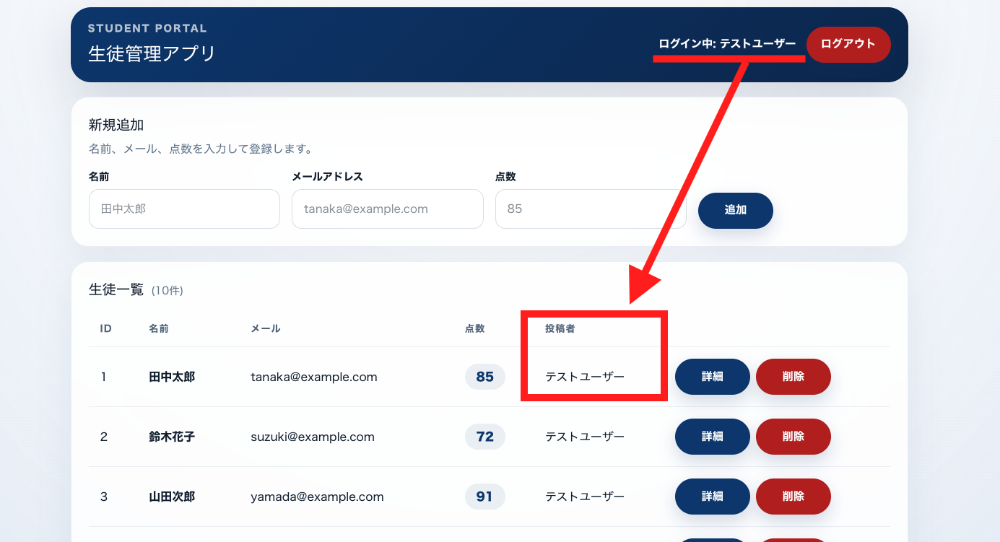
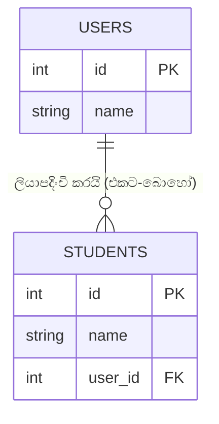

# පාඩම 25｜Users ⇔ Students relation එකකින් සම්බන්ධ කිරීම

> 🇯🇵 මුල් පිටපත (ජපන් භාෂාවෙන්): [2026_07_23_課題.md](<../../../2年生_システム開発実践/前期/2026_07_23/2026_07_23_課題.md>) <!-- original-ja-link -->

---

# මෙතෙක් කරපු අය, ඊළඟට Users table එකයි Students table එකයි relation එකකින් සම්බන්ධ කරමු

[Relational database ගැන](./リレーショナルデータベース入門.md)

දැනට තියෙන තත්ත්වයේදී, `students` table එකේ "ඒ සිසුවාගේ දත්ත ලියාපදිංචි කළේ කවුද" කියන තොරතුර නැහැ. කාටත් පේන්නේ එකම ලැයිස්තුවයි, "මේ දත්ත මම (login වී සිටින user) ලියාපදිංචි කළ ඒවා" කියලා දැනගන්න බැරි විදිහට තමයි හදලා තියෙන්නේ.

`users` table එකයි `students` table එකයි relation එකකින් (සම්බන්ධ කිරීමකින්) සම්බන්ධ කරලා, ලැයිස්තු සහ විස්තර තිරවල 「投稿者」(ඇතුළත් කළ පුද්ගලයා) ලෙස ලියාපදිංචි කළ user ගේ නම පෙන්වන්න හදමු.

## හදන්නේ මොකක්ද

අලුතින් සිසුවෙක් ලියාපදිංචි කළාම, ඒ සිසුවාගේ දත්ත වලට "දැන් login වී සිටින user" ස්වයංක්‍රීයව සම්බන්ධ වෙන්න හදනවා. ඊට පස්සේ ලැයිස්තු තිරයේත් විස්තර තිරයේත්, ඒ සිසුවා ලියාපදිංචි කළ user ගේ නම (ඇතුළත් කළ පුද්ගලයා) පෙන්වනවා.

වැදගත් කාරණය නම්, **login වී සිටින user ගේ නමයි (ඉහළ දකුණු කෙළවරේ), ලැයිස්තුවේ "投稿者" (ඇතුළත් කළ පුද්ගලයා) column එකේ පෙනෙන නමයි සමාන වීම**. මෙවර test user නම්, ඕනෑම සිසුවෙකුගේ පේළිය බැලුවත් "投稿者：テストユーザー" (ඇතුළත් කළ පුද්ගලයා: test user) කියලා පෙන්විය යුතුයි (දැනට තියෙන seed දත්ත සියල්ලම එකම user ලියාපදිංචි කළා කියලා තමයි සැලකෙන්නේ).

## Relation කියන්නේ මොකක්ද?

`users` table එකයි `students` table එකයි දැනට සම්පූර්ණයෙන්ම වෙන වෙනම table දෙකක් විදිහට තියෙන්නේ. මේ දෙක "එක් user කෙනෙකුට සිසුන් කිහිප දෙනෙක් ලියාපදිංචි කරන්න පුළුවන්" කියන සම්බන්ධයෙන් යා කරන එක තමයි මෙවර relation එක.

- `users` table එක: record 1ක් = user 1 දෙනෙක් (උපදේශකයා)
- `students` table එක: record 1ක් = සිසුවා 1 දෙනෙක්

මේ දෙක, `students` පැත්තට "ලියාපදිංචි කළේ කුමන user ද" කියලා පෙන්වන column එකක් (**foreign key**) දීලා සම්බන්ධ කරනවා. මේකෙන්,

- එක් user කෙනෙකුට සිසුන් කිහිප දෙනෙක් සිටිය හැක (**එකට-බොහෝ** සම්බන්ධය)
- එක් සිසුවෙකුගේ දත්ත, අනිවාර්යයෙන්ම එක් user කෙනෙකුට අයිති වේ

කියන සම්බන්ධය database එකේ ප්‍රකාශ කරන්න පුළුවන්. රූපයකින් පෙන්වුවොත් මෙහෙමයි (`user_id` තමයි foreign key එක).

Laravel වලදී, මේ foreign key එක පදනම් කරගෙන `User` model එකේත් `Student` model එකේත් relation define කළාම, "මේ user ලියාපදිංචි කළ සිසුන්ගේ ලැයිස්තුව" හෝ "මේ සිසුවා ලියාපදිංචි කළ user" පහසුවෙන් ගන්න පුළුවන් වෙනවා.

## තිරයට අවශ්‍ය අංග

- සිසුන්ගේ ලැයිස්තු තිරයේ (`/students`) හැම පේළියකම, **投稿者** (ඇතුළත් කළ පුද්ගලයා: ලියාපදිංචි කළ user ගේ නම) පෙන්වන column එකක්
- සිසුවාගේ විස්තර තිරයේත් (`/students/{id}`), ඒ විදිහටම **投稿者** (ඇතුළත් කළ පුද්ගලයා) පෙන්වන අයිතමයක්
- අලුතින් සිසුවෙක් ලියාපදිංචි කළාම, ඒ සිසුවාගේ දත්ත ස්වයංක්‍රීයව "දැන් login වී සිටින user" ට සම්බන්ධ වීම (වෙනත් user කෙනෙක් ලියාපදිංචි කළා කියලා සැලකෙන්නේ නැහැ)

## ක්‍රියාත්මක කිරීමට ඉඟි (මෙතෙක් ඉගෙනගත් දේවල් එක්ක සම්බන්ධයි)

- Database පැත්තේදී, `students` table එකට `users` table එක refer කරන foreign key column එකක් (උදා: `user_id`) එකතු කරනවා. දැනටමත් වැඩ කරන table එකක migration එක කෙලින්ම නැවත ලියනවා වෙනුවට, column එක එකතු කරන **අලුත් migration එකක්** හදන එක ආරක්ෂිතයි
- Foreign key එකක් එකතු කළාම, "foreign key එකෙන් refer කරන user delete වුණොත් මොකද කරන්නේ" කියන එකත් තීරණය කරන්න ඕන (delete වීමත් එක්කම සිසුන්ගේ දත්තත් මකන එක වගේ)
- Laravel වලදී, `User` model එකට "එක් user කෙනෙකුට සිසුන් කිහිප දෙනෙක් සිටී" කියන relation එක (`hasMany`), `Student` model එකට "එක් සිසුවෙක් එක් user කෙනෙකුට අයිති වේ" කියන relation එක (`belongsTo`) define කරනවා
- සිසුන්ගේ ලැයිස්තුව return කරන API එකේ (`index()`), සිසුන්ගේ දත්ත එක්කම ලියාපදිංචි කළ user ගේ තොරතුරුත් අරගෙන, response එකට ඇතුළත් කළ පුද්ගලයාගේ නම එකතු කරනවා. එකින් එක user තොරතුරු ගන්න ගියොත් communication (SQL) අනවශ්‍ය විදිහට වැඩි වෙන බවත් සැලකිල්ලට ගන්න (`with()` පාවිච්චි කරලා කලින්ම load කිරීම ප්‍රයෝජනවත් වෙනවා)
- අලුතින් සිසුවෙක් ලියාපදිංචි කරන API එකේ (`store()`), `$request->user()` (දැන් login වී සිටින user) හරහා දත්ත හදන නිසා, foreign key එක ස්වයංක්‍රීයව ඒ user ගේ ID එක වෙනවා
- Frontend පැත්තේදී, API response එකේ type එකට (`type Student`) ඇතුළත් කළ පුද්ගලයාගේ නම සඳහා field එකක් එකතු කරලා, ලැයිස්තු table එකටයි විස්තර තිරයටයි ඒක පෙන්වන JSX එකතු කරනවා

## ක්‍රියාත්මක කිරීමේ පිළිවෙළ

**1. DB පැත්තේ foreign key එක එකතු කිරීම**

`students` table එකට `user_id` column එක එකතු කරන්න. දැනට තියෙන migration එක නැවත නොලියා, අලුත් migration file එකක් හදලා එකතු කරන එක ආරක්ෂිතයි (production එකේ වැඩ කරන table ව්‍යුහය පස්සේ වෙනස් කරන විට පාවිච්චි කරන සම්මත ක්‍රමය).

**↓**

**2. Delete කරන විට හැසිරීම තීරණය කිරීම**

Foreign key එක දාන වෙලාවේදීම, foreign key එකෙන් refer කරන `users` table එකේ user මැකුණොත් මොකද කරන්නේ කියලාත් (`onDelete('cascade')` එකෙන් සිසුන්ගේ දත්තත් එකටම මකන එක වගේ) set කරන්න ඕන.

**↓**

**3. Model එකේ relation එක define කිරීම**

- `User` model → `hasMany(Student::class)` (එක් user කෙනෙකුට සිසුන් කිහිප දෙනෙක් සිටිය හැක)
- `Student` model → `belongsTo(User::class)` (එක් සිසුවෙක් එක් user කෙනෙකුට අයිති වේ)

**↓**

**4. ලැයිස්තු API එක වෙනස් කිරීම (`index()`)**

සිසුන්ගේ දත්ත ගන්න වෙලාවේදීම, ඇතුළත් කළ පුද්ගලයාගේ (user) තොරතුරුත් එකටම ගන්න. මෙතනදී එකින් එක query යැව්වොත් N+1 ප්‍රශ්නය නිසා SQL අනවශ්‍ය විදිහට වැඩි වෙන නිසා, `with('user')` වගේ Eager Loading පාවිච්චි කරන්න.

**↓**

**5. ලියාපදිංචි කිරීමේ API එක වෙනස් කිරීම (`store()`)**

අලුතින් සිසුවෙක් හදන විට, `$request->user()` එකෙන් ගත්ත "දැන් login වී සිටින user" හරහා record එක හදන්න. මෙහෙම කළාම `user_id` ස්වයංක්‍රීයව ඒ user ගේ ID එක වෙන නිසා, ඕනෑම කෙනෙකුට වෙන කෙනෙකුගේ ID එකක් දාන්න පුළුවන් වීම වගේ වංචා සිදු වෙන්නේ නැහැ.

**↓**

**6. Frontend පැත්ත වෙනස් කිරීම**

`type Student` type definition එකට ඇතුළත් කළ පුද්ගලයාගේ නම සඳහා field එකක් එකතු කරන්න → ලැයිස්තු table එකේ පේළි වලටයි විස්තර තිරයේ JSX එකටයි 「投稿者：〇〇」(ඇතුළත් කළ පුද්ගලයා: 〇〇) පෙන්වන කොටස එකතු කරන්න.
