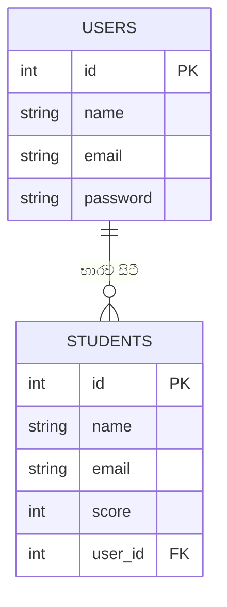

> 🇯🇵 මුල් පිටපත (ජපන් භාෂාවෙන්): [リレーショナルデータベース入門.md](<../../../2年生_システム開発実践/前期/2026_07_23/リレーショナルデータベース入門.md>) <!-- original-ja-link -->

## මේ ලිපියෙන් ඉගෙනගන්න පුළුවන් දේ

- Table, row, column
- Primary key
- Foreign key සහ table අතර සම්බන්ධය
- Table වෙන් කරන්නේ ඇයි

## Database = පිළිවෙළට සකස් කළ වගු එකතුවක්

කඩදාසි වල අවුල් සහගතව සටහන් ලියනවා වෙනුවට, වගු ආකාරයෙන් පිළිවෙළට සකස් කරලා save කරන ක්‍රමය තමයි "database" කියන්නේ. RDB (relational database) එකේ විශේෂත්වය නම්, මේ වගු (tables) කිහිපයක් එකට සම්බන්ධ කරලා (= relation කරලා) පාවිච්චි කරන්න පුළුවන් වීමයි.

## Table, row, column

මේ app එකේ වෙනස් කාර්යයන් තියෙන table දෙකක් තියෙනවා. ඒ දෙක උදාහරණ විදිහට අරගෙන, එක් එක් කොටසේ නම් බලමු.

### 🎓 students table එක (සිසුන්ගේ දත්ත)

| id | name | email | score |
|----|------|-------|-------|
| 1  | 田中太郎 | tanaka@example.com | 80 |
| 2  | 佐藤花子 | sato@example.com | 95 |

- **Table**: මේ වගුවම (අරමුණ අනුව කිහිපයක් හදනවා)
- **Column**: `id` `name` `email` `score` වගේ සිරස් අතට තියෙන අයිතම
- **Row (record)**: එක් දත්ත කට්ටලයක් (මෙතනදී එක් සිසුවෙකුගේ තොරතුරු)

### 🔑 users table එක (ගුරුවරුන්ගේ, පරිපාලකයින්ගේ login තොරතුරු)

| id | name | email | password |
|----|------|-------|----------|
| 1  | 小山先生 | koyama@example.com | $2y$10$abcdefGhIjKlmn...(hash කරලා) |
| 2  | 田中先生 | tanaka-t@example.com | $2y$10$OpQrStUvWxYz...(hash කරලා) |

- **Table**: `users` (login වෙන්න පාවිච්චි කරන account තොරතුරු. students ට වඩා වෙනස් කාර්යයක්)
- **Column**: `id` `name` `email` `password`
- **Row (record)**: එක් දත්ත කට්ටලයක් (මෙතනදී එක් ගුරුවරයෙකුගේ හෝ පරිපාලකයෙකුගේ login තොරතුරු)

> 💡 `password` එක ඇතුළත් කරපු විදිහටම (plain text) save කරන්නේ නැහැ, hashing කියන ආපසු හැරවිය නොහැකි පරිවර්තනයක් කරලා තමයි save කරන්නේ. කවදා හරි database එකේ අන්තර්ගතය එළියට ගියත්, මුල් password එක දැනගන්න බැරි වෙන්න තමයි මෙහෙම කරන්නේ.

## Primary key: දත්ත අනන්‍යව හඳුනාගන්න ID එක

`name` (නම) එකෙන් විතරක් search කළොත්, සම්පූර්ණ නම එකම විදිහට තියෙන අය ඉන්නවා නම් අවශ්‍ය පුද්ගලයා හරියටම හඳුනාගන්න බැහැ. ඒ නිසා වෙන කිසිම row එකක් එක්ක කවදාවත් duplicate නොවෙන අංකයක් (**primary key**) පාවිච්චි කරනවා. උඩ වගුවේ `id` තමයි ඒක, "id = 1 දත්ත දෙන්න" කිව්වොත්, 田中太郎 ගේ record එක විතරක් තෝරාගන්න පුළුවන්. Primary key = ජාතික හැඳුනුම්පත් අංකය හෝ සාමාජික අංකය වගේ දෙයක් කියලා හිතුවොත් තේරුම් ගන්න පහසුයි.

## Foreign key: table අතර සම්බන්ධය

Table කිහිපයක් ID එකෙන් එකිනෙකට සම්බන්ධ කරන්න පුළුවන් වීම තමයි RDB එකේ මූලික ස්වභාවය (= "relational" කියන නම ආවේ මෙතනින්).

මේ app එකේ, login වෙන්න පාවිච්චි කරන `users` table එකයි (ගුරුවරුන්ගේ, පරිපාලකයින්ගේ accounts), සිසුන්ගේ දත්ත තියෙන `students` table එකයි කියලා table දෙකක් තියෙනවා. දැනට මේ දෙක ID එකෙන් සම්බන්ධ වෙලා නැති, ස්වාධීන table දෙකක්.

"කුමන ගුරුවරයා (user) කුමන සිසුවා (student) ලියාපදිංචි කළාද / භාරව සිටිනවාද" කියලා record කරන්න ඕන වුණොත්, `students` table එකට `user_id` කියන column එකක් එකතු කරලා සම්බන්ධ කරනවා.

`USERS.id` (primary key) එක `STUDENTS.user_id` (foreign key) එකෙන් refer කරන විදිහට හැදුවොත්, එක් ගුරුවරයෙකුට (user) සිසුන් (student) කිහිප දෙනෙකු භාරව කටයුතු කළ හැකි සම්බන්ධය (එකට-බොහෝ) පෙන්වන්න පුළුවන්.

## Table වෙන් කරන්නේ ඇයි

Table වෙන් නොකර එක වගුවකට ඔක්කොම දැම්මොත්, එකම භාර ගුරුවරයාගේ නමයි email එකයි, එම ගුරුවරයා භාරයේ සිටින සිසුන් ගණනට සමාන වාර ගණනක් duplicate වෙනවා.

| student_id | student_name | staff_name | staff_email |
|-----------|-------|-------------|---------------|
| 101 | 田中花子 | 小山先生 | koyama@example.com |
| 103 | 田中次郎 | 小山先生 | koyama@example.com |

මෙහෙම තිබුණොත්, 小山先生 (Koyama ගුරුතුමා) email එක වෙනස් කළාම, අදාළ සියලුම row හොයලා හදන්න වෙනවා, සමහර ඒවා හදන්න අමතක වෙන්නත් පුළුවන්. users table එකයි students table එකයි වෙන් කරලා ID එකෙන් සම්බන්ධ කළොත්, 小山先生 ගේ තොරතුරු තියෙන්නේ එක තැනක විතරයි, වෙනස් කරන්නත් එක තැනක් විතරයි. මේ "duplicate වීම වළක්වන්න table වෙන් කරන" අදහසට **normalization** (සාමාන්‍යකරණය) කියලා කියනවා.

## සාරාංශය

- Database කියන්නේ, දත්ත පිළිවෙළට සකස් කරලා save කරලා තියන ක්‍රමයක්
- RDB දත්ත "table (වගු)" ආකාරයෙන් කළමනාකරණය කරනවා, table එකක් හැදිලා තියෙන්නේ "column (අයිතම)" සහ "row (එක් දත්ත කට්ටලයක්)" වලින්
- Primary key කියන්නේ, එක් එක් දත්ත කට්ටලය duplicate නැතුව හඳුනාගන්න පාවිච්චි කරන සලකුණ (ID)
- Foreign key කියන්නේ, වෙනත් table එකක primary key එක refer කරලා, table එකිනෙකට සම්බන්ධ කරන ක්‍රමය
- Table වෙන් කරලා සම්බන්ධ කිරීමෙන්, එකම තොරතුරු duplicate වීම වළක්වලා, දත්ත පිළිවෙළට තියාගන්න පහසු වෙනවා

මීට පස්සේ "SQL", "index", "transaction" වගේ දේවලුත් එනවා, නමුත් මුලින්ම මේ පදනම හිතින් මවාගන්න පුළුවන් නම් ඇති.
