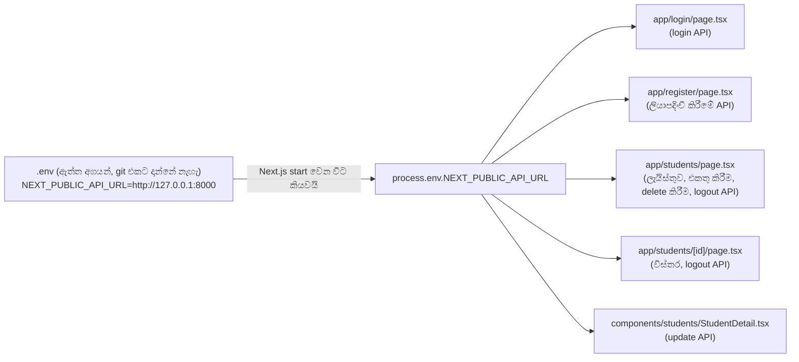
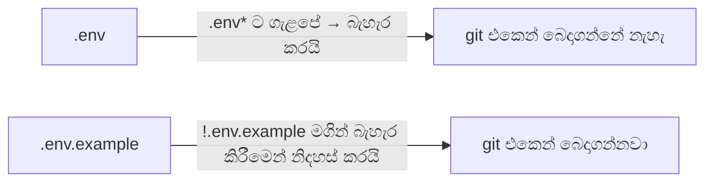

# පාඩම 26｜API URL එක environment variable (.env) එකකට වෙන් කිරීම - ක්‍රියාත්මක කිරීමේ පියවර

> 🇯🇵 මුල් පිටපත (ජපන් භාෂාවෙන්): [2026_07_30_実装.md](<../../../2年生_システム開発実践/前期/2026_07_30/2026_07_30_実装.md>) <!-- original-ja-link -->

## අද දවසේ ඉලක්කය

- `school-frontend` එකේ එක් එක් page එකේ කෙලින්ම ලියලා තිබුණු `http://localhost:8000` / `http://127.0.0.1:8000` එක තැනකට එකතු කිරීම
- `.env` file එකක් හදලා, API URL එක `NEXT_PUBLIC_API_URL` කියන environment variable එකක් ලෙස කළමනාකරණය කිරීම
- `.env.example` (අගයන් නැති template එක) git එකෙන් බෙදාගෙන, `.env` (ඇත්ත අගයන්) git කළමනාකරණයෙන් බැහැර කිරීම
- fetch පාවිච්චි කරන සියලුම තැන් `process.env.NEXT_PUBLIC_API_URL` හරහා යන විදිහට නැවත ලිවීම

> **මෙම පාඩමේ ස්ථානය:** මෙතෙක් අපි `fetch("http://127.0.0.1:8000/api/students")` වගේ, API URL එක හැම file එකකම කෙලින්ම ලිව්වා. මේ විදිහට ලිව්වොත්, development environment එකේයි production environment එකේයි URL වෙනස් වෙන විට file වල තැන් ගණනාවක් නැවත ලියන්න වෙනවා, ලියන්න අමතක වීමෙන් bugs ඇති වෙන්නත් පුළුවන්. මෙවර "වෙනස් වෙන්න පුළුවන් අගයන් (URL, API key වගේ) code එක ඇතුළේ නොලියා, environment variables විදිහට එළියට ගන්න" කියන අදහස ඉගෙනගන්නවා.

---

## සමස්ත චිත්‍රය: අපි හදන්නේ මොකක්ද



> 💡 **උදාහරණයක් ලෙස… ලිපිනයන් එක තැනකට එකතු කළ ලිපින පොතක්**
>
> මෙතෙක් කළේ, යාළුවෙකුට ලියුමක් යවන හැම වතාවකම "Tanaka ගේ ගෙදර ◯◯ නගරය 3-1" කියලා ලිපිනය හැම වතාවෙම තමන්ම ලියනවා වගේ දෙයක්. Tanaka ගෙදර මාරු වුණොත්, ලියපු ලියුම් ඔක්කොම නැවත ලියන්න වෙනවා. `.env` කියන්නේ "ලිපින පොතක්" වගේ දෙයක්. ලිපිනය (API URL එක) එක තැනක විතරක් ලියලා තියලා, ලියුම් වලින් (එක් එක් file එකේ fetch) "ලිපින පොතේ තියෙන Tanaka ගේ ලිපිනය" refer කරනවා. ගෙදර මාරු වුණත් (URL එක වෙනස් වුණත්), ලිපින පොත එක පාරක් වෙනස් කළාම ඇති.

### `.env` සහ `.env.example` වෙන් කරන්නේ ඇයි

මේ app එකේ `.env` එකේ රහස් අගයන් නැහැ, නමුත් සාමාන්‍යයෙන් සම්බන්ධ වෙන DB එකේ password එක, API key වගේ අනිත් අයට පේන්න ඕන නැති අගයන් තමයි තියෙන්නේ. ඒ නිසා `.env` එක `.gitignore` මගින් git කළමනාකරණයෙන් බැහැර කරලා, git එකෙන් බෙදාගන්නේ නැහැ. අනිත් අතට "මොන variable නම් අවශ්‍යද" කියන එක team එකත් එක්ක බෙදාගන්න ඕන නිසා, අගයන් හිස් (හෝ dummy අගයන්) කරපු `.env.example` එක විතරක් commit කරනවා. Project එකට අලුතින් එකතු වෙන කෙනා `.env.example` copy කරලා `.env` හදාගෙන, තමන්ගේ environment එකට ගැළපෙන අගයන් දානවා.

### File ව්‍යුහය (මෙවර වෙනස් කරන ඒවා)

| සංකේතය | අර්ථය |
|---|---|
| 🆕 අලුත් | අලුත් file එකක් හදනවා |
| ➕ එකතු කිරීම | තියෙන file එකකට code එකතු කරනවා |
| 🔁 ප්‍රතිස්ථාපනය | තියෙන process එක නැවත ලියනවා |

```
school-frontend/
├── .env                                       🆕 අලුත් (ඇත්ත අගයන්, git එකට දාන්නේ නැහැ)
├── .env.example                               🆕 අලුත් (template එක, git එකට දානවා)
├── .gitignore                                 ➕ .env.example එකට විතරක් බැහැර කිරීමේ rule එක අදාළ නොකරනවා
├── app/login/page.tsx                         🔁 fetch URL එක environment variable එකකින් ප්‍රතිස්ථාපනය කිරීම
├── app/register/page.tsx                      🔁 fetch URL එක environment variable එකකින් ප්‍රතිස්ථාපනය කිරීම
├── app/students/page.tsx                      🔁 fetch URL එක environment variable එකකින් ප්‍රතිස්ථාපනය කිරීම (තැන් 4)
├── app/students/[id]/page.tsx                 🔁 fetch URL එක environment variable එකකින් ප්‍රතිස්ථාපනය කිරීම (තැන් 2)
└── components/students/StudentDetail.tsx      🔁 fetch URL එක environment variable එකකින් ප්‍රතිස්ථාපනය කිරීම
```

---

## Step 1｜`.env` හැදීම

**🆕 අලුත් file එක** — `school-frontend` folder එකේ කෙලින්ම යටින් `.env` හදන්න.

```bash
# ▼ school-frontend/.env
NEXT_PUBLIC_API_URL=http://127.0.0.1:8000
```

- Key නමේ මුලට `NEXT_PUBLIC_` දාන එක තමයි වැදගත්. Next.js, `NEXT_PUBLIC_` තියෙන environment variables විතරක් browser පැත්තේත් (client components) කියවන්න පුළුවන් වෙන්න build එකට ඇතුළත් කරනවා. මෙවර නැවත ලියන `fetch` සියල්ලම `"use client"` තියෙන components ඇතුළේ තියෙන නිසා, මේ prefix එක අනිවාර්යයි.
- `NEXT_PUBLIC_` නැති environment variables (උදා: DB password එක වගේ) කියවන්න පුළුවන් server පැත්තේ code එකට විතරයි. Browser එකට පේන්න ඕන නැති අගයන්ට මේ prefix එක දාන්න එපා.

---

## Step 2｜`.env.example` හැදීම

**🆕 අලුත් file එක** — Team එකත් එක්ක බෙදාගන්න template එකක් විදිහට, එකම අන්තර්ගතය තියෙන file එකක් හදන්න. මෙවර තියෙන්නේ රහස් තොරතුරු නැති URL එකක් නිසා, එකම අගය එහෙමම ලියන්න.

```bash
# ▼ school-frontend/.env.example
NEXT_PUBLIC_API_URL=http://127.0.0.1:8000
```

> ⚠️ Password හෝ API key වගේ ඇත්තටම රහස් අගයන් තියෙනවා නම්, `.env.example` එකේ ඇත්ත අගය ලියන්නේ නැතුව, `DB_PASSWORD=` වගේ හිස්ව තියන්න හෝ `your-api-key-here` වගේ dummy අගයක් දාන්න.

---

## Step 3｜`.gitignore` එකේ `.env.example` එකට විතරක් බැහැර කිරීමේ rule එක අදාළ නොකිරීම

`create-next-app` මුල ඉඳන්ම හදලා දෙන `.gitignore` එකේ, පහත වගේ `.env*` කියන wildcard rule එකක් තියෙනවා.

```
# env files (can opt-in for committing if needed)
.env*
```

මේ rule එක `.env` විතරක් නෙවෙයි, `.env.example` එකත් ඇතුළුව "`.env` වලින් පටන් ගන්න සියලුම files" git කළමනාකරණයෙන් බැහැර කරනවා. රහස් තොරතුරු වැරදිලාවත් commit නොවෙන්න තියෙන ආරක්ෂක පියවරක් විදිහට මේක හරි setting එකක්, නමුත් මෙහෙම තිබුණොත් බෙදාගන්න ඕන `.env.example` එකත් git කළමනාකරණයෙන් බැහැර වෙනවා. ඒ නිසා, `.env.example` එක විතරක් ව්‍යතිරේකයක් විදිහට බැහැර නොකරන setting එකක් පේළියක් එකතු කරනවා.

**➕ එකතු කිරීම**

```
# env files (can opt-in for committing if needed)
.env*
!.env.example
```

මුලට `!` දැම්මොත් "මේ pattern එකට ගැළපෙන files බැහැර කරන්න එපා (= git එකෙන් කළමනාකරණය කරන්න)" කියන අර්ථය එනවා. `.env*` එකෙන් මුලින් ඔක්කොම බැහැර කරලා, ඊට පස්සේ `!.env.example` එකෙන් `.env.example` එක විතරක් ආපහු ගන්න කියන පිළිවෙළ වැදගත් (පිළිවෙළ මාරු වුණොත් වැඩ කරන්නේ නැහැ).

මේ setting එකෙන්, file දෙක පහත විදිහට සලකනවා.



---

## Step 4｜fetch URL එක environment variable එකකින් ප්‍රතිස්ථාපනය කිරීම

මේ වෙනකොට `.env` සූදානම්, නමුත් ඇත්ත code එක තාමත් කෙලින්ම `http://127.0.0.1:8000` බලනවා. එක් එක් file එකේ fetch call, `process.env.NEXT_PUBLIC_API_URL` පාවිච්චි කරන template literal එකකට නැවත ලියන්න.

### 4-1. `app/login/page.tsx`

**🔁 ප්‍රතිස්ථාපනය**

```tsx
// Before
const res = await fetch("http://127.0.0.1:8000/api/login", {

// After
const res = await fetch(`${process.env.NEXT_PUBLIC_API_URL}/api/login`, {
```

### 4-2. `app/register/page.tsx`

**🔁 ප්‍රතිස්ථාපනය**

```tsx
// Before
const res = await fetch("http://127.0.0.1:8000/api/register", {

// After
const res = await fetch(`${process.env.NEXT_PUBLIC_API_URL}/api/register`, {
```

### 4-3. `app/students/page.tsx` (තැන් 4)

**🔁 ප්‍රතිස්ථාපනය** — ලැයිස්තුව ගැනීම, සිසුවෙක් එකතු කිරීම, සිසුවෙක් delete කිරීම, logout කියන fetch 4 එකින් එක නැවත ලියන්න.

```tsx
// ලැයිස්තුව ගැනීම (Before → After)
const res = await fetch("http://127.0.0.1:8000/api/students", {
const res = await fetch(`${process.env.NEXT_PUBLIC_API_URL}/api/students`, {

// සිසුවෙක් එකතු කිරීම (Before → After)
const res = await fetch("http://127.0.0.1:8000/api/students", {
const res = await fetch(`${process.env.NEXT_PUBLIC_API_URL}/api/students`, {

// සිසුවෙක් delete කිරීම (Before → After)
const res = await fetch(`http://127.0.0.1:8000/api/students/${id}`, {
const res = await fetch(`${process.env.NEXT_PUBLIC_API_URL}/api/students/${id}`, {

// Logout (Before → After)
await fetch("http://127.0.0.1:8000/api/logout", {
await fetch(`${process.env.NEXT_PUBLIC_API_URL}/api/logout`, {
```

### 4-4. `app/students/[id]/page.tsx` (තැන් 2)

**🔁 ප්‍රතිස්ථාපනය** — මේ file එක මුලින්ම ලියලා තිබුණේ `http://localhost:8000` (`127.0.0.1` නෙවෙයි `localhost` විදිහට) කියලා. ලියන ක්‍රමය මෙහෙම එකිනෙකට වෙනස් වීමම "URL එක එක තැනකට එකතු කිරීමේ" අවශ්‍යතාව පෙන්වනවා.

```tsx
// විස්තර ගැනීම (Before → After)
const res = await fetch(`http://localhost:8000/api/students/${params.id}`, {
const res = await fetch(`${process.env.NEXT_PUBLIC_API_URL}/api/students/${params.id}`, {

// Logout (Before → After)
await fetch("http://localhost:8000/api/logout", {
await fetch(`${process.env.NEXT_PUBLIC_API_URL}/api/logout`, {
```

### 4-5. `components/students/StudentDetail.tsx`

**🔁 ප්‍රතිස්ථාපනය**

```tsx
// Before
const res = await fetch(`http://localhost:8000/api/students/${student.id}`, {

// After
const res = await fetch(`${process.env.NEXT_PUBLIC_API_URL}/api/students/${student.id}`, {
```

> 💡 මුල් string එක `"http://..."` වගේ double quotes (සාමාන්‍ය string එකක්) තිබුණු තැන් වලත්, `${...}` ඇතුළත් කරන්න පුළුවන් වෙන්න backtick (\` \`) template literal එකකට මාරු කරන්න ඕන. දැනටමත් template literal එකක් තිබුණු තැන් වල (`` `http://127.0.0.1:8000/api/students/${id}` `` වගේ) backtick එහෙමම තියලා, ඇතුළේ string කොටස විතරක් මාරු කරන්න.

---

## ක්‍රියාකාරිත්වය පරීක්ෂා කිරීම

```bash
# Backend
cd Laravel && php artisan serve   # http://localhost:8000

# Frontend
cd school-frontend && npm run dev # http://localhost:3000
```

> ⚠️ `.env` අලුතින් හැදුවාම හෝ අගයක් වෙනස් කළාම, `npm run dev` එක පාරක් නවත්තලා නැවත start කරන්න. Next.js environment variables කියවන්නේ build/start වෙන වෙලාවේ නිසා, server එක run වෙද්දී `.env` වෙනස් කළත්, hot reload එකෙන් ඒ වෙනස අදාළ වෙන්නේ නැහැ.

| පරීක්ෂා කරන දේ | කරන දේ | බලාපොරොත්තු වන ප්‍රතිඵලය |
|---|---|---|
| Code එකේ කෙලින්ම ලියපු URL ඉතුරු වෙලා නැද්ද | `grep -rn "localhost:8000\|127.0.0.1:8000" app components` run කරන්න | කිසිම output එකක් එන්නේ නැහැ (ඔක්කොම `process.env` හරහා යන විදිහට මාරු වෙලා) |
| Login | `/login` එකෙන් login වෙන්න | කලින් වගේම login වෙන්න පුළුවන්, `/students` වෙත යනවා |
| ලැයිස්තුව, විස්තර, එකතු කිරීම, delete කිරීම | `/students` එකේ මේ ක්‍රියා ටික කරන්න | ඔක්කොම කලින් වගේම වැඩ කරනවා (URL එක ලියන විදිහ විතරයි වෙනස් වුණේ, හැසිරීම වෙනස් වෙන්නේ නැහැ) |
| Environment variable මාරු කිරීම | `.env` එකේ අගය තාවකාලිකව වෙනත් port එකකට (උදා: නැති port එකකට) මාරු කරලා නැවත start කරන්න | API එකට සම්බන්ධ වීම අසාර්ථක වෙනවා = `.env` එකේ අගය ඇත්තටම පාවිච්චි වෙනවා කියලා තහවුරු කරගන්න පුළුවන් (පරීක්ෂා කළාට පස්සේ මුල් අගයට හරවන්න) |
| Git එකේ පෙනෙන විදිහ | `git status` run කරන්න | `.env` පෙන්වන්නේ නැහැ (git කළමනාකරණයෙන් බැහැර කරලා තියෙන නිසා), `.env.example` untracked file එකක් විදිහට පෙන්වනවා |

---

## සාරාංශය

| සංකල්පය | මෙවර අදාළ වූ තැන |
|---|---|
| Environment variable එකකට වෙන් කිරීම | `.env` එකේ `NEXT_PUBLIC_API_URL` |
| Client පැත්තේ environment variable කියවන්න අවශ්‍ය කොන්දේසිය | `NEXT_PUBLIC_` prefix එක |
| රහස් තොරතුරු git එකට නොදැමීමේ ක්‍රමය | `.gitignore` එකේ `.env*` |
| Template එක විතරක් team එකත් එක්ක බෙදාගැනීමේ ක්‍රමය | `.env.example` ＋ `!.env.example` මගින් බැහැර කිරීමෙන් නිදහස් කිරීම |
| Environment variable අදාළ වෙන වෙලාව | `.env` වෙනස් කළාට පස්සේ development server එක නැවත start කරන්න ඕන |

## අවසන් කිරීමේ checklist එක (Definition of Done)

- [ ] `school-frontend/.env` එකේ `NEXT_PUBLIC_API_URL=http://127.0.0.1:8000` set කරලා තියෙනවා
- [ ] `school-frontend/.env.example` හදලා, එකම variable නම template එකක් විදිහට ලියලා තියෙනවා
- [ ] `.gitignore` එකට `!.env.example` එකතු කරලා, `.env.example` එක විතරක් git එකෙන් කළමනාකරණය කරන්න පුළුවන්
- [ ] `app/login/page.tsx` / `app/register/page.tsx` / `app/students/page.tsx` / `app/students/[id]/page.tsx` / `components/students/StudentDetail.tsx` වල fetch සියල්ලම `process.env.NEXT_PUBLIC_API_URL` හරහා යනවා
- [ ] `grep -rn "localhost:8000\|127.0.0.1:8000" app components` එකෙන් කිසිවක් හමු වෙන්නේ නැහැ
- [ ] `npm run dev` නැවත start කරපු තත්ත්වයේ, login සිට ලැයිස්තුව, විස්තර, එකතු කිරීම, delete කිරීම දක්වා කලින් වගේම වැඩ කරනවා
- [ ] `git status` එකේ `.env` පෙන්වන්නේ නැහැ, `.env.example` එක විතරක් කළමනාකරණයට යටත් වෙලා තියෙනවා

## Start කරන commands

```bash
# Backend
cd Laravel && php artisan serve   # http://localhost:8000

# Frontend
cd school-frontend && npm run dev # http://localhost:3000
```
