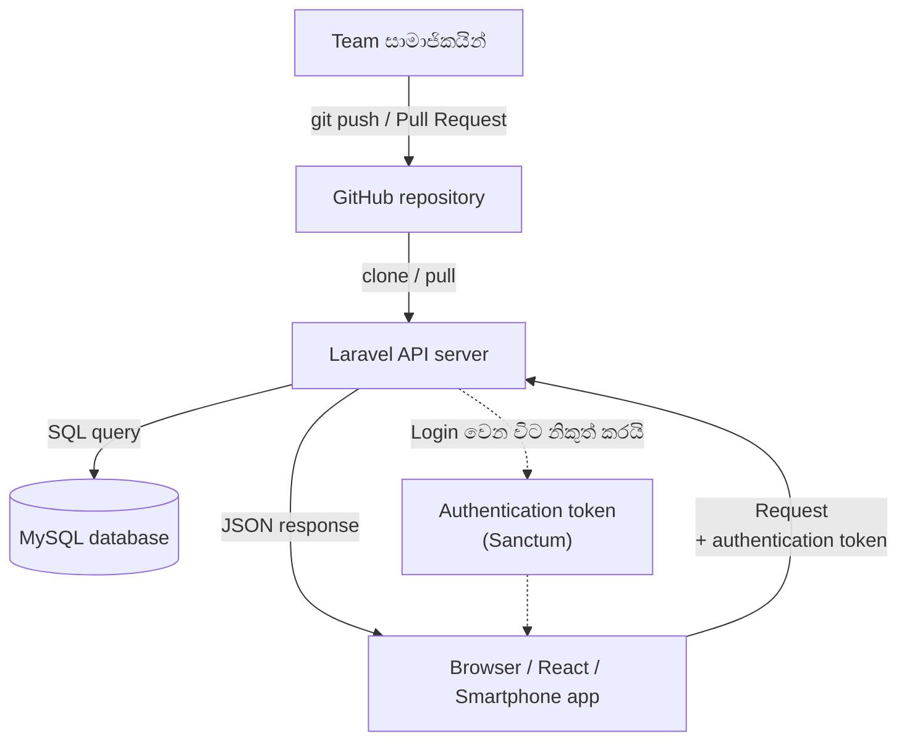
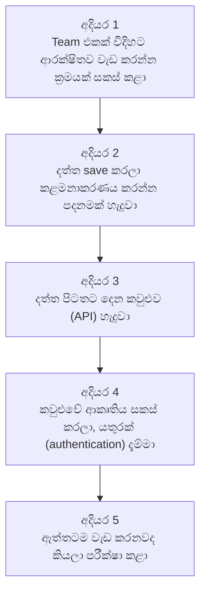

# Development ක්‍රියාවලිය: බිංදුවේ සිට API එකක් හදනකම්

> 🇯🇵 මුල් පිටපත (ජපන් භාෂාවෙන්): [開発の流れ_まとめ.md](<../../2年生_システム開発実践/前期/開発の流れ_まとめ.md>) <!-- original-ja-link -->

---

## හැඳින්වීම

මේ ලේඛනයෙන් "මොනවද කළේ" කියන එක විතරක් නෙවෙයි, "**ඒ පිළිවෙළට කළේ ඇයි**" කියන එකත් පැහැදිලි කරනවා.

---

## සමස්ත චිත්‍රය: අපි හැදුවේ මොකක්ද

### සම්පූර්ණ කළ system එකේ සමස්ත රූප සටහන



### අදියර 5

| අදියර | මාතෘකාව | මූල පද | අදාළ පාඩම |
|---------|--------|-----------|---------|
| 1 | Team development සඳහා සූදානම | Branch, PR, Review | 04/30 |
| 2 | App එකේ පදනම හැදීම | Laravel, DB, Migration | 05/06 |
| 3 | දත්ත සඳහා කවුළුව හැදීම | REST API, JSON, Routing | 05/14 |
| 4 | ආකෘතිය සහ ආරක්ෂාව සකස් කිරීම | Resource, Validation, Sanctum | 05/21 |
| 5 | වැඩ කරනවද කියලා තහවුරු කිරීම | curl, Browser test | 05/28 |

---

## අදියර 1: Team development සඳහා සූදානම

### මොනවද කළේ

Git වල branch, merge, Pull Request (PR), code review ඉගෙනගෙන,
app එක team එකක් විදිහට GitHub එකට upload කරලා හැමෝටම run කරන්න පුළුවන් තත්ත්වයට ගෙනාවා.

### අවශ්‍ය වුණේ ඇයි

> 💡 **උදාහරණයක් ලෙස… ඉදිකිරීම් භූමියක සැලසුම් කළමනාකරණය**
>
> ලොකු ගොඩනැගිල්ලක් කොන්ත්‍රාත්කරුවන් කිහිප දෙනෙක් එකට හදන විට, හැමෝම "එකම මුල් සැලසුමට"
> කෙලින්ම ලිව්වොත් අවුල් වෙනවා. ඒ නිසා හැම කොන්ත්‍රාත්කරුවෙක්ම "තමන්ගේම පිටපතකට (branch)"
> ලියලා, ඉවර වුණාම එකට සසඳලා බලලා (review) මුල් සැලසුමට ඇතුළත් කරනවා.

Team development වලදී කිහිප දෙනෙක් එකම file එක එකම වෙලාවේ edit කරනවා.
Branch එකක් හැදීමෙන් "ප්‍රධාන code එක කඩන්නේ නැතුව අලුත් feature එකක් develop කරන්න" පුළුවන්.
PR කියන්නේ "මේ code එක ප්‍රධාන code එකට දාන්න පුළුවන්ද?" කියලා කරන ඉල්ලීමක්,
review කියන්නේ ඒ code එක හරිද, කියවන්න පහසුද කියලා team එකක් විදිහට පරීක්ෂා කරන අවස්ථාවයි.

> ⚠️ **මේක නැත්නම්…** කෙනෙකුගේ code එකක් තව කෙනෙකුගේ code එකෙන් overwrite වෙලා මැකිලා යනවා.
> "ටිකකට කලින් වැඩ කළා, දැන් වැඩ කරන්නේ නැහැ" කියන දේ නිතරම වෙනවා.

### මේ අදියරෙන් කරන්න පුළුවන් වුණ දේවල්

- `git switch -c feature/xxxx` එකෙන් branch එකක් හදලා වැඩ කරන්න පුළුවන්
- `git push origin feature/xxxx` එකෙන් team එකත් එක්ක බෙදාගන්න පුළුවන්
- GitHub එකේ PR එකක් හදලා review එකක් ඉල්ලන්න පුළුවන්
- Review comments වලට අනුව code එක හදන්න පුළුවන්

### විස්තරාත්මක පියවර

→ [`2026_04_30/2026_04_30.md`](2026_04_30/2026_04_30.md)

---

## අදියර 2: App එකේ පදනම හැදීම

### මොනවද කළේ

Laravel project එකක් හදලා, database එකක් (`school_api`) සූදානම් කරලා,
`students` table එක define කරලා හැදුවා. Test දත්ත 10ක් ඇතුළත් කරලා server එක start කළා.

### අවශ්‍ය වුණේ ඇයි

> 💡 **උදාහරණයක් ලෙස… අවන්හලක මුළුතැන්ගෙය හැදීම**
>
> පාරිභෝගිකයින්ට කෑම (API response) දෙන්න නම්,
> මුලින්ම මුළුතැන්ගෙයක් (Laravel) සහ අමුද්‍රව්‍ය තියන තැනක් (database) අවශ්‍යයි.
> මුළුතැන්ගෙයේ සැලැස්ම (migration) කලින්ම හදලා තිබුණොත්,
> team එකේ ඕනෑම කෙනෙකුට එකම environment එක නැවත හදාගන්න පුළුවන්.

Laravel කියන්නේ "නිතර පාවිච්චි කරන features (routing, DB මෙහෙයුම්, authentication වගේ) මුල ඉඳන්ම ඇතුළත් පෙට්ටියක්".
Migration කියන්නේ database එකේ සැලසුම් ලේඛනයයි, `php artisan migrate` run කිරීමෙන්ම
team එකේ හැමෝටම එකම table ව්‍යුහය තමන්ගේ පරිගණකයේ නැවත හදාගන්න පුළුවන්.
Seeder කියන්නේ test දත්ත ස්වයංක්‍රීයව හදන දෙයක්, අතින් දත්ත ඇතුළත් කරන වෙහෙස අඩු කරනවා.

> ⚠️ **මේක නැත්නම්…** API code එක ලිව්වත් දත්ත save කරන්න තැනක් නැති නිසා,
> හැම request එකකදීම දත්ත නැති වෙනවා.

### මේ අදියරෙන් කරන්න පුළුවන් වුණ දේවල්

- `composer create-project laravel/laravel` එකෙන් project එකක් හදන්න පුළුවන්
- `.env` එකේ DB connection තොරතුරු set කරන්න පුළුවන්
- `php artisan make:model Student -mf` එකෙන් model, migration, factory එකවර හදන්න පුළුවන්
- `php artisan migrate` එකෙන් table හදන්න පුළුවන්
- `php artisan db:seed` එකෙන් test දත්ත ඇතුළත් කරන්න පුළුවන්
- `php artisan serve` එකෙන් local server එක start කරන්න පුළුවන්

### විස්තරාත්මක පියවර

→ [`2026_05_06/20260506.md`](2026_05_06/20260506.md)

---

## අදියර 3: දත්ත සඳහා කවුළුව හැදීම

### මොනවද කළේ

REST API සංකල්පය (URL × HTTP method, JSON response, status code) ඉගෙනගෙන,
`StudentController` හදලා `GET /api/students` ඇතුළු endpoints 5ක් implement කළා.

### අවශ්‍ය වුණේ ඇයි

> 💡 **උදාහරණයක් ලෙස… vending machine එකක බොත්තම්**
>
> Vending machine එකක "කෝලා", "තේ", "වතුර" වගේ බොත්තම් තියෙනවා,
> ඔබපුවාම ඊට අදාළ භාණ්ඩය එළියට එනවා.
> API endpoints වලත් එහෙමමයි,
> "`GET /api/students` (ඔක්කොම දෙන්න)" "`DELETE /api/students/3` (අංක 3 delete කරන්න)"
> වගේ URL × HTTP method සංයෝජනයෙන් කරන්න ඕන දේ තීරණය වෙනවා.

පළමු වසරේ හදපු Blade app එක return කළේ HTML pages.
API එක ඒ වෙනුවට JSON දත්ත විතරක් return කරනවා.
දත්ත JSON ආකෘතියෙන් ලබා දෙන නිසා, React, Vue, smartphone apps වගේ
**වෙනස් තිර වලින් එකම දත්ත නැවත නැවත පාවිච්චි කරන්න** පුළුවන් වෙනවා.

> ⚠️ **මේක නැත්නම්…** Frontend එකටයි server එකටයි කතා කරගන්න බැහැ.
> React එකෙන් API එක call කළත් "කොහෙට යවන්න ඕනද කියලා දන්නේ නැති" තත්ත්වයක් ඇති වෙනවා.

### මේ අදියරෙන් කරන්න පුළුවන් වුණ දේවල්

- REST API එකේ URL සැලසුම (resource නම, HTTP method) තේරුම් ගන්න පුළුවන්
- `php artisan make:controller Api/StudentController --api` එකෙන් API controller එකක් හදන්න පුළුවන්
- `routes/api.php` එකට routing එකතු කරන්න පුළුවන්
- `response()->json()` එකෙන් JSON response එකක් return කරන්න පුළුවන්
- HTTP status codes (200, 201, 404, 422) වල අර්ථය දන්නවා

### විස්තරාත්මක පියවර

→ [`2026_05_14/20260514.md`](2026_05_14/20260514.md)

---

## අදියර 4: ආකෘතිය සහ ආරක්ෂාව සකස් කිරීම

### මොනවද කළේ

`StudentResource` එකෙන් response ආකෘතිය එක විදිහකට සකස් කරලා, validation එකෙන් ඇතුළත් කරන දත්ත පරීක්ෂා කිරීම එකතු කළා.
Laravel Sanctum එකෙන් authentication (login, token නිකුත් කිරීම, logout) implement කළා.

### අවශ්‍ය වුණේ ඇයි

> 💡 **උදාහරණයක් ලෙස… courier සේවාවක ලේබල් ආකෘතිය + ඇතුළු වීමේ කාඩ්පත**
>
> Courier සේවාවක "යවන්නා, ලබන්නා, භාණ්ඩයේ නම" නියමිත තැන් වල ලියලා තියෙනවා.
> ආකෘතිය එකම විදිහට තියෙන නිසා, භාරගන්න පැත්තට අවුල් නොවී වැඩ කරන්න පුළුවන්.
> `StudentResource` කියන්නේ response ආකෘතිය තීරණය කරන "ලේබල් ආකෘතියයි".
>
> Sanctum token එක කියන්නේ "ඇතුළු වීමේ කාඩ්පතයි".
> Login වෙන විට නිකුත් කරපු ඇතුළු වීමේ කාඩ්පත (token) තියෙන අයට විතරයි
> ගොඩනැගිල්ල (API) ඇතුළට යන්න පුළුවන්.

අදියර 3 දී API එක වැඩ කරන්න පටන් ගත්තත්, තාමත් ඕනෑම කෙනෙකුට access කරන්න පුළුවන් තත්ත්වයක තිබුණේ.
Authentication නැත්නම් නොදන්න අයට දත්ත කැමති විදිහට ගන්නත් delete කරන්නත් පුළුවන්.
ඒ වගේම API response ආකෘති එකිනෙකට වෙනස් නම්, frontend එකට දත්ත හසුරුවන්න අමාරු වෙනවා.

> ⚠️ **මේක නැත්නම්…** Internet එකේ ඕනෑම කෙනෙකුට දත්ත වෙනස් කරන්නත් delete කරන්නත් පුළුවන්.
> Password, email address වගේ පුද්ගලික තොරතුරු හැමෝටම පේන්න තියෙන අවදානමකුත් තියෙනවා.

### මේ අදියරෙන් කරන්න පුළුවන් වුණ දේවල්

- `php artisan make:resource StudentResource` එකෙන් response සකස් කරන class එකක් හදන්න පුළුවන්
- `$request->validate()` එකෙන් validation ලියන්න පුළුවන්
- `composer require laravel/sanctum` එකෙන් authentication package එක ස්ථාපනය කරන්න පුළුවන්
- `POST /api/login` එකෙන් token එකක් ගන්න පුළුවන්
- `auth:sanctum` middleware එකෙන් authentication අවශ්‍ය routes ආරක්ෂා කරන්න පුළුවන්

### විස්තරාත්මක පියවර

→ [`2026_05_21/20260521.md`](2026_05_21/20260521.md)

---

## අදියර 5: වැඩ කරනවද කියලා තහවුරු කිරීම

### මොනවද කළේ

`curl` command එකෙන් API එකට requests යවලා ක්‍රියාකාරිත්වය පරීක්ෂා කළා,
ඒ වගේම browser එකෙන් පාවිච්චි කරන්න පුළුවන් test තිරයක් (`/api-test`) හදලා
login සිට සිසුන්ගේ ලැයිස්තුව ගැනීම, එකතු කිරීම, delete කිරීම දක්වා සම්පූර්ණ ක්‍රියාවලිය පරීක්ෂා කළා.

### අවශ්‍ය වුණේ ඇයි

> 💡 **උදාහරණයක් ලෙස… හදලා ඉවර කරපු vending machine එකට ඇත්තටම සල්ලි දාලා බලනවා වගේ**
>
> Vending machine එකක් සැලසුම් කරලා නිෂ්පාදනය කළත්, ඇත්තටම සල්ලි දාලා බොත්තම ඔබලා බලනකම්
> "ඇත්තටම භාණ්ඩය එළියට එනවද" කියලා දන්නේ නැහැ.
> API එකත් එහෙමමයි, code එක ලිව්වා කියලා හරියට වැඩ කරනවද කියලා දන්නේ නැහැ.
> ඇත්තටම request එකක් යවලා, බලාපොරොත්තු වුණ JSON එක එනවද කියලා පරීක්ෂා කරන්න ඕන.

`curl` කියන්නේ "terminal එකෙන් HTTP request යවන command එකක්".
Browser එක open නොකරත් API එකේ ක්‍රියාකාරිත්වය ඉක්මනින් පරීක්ෂා කරන්න පුළුවන්.
Browser test තිරය කියන්නේ curl කරන දේම graphical විදිහට කරන්න පුළුවන් page එකක්,
"React එකෙන් බැලුවොත් මෙහෙම පේනවා" කියලා අදහසක් ගන්නත් උදව් වෙනවා.

> ⚠️ **මේක නැත්නම්…** Bug එකක් තියෙනවා කියලා නොදැනම production environment එකට යනවා.
> "Development environment එකේ වැඩ කළා, production එකේ කැඩුණා" කියන දේ වළක්වන්නත් ක්‍රියාකාරිත්වය පරීක්ෂා කිරීම අනිවාර්යයි.

### මේ අදියරෙන් කරන්න පුළුවන් වුණ දේවල්

- `curl` එකෙන් GET, POST, DELETE requests යවන්න පුළුවන්
- `Authorization: Bearer <token>` header එකෙන් authentication සහිත requests යවන්න පුළුවන්
- Browser එකෙන් API එකේ login, ලැයිස්තුව ගැනීම, එකතු කිරීම, delete කිරීම කරන්න පුළුවන්
- HTTP status code එකයි response JSON එකයි කියවලා "හරියට වැඩ කරනවද" කියලා තීරණය කරන්න පුළුවන්

### විස්තරාත්මක පියවර

→ [`2026_05_28/20260528.md`](2026_05_28/20260528.md)

---

## සාරාංශය: අදියර 5 එකට සම්බන්ධ වුණා

අදියර 5 ආපසු හැරී බැලුවොත්, හැම අදියරක්ම කලින් අදියර උඩ ගොඩනැගිලා තියෙනවා කියලා තේරෙනවා.



ඒ කියන්නේ හැම අදියරක්ම "ඊළඟ අදියරට අවශ්‍ය වුණා".
පිළිවෙළ මාරු වුණොත් මේක සාර්ථක වෙන්නේ නැහැ.

### ඊළඟ පියවර

මේ API එක දැනටමත් **React වගේ frontend එකකින් call කරන්න පුළුවන් තත්ත්වයක** තියෙන්නේ.
```javascript
fetch('/api/students', { headers: { Authorization: 'Bearer ' + token } })
```
කියලා ලිව්වාම විතරක්, browser එකේ දත්ත අරගෙන පෙන්වන්න පුළුවන්.

ඉදිරි ඉගෙනීමේදී "මේ API එක පාවිච්චි කරලා තිර හදන" frontend development එකට යනවා.
