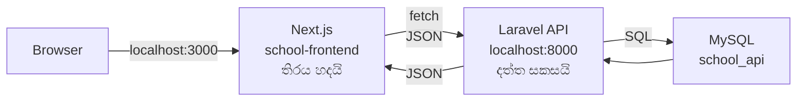
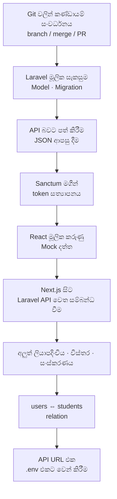
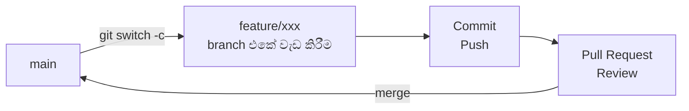
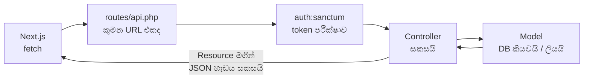
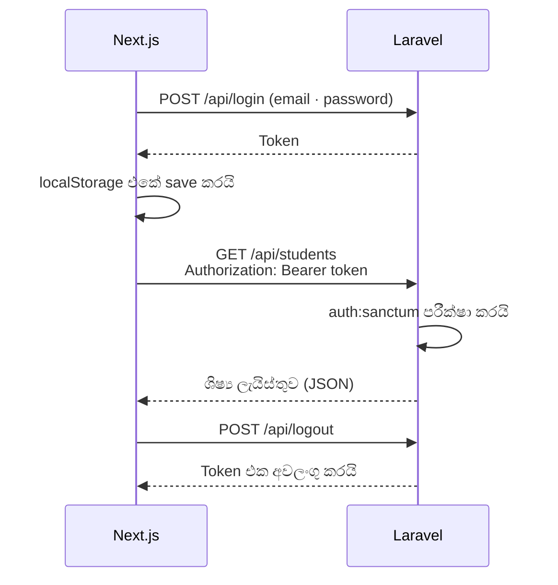
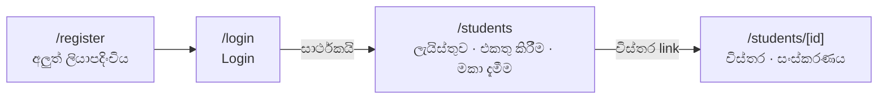
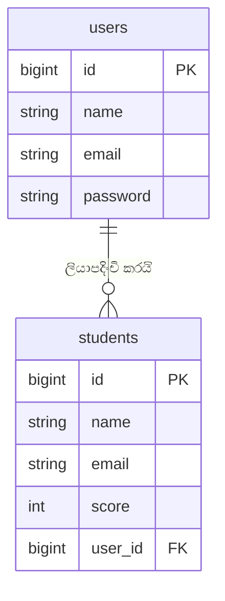
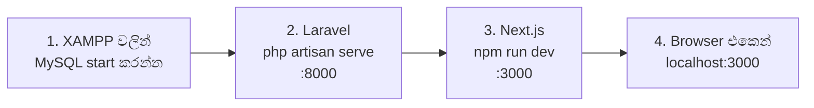

# පළමු වාරය ආපසු හැරී බැලීම (පුනරීක්ෂණය)

> 🇯🇵 මුල් පිටපත (ජපන් භාෂාවෙන්): [2026_10_02_資料1.md](<../../../2年生_システム開発実践/後期/2026_10_02/2026_10_02_資料1.md>) <!-- original-ja-link -->

දෙවන වාරයට යන්න කලින්, පළමු වාරයේ අපි හැදූ **ශිෂ්‍ය කළමනාකරණ app එකේ** සමස්ත චිත්‍රය මතක් කරගනිමු.
පළමු වාරයේදී අපි තිරය (frontend) සහ දත්ත සැකසීම (backend) **වෙන වෙනම app දෙකක්** විදිහට හදලා, API එකකින් ඒ දෙක සම්බන්ධ කළා.



- **Next.js**: තිරය හදන කෙනා. බොත්තමක් එබුවාම Laravel වෙත ඉල්ලීමක් (request) යවනවා
- **Laravel**: ඉල්ලීම භාරගෙන, database එකේ දත්ත කියවලා / ලියලා, ප්‍රතිඵලය **JSON** විදිහට ආපසු යවන කෙනා
- **MySQL**: දත්ත ගබඩා කරලා තියාගන්න කෙනා

---

## 1. පළමු වාරයේ ගමන් මග

පළමු වාරයේදී අපි මේ පිළිවෙළට app එක ටිකෙන් ටික වැඩි දියුණු කළා.



| දිනය | අන්තර්ගතය | ද්‍රව්‍ය |
|----|------|------|
| 4/30 | Git කණ්ඩායම් සංවර්ධනය (branch · merge · Pull Request) | [ද්‍රව්‍ය](../../前期/2026_04_30/2026_04_30.md) |
| 5/6 | Laravel project එකේ මූලික සැකසුම | [ද්‍රව්‍ය](../../前期/2026_05_06/20260506.md) |
| 5/14 | Blade app එක API එකක් බවට පත් කිරීම | [ද්‍රව්‍ය](../../前期/2026_05_14/20260514.md) |
| 5/21 | Resource controller · Sanctum මගින් token සත්‍යාපනය | [ද්‍රව්‍ය](../../前期/2026_05_21/20260521.md) |
| 5/28 | Browser එකෙන් token සත්‍යාපනය පරීක්ෂා කිරීම | [ද්‍රව්‍ය](../../前期/2026_05_28/20260528.md) |
| 6/11 | React මූලික කරුණු (component · JSX · props · useState) | [ද්‍රව්‍ය](../../前期/2026_06_11/2026_06_11.md) |
| 7/2 | Next.js හැඳින්වීම → Laravel API සමඟ සම්බන්ධ කිරීම | [ද්‍රව්‍ය](../../前期/2026_07_02/2026_07_02.md) |
| 7/9 | අලුත් user ලියාපදිංචිය + token · CRUD · MVC පුනරීක්ෂණය | [ද්‍රව්‍ය](../../前期/2026_07_09/2026_07_09.md) |
| 7/16 | විස්තර තිරය · සංස්කරණ විශේෂාංගය | [ද්‍රව්‍ය](../../前期/2026_07_16/2026_07_16_実装.md) |
| 7/23 | users ⇔ students relation | [ද්‍රව්‍ය](../../前期/2026_07_23/2026_07_23_実装%20.md) |
| 7/30 | API URL එක .env එකට වෙන් කිරීම | [ද්‍රව්‍ය](../../前期/2026_07_30/2026_07_30_実装.md) |

---

## 2. Git වලින් කණ්ඩායම් සංවර්ධනය

කණ්ඩායමක් එකම repository එකේ වැඩ කරන විට, අපි **branch** එකක් හදලා එහි වැඩ කරලා, **Pull Request (PR)** එකකින් review කරලා පස්සේ main එකට ඇතුළත් කළා (GitHub Flow).



- **main එක කෙලින්ම වෙනස් කරන්න එපා**: ඕනෑම වෙලාවක වැඩ කරන තත්ත්වයේ තියාගන්න
- දෙන්නෙක් එකම පේළිය වෙනස් කළොත් **conflict** එකක් ඇති වෙනවා → file එක open කරලා අතින් හදලා, පස්සේ commit කරන්න

---

## 3. Laravel API

### MVC (අවන්හලක උපමාව)

| භූමිකාව | File උදාහරණය | උපමාව |
|------|------------|-----------|
| **Model** | `app/Models/Student.php` | මුළුතැන්ගෙය · ශීතකරණය (දත්ත හසුරුවයි) |
| **Controller** | `app/Http/Controllers/Api/StudentController.php` | වේටර් (ඇණවුම භාරගෙන ගෙනයයි) |
| **View** | → API බවට පත් කර **Next.js වෙත මාරු කළා** | කෑම පිඟානට සකස් කිරීම (පෙනුම) |

API බවට පත් කළ නිසා, Laravel තවදුරටත් තිර හදන්නේ නැහැ; **JSON (දත්ත පමණක්)** ආපසු යවනවා.

### Request එකක් ගමන් කරන මාර්ගය



### අපි හැදූ API

`Route::apiResource('students', ...)` කියන එක පේළියෙන්ම, CRUD සඳහා මාර්ග 5ම එකවර හැදුණා.

| CRUD | Method | URL | Controller | සත්‍යාපනය |
|------|---------|-----|-----------|:----:|
| — | POST | `/api/register` | `AuthController@register` | අවශ්‍ය නැත |
| — | POST | `/api/login` | `AuthController@login` | අවශ්‍ය නැත |
| — | POST | `/api/logout` | `AuthController@logout` | 🔒 |
| Read | GET | `/api/students` | `index` (ලැයිස්තුව) | 🔒 |
| Create | POST | `/api/students` | `store` (එකතු කිරීම) | 🔒 |
| Read | GET | `/api/students/{id}` | `show` (විස්තර) | 🔒 |
| Update | PUT | `/api/students/{id}` | `update` (යාවත්කාලීන කිරීම) | 🔒 |
| Delete | DELETE | `/api/students/{id}` | `destroy` (මකා දැමීම) | 🔒 |

🔒 ලකුණ ඇති ඒවා `auth:sanctum` ඇතුළේ තියෙන නිසා, **token එකක් නැත්නම් 401 error** එකක් එනවා.

---

## 4. Token සත්‍යාපනය

Login වුණාම, Laravel විසින් **token** එකක් (විනෝද උද්‍යානයක අතට දාන wristband එකක් වගේ දෙයක්) නිකුත් කරනවා.
Next.js ඒක save කරලා තියාගෙන, API එක call කරන හැම වෙලාවකම ඒක පෙන්වනවා.



හරියට වැඩ නොකරන විට, browser එකේ **Developer Tools** වලින් පරීක්ෂා කරන්න.

- `Application` tab → `Local Storage`: token එක save වෙලා තියෙනවාද
- `Network` tab: request එකට `Authorization: Bearer ...` එකතු වෙලා තියෙනවාද

---

## 5. Next.js තිර

`app/` ඇතුළේ තියෙන folder, එලෙසම **URL** බවට පත් වුණා.



| URL | File | භාවිත කරන API |
|-----|---------|--------|
| `/login` | `app/login/page.tsx` | `POST /api/login` |
| `/register` | `app/register/page.tsx` | `POST /api/register` |
| `/students` | `app/students/page.tsx` | ලැයිස්තුව · එකතු කිරීම · මකා දැමීම · logout |
| `/students/[id]` | `app/students/[id]/page.tsx` + `components/students/StudentDetail.tsx` | විස්තර · යාවත්කාලීන කිරීම |

`[id]` වගේ folder නම `[ ]` වලින් වට කළාම, `/students/1`, `/students/2` … වගේ **URL එකේ කොටසක් variable එකක් විදිහට ලබාගන්න පුළුවන්**.

React වල මූලික කරුණුත් මතක් කරගනිමු.

| නම | භූමිකාව |
|------|------|
| **Component** | තිරයේ කොටස් (`LoginForm`, `StudentList` වගේ) |
| **props** | මව් component එකෙන් දරු component එකට දත්ත යවයි |
| **useState** | තිරය ඇතුළේ වෙනස් වෙන අගයන් (ඇතුළත් කළ දේ · ලැයිස්තු දත්ත වගේ) තියාගනී |
| **useEffect** | තිරය පෙන්වන වෙලාවට වගේ අවස්ථාවලදී API එක call කරලා දත්ත ලබාගනී |

---

## 6. Table සහ relation

ශිෂ්‍යයෙක්ව "ලියාපදිංචි කළේ කවුද" කියලා දැනගන්න පුළුවන් වෙන්න, `students` එකට `user_id` (foreign key) එකක් එකතු කළා.



- එක user කෙනෙකුට ශිෂ්‍යයන් ගොඩක් ලියාපදිංචි කරන්න පුළුවන් (**one-to-many**)
- Model එකේ `hasMany` / `belongsTo` ලිව්වාම, `$student->user->name` වලින් ලියාපදිංචි කළ කෙනාගේ නම ගන්න පුළුවන්

---

## 7. .env දෙකක්

Laravel සහ Next.js දෙකටම, **වෙන වෙනම `.env`** එකක් තියෙනවා.

| File | ඇතුළේ ලියා ඇති දේ | උදාහරණය |
|---------|--------------|----|
| Laravel හි `.env` | Database සම්බන්ධ වන ස්ථානය | `DB_DATABASE=school_api` |
| Next.js හි `.env` | API URL එක | `NEXT_PUBLIC_API_URL=http://127.0.0.1:8000` |

- `.env` එක **Git එකට දාන්න එපා** (password වගේ දේවල් ඇතුළත් වෙන්න පුළුවන් නිසා)
- ඒ වෙනුවට, අගයන් හිස් කරපු `.env.example` එක share කරන්න
- `.env` එක වෙනස් කළාම, **development server එක restart** කරන්න

---

## 8. App එක run කරන පිළිවෙළ

මේ තුනෙන් එකක් හරි run වෙන්නේ නැත්නම් app එක වැඩ කරන්නේ නැහැ. මේ පිළිවෙළට start කරන්න.



Terminal **දෙකක්** open කරන්න.

```bash
# Terminal ① Backend
cd Laravel
php artisan serve        # → http://localhost:8000

# Terminal ② Frontend
cd school-frontend
npm run dev              # → http://localhost:3000
```

---

## තේරුම් ගැනීමේ ප්‍රශ්නාවලිය

ඔබට පැහැදිලි කරන්න පුළුවන්ද කියලා පරීක්ෂා කරලා බලන්න.

- [ ] Next.js සහ Laravel එක් එක් එකෙන් කරන්නේ මොකක්ද?
- [ ] `GET /api/students` සහ `POST /api/students` අතර වෙනස මොකක්ද?
- [ ] Token එකක් නැතුව `/api/students` call කළොත්, මොකක්ද ආපසු එන්නේ?
- [ ] `students` table එකේ `user_id` තියෙන්නේ මොකටද?
- [ ] `.env` එක Git එකට දාන්නේ නැත්තේ ඇයි? ඒ වෙනුවට share කරන්නේ මොකක්ද?
- [ ] App එක run කරන්න, මොනවද start කරන්න ඕනේ, කුමන පිළිවෙළටද?
