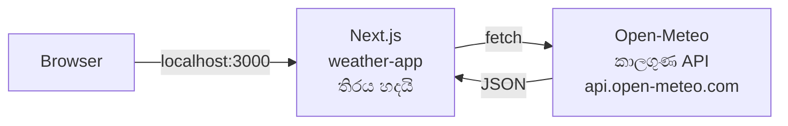
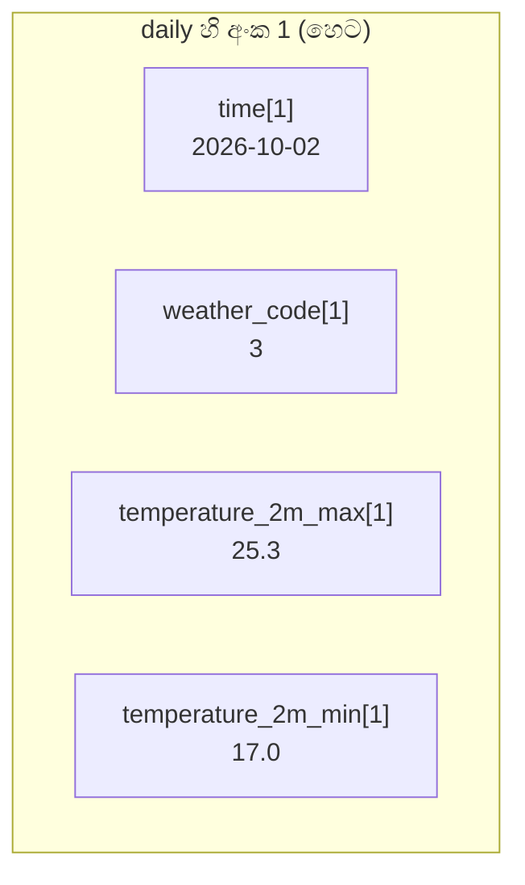
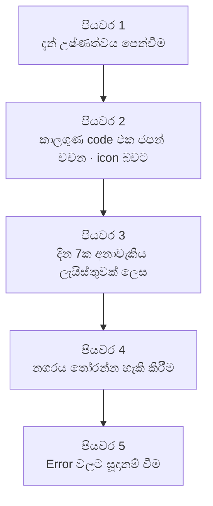
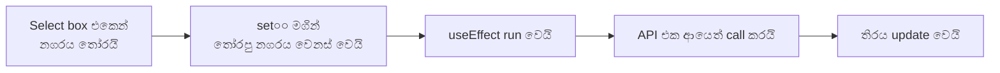

# දියුණු අභ්‍යාසය: කාලගුණ API එකෙන් කාලගුණ අනාවැකි app එකක් හදමු

> 🇯🇵 මුල් පිටපත (ජපන් භාෂාවෙන්): [2026_10_02_資料2.md](<../../../2年生_システム開発実践/後期/2026_10_02/2026_10_02_資料2.md>) <!-- original-ja-link -->

**ශිෂ්‍ය කළමනාකරණ app එක හදලා ඉවර කරපු අය** මේ අභ්‍යාසයට යන්න.
පළමු වාරයේදී අපි "අපිම හදපු Laravel API එකෙන්" JSON ලබාගෙන තිරයේ පෙන්නුවා.
මේ පාර අපි **අන්තර්ජාලයේ ප්‍රසිද්ධියේ තියෙන කාලගුණ API එකකින් (Open-Meteo)** JSON ලබාගෙන, **අලුත් Next.js project එකක** කාලගුණ අනාවැකි app එකක් හදනවා.



### අවසාන app එකේ පෙනුම

```
┌─────────────────────────────────────────┐
│ 天気予報（東京）              [ 東京 ▼ ]  │  ← නගරය තෝරන්න පුළුවන්
├─────────────────────────────────────────┤
│        ☀️                                │
│      晴れ   28℃                          │  ← දැන් කාලගුණය
│      風速 0.7 km/h                       │
├─────────────────────────────────────────┤
│ 10/1(木)  ☀️ 晴れ    29℃ / 18℃  ☔ 0%    │
│ 10/2(金)  ☁️ くもり  25℃ / 17℃  ☔ 20%   │  ← දින 7ක අනාවැකිය
│ 10/3(土)  🌧️ 雨      21℃ / 16℃  ☔ 80%   │
│   …                                     │
└─────────────────────────────────────────┘
```

### අද ඉලක්කය

- **Next.js project එකක් මුල ඉඳන් හදන්න** පුළුවන් වෙනවා
- ප්‍රසිද්ධියේ තියෙන **බාහිර API** එකක් call කරලා, JSON එක තිරයේ පෙන්නන්න පුළුවන් වෙනවා
- JSON එක ඇතුළෙන් **අවශ්‍ය අගයන් විතරක් ගන්න** පුළුවන් වෙනවා
- තෝරපු අගය (නගරය) වෙනස් වුණාම, **API එක ආයෙත් call කරන්න** පුළුවන් වෙනවා

> මේ ද්‍රව්‍යයේ **පිළිතුරු code එක දාලා නැහැ.**
> පළමු වාරයේ ශිෂ්‍ය කළමනාකරණ app එකේ (`school-frontend`) code එක බලලා, ඔබම හිතලා ලියලා බලන්න.

---

## 1. භාවිත කරන API: Open-Meteo

[Open-Meteo](https://open-meteo.com/) කියන්නේ නොමිලේ භාවිත කරන්න පුළුවන් කාලගුණ API එකක්.

- **ලියාපදිංචියක් හෝ API key එකක් අවශ්‍ය නැහැ** (URL එක open කළාම ඇති)
- ස්ථානය දෙන්නේ **අක්ෂාංශ (latitude) · දේශාංශ (longitude)** වලින්
- **උපරිම දින 16ක** අනාවැකියක් ලබාගන්න පුළුවන් (මේ පාර අපි දින 7ක් භාවිත කරනවා)

ශිෂ්‍ය කළමනාකරණ app එකත් එක්ක සසඳලා බලමු.

| | ශිෂ්‍ය කළමනාකරණ app එක | කාලගුණ අනාවැකි app එක |
|---|---|---|
| API එක හැදුවේ | අපිම (Laravel) | Open-Meteo |
| URL | `http://localhost:8000/api/students` | `https://api.open-meteo.com/v1/forecast?...` |
| සත්‍යාපනය | Token එකක් අවශ්‍යයි (🔒) | **අවශ්‍ය නැහැ** |
| භාවිත කරන method | GET / POST / PUT / DELETE | GET විතරයි (කියවීම පමණයි) |

> මේක නොමිලේ ප්‍රසිද්ධියේ දීලා තියෙන API එකක්. **බොත්තම නැවත නැවත ඔබලා හරි loop එකකින් හරි ගොඩක් වාර ගණනක් call කරන්න එපා.**

---

## 2. මුලින්ම browser එකෙන් API එක බලමු

Code ලියන්න කලින්, **මොන වගේ JSON එකක්ද ආපසු එන්නේ** කියලා බලන එක වැදගත්.
පහත URL එක browser එකේ address bar එකට paste කරලා open කරලා බලන්න (මේ ටෝකියෝවල කාලගුණය).

```
https://api.open-meteo.com/v1/forecast?latitude=35.68&longitude=139.77&current=temperature_2m,weather_code,wind_speed_10m&daily=weather_code,temperature_2m_max,temperature_2m_min,precipitation_probability_max&timezone=Asia%2FTokyo
```

> Chrome එකේ 「プリティ プリント」(Pretty-print) එක tick කළාම, JSON එක කියවන්න පහසු වෙනවා.

### URL එක කියවන හැටි

`?` ලකුණට පස්සේ තියෙන්නේ **query parameter** (API එකට දෙන ඇණවුමේ විස්තර). ඒවා `&` වලින් වෙන් කරලා පෙළගස්වනවා.

| Parameter | තේරුම |
|-----------|------|
| `latitude=35.68` | අක්ෂාංශය |
| `longitude=139.77` | දේශාංශය |
| `current=temperature_2m,weather_code,wind_speed_10m` | **දැන්** තියෙන උෂ්ණත්වය · කාලගුණ code එක · සුළං වේගය ඕනේ |
| `daily=weather_code,temperature_2m_max,...` | **දිනපතා** කාලගුණ code එක · උපරිම උෂ්ණත්වය · අවම උෂ්ණත්වය · වර්ෂාපතන සම්භාවිතාව ඕනේ |
| `timezone=Asia%2FTokyo` | ජපාන වේලාවෙන් දෙන්න (`%2F` කියන්නේ `/`) |

> `current=` හෝ `daily=` පස්සේ තියෙන දේවල් අඩු කළොත් හෝ වැඩි කළොත්, ආපසු එන JSON එකත් වෙනස් වෙනවා. උත්සාහ කරලා බලන්න.
> මොන අයිතම තියෙනවද කියලා [Open-Meteo documentation](https://open-meteo.com/en/docs) එකෙන් හොයාගන්න පුළුවන්.

### ආපසු එන JSON (කොටසක්)

```json
{
  "current": {
    "time": "2026-10-01T17:00",
    "temperature_2m": 28.2,
    "weather_code": 0,
    "wind_speed_10m": 0.7
  },
  "daily": {
    "time": ["2026-10-01", "2026-10-02", "2026-10-03", ...],
    "weather_code": [0, 3, 61, ...],
    "temperature_2m_max": [29.1, 25.3, 21.0, ...],
    "temperature_2m_min": [18.2, 17.0, 16.4, ...],
    "precipitation_probability_max": [0, 20, 80, ...]
  }
}
```

### මොකක්ද කොහේ තියෙන්නේ?

| පෙන්නන්න ඕනේ දේ | JSON එකේ කොහෙද? |
|--------------|-------------|
| දැන් උෂ්ණත්වය | `current.temperature_2m` |
| දැන් කාලගුණ code එක | `current.weather_code` |
| දැන් සුළං වේගය | `current.wind_speed_10m` (km/h) |
| දිනය (දින 7ක්) | `daily.time` ← **array** |
| දිනපතා කාලගුණ code එක | `daily.weather_code` ← **array** |
| දිනපතා උපරිම · අවම උෂ්ණත්වය | `daily.temperature_2m_max` · `daily.temperature_2m_min` ← **array** |
| දිනපතා වර්ෂාපතන සම්භාවිතාව (%) | `daily.precipitation_probability_max` ← **array** |

මෙන්න වැදගත් කරුණ.

- `current` එකේ තියෙන්නේ **එක අගයක්**
- `daily` එකේ **එක එක අයිතමයට array එකක්** තියෙනවා; **එකම අංකය (index) තියෙන ඒවා එකම දවසේ** දත්ත



### කාලගුණ code (weather_code)

කාලගුණය එන්නේ 「晴れ」(ඉර පායා ඇත) වගේ වචනවලින් නෙවෙයි, **අංකයකින් (WMO code)**.
තිරයේ පෙන්නනකොට, ඔබම ඒක ජපන් භාෂාවට හරවන්න ඕනේ.

| Code | කාලගුණය | Icon උදාහරණය |
|-------|------|-----------|
| 0 | ඉර පායා ඇත (晴れ) | ☀️ |
| 1, 2 | ඉර පායා ඇත, විටින් විට වලාකුළු (晴れ時々くもり) | 🌤️ |
| 3 | වලාකුළු සහිතයි (くもり) | ☁️ |
| 45, 48 | මීදුම (霧) | 🌫️ |
| 51〜57 | පොද වැස්ස (霧雨) | 🌦️ |
| 61〜67 | වැස්ස (雨) | 🌧️ |
| 71〜77 | හිම (雪) | ❄️ |
| 80〜82 | හදිසි වැසි (にわか雨) | 🌦️ |
| 85, 86 | හදිසි හිම (にわか雪) | 🌨️ |
| 95〜99 | ගිගුරුම් සහිත වැසි (雷雨) | ⛈️ |

---

## 3. Next.js project එක හදමු

මේක ශිෂ්‍ය කළමනාකරණ app එකට (`school-frontend`) **වෙනස් folder එකක** හදන්න.
`school-frontend` ඇතුළේ හදන්නේ නැති වෙන්න පරිස්සම් වෙන්න.

```bash
npx create-next-app@latest weather-app
```

ප්‍රශ්නවලට, පළමු වාරයේ වගේම උත්තර දෙන්න.

```
Would you like to use TypeScript?             → Yes
Would you like to use ESLint?                 → Yes
Would you like to use Tailwind CSS?           → Yes
Would you like your code inside a src/ dir?   → No
Would you like to use App Router?             → Yes
Would you like to use Turbopack?              → No
Would you like to customize the import alias? → No
```

```bash
cd weather-app
npm run dev
```

http://localhost:3000 open කරලා, Next.js sample තිරය පෙනුණොත් සාර්ථකයි.

### Project එක හැදුව ගමන් කරන්න ඕනේ දේවල්

| File | කරන්න ඕනේ දේ | උදව්වට |
|---------|---------|------|
| `app/layout.tsx` | `lang="en"` එක `lang="ja"` කරන්න, `title` එක "天気予報アプリ" (කාලගුණ අනාවැකි app එක) කරන්න | `school-frontend/app/layout.tsx` |
| `app/globals.css` | `@import "tailwindcss";` හැර අනිත් සේරම මකලා, `body` එකේ පසුබිම් වර්ණය · අකුරු වර්ණය ඔබම තීරණය කරන්න | — |
| `app/page.tsx` | Sample එකේ තියෙන සේරම මකලා, කාලගුණ අනාවැකි තිරය ලියන්න පටන් ගන්න | — |

> **globals.css වෙනස් කරන්න හේතුව**
> මුලින්ම තියෙන `globals.css` එකේ, පරිගණකය dark mode එකේ තියෙනකොට **අකුරු සුදු පාට** වෙන විදිහට සකසලා තියෙනවා.
> සුදු card එකක් උඩ අකුරු දැම්මොත් පේන්නේ නැති නිසා, වර්ණ ඔබම තීරණය කරලා තියාගන්න.

> මේ පාර API key එකක් අවශ්‍ය නැති නිසා, `.env` එකක් හදන්න ඕනේ නැහැ.
> ඒ වගේම Laravel භාවිත කරන්නේ නැති නිසා, XAMPP හෝ `php artisan serve` start කරන්නත් ඕනේ නැහැ.

---

## 4. හදාගෙන යන පිළිවෙළ

එකපාරටම සේරම හදන්න උත්සාහ කරන්නේ නැතුව, **එක පියවරක් බැගින් run කරලා බලමින්** ඉස්සරහට යන්න.



### පියවර 1: දැන් උෂ්ණත්වය පෙන්වන්න

**කරන්න ඕනේ දේ**
- `app/page.tsx` එකේ, page එක පෙන්නන වෙලාවේ API එක call කරලා, ටෝකියෝවල **දැන් උෂ්ණත්වය · කාලගුණ code එක · සුළං වේගය** පෙන්වන්න

**ඉඟි**
- පළමු පේළියේ `"use client";` ලියන්න (`useState` · `useEffect` භාවිත කරන නිසා)
- ශිෂ්‍ය කළමනාකරණ app එකේ `app/students/page.tsx` එකේ **`useEffect` සහ `loadStudents`** හැඩය එලෙසම ආදර්ශයක් විදිහට ගන්න පුළුවන්
- මේ පාර **token එකක් (`Authorization` header) අවශ්‍ය නැහැ**. URL එක `fetch` කළාම ඇති
- මුලින් URL එකේ `current=` විතරක් තිබුණාම ඇති (`daily=` පියවර 3 දී එකතු කරනවා)
- දත්ත ලැබෙන්න කලින් දත්ත හිස් (`null`) නිසා, "読み込み中..." (load වෙමින්...) කියලා මුලින් පෙන්වලා තියන්න
- TypeScript වල `useState(null)` කියලා ලිව්වොත්, පස්සේ `weather.current` එකේ error එකක් එනවා → `useState<any>(null)` කියලා ලියන්න

**✅ පරීක්ෂාව**: උෂ්ණත්වය · කාලගුණ code එක (අංකය) · සුළං වේගය පෙනුණා

### පියවර 2: කාලගුණ code එක ජපන් වචන සහ icon බවට හරවන්න

**කරන්න ඕනේ දේ**
- කාලගුණ code එක භාරගෙන, "晴れ" (ඉර පායා ඇත) වගේ ජපන් වචනය සහ emoji icon එක ආපසු දෙන **function** එකක් හදන්න
- දැන් කාලගුණය සුදු card එකක් ඇතුළේ **icon · කාලගුණය · උෂ්ණත්වය · සුළං වේගය** විදිහට පෙන්වන්න

**ඉඟි**
- Function එක `export default function ...` එකට **පිටතින් (උඩින්)** හදන එක හොඳයි
- 2. කොටසේ කාලගුණ code table එක බලමින්, `if` වලින් කුඩා code එකේ ඉඳන් පිළිවෙළට පරීක්ෂා කරන්න
- ජපන් වචනය සහ icon එක කියන දෙකම ආපසු දෙන්න ඕනේ නම්, `{ label: "晴れ", icon: "☀️" }` වගේ **object** එකක් ආපසු දෙන්න
- උෂ්ණත්වය එන්නේ `28.2` වගේ දශම සංඛ්‍යාවක් විදිහට → `Math.round()` වලින් ආසන්නතම පූර්ණ සංඛ්‍යාවට වට කළොත් කියවන්න පහසුයි

**✅ පරීක්ෂාව**: Icon එක සහ "晴れ" (ඉර පායා ඇත) වගේ ජපන් වචනය පෙනුණා

### පියවර 3: දින 7ක අනාවැකිය ලැයිස්තුවක් විදිහට පෙන්වන්න

**කරන්න ඕනේ දේ**
- URL එකට `daily=...` එකතු කරලා, දින 7ක අනාවැකිය ලැයිස්තුවක් විදිහට පෙන්වන්න
- එක පේළියක "දිනය · icon · කාලගුණය · උපරිම උෂ්ණත්වය · අවම උෂ්ණත්වය · වර්ෂාපතන සම්භාවිතාව" පෙළගස්වන්න

**ඉඟි**
- ලැයිස්තුවක් පෙන්නන්න ශිෂ්‍ය ලැයිස්තුවේ වගේම `map` භාවිත කරන්න. `key` එකට එකිනෙකට සමාන නොවන අගයක් (දිනය) දෙන්න
- `daily.time` එක `map` කළාම, දෙවන argument එකෙන් **අංකය `i`** ලැබෙනවා → `(date, i) => ...`
- ඒ `i` එක භාවිත කරලා, `daily.weather_code[i]` වගේ **එකම අංකයෙන්** අනිත් array වලින් අගයන් ගන්න
- `2026-10-02` දිනය `10/2(金)` හැඩයට හරවන්න කැමති අය, `new Date(date)` එකක් හදලා `getMonth()` (**0 සිට ආරම්භ** වන නිසා +1) · `getDate()` · `getDay()` (0 = ඉරිදා) භාවිත කරන්න

**✅ පරීක්ෂාව**: දින 7ක අනාවැකිය පෙළට පෙනුණා

### පියවර 4: නගරය තෝරන්න පුළුවන් කරන්න

**කරන්න ඕනේ දේ**
- Select box එකෙන් නගරයක් තෝරපුවාම, ඒ නගරයේ කාලගුණයට · අනාවැකියට මාරු වෙන්න හදන්න

නගරවල අක්ෂාංශ · දේශාංශ සඳහා පහත table එක භාවිත කරන්න.

| නගරය | අක්ෂාංශ (latitude) | දේශාංශ (longitude) |
|-----|---------------|----------------|
| 東京 (ටෝකියෝ) | 35.68 | 139.77 |
| 大阪 (ඔසාකා) | 34.69 | 135.50 |
| 札幌 (සප්පොරෝ) | 43.06 | 141.35 |
| 那覇 (නහා) | 26.21 | 127.68 |

**ඉඟි**
- නගර ලැයිස්තුව `{ name: "東京", latitude: 35.68, longitude: 139.77 }` වගේ object වල **array** එකක් විදිහට හදාගන්න
- "දැනට තෝරලා තියෙන නගරය" `useState` එකකින් තියාගන්න
- URL එකේ `latitude=` සහ `longitude=` කොටස්, තෝරපු නගරයේ අගයන්ගෙන් ආදේශ කරන්න (template string `` `...${ }...` `` පහසුයි)
- `useEffect` එකේ dependency array එක මතක් කරගන්න



| Dependency array එක ලියන විදිහ | Run වෙන්නේ කවදාද? |
|----------------|----------------|
| `[]` | Page එක පෙන්නන වෙලාවේ **එක පාරක් විතරයි** (ශිෂ්‍ය ලැයිස්තුවේ භාවිත කළා) |
| `[city]` | මුල් පාර + **city වෙනස් වෙන හැම වෙලාවකම** |

**✅ පරීක්ෂාව**: නගරය මාරු කළාම කාලගුණය සහ අනාවැකිය වෙනස් වුණා (සප්පොරෝ සහ නහා උෂ්ණත්වය සසඳලා බලන්න)

### පියවර 5: Error වලට සූදානම් වෙන්න

**කරන්න ඕනේ දේ**
- API එක අසාර්ථක වුණොත්, තිරය සම්පූර්ණයෙන් සුදු වෙන්නේ නැතුව, **error පණිවිඩයක්** පෙන්වන්න හදන්න

**ඉඟි**
- ශිෂ්‍ය කළමනාකරණ app එකේදීත් `res.ok` වලින් අසාර්ථක වුණාද කියලා බැලුවා
- Internet සම්බන්ධ නැති වෙලාවට `fetch` එකම අසාර්ථක වෙනවා → `try` / `catch` වලින් අල්ලගන්න
- සාර්ථක වුණත් අසාර්ථක වුණත් "load වෙමින්" තත්ත්වය අවසන් කරන්න → `finally`

**✅ පරීක්ෂාව**: URL එකේ `latitude=` එක හිතාමතාම `latitude=999` කළාම, error පණිවිඩයක් පෙනුණා (පරීක්ෂා කළාට පස්සේ ආපසු කලින් තිබුණු විදිහට හදන්න)

---

## 5. හරියට වැඩ නොකරන විට

| මතුවන ගැටලුව | පරීක්ෂා කරන්න ඕනේ දේ |
|------|-------------|
| `useState is not defined` | පළමු පේළියේ `"use client";` එකත්, ඊට පහළින් `import { useState, useEffect } from "react";` එකත් තියෙනවාද |
| `Cannot read properties of null` | දත්ත එන්න කලින් පෙන්නන්න හදනවා → "load වෙමින්" පරීක්ෂාවට **පහළින්** භාවිත කරනවාද |
| `Cannot read properties of undefined` | JSON එකෙන් අගය ගන්න විදිහ වැරදියි / URL එකට `daily=` දාන්න අමතක වෙලාද → 2. කොටසේ table එකත් එක්ක සසඳන්න |
| වේලාව හෝ දිනය පැය 9කින් වෙනස් වෙනවා | URL එකට `timezone=Asia%2FTokyo` දාලා තියෙනවාද |
| අකුරු පේන්නේ නැහැ (සුදු පාටයි) | `globals.css` එකේ dark mode සැකසුම මැකුවාද |
| අගයන් අමුතුයි · පේන්නේ නැහැ | Developer Tools වල `Network` tab එකෙන්, API එකේ response එක (JSON) පරීක්ෂා කරන්න |

---

## 6. තවත් අභියෝග (ඉවර කරපු අයට)

- [ ] **කොටස්වලට බෙදන්න**: "දැන් කාලගුණය" සහ "අනාවැකි ලැයිස්තුව" `components/` ඇතුළේ වෙනම file වලට බෙදලා, `props` වලින් දත්ත යවන්න
- [ ] **නගර වැඩි කරන්න**: ඔබේ උපන් ගම එකතු කරන්න (Google Maps එකේ ස්ථානය මත right-click කළාම අක්ෂාංශ · දේශාංශ පෙන්වනවා)
- [ ] **නගරයේ නමින් සොයන්න**: Input field එකට නගරයේ නම දාලා සොයන්න පුළුවන් කරන්න ([Geocoding API](https://open-meteo.com/en/docs/geocoding-api) එකෙන් නගරයේ නම → අක්ෂාංශ · දේශාංශ බවට හරවන්න පුළුවන්. මේකටත් key එකක් ඕනේ නැහැ)
- [ ] **පැයෙන් පැයට අනාවැකිය**: URL එකට `hourly=temperature_2m&forecast_days=1` එකතු කරලා, අද දවසේ පැයෙන් පැයට උෂ්ණත්වය පෙන්වන්න
- [ ] **ඔබ ඉන්න තැන කාලගුණය**: `navigator.geolocation.getCurrentPosition()` වලින් ඔබේ අක්ෂාංශ · දේශාංශ අරගෙන, ඒ ස්ථානයේ කාලගුණය පෙන්වන්න
- [ ] **පෙනුම වෙනස් කරන්න**: කාලගුණය අනුව පසුබිම් වර්ණය වෙනස් කරන්න (ඉර පායනකොට තැඹිලි, වැස්සට නිල් වගේ) / Tailwind CSS වලින් ලියලා බලන්න

> තවත් කාලය තියෙන අය, [ද්‍රව්‍ය 3](./2026_10_02_資料3.md) එකේ තියෙන **Gemini වලින් ඔබේම කාලගුණ icon හදන එක** · **Vercel වෙත නොමිලේ deploy කරන එක** උත්සාහ කරන්න.

---

## තේරුම් ගැනීමේ ප්‍රශ්නාවලිය

- [ ] ශිෂ්‍ය කළමනාකරණ app එකේ API එකයි Open-Meteo API එකයි අතර වෙනස මොකක්ද? (හැදුවේ කවුද · සත්‍යාපනය)
- [ ] URL එකේ `?` එකට පස්සේ තියෙන `latitude=35.68&longitude=139.77` වලින් පෙන්නන්නේ මොකක්ද?
- [ ] `daily` ඇතුළේ, එකම දවසේ දත්ත හොයාගන්නේ කොහොමද?
- [ ] කාලගුණ code `3` කියන්නේ මොන කාලගුණයද? ඒක තිරයේ "くもり" (වලාකුළු සහිතයි) කියලා පෙන්නන්න මොකද කරන්නේ?
- [ ] `useEffect(() => { ... }, [city])` run වෙන්නේ කවදාද?
- [ ] `try` / `catch` / `finally` වල `finally` එක run වෙන්නේ කවදාද?
