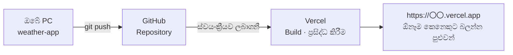
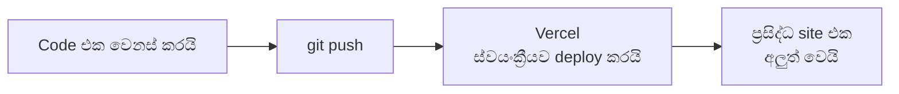

# දියුණු අභ්‍යාසය: කාලගුණ අනාවැකි app එක තවත් බලවත් කරමු

> 🇯🇵 මුල් පිටපත (ජපන් භාෂාවෙන්): [2026_10_02_資料3.md](<../../../2年生_システム開発実践/後期/2026_10_02/2026_10_02_資料3.md>) <!-- original-ja-link -->

[ද්‍රව්‍ය 2](./2026_10_02_資料2.md) එකේ කාලගුණ අනාවැකි app එක (`weather-app`) **හදලා ඉවර කරපු අය** මේ ද්‍රව්‍යයට යන්න.

| | කරන්න ඕනේ දේ |
|---|---|
| 1. | Gemini වලින් ඔබේම කාලගුණ icon හදලා, emoji වෙනුවට පෙන්වන්න |
| 2. | Vercel වෙත නොමිලේ deploy කරලා, smartphone එකෙනුත් බලන්න පුළුවන් කරන්න |

---

## 1. Gemini වලින් ඔබේම කාලගුණ icon හදමු

Open-Meteo **icon පින්තූර එවන්නේ නැහැ** (එවන්නේ කාලගුණ code අංකය විතරයි).
ඒ නිසා, **Gemini වලින් පින්තූර generate කරලා** `public/` folder එකට දාලා, කාලගුණ code එකට ගැළපෙන විදිහට පෙන්වමු.


### 1-1. Gemini වලින් පින්තූර හදන්න

[Gemini](https://gemini.google.com/) open කරලා, එක එක කාලගුණයට පින්තූරයක් හදලා දෙන්න කියන්න.

| කාලගුණය | File නම් සඳහා උදාහරණ |
|-----|-------------|
| ඉර පායා ඇත | `sunny.png` |
| ඉර පායා ඇත, විටින් විට වලාකුළු | `partly-cloudy.png` |
| වලාකුළු සහිතයි | `cloudy.png` |
| මීදුම | `fog.png` |
| වැස්ස (පොද වැස්ස · හදිසි වැසිත් ඇතුළුව) | `rainy.png` |
| හිම | `snowy.png` |
| ගිගුරුම් සහිත වැසි | `thunder.png` |

Prompt එකක (ඉල්ලීමේ වාක්‍යය) උදාහරණයක්:

```
කාලගුණ අනාවැකි app එකක භාවිත කරන "ඉර පායා ඇත" icon එකක් හදලා දෙන්න.
සරල හා හුරුබුහුටි චිත්‍රයක්, සමචතුරස්‍ර හැඩය, සුදු පසුබිම, අකුරු කිසිවක් දාන්න එපා.
```

> **වැදගත් කරුණු**
> - පළමු එක හැදුණාට පස්සේ, "**ඒ විලාසයෙන්ම** 'වලාකුළු සහිතයි' icon එකත් හදලා දෙන්න" කියලා දිගටම ඉල්ලුවොත්, චිත්‍ර විලාසය එක වගේ වෙනවා
> - හැදුණු පින්තූර download කරලා, උඩ table එකේ තියෙන නම්වලට rename කරන්න
> - File නම් **ඉංග්‍රීසි අකුරු සහ ඉලක්කම් (half-width)** වලින් දෙන්න (ජපන් භාෂාවෙන් file නම් දාන්න එපා)

### 1-2. public folder එකට දාන්න

```
weather-app/
└── public/
    └── icons/          ← හදන්න
        ├── sunny.png
        ├── cloudy.png
        └── ...
```

`public/` එකට දාපු file, **`/` එකෙන් පටන් ගන්න path එකකින්** පෙන්වන්න පුළුවන්.
උදාහරණයක් විදිහට `public/icons/sunny.png` එක `` වලින් පෙන්වන්න පුළුවන්.

> මුලින්ම browser එකේ http://localhost:3000/icons/sunny.png open කරලා, පින්තූරය පේනවද කියලා බලන්න.

### 1-3. කාලගුණ code එකට ගැළපෙන විදිහට පෙන්වන්න

**කරන්න ඕනේ දේ**
- ද්‍රව්‍ය 2 හි පියවර 2 දී හදපු function එක වෙනස් කරලා, ජපන් වචනයට හා emoji එකට අමතරව **පින්තූරයේ path එකත්** (`/icons/sunny.png` වගේ) ආපසු දෙන්න හදන්න
- වත්මන් කාලගුණය සහ දින 7ක අනාවැකිය පෙන්වන විට, emoji වෙනුවට `` එකෙන් පින්තූරය පෙන්වන්න

**ඉඟි**
- ආපසු දෙන object එකට `image: "/icons/sunny.png"` වගේ අයිතමයක් එකතු කරන්න
- පින්තූරයේ ප්‍රමාණය `` එකේ `width` හෝ `style` වලින් තීරණය කරන්න (අනාවැකි ලැයිස්තුවේ ටිකක් පොඩියට)
- `alt` එකට "晴れ" (ඉර පායා ඇත) වගේ ජපන් වචනය දාලා තිබුණොත්, පින්තූරය load නොවුණත් කාලගුණය මොකක්ද කියලා දැනගන්න පුළුවන්

**✅ පරීක්ෂාව**: නගරය මාරු කළාම, කාලගුණයට ගැළපෙන ඔබේම icon පෙනුණා

---

## 2. Vercel වෙත නොමිලේ deploy කරමු

දැන් තියෙන app එක `localhost:3000` නිසා, **ඔබේ පරිගණකයෙන් විතරයි බලන්න පුළුවන්.**
[Vercel](https://vercel.com/) (Next.js හදන සමාගමේ සේවාව) භාවිත කළොත්, නොමිලේ අන්තර්ජාලයේ ප්‍රසිද්ධ කරන්න පුළුවන්.
ප්‍රසිද්ධ කළාම `https://weather-app-xxxx.vercel.app` වගේ URL එකක් ලැබෙනවා; **smartphone එකෙන් හෝ යාළුවෙක්ගේ පරිගණකයෙන් වුණත් බලන්න පුළුවන්** වෙනවා.



> **Deploy** කියන්නේ, හදපු app එක server එකක තියලා, අන්තර්ජාලයෙන් භාවිත කරන්න පුළුවන් කරන එකයි.

### 2-1. ඔබේ පරිගණකයේ build වෙනවද කියලා බලන්න

Vercel එකේදීත් මේ `npm run build` එකම run වෙනවා. ඒ නිසා මුලින්ම ඔබේ පරිගණකයේ error එන්නේ නැද්ද කියලා බලන්න.

```bash
# npm run dev එක Ctrl + C වලින් නවත්වලා ඉන්පසු
npm run build
```

- අන්තිමට `✓ Compiled successfully` වගේ එකක් පෙනිලා, error එකකින් නතර වුණේ නැත්නම් OK
- **රතු පාට error** එකක් ආවොත්, පණිවිඩයේ තියෙන file එක · පේළිය හදලා, ආයෙත් `npm run build` කරන්න
- පරීක්ෂා කළාට පස්සේ, ආයෙත් `npm run dev` වලින් development දිගටම කරගෙන යන්න පුළුවන්

### 2-2. GitHub වෙත push කරන්න

`create-next-app` වලින් හදපු project එක, **මුල ඉඳන්ම Git repository එකක්**.

1. GitHub එකේ **අලුත් repository එකක්** හදන්න (නම `weather-app`, **README වගේ දේවල් එකතු කරන්න එපා**)
2. හදපු repository එකේ page එකේ පෙන්වන command බලලා, `git remote add origin ...` වලින් සම්බන්ධ කරන්න
3. `git add` → `git commit` → `git push` කරලා, මේ වෙනකන් ලියපු code එක push කරන්න

> Git භාවිත කරන හැටි දැනගන්න, පළමු වාරයේ 4/30 ද්‍රව්‍යයෙන් ආපසු බලන්න.
> `public/icons/` එකේ පින්තූරත් එක්කම push වෙලාද කියලා GitHub තිරයෙන් පරීක්ෂා කරන්න.

### 2-3. Vercel එකෙන් ප්‍රසිද්ධ කරන්න

1. https://vercel.com/ open කරලා, **Sign Up** → plan එක විදිහට **Hobby (නොමිලේ)** තෝරන්න
2. **Continue with GitHub** එකෙන්, GitHub account එකෙන් login වෙන්න
3. **Add New...** → **Project** තෝරන්න
4. ලැයිස්තුවෙන් `weather-app` එකේ **Import** ඔබන්න (පේන්නේ නැත්නම්, GitHub වෙත access දෙන්න)
5. සැකසුම් **එහෙමම තිබුණාට කමක් නැහැ** (Next.js නම් ස්වයංක්‍රීයව හඳුනාගන්නවා) → **Deploy** ඔබන්න
6. විනාඩි 1–2ක් ඉන්න, සුබපැතුම් තිරය ආවොත් ඉවරයි! පෙන්වපු URL එක open කරලා බලන්න

> මේ පාර API key එකක් භාවිත කරන්නේ නැති නිසා, Vercel එකේ environment variables සකසන්න ඕනේ නැහැ.

### 2-4. වෙනස් කළාට පස්සේ push කළාම ඇති, update වෙනවා

එක පාරක් සම්බන්ධ කළාට පස්සේ, **GitHub එකට `git push` කරන හැම වෙලාවකම Vercel ස්වයංක්‍රීයව ආයෙත් deploy කරනවා**.



> **අවධානයට**
> - ප්‍රසිද්ධ කරපු URL එක **ඕනෑම කෙනෙකුට බලන්න පුළුවන්**. නම වගේ පුද්ගලික තොරතුරු තිරයට දාන්න එපා
> - Hobby plan එක **පුද්ගලික · ඉගෙනීමේ කටයුතු සඳහා** පමණයි (මුදල් උපයන site වලට භාවිත කරන්න බැහැ)
> - Deploy එක අසාර්ථක වුණොත්, Vercel තිරයේ **Build Logs** එකේ error එක පෙන්වනවා. ඔබේ පරිගණකයේ `npm run build` කළාමත් එම error එකම එනවද කියලා බලන්න

**✅ පරීක්ෂාව**: Smartphone එකෙන් Vercel URL එක open කළාම, කාලගුණ අනාවැකිය පෙනුණා
