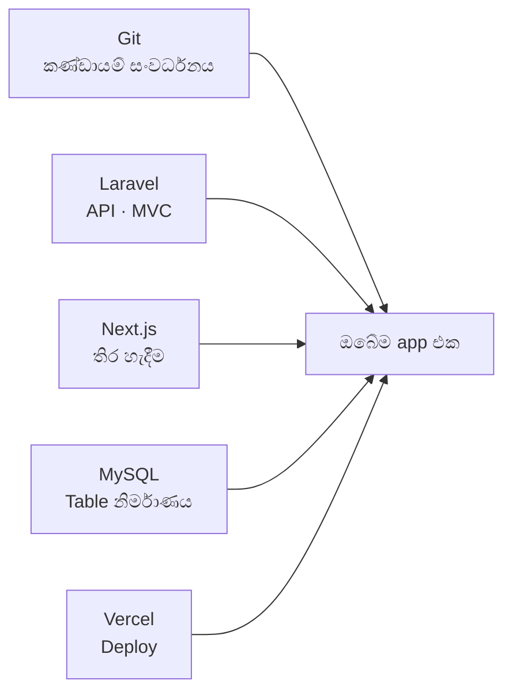
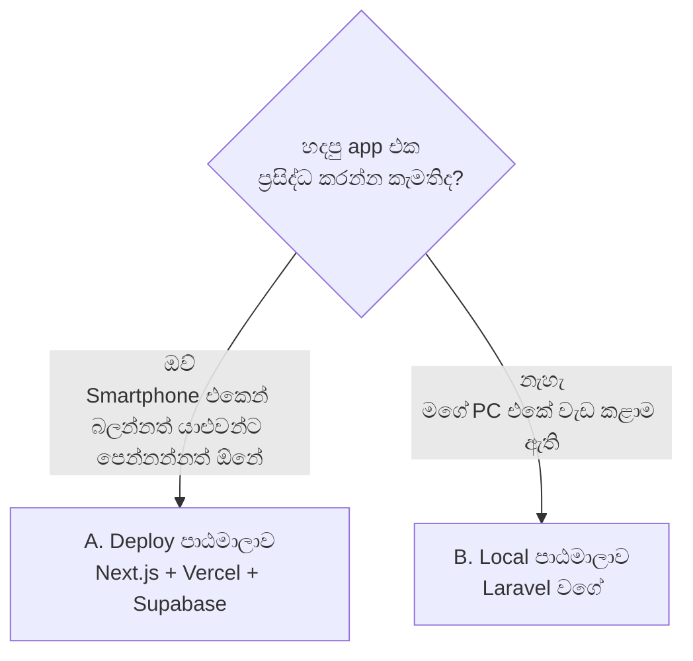
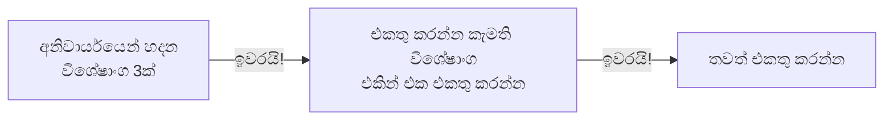
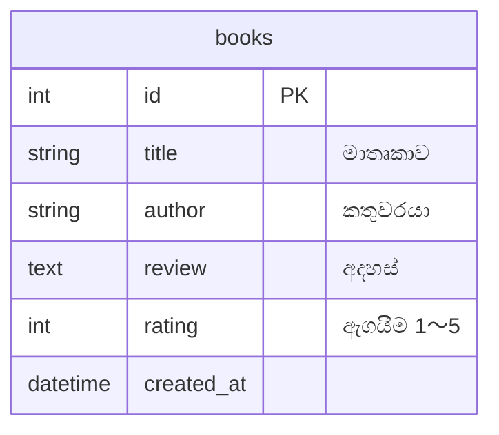
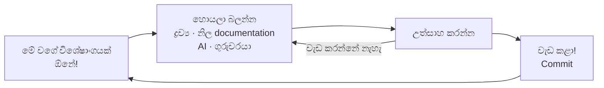
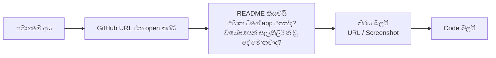
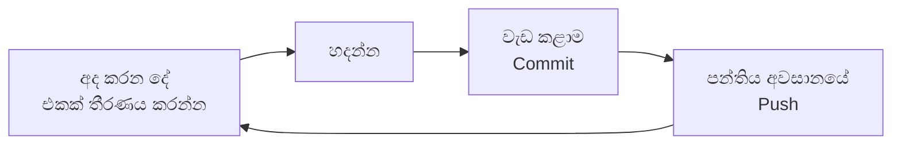

# ස්වාධීන නිර්මාණය: මූලික දේවල් ඉගෙනගත්තා, දැන් ඉඳන් හදන්න කැමති දේ හදමින් ඉගෙනගමු

> 🇯🇵 මුල් පිටපත (ජපන් භාෂාවෙන්): [2026_10_09_資料1.md](<../../../2年生_システム開発実践/後期/2026_10_09/2026_10_09_資料1.md>) <!-- original-ja-link -->

## අද ඉලක්කය
- හදන්න කැමති app එක තීරණය කරන්න පුළුවන් වෙනවා
- හදලා ඉවර කරපු app එක, රැකියා සෙවීමේදී **portfolio එකක් විදිහට ඉදිරිපත් කරන්න පුළුවන්** වීම ඉලක්කය කරගන්නවා
- ඔබට ගැළපෙන පාඨමාලාව (deploy කරන / local විතරක්) තෝරන්න පුළුවන් වෙනවා
- සංවර්ධනය පටන් ගන්න සූදානම (repository හැදීම · project හැදීම) කරන්න පුළුවන් වෙනවා
- "හදමින් ඉගෙනගැනීම" සහ "ඔබ විශේෂයෙන් සැලකිලිමත් වන දේ අගය කිරීම" කියන දෙක ගැන සැලකිලිමත් වෙන්න පුළුවන් වෙනවා

---

## 1. ස්වාධීන නිර්මාණය කියන්නේ මොකක්ද

මේ වෙනකන් ඉගෙනගත්ත දේවල් යොදාගෙන, **ඔබ කැමති දෙයක්** හදනවා.
මාතෘකාව ඔබේ කැමැත්තට. විනෝදාංශ · ක්‍රීඩා/සමාජ කටයුතු · part-time රැකියාව · ඔබ අවට "තිබුණා නම් පහසුයි" කියලා හිතෙන දේවල් app එකක් විදිහට හදමු.

> 🎯 **ඉලක්කය: රැකියා සෙවීමේදී, portfolio එකක් විදිහට සමාගමකට ඉදිරිපත් කරන්න පුළුවන් app එකක් හදන එක**
> ඔබ මොන පාඨමාලාව තෝරුවත්, හදලා ඉවර කරපු app එක **"මම හදපු දෙයක්" විදිහට සමාගමට පෙන්නන්න පුළුවන්** වෙන්න හදනවා.
> ඉදිරිපත් කරන විදිහ [5. Portfolio එකක් ලෙස ඉදිරිපත් කිරීම](#5-portfolio-එකක්-ලෙස-ඉදිරිපත්-කිරීම) එකෙන් බලන්න.



### ඇයි ඔබ හදන්න කැමති දේම හදන්නේ?

මූලික දේවල් මේ වෙනකන් පන්තිවලින් ඉගෙනගත්තා. මෙතැන් ඉඳන් තියෙන්නේ ඒවා **ප්‍රායෝගිකව යොදාගැනීම**.
ගුරුවරයා තීරණය කරපු අභ්‍යාසයක් නෙවෙයි, **ඔබම හදන්න කැමති දේ තීරණය කරලා හදන්න** හේතු 3ක් තියෙනවා.

#### ① ඔබ හදන්න කැමති දෙයක් නම්, උනන්දුව දිගටම තියාගන්න පහසුයි

App එකක් හදලා ඉවර කරනකම් error සහ "තේරෙන්නේ නැහැ" කියන දේවල් ගොඩක් එනවා.
**ඔබට ඇත්තටම ඕනේ දෙයක්** නම්, "හදලා ඉවර කරන්නම ඕනේ!" කියන හැඟීමෙන් අන්තිම වෙනකන් උත්සාහ කරන්න පුළුවන්.

#### ② AI එකට code ලියන්න පුළුවන් කාලයක් නිසා, බලන්නේ "මොකක්ද හදන්නේ" කියන එක

දැන් AI එකෙන් ඉල්ලුවොත් code ලියලා දෙන කාලයක්.
ඒ නිසාම, **"මොකක්ද හදන්නේ" "මොකක්ද පහසු කරන්න හදන්නේ" "ඇයි ඒක හැදුවේ"** කියන දේවල් වැදගත් වෙනවා.
Code ලියන්න පුළුවන් වීම විතරක් නෙවෙයි, **ඔබම ප්‍රශ්නයක් හොයාගෙන, ඒකට විසඳුමක් හදන හැකියාව** බලනවා.

#### ③ Portfolio එකක් විදිහට සමාගමකට ඉදිරිපත් කරන්න පුළුවන්

හදලා ඉවර කරපු app එක රැකියා සෙවීමේදී **portfolio එකක් විදිහට සමාගමකට ඉදිරිපත් කරන්න** පුළුවන්.
හැබැයි හැමෝම එක වගේ දේවල් හැදුවොත්, සමාගමේ අයගේ මතකයේ රැඳෙන්නේ නැහැ.
**ඔබ අයදුම් කරන සමාගමේ අය "ෂා!" කියලා පුදුම වෙන, ඔබට විතරක් ආවේණික product එකක්** හදමු.

### මාතෘකා උදාහරණ

| වර්ගය | උදාහරණ |
|---------|-----|
| වාර්තා තියාගැනීම | කියවූ පොත් වාර්තාව, ව්‍යායාම වාර්තාව, ගෘහ ගිණුම් පොත, game ප්‍රතිඵල සටහන් |
| එකතු කිරීම · පෙන්වීම | ඔබ ආසම කෙනා (oshi) ගැන තොරතුරු එකතුව, නිර්දේශිත කඩ ලැයිස්තුව, නිර්මාණ gallery එක |
| ප්‍රයෝජනවත් | ක්‍රීඩා/සමාජ කටයුතු පැමිණීමේ ලේඛනය, පැවරුම් අවසන් දින කළමනාකරණය, කෑම මෙනු roulette එක |
| API භාවිතය | කාලගුණය + ඇඳුම් උපදෙස්, Pokémon විශ්වකෝෂය, චිත්‍රපට සෙවීම |

---

## 2. පාඨමාලාව තෝරන්න

හදපු app එක **අන්තර්ජාලයේ ප්‍රසිද්ධ කරන්න කැමතිද** කියන එක අනුව පාඨමාලාව තෝරන්න.



| | A. Deploy පාඨමාලාව | B. Local පාඨමාලාව |
|---|---|---|
| ද්‍රව්‍ය | [ද්‍රව්‍ය 2](./2026_10_09_資料2.md) | [ද්‍රව්‍ය 3](./2026_10_09_資料3.md) |
| භාවිත කරන දේ | Next.js + **Vercel** + **Supabase** | Laravel + MySQL (+ Next.js) |
| බලන්න පුළුවන් තැන | අන්තර්ජාලය (`https://〇〇.vercel.app`) | ඔබේ PC එක (`localhost`) |
| Database | Supabase (අන්තර්ජාලයේ තියෙන database එකක්) | MySQL (ඔබේ PC එක) |
| අලුතින් ඉගෙනගන්න දේ | Supabase භාවිත කරන හැටි | අඩුයි (පළමු වාරයේ දේවල් යොදාගැනීම) |
| නිර්දේශ කරන්නේ මේ වගේ අයට | අලුත් තාක්ෂණයකටත් අත ගහලා බලන්න කැමති අය | පළමු වාරයේ දේවල් හොඳින් ස්ථිර කරගන්න කැමති අය |
| Portfolio ඉදිරිපත් කිරීම | **URL** + GitHub | **GitHub** (README · screenshot) |

> මොකක් තෝරුවත් ලකුණු දීම වෙනස් වෙන්නේ නැහැ. **පාඨමාලා දෙකෙන්ම portfolio එකක් ඉදිරිපත් කරන්න පුළුවන්.**
> තීරණය කරගන්න අමාරු නම් ගුරුවරයාගෙන් අහන්න.

---

## 3. හදන්න පටන් ගන්න කලින්

### මුලින්ම පොඩියට හදන්න

මුල ඉඳන්ම විශේෂාංග ගොඩක් දාන්න ගියොත්, ඉවර නොකරම නතර වෙනවා.
**මුලින් පොඩියට හදලා ඉවර කරලා, පස්සේ එකතු කරගෙන යන එක** තමයි රහස.



### Table ගැන හිතන්න

පළමු වාරයේ ඉගෙනගත්ත table නිර්මාණය භාවිත කරලා, අවශ්‍ය table සහ column ලියාගන්න.



---

## 4. හදමින් ඉගෙනගැනීම

මෙතැන් ඉඳන්, ගුරුවරයා සියලුම පියවර සූදානම් කරලා දෙන්නේ නැහැ; **ඔබ හදන්න කැමති දේ හදමින් ඉගෙනගන්නවා.**



- අවශ්‍ය වෙන වෙලාවට, අවශ්‍ය දේ හොයලා බලන්න. **සේරම තේරුම් ගත්තට පස්සේ හදන්න පටන් ගන්න ඕනේ නැහැ**
- Error එකක් කියන්නේ අසාර්ථක වීමක් නෙවෙයි, **ඊළඟට මොකක්ද හොයන්න ඕනේ කියන ඉඟියක්**
- පළමු වාරයේ ද්‍රව්‍ය · අවසන් අනුවාදයේ code ඕනෑම වෙලාවක ආපසු බැලුවාට කමක් නැහැ

### වැදගත් කරුණ: ඔබ විශේෂයෙන් සැලකිලිමත් වන දේ අගය කරන්න

ස්වාධීන නිර්මාණයේ වැදගත්ම දේ, **"මේ කොටස නම් මේ විදිහටම තියෙන්න ඕනේ" කියලා ඔබ විශේෂයෙන් සැලකිලිමත් වන දේවල්**.

| විශේෂයෙන් සැලකිලිමත් විය හැකි දේවල උදාහරණ |
|------------|
| ඔබ ආසම කෙනාගේ පාටින් තිරය හදන්න ඕනේ |
| Smartphone එකේ එක අතකින් පහසුවෙන් භාවිත කරන්න පුළුවන් වෙන්න ඕනේ |
| මමම හැමදාම ඇත්තටම භාවිත කරන app එකක් කරන්න ඕනේ |
| බොත්තම එබුවාම වෙන චලනය සතුටුදායක කරන්න ඕනේ |

ඔබ විශේෂයෙන් සැලකිලිමත් වන දෙයක් තියෙනකොට,

- "කොහොමද මේක කරන්නේ?" කියලා **ඔබටම හොයලා බලන්න හිතෙනවා**
- ඉවර කළාම **අනිත් අයට පෙන්නන්න හිතෙනවා** (portfolio එකක් වෙනවා)
- සම්මුඛ පරීක්ෂණයේදී **"ඇයි මේක හැදුවේ" කියලා ඔබේම වචනවලින් කියන්න පුළුවන්**

විශේෂාංග ගණනට වඩා, **ඔබ විශේෂයෙන් සැලකිලිමත් වූ දේ අනිත් අයට තේරෙන එක** වැදගත් කරගන්න.

---

## 5. Portfolio එකක් ලෙස ඉදිරිපත් කිරීම

**Portfolio** කියන්නේ "මට මේ වගේ දේවල් හදන්න පුළුවන්" කියලා සමාගමකට පෙන්නන නිර්මාණයක්.
රැකියා සෙවීමේදී, අයදුම්පත (entry sheet) ඉදිරිපත් කරන විට හෝ සම්මුඛ පරීක්ෂණයේදී, හදපු app එක ඉදිරිපත් කරන අවස්ථා තියෙනවා.

### සමාගමේ අය බලන තැන්

සමාගමේ අය කාර්යබහුල නිසා **කෙටි කාලයකින්** බලනවා. "ඉක්මනට බලන්න පුළුවන්" "ඉක්මනට තේරෙනවා" කියන එක වැදගත්.



### පාඨමාලාව අනුව ඉදිරිපත් කරන විදිහ

| | A. Deploy පාඨමාලාව | B. Local පාඨමාලාව |
|---|---|---|
| ඉදිරිපත් කරන දේ | **ප්‍රසිද්ධ URL එක** + GitHub URL එක | GitHub URL එක |
| සමාගමේ අය තිරය බලන විදිහ | URL එක open කළාම, වහාම භාවිත කරන්න පුළුවන් | README එකේ **screenshot · video** වලින් බලනවා |

Local පාඨමාලාවේ app එක, සමාගමේ අයගේ PC එකේ run කරන්න බැහැ.
ඒ නිසා, **README එකට screenshot හෝ තිරයේ video (GIF) දාලා, app එක වැඩ කරන හැටි තේරෙන්න** හදන්න.

### README එකේ ලියන්න ඕනේ දේ

පාඨමාලා දෙකේම, GitHub එකේ `README.md` එක තමයි app එකේ **මුහුණ**.

```markdown
# App එකේ නම


## මොන වගේ app එකක්ද?
කියවපු පොත් සහ ඒ ගැන අදහස් සටහන් කරලා, පොත් රාක්කයක් වගේ ආපසු බලන්න පුළුවන් app එකක්.

## විශේෂයෙන් සැලකිලිමත් වූ දේවල්
- පොත්වල කවර පෙළට තියලා, පොත් රාක්කයක් වගේ පේන්න හැදුවා
- Smartphone එකෙනුත් බලන්න පහසු layout එකක් හැදුවා

## භාවිත කළ තාක්ෂණය
- Next.js / Supabase / Vercel

## URL (Deploy පාඨමාලාවට පමණයි)
https://〇〇.vercel.app
```

- **විශේෂයෙන් සැලකිලිමත් වූ දේවල්** කියන කොටස, සම්මුඛ පරීක්ෂණයේදී "ඇයි මේක හැදුවේ?" කියලා ඇහුවාම දෙන උත්තරය වෙනවා
- සංවර්ධනය අතරතුරම ටිකෙන් ටික ලියාගෙන ගියොත්, අන්තිමට කලබල වෙන්න වෙන්නේ නැහැ

### ඉදිරිපත් කරන්න කලින් පරීක්ෂාව

| පරීක්ෂාව | ✅ |
|---------|---|
| GitHub repository එක **Public (ප්‍රසිද්ධ)** කරලා තියෙනවා | |
| README එකේ app එකේ විස්තරය · විශේෂයෙන් සැලකිලිමත් වූ දේවල් · භාවිත කළ තාක්ෂණය · තිරය තියෙනවා | |
| API key හෝ password GitHub එකට දාලා නැහැ | |
| (Deploy පාඨමාලාව) ප්‍රසිද්ධ URL එක open කළාම හරියට වැඩ කරනවා | |

> ⚠️ **Public කළොත්, ලෝකයේ ඕනෑම කෙනෙකුට බලන්න පුළුවන්**
> සැබෑ නම · ලිපිනය · පාසලේ අභ්‍යන්තර තොරතුරු වගේ දේවල් ඇතුළත් වෙලා නැද්ද කියලා, ඉදිරිපත් කරන්න කලින් පරීක්ෂා කරන්න.

---

## 6. සංවර්ධනය කරගෙන යන විදිහ

පාඨමාලා දෙකේම, හැම පන්තියකදීම පහත පියවර අනුගමනය කරනවා.



- **GitHub එකේ repository එකක් හදන්න**: ඔබේ account එකෙන්, app එකේ නමින් repository එකක් හදන්න
- **නිතර නිතර commit කරන්න**: "මෙතෙක් වැඩ කළා" කියලා හිතුණාම save කරන්න
- **පන්තිය අවසානයේ push කරන්න**: ගෙදර PC එකෙන් හෝ වෙනත් PC එකකින් ඉතිරි වැඩ කරගෙන යන්න පුළුවන්
- **README එකත් ටිකෙන් ටික ලියන්න**: Portfolio එකක් විදිහට ඉදිරිපත් කරනකොට එලෙසම භාවිත කරන්න පුළුවන්
- **ප්‍රශ්නයක් ආවොත් විනාඩි 15 නීතිය**: විනාඩි 15ක් හොයලත් තේරෙන්නේ නැත්නම්, ගුරුවරයාගෙන් හෝ යාළුවෙක්ගෙන් අහන්න

> ⚠️ **API key හෝ password GitHub එකට දාන්න එපා**
> ඒවා `.env` හෝ `.env.local` එකේ ලියලා, push වෙලා නැද්ද කියලා GitHub තිරයෙන් පරීක්ෂා කරන්න.

---

## 7. අද කරන්න ඕනේ දේ

| කරන්න ඕනේ දේ | කළාම ✅ |
|---------|-----------|
| හදන්න කැමති app එක සහ පාඨමාලාව තීරණය කරන්න | |
| Table ගැන හිතන්න | |
| GitHub එකේ repository එකක් හදන්න | |
| තෝරපු පාඨමාලාවේ ද්‍රව්‍යයෙන් ([ද්‍රව්‍ය 2](./2026_10_09_資料2.md) / [ද්‍රව්‍ය 3](./2026_10_09_資料3.md)) සූදානම් වෙන්න | |
| පළමු push එක කරන්න | |
