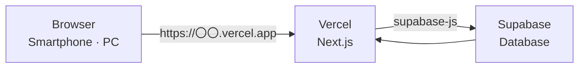
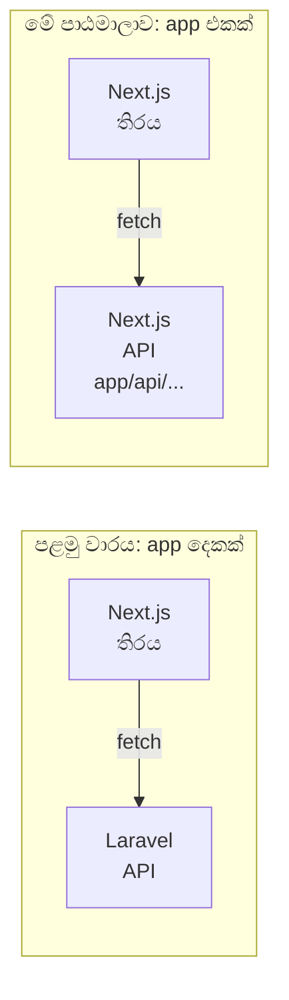
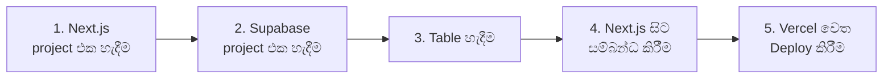
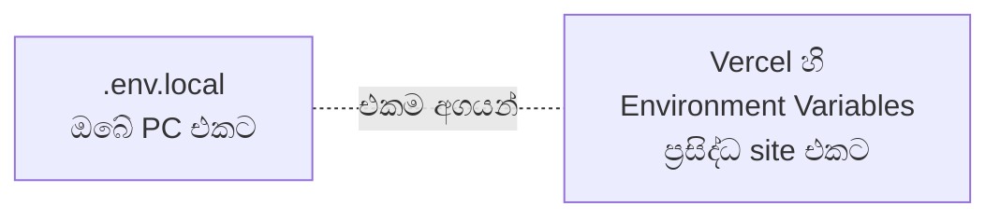

# ස්වාධීන නිර්මාණය A. Deploy පාඨමාලාව — Next.js + Vercel + Supabase

> 🇯🇵 මුල් පිටපත (ජපන් භාෂාවෙන්): [2026_10_09_資料2.md](<../../../2年生_システム開発実践/後期/2026_10_09/2026_10_09_資料2.md>) <!-- original-ja-link -->

මේක, හදපු app එක **අන්තර්ජාලයේ ප්‍රසිද්ධ කරලා**, smartphone එකෙන් හෝ යාළුවන්ගේ PC එකෙනුත් භාවිත කරන්න පුළුවන් කරන පාඨමාලාවක්.

> 💰 **සේරම නොමිලේ හදන්න පුළුවන්**
> | සේවාව | භාවිත කරන plan එක |
> |---------|----------|
> | Next.js | නොමිලේ (open source) |
> | Vercel | **Hobby** (නොමිලේ. පුද්ගලික, වාණිජ නොවන භාවිතය) |
> | Supabase | **Free** (නොමිලේ) |
>
> Credit card එකක් ලියාපදිංචි කරන්න ඕනේ නැහැ. මුදල් ගෙවන plan එකකට upgrade කරන්න කිව්වත්, ඒක තෝරන්න එපා.

[ස්වාධීන නිර්මාණය: ඔබ කැමති දෙයක් සංවර්ධනය කරමු — පිටුවට ආපසු යන්න](./2026_10_09_資料1.md)

---

## 1. ක්‍රියා කරන ආකාරය

පළමු වාරයේදී, දත්ත සැකසීම Laravel එකෙනුත්, දත්ත ගබඩා කිරීම MySQL එකෙනුත් කළා.
මේ පාඨමාලාවේදී, ඒ දෙක වෙනුවට **Supabase** භාවිත කරනවා.



| නම | මොකක්ද? | පළමු වාරයේ දේවල්වලින් කිව්වොත් |
|------|-----------|------------|
| **Next.js** | තිරය හදයි (**backend API එකත් හදන්න පුළුවන්**) | school-frontend (+ Laravel API) |
| **Vercel** | Next.js එක අන්තර්ජාලයේ ප්‍රසිද්ධ කරයි | (නැහැ) |
| **Supabase** | අන්තර්ජාලයේ තියෙන database එකක්. API එකත් ස්වයංක්‍රීයව සූදානම් කරලා දෙනවා | Laravel API + MySQL |

### Next.js කියන්නේ full-stack framework එකක්

පළමු වාරයේදී "තිරය Next.js, API එක Laravel" කියලා app දෙකකට බෙදලා හැදුවා.
හැබැයි Next.js කියන්නේ **full-stack framework** එකක් නිසා, **තිරය (frontend) සහ API එක (backend) එකම project එකක හදන්න පුළුවන්.**



`app/api/` ඇතුළේ `route.ts` එකක් හැදුවාම, ඒක API එකක් වෙනවා (මේකට **Route Handler** කියලා කියනවා).

```ts
// app/api/hello/route.ts
export async function GET() {
  return Response.json({ message: "こんにちは" });
}
```

`npm run dev` වලින් start කරලා http://localhost:3000/api/hello open කළාම, JSON එකක් ආපසු එනවා (`こんにちは` කියන්නේ "ආයුබෝවන්" කියන අර්ථයයි).

| | පළමු වාරය (Laravel) | Next.js |
|---|---|---|
| URL එක තීරණය කිරීම | `routes/api.php` එකේ ලියනවා | `app/api/〇〇/route.ts` එකේ **folder එක තියෙන තැනින්** තීරණය වෙනවා |
| සැකසීම ලිවීම | Controller එකේ method | `GET` / `POST` වගේ function |
| JSON ආපසු දීම | `return response()->json([...])` | `return Response.json({...})` |

**මේ වගේ වෙලාවට Next.js API එක භාවිත කරන්න**

- බාහිර API (AI වගේ) භාවිත කරනකොට, **API key එක browser එකට පෙන්නන්න ඕනේ නැත්නම්**
  (API එක ඇතුළේ සැකසීම server එකේ run වෙන නිසා, `NEXT_PUBLIC_` නැති environment variables ආරක්ෂිතව භාවිත කරන්න පුළුවන්)
- දත්ත save කරන්න කලින්, server පැත්තේ පරීක්ෂා කරන්න ඕනේ නම්

> සරල දත්ත ගන්න / දාන්න නම්, තිරයේ ඉඳන් කෙලින්ම Supabase එකට සම්බන්ධ කළාම ඇති.
> "Server පැත්තේ කරන්න ඕනේ දෙයක්" ආවොත්, Next.js API එකක් හදන්න.

## 2. සූදානම් වීමේ පියවර



### 2-1. Next.js project එක හදන්න

කාලගුණ අනාවැකි app එක වගේම `create-next-app` වලින් හදලා, GitHub එකට push කරලා තියන්න.
→ [කාලගුණ අනාවැකි app එකේ ද්‍රව්‍ය](../2026_10_02/2026_10_02_資料2.md)

### 2-2. Supabase project එක හදන්න

1. https://supabase.com/ open කරලා, `Start your project` → **GitHub එකෙන් login වෙන්න**
2. `New project` ඔබලා, පහත විදිහට ඇතුළත් කරන්න

| අයිතමය | ඇතුළත් කරන දේ |
|------|------------|
| Project name | App එකේ නම |
| Database Password | ශක්තිමත් password එකක් (`Generate a password` එක ඇති. ලියලා තියාගන්න) |
| Region | **Northeast Asia (Tokyo)** |
| Plan එක | **Free (නොමිලේ)** |

### 2-3. Table හදන්න

වම් පැත්තේ menu එකේ `Table Editor` → `Create a new table` වලින්, සැලසුම් පත්‍රයේ (planning sheet) සැලසුම් කළ table හදන්න.
`Enable Row Level Security (RLS)` එක **on කරලාම තියන්න** (පහළ අවධානය යොමු කරන්න ඕනේ කරුණ බලන්න).

### 2-4. Next.js සිට සම්බන්ධ කරන්න

Supabase එකේ `Project Settings` → `API Keys` එකෙන්, **Project URL** එක සහ **Publishable key** එක (නැත්නම් anon key එක) copy කරගන්න.
Next.js project එකට, Supabase භාවිත කරන්න අවශ්‍ය package එක install කරන්න.

```bash
npm install @supabase/supabase-js
```

Project එකේ මුල් folder එකේ `.env.local` එකක් හදලා, copy කරගත්ත අගයන් ලියන්න.

```bash
NEXT_PUBLIC_SUPABASE_URL=https://xxxxxxxx.supabase.co
NEXT_PUBLIC_SUPABASE_KEY=copy කරගත්ත Publishable key එක
```

`lib/supabase.ts` හදලා, Supabase එකට සම්බන්ධ වෙන්න සූදානම් කරන්න.

```ts
import { createClient } from "@supabase/supabase-js";

export const supabase = createClient(
  process.env.NEXT_PUBLIC_SUPABASE_URL!,
  process.env.NEXT_PUBLIC_SUPABASE_KEY!
);
```

ඊට පස්සේ, දත්ත ගන්නත් එකතු කරන්නත් පුළුවන්.

| කරන්න ඕනේ දේ | Supabase | පළමු වාරයේ Laravel වලින් කිව්වොත් |
|------------|---------|----------------------|
| සේරම ගන්න | `supabase.from("books").select("*")` | `Book::all()` |
| එකතු කරන්න | `supabase.from("books").insert({ title: "..." })` | `Book::create([...])` |
| මකන්න | `supabase.from("books").delete().eq("id", 1)` | `Book::find(1)->delete()` |

> ⚠️ **RLS (Row Level Security) ගැන සැලකිලිමත් වෙන්න**
> RLS on කරපු table එකකට **policy එකක් (කාටද කියවන්න / ලියන්න පුළුවන් කියන නීතිය)** හැදුවේ නැත්නම්, දත්ත හිස්ව ආපසු එනවා.
> `Authentication` → `Policies` එකෙන්, එක එක table එකට policy එකතු කරන්න.
> "දත්ත එන්නේ නැහැ!" වගේ වෙලාවට, මුලින්ම මෙතන පරීක්ෂා කරන්න. තේරෙන්නේ නැත්නම් ගුරුවරයාට කතා කරන්න.

> ⚠️ **`secret` key එක (service_role key එක) භාවිත කරන්න එපා**
> `NEXT_PUBLIC_` තියෙන අගයන් browser එකෙන් ඕනෑම කෙනෙකුට බලන්න පුළුවන්.
> මෙතනට දාන්නේ **Publishable key එක (anon key එක) විතරයි**. `secret` key එක දැම්මොත්, ඕනෑම කෙනෙකුට database එක වෙනස් කරන්න පුළුවන් වෙනවා.

### 2-5. Vercel වෙත deploy කරන්න

කාලගුණ අනාවැකි app එකේ පියවරවලින්ම deploy කරන්න. → [Vercel වෙත deploy කිරීම](../2026_10_02/2026_10_02_資料3.md#2-vercel-වෙත-නොමිලේ-deploy-කරමු)

හැබැයි, මේ පාර **environment variables සැකසීම අවශ්‍යයි**.
Vercel project එකේ `Settings` → `Environment Variables` එකට, `.env.local` එකේ තියෙන අගයන් දෙකම ලියාපදිංචි කරලා, ආයෙත් deploy කරන්න.



> `.env.local` එක GitHub එකට push වෙන්නේ නැහැ (`.gitignore` එකේ ඇතුළත් කරලා තියෙනවා).
> ඒ නිසා, Vercel එකෙත් වෙනම ලියාපදිංචි කරන්න ඕනේ.

---

## 3. මෙතැන් ඉඳන්, හදමින් ඉගෙනගන්න

සූදානම ඉවර වුණාම, ඊට පස්සේ **ඔබ හදන්න කැමති දේ හදමින්** ඉගෙනගන්නවා.
"මේ විශේෂාංගය හදන්න ඕනේ → හොයලා බලනවා → උත්සාහ කරනවා → වැඩ කළා!" කියන චක්‍රය නැවත නැවත කරනකොට, ඔබට භාවිත කරන්න පුළුවන් තාක්ෂණ වැඩි වෙනවා.

අවිනිශ්චිත වුණොත්, **ඔබ විශේෂයෙන් සැලකිලිමත් වන දේ** නැවත මතක් කරගන්න. "මේ කොටස නම් මේ විදිහටම ඕනේ" කියන අදහස, ඊළඟට ඉගෙනගන්න ඕනේ දේ තීරණය කරන්න උදව් කරයි.

ඉවර වුණාම, **ප්‍රසිද්ධ URL එක සහ GitHub URL එක** portfolio එකක් විදිහට ඉදිරිපත් කරන්න පුළුවන්.

> ⚠️ **Supabase ටික කාලයක් භාවිත නොකළොත් තාවකාලිකව නතර වෙනවා**
> නොමිලේ plan එකේදී, **සතියක් විතර access නොවුණොත්, project එක තාවකාලිකව නතර** වෙනවා.
> නතර වෙලා තියෙන කාලයේ, ප්‍රසිද්ධ URL එක open කළත් දත්ත පෙන්වන්නේ නැහැ.
> Supabase dashboard එකෙන් නැවත ආරම්භ කළාම කලින් තිබුණු විදිහටම වැඩ කරනවා (දත්ත මැකෙන්නේ නැහැ).
> **ඉදිරිපත් කරන්න කලින් සහ සම්මුඛ පරීක්ෂණයට කලින්, ඔබම ප්‍රසිද්ධ URL එක open කරලා වැඩ කරනවද කියලා බලන්න.**
→ [Portfolio එකක් ලෙස ඉදිරිපත් කිරීම](./2026_10_09_資料1.md#5-portfolio-එකක්-ලෙස-ඉදිරිපත්-කිරීම)

[ද්‍රව්‍ය 1 හි "හදමින් ඉගෙනගැනීම"](./2026_10_09_資料1.md#4-හදමින්-ඉගෙනගැනීම) කොටසත් එක්කම කියවන්න.
