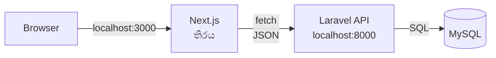
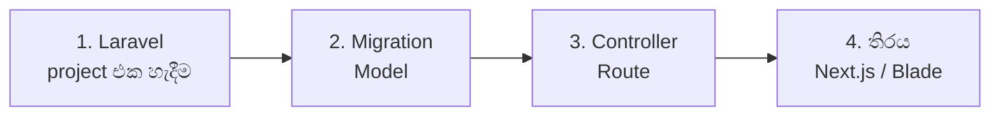

# ස්වාධීන නිර්මාණය B. Local පාඨමාලාව — Laravel වගේ

> 🇯🇵 මුල් පිටපත (ජපන් භාෂාවෙන්): [2026_10_09_資料3.md](<../../../2年生_システム開発実践/後期/2026_10_09/2026_10_09_資料3.md>) <!-- original-ja-link -->

මේක ඔබේ PC එකේ (`localhost`) run කරන පාඨමාලාවක්.

[ස්වාධීන නිර්මාණය: ඔබ කැමති දෙයක් සංවර්ධනය කරමු — පිටුවට ආපසු යන්න](./2026_10_09_資料1.md)

---

පළමු වාරයේ **ශිෂ්‍ය කළමනාකරණ app එක** හදන්න පාවිච්චි කළ තාක්ෂණයන්ම යොදාගෙන මේකත් හදනවා. අලුතින් ඉගෙනගන්න දේවල් අඩු නිසා, **විශේෂාංග හදන එකට අවධානය යොමු කරන්න** පුළුවන්.

---

## 1. හදන විදිහ තෝරන්න

හදන්න විදි 2ක් තියෙනවා.

| හදන විදිහ | අන්තර්ගතය | නිර්දේශ කරන්නේ |
|-------|------|---------|
| **Laravel API + Next.js** | පළමු වාරයේ වගේමයි. තිරය Next.js, දත්ත Laravel | පළමු වාරයේ දේවල් පුනරීක්ෂණය කරමින් හදන්න කැමති අයට |
| **Laravel විතරක් (Blade)** | තිරයත් Laravel හි Blade වලින් හදනවා | ව්‍යුහය සරල කරගන්න කැමති අයට |

---

## 2. සූදානම් වීමේ පියවර

පළමු වාරයේ ද්‍රව්‍ය සහ සම්පූර්ණ කළ code එක බලලා උදව් ගන්න.

- සමස්ත ක්‍රියාවලිය → [Development ක්‍රියාවලිය: බිංදුවේ සිට API එකක් හදනකම්](../../前期/開発の流れ_まとめ.md)
- පළමු වාරය ආපසු හැරී බැලීම → [පළමු වාරය ආපසු හැරී බැලීම (පුනරීක්ෂණය)](../2026_10_02/2026_10_02_資料1.md)
- අවසන් අනුවාදයේ code → [portfolio](../../前期/portfolio/)

> **"Laravel වගේ" කියන එකේ "වගේ"**
> පළමු වාරයේ භාවිත කළ දේවල් හැර වෙනත් දෙයකින් (Python වගේ) හදන්න කැමති අය, ගුරුවරයාගෙන් අහන්න.

---

## 3. මෙතැන් ඉඳන්, හදමින් ඉගෙනගන්න

සූදානම ඉවර වුණාම, ඊට පස්සේ **ඔබ හදන්න කැමති දේ හදමින්** ඉගෙනගන්නවා.
"මේ විශේෂාංගය හදන්න ඕනේ → හොයලා බලනවා → උත්සාහ කරනවා → වැඩ කළා!" කියන චක්‍රය නැවත නැවත කරනකොට, ඔබට භාවිත කරන්න පුළුවන් තාක්ෂණයන් වැඩි වෙනවා.

අවිනිශ්චිත වුණොත්, **ඔබ විශේෂයෙන් සැලකිලිමත් වන දේ** නැවත මතක් කරගන්න. "මේ කොටස නම් මේ විදිහටම ඕනේ" කියන අදහස, ඊළඟට ඉගෙනගන්න ඕනේ දේ තීරණය කරන්න උදව් කරයි.

ඉවර වුණාම, **GitHub URL එක** portfolio එකක් විදිහට ඉදිරිපත් කරන්න පුළුවන්. README එකට **screenshot, තිරයේ video වගේ දේවල්** දාලා, app එක වැඩ කරන හැටි තේරෙන්න හදන්න.
→ [Portfolio එකක් ලෙස ඉදිරිපත් කිරීම](./2026_10_09_資料1.md#5-portfolio-එකක්-ලෙස-ඉදිරිපත්-කිරීම)

[ද්‍රව්‍ය 1 හි "හදමින් ඉගෙනගැනීම"](./2026_10_09_資料1.md#4-හදමින්-ඉගෙනගැනීම) කොටසත් එක්කම කියවන්න.
