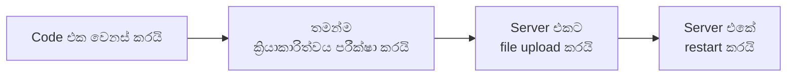
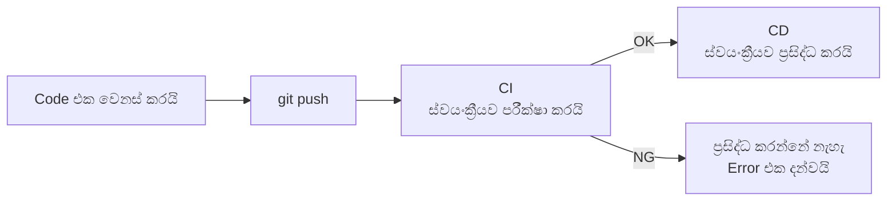
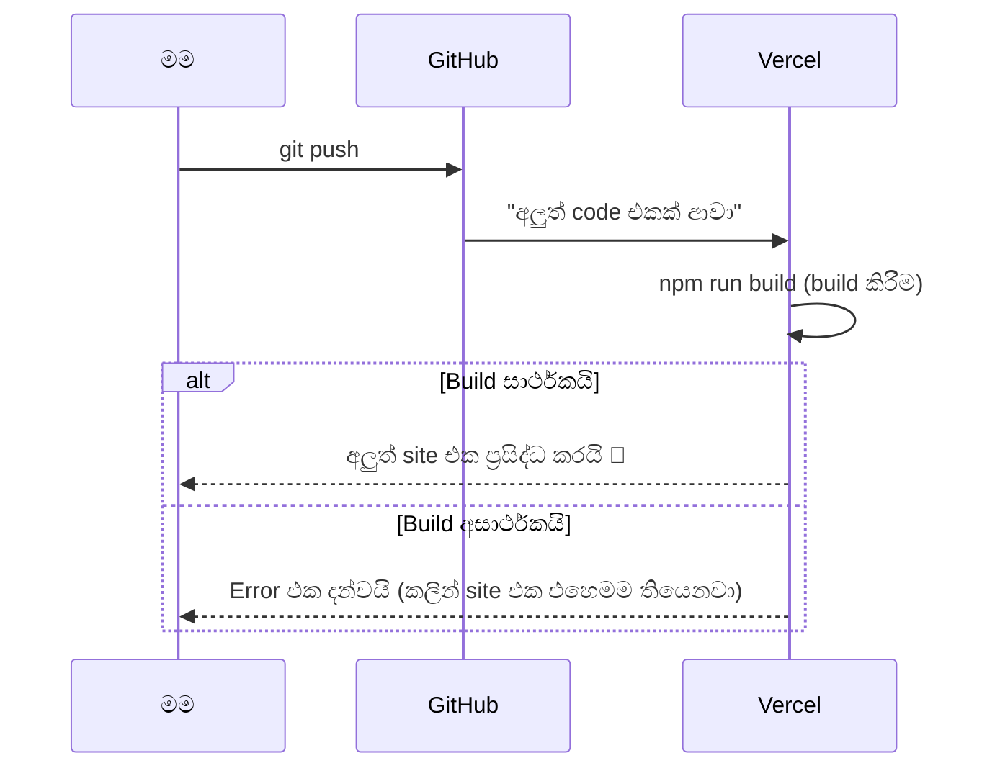
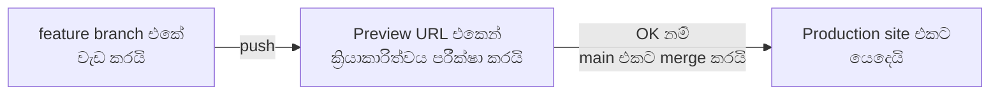
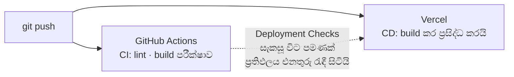

# CI/CD ගැන

> 🇯🇵 මුල් පිටපත (ජපන් භාෂාවෙන්): [CICDについて.md](<../../../2年生_システム開発実践/後期/2026_10_09/CICDについて.md>) <!-- original-ja-link -->

Deploy පාඨමාලාවේදී, GitHub එකට push කළා විතරයි, Vercel site එක අලුත් වුණා.
ඇත්තටම මේක තමයි **CI/CD (සී-අයි · සී-ඩී)** ක්‍රමය.
මෙතනදී, CI/CD කියන්නේ මොකක්ද කියලා බලමු.

[ස්වාධීන නිර්මාණය A. Deploy පාඨමාලාව වෙත ආපසු යන්න](./2026_10_09_資料2.md)

---

## 1. CI/CD කියන්නේ මොකක්ද

**CI/CD** කියන්නේ "code ලිව්වට පස්සේ කරන වැඩ **ස්වයංක්‍රීය** කරන" ක්‍රමයක්.

| නම | නිල නම | තේරුම | කෙටියෙන් |
|------|----------|------|-----------|
| **CI** | Continuous Integration (අඛණ්ඩ ඒකාබද්ධ කිරීම) | Push කරන හැම වෙලාවකම, **ස්වයංක්‍රීයව පරීක්ෂා** කරනවා | ස්වයංක්‍රීය පරීක්ෂාව |
| **CD** | Continuous Delivery / Deployment (අඛණ්ඩ බෙදාහැරීම / අඛණ්ඩ deploy කිරීම) | පරීක්ෂාව සාර්ථක වුණාම, **ස්වයංක්‍රීයව ප්‍රසිද්ධ** කරනවා | ස්වයංක්‍රීය ප්‍රසිද්ධ කිරීම |

> 💡 **උපමාවක් විදිහට "වාර්තාවක් භාර දීම"**
> - **CI** = භාර දෙන්න කලින්, අකුරු වැරදි සහ පිටු ගණන **ස්වයංක්‍රීයව පරීක්ෂා කරලා දෙන** පහසුකම
> - **CD** = පරීක්ෂාව සාර්ථක වුණාම, **ස්වයංක්‍රීයව ගුරුවරයාට භාර දෙන** පහසුකම
>
> මිනිස් අතින් කළොත් "පරීක්ෂා කරන්න අමතක වුණා" "භාර දෙන්න අමතක වුණා" වගේ දේවල් වෙනවා. ස්වයංක්‍රීය කළොත්, හැම වෙලාවකම එකම විදිහට කරන්න පුළුවන්.

> 📝 **CD වල තේරුම් දෙකක්**
> CD වලට, **අඛණ්ඩ බෙදාහැරීම (Continuous Delivery)** (ඕනෑම වෙලාවක ප්‍රසිද්ධ කරන්න පුළුවන් තත්ත්වයේ තියාගෙන, ප්‍රසිද්ධ කරන බොත්තම මිනිසෙක් ඔබනවා) සහ **අඛණ්ඩ deploy කිරීම (Continuous Deployment)** (ප්‍රසිද්ධ කරනකම්ම සේරම ස්වයංක්‍රීයයි) කියලා තේරුම් දෙකක් තියෙනවා.
> මේ ද්‍රව්‍යයේ Vercel වගේ, push කළාම ස්වයංක්‍රීයව ප්‍රසිද්ධ වෙන එක **අඛණ්ඩ deploy කිරීම** යි.

---

## 2. CI/CD නැත්නම් මොකද වෙන්නේ?

CI/CD නැත්නම්, code එක වෙනස් කරන හැම වෙලාවකම **මිනිස් අතින්** වැඩ කරන්න වෙනවා.



- පරීක්ෂා කරන්න අමතක වෙලා, **error තියෙන code එක ප්‍රසිද්ධ** කරනවා
- Upload කරන file **වැරදෙනවා**
- හැම පාරම එකම වැඩේ කරන නිසා **කාලය ගත වෙනවා**

CI/CD තියෙනවා නම්, මෙහෙම වෙනවා.



**ඔබට කරන්න තියෙන්නේ `git push` විතරයි**.

---

## 3. Vercel අපි වෙනුවෙන් CD කරනවා

Vercel සහ GitHub සම්බන්ධ කළාම, **push කරන හැම වෙලාවකම ස්වයංක්‍රීයව deploy** වෙනවා. මේක තමයි **CD**.



> 📝 **Build එක අසාර්ථක වුණත්, site එක කැඩෙන්නේ නැහැ**
> Build එක අසාර්ථක වුණාම, **කලින් version එකේ site එක එහෙමම** පෙන්වනවා.
> Vercel එකේ `Deployments` තිරයෙන්, අසාර්ථක වුණු හේතුව (error පණිවිඩය) පරීක්ෂා කරන්න.

### එක් එක් branch එකට "අත්හදා බැලීමේ URL" එකක් හැදෙනවා

Vercel එකේදී, branch එක අනුව ප්‍රසිද්ධ වෙන විදිහ වෙනස් වෙනවා.

| Push කරපු branch එක | මොකද වෙන්නේ? | URL |
|------------------|-----------|-----|
| `main` | **සැබෑ (production) site එක** අලුත් වෙනවා | `https://〇〇.vercel.app` |
| ඒ හැර අනිත් ඒවා (`feature/login` වගේ) | **අත්හදා බැලීමේ site එකක් (Preview)** හැදෙනවා | `https://〇〇-git-feature-login-〇〇.vercel.app` වගේ |



අලුත් විශේෂාංග, **branch එකක් හදලා Preview URL එකෙන් පරීක්ෂා කළාට පස්සේ main එකට merge** කළොත්, production site එක කඩන්නේ නැතුව ඉන්න පුළුවන්.
මේක පළමු වාරයේ කණ්ඩායම් සංවර්ධනයේදී ඉගෙනගත්ත **branch → pull request → merge** ක්‍රියාවලියම තමයි.

---

## 4. CI කරලා බලමු (GitHub Actions)

Vercel ප්‍රධාන වශයෙන් කරන්නේ CD.
**CI (ස්වයංක්‍රීය පරීක්ෂාව)** එක, **GitHub Actions** කියන GitHub පහසුකමෙන් එකතු කරන්න පුළුවන් (public repository නම් නොමිලේ. Private repository වුණත්, මාසෙකට නියමිත කාලයක් දක්වා නොමිලේ).

### 4-1. සැකසුම් file එක හදන්න

Project එකේ `.github/workflows/ci.yml` හදන්න.

```yaml
# .github/workflows/ci.yml
name: CI

# කවදාද run කරන්නේ: push සහ pull request වෙලාවට
on:
  push:
  pull_request:

jobs:
  check:
    runs-on: ubuntu-latest   # GitHub සූදානම් කරලා දෙන PC එකේ run වෙනවා
    steps:
      - uses: actions/checkout@v6      # Code එක ගෙනෙනවා
      - uses: actions/setup-node@v6    # Node.js install කරනවා
        with:
          node-version: 24
      - run: npm ci                    # Package install කරනවා
      - run: npm run lint              # Code ලියපු විදිහ පරීක්ෂා කරනවා
      - run: npm run build             # Build කරන්න පුළුවන්ද පරීක්ෂා කරනවා
```

> ⚠️ **`npm run lint` වැඩ කරන්නේ නැති විට**
> `create-next-app` එකේදී **Linter එකට None තෝරපු** project එකක `lint` script එකක් නැහැ. එහෙම නම් `npm run lint` පේළිය මකන්න.
> ඒ වගේම, Next.js 16 ඉඳන් `next lint` command එක අයින් කළා. පරණ project එකක `"lint": "next lint"` කියලා තියෙනවා නම්, ඒක `"lint": "eslint"` කියලා වෙනස් කරන්න.
> `package.json` එකේ `"scripts"` බලලා, `lint` තියෙනවද කියලා පරීක්ෂා කරන්න.

| පේළිය | තේරුම |
|----|------|
| `on:` | **කවදාද** run කරන්නේ |
| `runs-on:` | **කොහෙද** run කරන්නේ (GitHub එකේ PC එකක් ණයට ගන්නවා) |
| `steps:` | **මොකක්ද** කරන්නේ (උඩ ඉඳන් පිළිවෙළට run කරනවා) |

### 4-2. ප්‍රතිඵලය බලන්න

File එක push කළාම, GitHub repository එකේ **`Actions`** tab එකෙන් ප්‍රතිඵලය බලන්න පුළුවන්.

| පෙන්වන දේ | තේරුම |
|------|------|
| ✅ කොළ පාට tick | සියලු පරීක්ෂා සාර්ථකයි |
| ❌ රතු පාට කතිරය | කොහේ හරි අසාර්ථක වුණා → click කළාම error එක බලන්න පුළුවන් |

Pull request තිරයේත් ප්‍රතිඵලය පෙන්වන නිසා, **merge කරන්න කලින් ගැටලු හඳුනාගන්න පුළුවන්**.

> ⚠️ **GitHub Actions අසාර්ථක වුණත්, Vercel deploy කරනවා**
> GitHub Actions (CI) සහ Vercel (CD) **එකිනෙකට වෙන වෙනම** ක්‍රියා කරනවා.
> ඒ නිසා, කිසිම සැකසුමක් නොකළොත්, CI එක ❌ වුණත් Vercel build එක සාර්ථක නම් **production site එක අලුත් වෙනවා**.
> "CI එක ✅ වුණොත් විතරක් production එකට දාන්න" ඕනේ නම්, Vercel හි **Deployment Checks** කියන පහසුකම භාවිත කරන්න.
> Project එකේ `Settings` යටතේ `Build and Deployment` එකේ තියෙන Deployment Checks එකේ `Add Checks` ඔබලා, GitHub Actions check එක තෝරන්න (වැඩි විස්තර [Vercel documentation](https://vercel.com/docs/deployment-checks) එකේ).

CI සහ CD අතර සම්බන්ධය රූපයකින් පෙන්නුවොත් මෙහෙමයි.



> 💡 **README එකට badge එකක් දැම්මොත්, portfolio එකේදී ඔබව ඉස්මතු කරගන්න පුළුවන්**
> `Actions` tab එකේ workflow එක open කරලා, `Filter workflow runs` එක ළඟ තියෙන `⋮` → `Create status badge` → `Copy status badge Markdown` වලින් badge එකේ code එක හදාගන්න පුළුවන්.
> README එකට දැම්මාම "CI/CD භාවිත කරලා සංවර්ධනය කරනවා" කියන එක එක බැල්මෙන්ම තේරෙනවා.

---

## 5. CI/CD වල හොඳ පැති

- **වැරදි ඉක්මනින් හඳුනාගන්න පුළුවන්**: Push කළ ගමන් පරීක්ෂා කරනවා
- **ප්‍රසිද්ධ කිරීම පහසුයි**: `git push` විතරක් කළාම production එකට යෙදෙනවා
- **හැම පාරම එකම පියවරවලින් කරන්න පුළුවන්**: අතින් කරන වැරදි නැති වෙනවා
- **කණ්ඩායම් සංවර්ධනයට හොඳයි**: කාගේ code එක වුණත් එකම නීතිවලින් පරීක්ෂා කරනවා

සැබෑ සංවර්ධන ක්ෂේත්‍රයේ CI/CD **නිතරම වගේ** භාවිත කරනවා.
ස්වාධීන නිර්මාණයේදී භාවිත කරලා තිබුණොත්, රැකියා සෙවීමේදීත් කතා කරන්න පුළුවන් අත්දැකීමක් වෙනවා.

---

## 6. සාරාංශය

- **CI** = push කළාම **ස්වයංක්‍රීයව පරීක්ෂා කරනවා**, **CD** = පරීක්ෂාව සාර්ථක වුණාම **ස්වයංක්‍රීයව ප්‍රසිද්ධ කරනවා**
- Vercel ස්වයංක්‍රීයව පරීක්ෂා කරන්නේ **build එක සාර්ථකද නැද්ද** කියන එක විතරයි. GitHub Actions ප්‍රතිඵලය අනුව ප්‍රසිද්ධ කිරීම නවත්වන්න ඕනේ නම් **Deployment Checks** සකසන්න
- Vercel, GitHub එක්ක සම්බන්ධ වෙලා, **push කරන හැම වෙලාවකම ස්වයංක්‍රීයව deploy (CD)** කරනවා
- `main` හැර අනිත් branch **Preview URL** එකෙන් පරීක්ෂා කරන්න පුළුවන්
- **GitHub Actions** භාවිත කළොත්, lint සහ build සඳහා **ස්වයංක්‍රීය පරීක්ෂා (CI)** එකතු කරන්න පුළුවන්
- ඔබට කරන්න තියෙන්නේ **`git push` විතරයි**

[ස්වාධීන නිර්මාණය A. Deploy පාඨමාලාව වෙත ආපසු යන්න](./2026_10_09_資料2.md)
