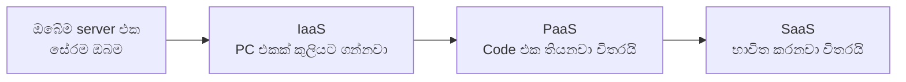
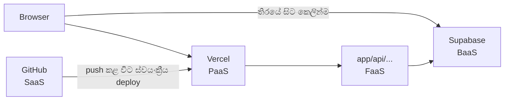

# IaaS · PaaS · SaaS · BaaS ගැන

> 🇯🇵 මුල් පිටපත (ජපන් භාෂාවෙන්): [IaaS_PaaS_SaaS_BaaSについて.md](<../../../2年生_システム開発実践/後期/2026_10_09/IaaS_PaaS_SaaS_BaaSについて.md>) <!-- original-ja-link -->

Cloud සේවා ගැන හොයලා බලනකොට, **IaaS (අයාස්)** · **PaaS (පාස්)** · **SaaS (සාස්)** · **BaaS (බාස්)** වගේ වචන නිතර හම්බ වෙනවා.
මේ හැම එකක්ම "〇〇 as a Service (〇〇 සේවාවක් විදිහට භාවිත කිරීම)" කියන එකේ කෙටි නම්; ඒවායින් පෙන්නන්නේ **කොතෙක් දුරට සේවාවට භාර දෙනවද** කියන වෙනස.

[ස්වාධීන නිර්මාණය A. Deploy පාඨමාලාව වෙත ආපසු යන්න](./2026_10_09_資料2.md)

---

## 1. කෙටියෙන් කිව්වොත්

| නම | නිල නම | කුලියට ගන්නා දේ | කෙටියෙන් |
|------|----------|-----------|-----------|
| **IaaS** | Infrastructure as a Service | **Server (PC) එකම** | හිස් PC එකක් කුලියට ගන්නවා |
| **PaaS** | Platform as a Service | **App එක run කරන තැන** | Code එක තිබ්බාම run වෙනවා |
| **BaaS** | Backend as a Service | **Backend පහසුකම්** | Database සහ login මුල ඉඳන්ම තියෙනවා |
| **FaaS** | Function as a Service | **Function run කරන තැන** | Function එක විතරක් ලිව්වාම run වෙනවා |
| **SaaS** | Software as a Service | **සම්පූර්ණ කරපු app එකක්** | එහෙමම භාවිත කළාම ඇති |

පහළට යනකොට, **ඔබට කරන්න තියෙන දේවල් අඩු** වෙනවා.

---

## 2. Pizza එකකින් උපමා කළොත්

| | ඔබට කරන්න තියෙන දේ | Pizza එකකින් කිව්වොත් |
|---|---|---|
| **ඔබේම server එක** | සේරම | පිටිවලින් pizza පිටි ගුලිය හදලා, oven එකත් ඔබම මිලදී ගන්නවා |
| **IaaS** | OS · software සූදානම් කිරීම, app එක | කුස්සියයි oven එකයි කුලියට අරගෙන, අමුද්‍රව්‍යවලින් ඔබම හදනවා |
| **PaaS** | App එක (code) විතරයි | පිටි ගුලියයි oven එකයි සූදානම් කරලා තියෙනවා. Topping විතරක් ඔබ දානවා |
| **SaaS** | කිසිම දෙයක් නැහැ (භාවිත කරනවා විතරයි) | Delivery pizza එකක් order කරලා කනවා විතරයි |

→ දකුණට යනකොට **පහසුයි**. වමට යනකොට **නිදහසේ customize කරන්න පුළුවන්**.

---

## 3. කවුද මොනවා කළමනාකරණය කරන්නේ?

App එකක් run කරන්න, විවිධ "ස්තර (layer)" අවශ්‍යයි.
**🟦 = ඔබම කළමනාකරණය කරනවා**, **⬜ = සේවාව කළමනාකරණය කරලා දෙනවා**.

| ස්තරය | ඔබේම server එක | IaaS | PaaS | SaaS |
|----|:---:|:---:|:---:|:---:|
| App එක (ඔබේ code) | 🟦 | 🟦 | 🟦 | ⬜ |
| දත්ත | 🟦 | 🟦 | 🟦 | ⬜ |
| PHP · Node.js වගේ runtime environment | 🟦 | 🟦 | ⬜ | ⬜ |
| OS (Linux වගේ) | 🟦 | 🟦 | ⬜ | ⬜ |
| Server (PC එකම) | 🟦 | ⬜ | ⬜ | ⬜ |
| Network · ගොඩනැගිල්ල · විදුලිය | 🟦 | ⬜ | ⬜ | ⬜ |

---

## 4. එකින් එක විස්තරාත්මකව

### 4-1. IaaS (අයාස්) — හිස් PC එකක් කුලියට ගන්නවා

අන්තර්ජාලය හරහා පාවිච්චි කරන්න පුළුවන් **PC එකක් කුලියට ගන්නවා** වගේ අදහසක්.
OS එක දාන එක, PHP, MySQL වගේ දේවල් install කරන එක කරන්නේ **ඔබම**.

- **උදාහරණ**: AWS හි EC2, Google Cloud හි Compute Engine, さくらのクラウド (Sakura Cloud)
- **හොඳ පැත්ත**: ඕනෑම දෙයක් නිදහසේ කරන්න පුළුවන්
- **අමාරු පැත්ත**: සැකසුම් සහ ආරක්ෂක පියවර සේරම ඔබම කරන්න ඕනේ

> පළමු වාරයේ Laravel app එක IaaS එකකින් ප්‍රසිද්ධ කරනවා නම්, "Linux දානවා → PHP · MySQL දානවා → Code එක තියනවා → පැය 24ම run කරනවා" කියන සේරම ඔබම කරනවා.

### 4-2. PaaS (පාස්) — Code එක තිබ්බාම run වෙනවා

**App එක run කරන්න අවශ්‍ය පරිසරය මුල ඉඳන්ම සූදානම් කරලා තියෙන** සේවාවක්.
ඔබ **code එක සූදානම් කළාම ඇති**; ප්‍රසිද්ධ කරනකම්ම සේවාව බලාගන්නවා.

- **උදාහරණ**: **Vercel**, Render, Heroku, Google App Engine
  (Heroku 2026 දී අලුත් විශේෂාංග සංවර්ධනය නවත්වන බව ප්‍රකාශ කරලා තියෙනවා. ඒත් PaaS සඳහා කාලයක් තිස්සේ ප්‍රසිද්ධ උදාහරණයක් විදිහට ඒ නම නිතර හම්බ වෙනවා)
- **හොඳ පැත්ත**: Server සැකසුම් ඕනේ නැහැ. `git push` විතරක් කරලා ප්‍රසිද්ධ කරන්න පුළුවන්
- **අමාරු පැත්ත**: සේවාව සහාය දෙන භාෂා · භාවිත ක්‍රමවලට සීමා වෙනවා

> 🎯 **Deploy පාඨමාලාවේ භාවිත කරන Vercel කියන්නේ PaaS එකක්.**
> Next.js code එක GitHub එකට push කළා විතරයි, අන්තර්ජාලයේ ප්‍රසිද්ධ කරන්න පුළුවන් වුණා.

### 4-3. BaaS (බාස්) — Backend එක මුල ඉඳන්ම තියෙනවා

**Database · login පහසුකම · file ගබඩා කිරීම වගේ backend පහසුකම් එකට සපයන** සේවාවක්.
Backend code එක (පළමු වාරයේ Laravel API එක වගේ) **ඔබම ලියන්නේ නැතුවම** app එකක් හදන්න පුළුවන්.

- **උදාහරණ**: **Supabase**, Firebase
- **හොඳ පැත්ත**: Frontend (තිරය) හදන එකට අවධානය යොමු කරන්න පුළුවන්
- **අමාරු පැත්ත**: සංකීර්ණ ක්‍රියාවලි සඳහා, වෙනම API එකක් හදන්න වෙනවා

| කරන්න ඕනේ දේ | පළමු වාරය (ඔබම හදනවා) | Supabase (BaaS) |
|------------|-----------------|-----------------|
| දත්ත save කිරීම | Laravel API + MySQL | මුල ඉඳන්ම තියෙනවා |
| Login පහසුකම | ඔබම හදනවා | මුල ඉඳන්ම තියෙනවා (Authentication) |
| පින්තූර save කිරීම | ඔබම හදනවා | මුල ඉඳන්ම තියෙනවා (Storage) |

> 🎯 **Deploy පාඨමාලාවේ භාවිත කරන Supabase කියන්නේ BaaS එකක්.**

### 4-4. FaaS (ෆාස්) — Function එක විතරක් ලිව්වාම run වෙනවා

**Function එකක් ලිව්වාම, ඒක call කරන වෙලාවට විතරක් run කරලා දෙන** සේවාවක්.
මේක "serverless" කියන අදහසේ හරය. → [Serverless ගැන](./サーバレスについて.md)

- **උදාහරණ**: **Vercel Functions** (Next.js හි `app/api/〇〇/route.ts`), AWS Lambda, Cloudflare Workers
- **හොඳ පැත්ත**: භාවිත කරපු ප්‍රමාණයට විතරයි මුදල් යන්නේ. Access වැඩි වුණත් ස්වයංක්‍රීයව ගැළපෙනවා
- **අමාරු පැත්ත**: වැඩි වෙලාවක් ගත වන ක්‍රියාවලිවලට හොඳ නැහැ. Function එක ඇතුළේ දත්ත තියාගන්න බැහැ

### 4-5. SaaS (සාස්) — සම්පූර්ණ කරපු app එකක් භාවිත කරනවා

**හදලා ඉවර කරපු app එකක්, අන්තර්ජාලය හරහා එහෙමම භාවිත කරන** සේවාවක්.
ඔබ හැමදාම භාවිත කරන ගොඩක් දේවල් SaaS.

- **උදාහරණ**: Gmail, Google Docs, **GitHub**, Slack, Zoom, Notion
- **හොඳ පැත්ත**: Install කරන්නවත් කළමනාකරණය කරන්නවත් ඕනේ නැහැ. වහාම භාවිත කරන්න පුළුවන්
- **අමාරු පැත්ත**: ඇතුළේ තියෙන දේවල් ඔබට වෙනස් කරන්න බැහැ

> ස්වාධීන නිර්මාණයේදී හදපු app එක ප්‍රසිද්ධ කරලා, හැමෝටම භාවිත කරන්න දුන්නොත්, ඒකත් **SaaS** එකක්.

---

## 5. Deploy පාඨමාලාවේ ව්‍යුහයට ගළපලා බැලුවොත්

| භාවිත කරන දේ | වර්ගය |
|--------------|------|
| GitHub | SaaS (code කළමනාකරණය කරන සම්පූර්ණ සේවාවක්) |
| Vercel | PaaS (Next.js run කරන තැන) |
| Next.js API (`app/api/`) | FaaS (Vercel මත, call කරන වෙලාවට විතරක් run වෙන function) |
| Supabase | BaaS (Database · login වගේ backend) |

> 📝 **හරියටම වෙන් කරන්න බැරි අවස්ථාත් තියෙනවා**
> "Vercel කියන්නේ PaaS එකක්, ඒ වගේම FaaS එකකුත් සපයනවා" වගේ, එක සේවාවකට මුහුණු කිහිපයක් තියෙන්න පුළුවන්.
> නම් කටපාඩම් කරනවට වඩා, **"කොතෙක් දුරට සේවාවට භාර දීලා තියෙනවද"** කියලා හිතන්න පුරුදු වෙන්න.

---

## 6. සාරාංශය

- "〇〇 as a Service" කියන්නේ, **කොතෙක් දුරට සේවාවට භාර දෙනවද** කියන වෙනස
- **IaaS**: PC එකක් කුලියට ගන්නවා (නිදහස් වුණත් අමාරුයි)
- **PaaS**: Code එක තිබ්බාම run වෙනවා (Vercel)
- **BaaS**: Backend පහසුකම් මුල ඉඳන්ම තියෙනවා (Supabase)
- **FaaS**: Function එක විතරක් ලිව්වාම run වෙනවා (Vercel මත Next.js API)
- **SaaS**: සම්පූර්ණ කරපු app එකක් භාවිත කරනවා විතරයි (Gmail · GitHub)
- භාර දෙනකොට **පහසුයි**, ඔබම කරනකොට **නිදහස්**

[ස්වාධීන නිර්මාණය A. Deploy පාඨමාලාව වෙත ආපසු යන්න](./2026_10_09_資料2.md)
