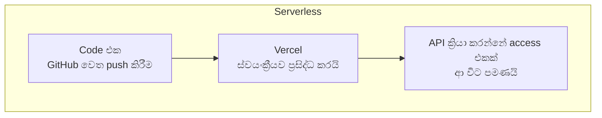
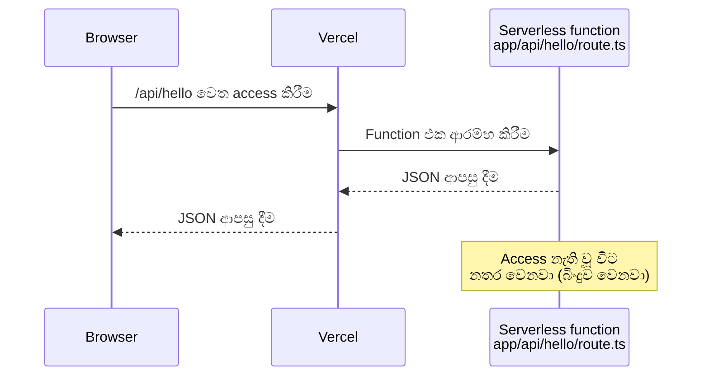
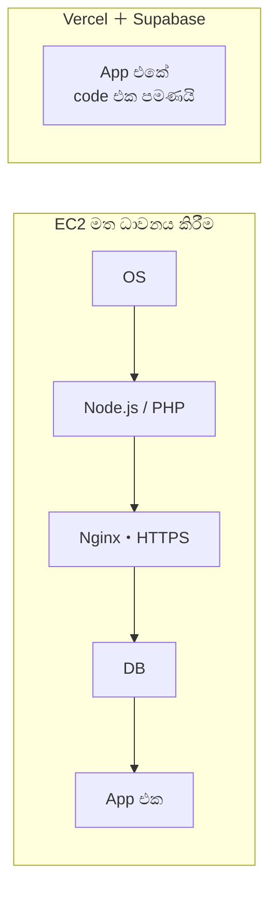

# Serverless ගැන

> 🇯🇵 මුල් පිටපත (ජපන් භාෂාවෙන්): [サーバレスについて.md](<../../../2年生_システム開発実践/後期/2026_10_09/サーバレスについて.md>) <!-- original-ja-link -->

Deploy පාඨමාලාවේදී භාවිත කරන **Vercel** හි, Next.js API ක්‍රියා කරන්නේ "**serverless**" ලෙස හඳුන්වන ක්‍රමයකටයි.
මෙහිදී, serverless යනු කුමක්ද යන්න පළමු වාරයේ ඉගෙන ගත් Laravel සමඟ සසඳමින් බලමු.

[ස්වාධීන නිර්මාණය A. Deploy පාඨමාලාව වෙත ආපසු යන්න](./2026_10_09_資料2.md)

---

## 1. Serverless යනු කුමක්ද

**Serverless** යන්නෙන් "server එකක් නැත" යන අර්ථය ලැබෙන්නේ නැහැ.
Server එක **ඇත්තටම තියෙනවා**. නමුත් එය, **server එක සූදානම් කිරීම සහ කළමනාකරණය ඔබ විසින්ම කළ යුතු නැති** ක්‍රමයකි.

> 💡 **උපමාවකින් කිව්වොත් "ටැක්සියක්"**
> - **ඔබම server එකක් සූදානම් කිරීම** ＝ වාහනයක් මිලදී ගැනීම. වාහනය නවත්වන්න තැනක් හොයාගැනීම, වාහන පරීක්ෂාව, ඉන්ධන පිරවීම, කැඩුණු විට අලුත්වැඩියා කිරීම යන සියල්ල ඔබම කළ යුතුයි
> - **Serverless** ＝ ටැක්සියකින් යාම. යන තැන කිව්වාම ඇති, වාහනය කළමනාකරණය රියදුරා (සමාගම) කරනවා
>
> දෙකේදීම "වාහනයක්" භාවිත කරනවා. වෙනස වන්නේ **කළමනාකරණය කරන්නේ කවුද** යන්නයි.

---

## 2. පළමු වාරයේ ක්‍රමය සමඟ සසඳා බලමු

පළමු වාරයේදී, ඔබේ PC එකේ `php artisan serve` ධාවනය කර Laravel server එක ආරම්භ කළා.
මෙය අන්තර්ජාලයේ ප්‍රසිද්ධ කරනවා නම්, **නොනවත්වා දිගටම ක්‍රියා කරන server එකක්** ඔබම සූදානම් කළ යුතුයි.

```mermaid
graph TB
    subgraph ඔබම server එකක් සූදානම් කිරීම
        S1[Server එකක් කුලියට ගැනීම] --> S2[OS・PHP・MySQL<br>ස්ථාපනය කිරීම] --> S3[App එක තැබීම] --> S4[පැය 24 පුරා<br>ධාවනය කිරීම]
        S4 --> S5[Update සහ<br>දෝෂ විසඳීමත් ඔබම]
    end
```



| | ඔබම server එකක් සූදානම් කිරීම | Serverless (Vercel වැනි) |
|---|---|---|
| Server එක සූදානම් කිරීම | ඔබම කළ යුතුයි (OS・software ස්ථාපනය) | **අවශ්‍ය නැහැ** |
| ක්‍රියා කරන කාලය | **පැය 24 පුරාම** | **Access එකක් ආ විට පමණයි** |
| Access හදිසියේ වැඩි වුවහොත් | ඔබම server ගණන වැඩි කළ යුතුයි | **ස්වයංක්‍රීයව වැඩි වෙනවා** |
| Update සහ ආරක්ෂක පියවර | ඔබම කළ යුතුයි | සේවාව විසින් කරනවා |
| මුදල් | භාවිත නොකළත් ගෙවිය යුතුයි | **භාවිත කළ ප්‍රමාණයට පමණයි** (ටිකක් නම් නොමිලේ) |

---

## 3. "Access එකක් ආ විට පමණක් ක්‍රියා කිරීම" යනු

Serverless හි ප්‍රධානම ලක්ෂණය වන්නේ, **කැඳවූ විට පමණක් ක්‍රියා කිරීමයි**.

ලේඛනය 2 හි හැදූ Next.js API එක (`app/api/(නම)/route.ts`) Vercel වෙත deploy කළ විට, එය **serverless function (Vercel Functions)** ලෙස ක්‍රියා කරනවා.



```ts
// app/api/hello/route.ts
export async function GET() {
  return Response.json({ message: "こんにちは" });
}
```

ඔබ ලිවිය යුත්තේ **මෙම function එක පමණයි** ("こんにちは" කියන්නේ "ආයුබෝවන්" කියන අර්ථයයි).
"Server එක ආරම්භ කිරීම", "port අංකය තීරණය කිරීම" වැනි වැඩ Vercel විසින් කරනවා.

---

## 4. Supabase serverless ද?

**Server එක කළමනාකරණය කළ යුතු නැහැ** යන කාරණයෙන් Supabase ද සමානයි. පළමු වාරයේදී MySQL ඔබේම PC එකේ (XAMPP හෝ Homebrew) ධාවනය කළා,
නමුත් Supabase හිදී, **database එක සූදානම් කිරීම සහ API සෑදීම Supabase විසින් කරනවා**.

| කළ යුතු දේ | පළමු වාරය (Laravel ＋ MySQL) | Supabase |
|---------|------------------------|----------|
| Database එක ධාවනය කිරීම | XAMPP වැනි දෙයකින් ඔබම ආරම්භ කිරීම | Supabase විසින් ධාවනය කරනවා |
| Table සෑදීම | Migration ලිවීම | Table Editor මගින් සෑදිය හැකියි |
| දත්ත ඇතුළත් කිරීමට/ලබා ගැනීමට API | Controller සහ route ඔබම ලිවීම | **ස්වයංක්‍රීයව සූදානම් කෙරේ** |

කෙසේ වෙතත්, Supabase database එක **කැඳවූ විට පමණක් ක්‍රියා කරන එකක් නොවේ**.
එක් එක් project එක සඳහා database server එකක් සූදානම් කර ඇති අතර, එය **නොනවත්වා දිගටම ක්‍රියා කරනවා** (නොමිලේ ලැබෙන plan එකේ සතියක් පමණ භාවිත නොකළොත් තාවකාලිකව නතර වන්නේ මේ නිසයි).

| | Vercel API (serverless function) | Supabase database |
|---|---|---|
| Server කළමනාකරණය | අවශ්‍ය නැහැ | අවශ්‍ය නැහැ |
| ක්‍රියා කරන කාලය | **කැඳවූ විට පමණයි** | **නොනවත්වා ක්‍රියා කරනවා** |
| වර්ගය | Serverless (FaaS) | **BaaS** (backend එක භාර දෙන සේවාවක්) |

> ⚠️ **නොමිලේ ලැබෙන plan එකේ ස්වයංක්‍රීය backup නැහැ**
> Supabase දිනපතා ස්වයංක්‍රීයව backup ගන්නේ ගෙවන plan වල පමණයි.
> නොමිලේ ලැබෙන plan එකේදී, නැති වුවහොත් ගැටලුවක් වන දත්ත ඔබම export කර තබා ගන්න.

> 📝 **"Serverless" යන වචනය භාවිත වන ආකාරය**
> "Server එක කළමනාකරණය කළ යුතු නැහැ" යන පුළුල් අර්ථයෙන්, Supabase වැනි සේවාවන්ද සමහර විට "serverless" ලෙස හඳුන්වනවා.
> නමුත් මෙම ලේඛනයේ කියන "කැඳවූ විට පමණක් ක්‍රියා කරන" serverless වලින් එය ටිකක් වෙනස් නිසා, Supabase **BaaS** ලෙස මතක තබා ගන්න.
> → [IaaS・PaaS・SaaS・BaaS ගැන](./IaaS_PaaS_SaaS_BaaSについて.md)

---

## 5. හොඳ පැති සහ සැලකිලිමත් විය යුතු දේ

### හොඳ පැති 👍

- **ඉක්මනින් ප්‍රසිද්ධ කළ හැකියි**: GitHub වෙත push කිරීමෙන් පමණක් deploy කළ හැකියි
- **වියදම අඩු විය හැකියි**: භාවිත කළ ප්‍රමාණයට පමණයි. ශිෂ්‍යයෙකුගේ පුද්ගලික app එකකට නොමිලේ ලැබෙන plan එක ප්‍රමාණවත්
- **Access වැඩි වුණත් ගැටලුවක් නැහැ**: සැකසිය හැකි ප්‍රමාණය ස්වයංක්‍රීයව වැඩි වෙනවා
- **App එක සෑදීමට අවධානය යොමු කළ හැකියි**: Server කළමනාකරණය ගැන සිතිය යුතු නැහැ

### සැලකිලිමත් විය යුතු දේ ⚠️

| සැලකිලිමත් විය යුතු දේ | එහි අර්ථය කුමක්ද? |
|---------------|--------------|
| **පළමු access එක ටිකක් ප්‍රමාද විය හැකියි** | ටික කලක් භාවිත නොකළ විට function එක නතර වී ඇති නිසා, ආරම්භ වීමට කාලයක් ගත වෙනවා (මෙය **cold start** ලෙස හඳුන්වනවා). දැන් Vercel හි මෙම කාලය හැකි තරම් කෙටි කිරීමට ක්‍රම යොදා තිබෙනවා |
| **වැඩි වෙලාවක් ගත වන සැකසුම් වලට සුදුසු නැහැ** | එක් සැකසීමකට කාල සීමාවක් තිබෙනවා (Vercel නොමිලේ ලැබෙන plan එකේ **උපරිම මිනිත්තු 5**). වැඩි සම්පත් අවශ්‍ය වන සැකසුම් වලට සුදුසු නැහැ |
| **Function එක තුළ දත්ත සුරැකිය නොහැකියි** | Function එක කවදා නතර වේදැයි නොදන්නා නිසා, variable එකක හෝ file එකක සුරැකුවත් **ඊළඟ වතාවේ තිබෙනු ඇතැයි සහතික නැහැ** → **දත්ත Supabase හි සුරකින්න** |
| **නොමිලේ ලැබෙන plan එකට සීමාවන් තිබෙනවා** | වැඩිපුර භාවිත කළොත් නතර විය හැකියි. ගෙවන plan තෝරා නොගන්න |

> 📝 **"දත්ත function එක තුළ ඉතිරි නොවේ" යන්න ඉතා වැදගත්**
> Laravel භාවිත කළ විට මෙන්ම, **දත්ත database එකේ සුරැකීම** මූලික නීතියයි.
> Serverless function එකක් තුළ ඇති variable, ඊළඟ access එකේදී **මැකී ගොස් තිබිය හැකි බව** මතක තබා ගන්න.
> අනෙක් අතට, Vercel හිදී එක් function එකකට එකවර request කිහිපයක් හැසිරවිය හැකි නිසා, **වෙනත් කෙනෙකුගේ request එකක් සමඟත් variable බෙදාගැනීමට** ද ඉඩ තිබෙනවා. එක් එක් user ගේ දත්ත function එකෙන් පිටත ඇති variable වල දැමීමෙන් වළකින්න.

---

## 6. Serverless භාවිත නොකළා නම්? (EC2 මත ධාවනය කරන විට)

Serverless හි වටිනාකම හොඳින්ම තේරෙන්නේ, **ඔබම server එකක් සූදානම් කරන අවස්ථාව** සමඟ සසඳන විටයි.
මෙහිදී, AWS හි **EC2** (අන්තර්ජාලයේ අනෙක් පැත්තේ ඇති PC එකක් කුලියට ගන්නා සේවාවක්) මත ධාවනය කරන අවස්ථාව බලමු.

EC2 යනු **හිස් PC එකක් (Linux)** කුලියට ගැනීම පමණයි. Node.js හෝ PHP කිසිවක් ස්ථාපනය කර නැහැ.
→ වැඩි විස්තර සඳහා [IaaS・PaaS・SaaS・BaaS ගැන](./IaaS_PaaS_SaaS_BaaSについて.md) හි IaaS කොටස බලන්න.

### 6-1. Next.js EC2 මත ධාවනය කරනවා නම්

| කළ යුතු දේ | විස්තරය | Vercel හිදී නම් |
|---|---|---|
| 1. EC2 සෑදීම | OS එකක් (Ubuntu වැනි) තෝරා ආරම්භ කිරීම | අවශ්‍ය නැහැ |
| 2. Node.js ස්ථාපනය | `nvm` වැනි මෙවලමකින් Node.js install කිරීම | අවශ්‍ය නැහැ |
| 3. Code එක ගෙන ඒම | `git clone` කිරීම | GitHub සම්බන්ධ කිරීම පමණයි |
| 4. Environment variable තැබීම | `.env.local` වැනි file ඔබම සෑදීම | තිරයෙන් ලියාපදිංචි කිරීම |
| 5. Build කර ආරම්භ කිරීම | `npm ci` → `npm run build` → `npm run start` | ස්වයංක්‍රීයයි |
| 6. නොනවත්වා ධාවනය කිරීම | Terminal එක වැසුවත් නතර නොවන ලෙස **PM2** වැනි මෙවලමක් භාවිත කිරීම | ස්වයංක්‍රීයයි |
| 7. Port විවෘත කිරීම | EC2 හි **security group** තුළ 80 සහ 443 port විවෘත කිරීම | අවශ්‍ය නැහැ |
| 8. Nginx තැබීම | Next.js 3000 port එකේ ක්‍රියා කරන නිසා, **Nginx** මගින් 80 සහ 443 port වලින් එයට යොමු කිරීම | අවශ්‍ය නැහැ |
| 9. HTTPS කිරීම | **Let's Encrypt** වැනි සේවාවකින් සහතිකය ලබාගෙන, දිගටම අලුත් කිරීම | ස්වයංක්‍රීයයි |
| 10. Update කරන විට | සෑම වතාවකම login වී `git pull` → build → නැවත ආරම්භ කිරීම | `git push` පමණයි |
| 11. දිගටම කළමනාකරණය | OS update, ආරක්ෂක පියවර, server එක බිඳ වැටුණු විට විසඳීම | අවශ්‍ය නැහැ |

### 6-2. Laravel EC2 මත ධාවනය කරනවා නම්

Laravel නම්, ස්ථාපනය කළ යුතු දේ තවත් වැඩි වෙනවා.

| කළ යුතු දේ | විස්තරය | පළමු වාරයේදී (ඔබේ PC එකේ) |
|---|---|---|
| 1. EC2 සෑදීම | OS එකක් (Ubuntu වැනි) තෝරා ආරම්භ කිරීම | ඔබේම PC එක |
| 2. PHP ස්ථාපනය | PHP සහ Laravel භාවිත කරන extension (`mbstring`・`xml`・`curl`, MySQL සමඟ සම්බන්ධ වීමට `pdo_mysql` වැනි) | XAMPP හෝ Homebrew |
| 3. Composer ස්ථාපනය | PHP package කළමනාකරණය කරන මෙවලම | ස්ථාපනය කළා |
| 4. Web server ස්ථාපනය | **Nginx ＋ PHP-FPM** (PHP ධාවනය කරන ක්‍රමය) ස්ථාපනය කර, `public/` folder එක ප්‍රසිද්ධ කිරීමට සැකසීම | `php artisan serve` |
| 5. MySQL සූදානම් කිරීම | EC2 මත ඔබම ස්ථාපනය කිරීම, හෝ AWS හි **RDS** (database සේවාව) භාවිත කිරීම | XAMPP හෝ Homebrew |
| 6. Code එක ගෙන ඒම | `git clone` → `composer install --no-dev` | එසේමයි |
| 7. `.env` සෑදීම | `APP_ENV=production`・`APP_DEBUG=false`・DB සම්බන්ධතා තොරතුරු ආදිය ලියා, `php artisan key:generate` | එසේමයි (production අගයන් යොදන්න) |
| 8. Table සෑදීම | `php artisan migrate --force` | `php artisan migrate` |
| 9. අවසර සැකසීම | `storage/` සහ `bootstrap/cache/` වෙත web server එකට ලිවිය හැකි ලෙස සැකසීම | ගණන් ගත යුතු වුණේ නැහැ |
| 10. Port විවෘත කිරීම・HTTPS | 80 සහ 443 port විවෘත කර, Let's Encrypt මගින් සහතිකය ලබා ගැනීම | අවශ්‍ය වුණේ නැහැ |
| 11. Update කරන විට | `git pull` → `composer install` → `migrate` → cache නැවත සෑදීම (`php artisan optimize`) | — |
| 12. දිගටම කළමනාකරණය | OS සහ PHP update, ආරක්ෂක පියවර, දෝෂ විසඳීම | — |

> ⚠️ **Production හිදී සැලකිලිමත් විය යුතු දේ**
> - **`php artisan serve` production හිදී භාවිත කරන්නේ නැහැ.** එය development සඳහා වූ සරල server එකක් වන අතර, access විශාල ප්‍රමාණයක් හසුරුවන ලෙස සාදා නැති නිසයි. ඒ වෙනුවට Nginx ＋ PHP-FPM භාවිත කරනවා (ඒ නිසා, Next.js හිදී මෙන් PM2 සාමාන්‍යයෙන් අවශ්‍ය නැහැ).
> - **`APP_DEBUG=true` ලෙස තිබියදී ප්‍රසිද්ධ නොකරන්න.** දෝෂ තිරයේ මුරපද වැනි වැදගත් තොරතුරු පෙන්විය හැකියි.

### 6-3. සසඳා බැලූ විට



පළමු වාරයේ ශිෂ්‍ය කළමනාකරණ app එක (Next.js ＋ Laravel API ＋ MySQL) EC2 මත ප්‍රසිද්ධ කිරීමට උත්සාහ කළොත්, **6-1 සහ 6-2 දෙකම** අවශ්‍ය වෙනවා.
Deploy පාඨමාලාවේදී **Vercel ＋ Supabase** භාවිත කරන්නේ, මෙවැනි සූදානම් කිරීම් සහ කළමනාකරණය භාර දී, **app එක සෑදීමට අවධානය යොමු කිරීමටයි**.

> 💡 **EC2 මත ධාවනය කිරීමටත් වටිනාකමක් තිබෙනවා**
> සියල්ල ඔබම කිරීම අපහසු වුවත්, ඒ වෙනුවට **server ක්‍රියා කරන ආකාරය හොඳින් තේරෙන අතර**, ඕනෑම දෙයක් නිදහසේ සැකසිය හැකියි.
> සැබෑ සමාගම් වලද EC2 වැනි server බහුලව භාවිත කරනවා. උනන්දුවක් ඇත්නම්, ස්වාධීන නිර්මාණයෙන් පසු උත්සාහ කර බලන්න.

---

## 7. සාරාංශය

- Serverless යනු "server එකක් නැත" යන්න නොව, **server එක කළමනාකරණය කළ යුතු නැති** ක්‍රමයකි
- **Access එකක් ආ විට පමණක්** ක්‍රියා කරන අතර, **භාවිත කළ ප්‍රමාණයට පමණක්** මුදල් වැය වෙනවා
- Vercel වෙත deploy කළ Next.js API **serverless function** ලෙස ක්‍රියා කරනවා
- Supabase වෙතද කළමනාකරණය භාර දිය හැකි නමුත්, database එක **නොනවත්වා ක්‍රියා කරනවා**. එය serverless වලට වඩා **BaaS** කි
- දත්ත function එක තුළ නොව, **database එකේ සුරකින්න**
- EC2 වැනි server එකක ධාවනය කරන විට, Node.js・PHP・Nginx・HTTPS・database ආදී **සියල්ල ඔබම සූදානම් කර කළමනාකරණය** කළ යුතුයි

[ස්වාධීන නිර්මාණය A. Deploy පාඨමාලාව වෙත ආපසු යන්න](./2026_10_09_資料2.md)
