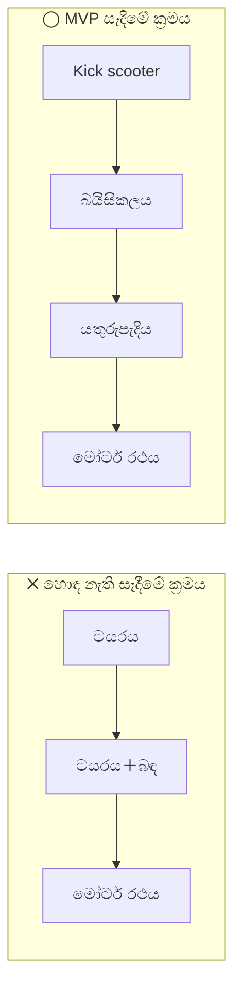
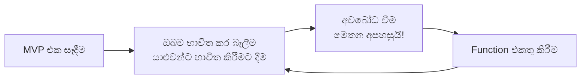
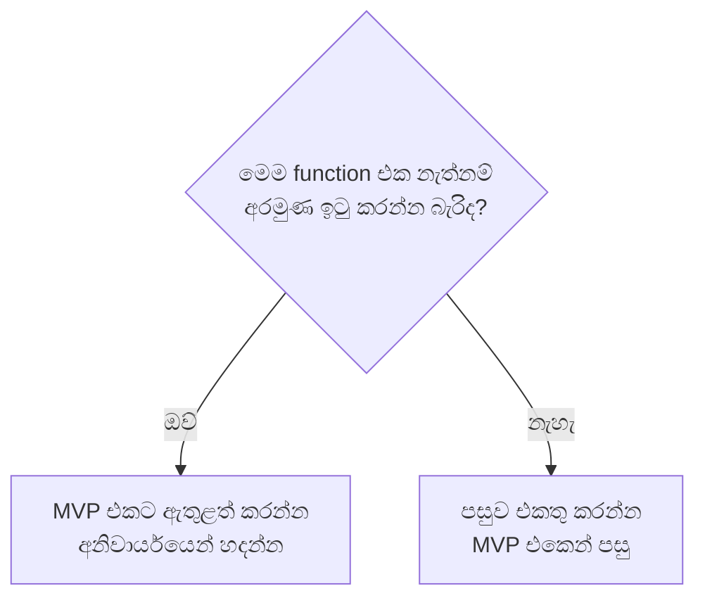
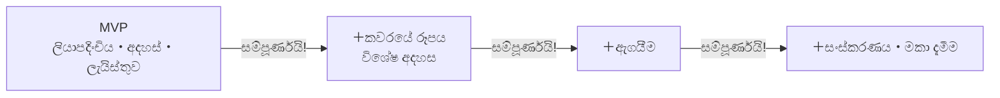
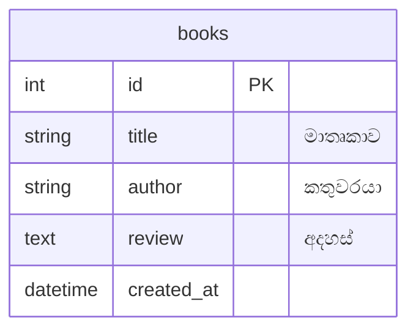

# MVP: මුලින්ම "භාවිත කළ හැකි අවම දෙය" සම්පූර්ණ කරමු

> 🇯🇵 මුල් පිටපත (ජපන් භාෂාවෙන්): [2026_10_16_資料1.md](<../../../2年生_システム開発実践/後期/2026_10_16/2026_10_16_資料1.md>) <!-- original-ja-link -->

## 1. MVP යනු කුමක්ද

පසුගිය පාඩමේදී, [මුලින්ම පොඩියට හදන්න](../2026_10_09/2026_10_09_資料1.md#මුලින්ම-පොඩියට-හදන්න) ගැන කතා කළා.
මෙම "කුඩාවට හැදූ දෙයට" නමක් තිබෙනවා. ඒ තමයි **MVP**.

| කෙටි කිරීමට පෙර | අර්ථය |
|-------|------|
| **M**inimum | අවම |
| **V**iable | භාවිත කළ හැකි・සාර්ථකව ක්‍රියා කරන |
| **P**roduct | නිෂ්පාදනය・app එක |

එනම් MVP යනු, **"මෙපමණක් තිබුණොත් භාවිත කළ හැකියි" යන අවම app එකයි**.
සැබෑ සමාගම් වලද, නව සේවාවක් සාදන විට මුලින්ම MVP එකක් සාදා ප්‍රසිද්ධ කර, භාවිත කරන අයගේ ප්‍රතිචාර බලමින් එය වර්ධනය කරනවා.

> 💡 **උපමාවකින් කිව්වොත් "කරි සහ බත්"**
> කරි බත් වල MVP එක "බත් ＋ කරි" වේ. මෙපමණකින්ම **කරි බත් ලෙස හරියට කන්න පුළුවන්**.
> Tonkatsu (බැදපු ඌරු මස්), චීස්, Fukujinzuke (අච්චාරු) යනු පසුව topping ලෙස එකතු කළ හැකි දේවල්.
> අනෙක් අතට, topping ගොඩක් තිබුණත් **කරි නැත්නම්**, කරි බත් ලෙස කන්න බැහැ.

---

## 2. MVP ගැන බහුලව ඇති වැරදි වැටහීම්

MVP යනු "අඩක් හැදූ දෙයක්" නොවේ. **කුඩා වුවත්, හරියට භාවිත කළ හැකි වීම** වැදගත්.



| | ✕ හොඳ නැති සෑදීමේ ක්‍රමය | ◯ MVP සෑදීමේ ක්‍රමය |
|---|---|---|
| 1 වන වතාව | ටයරය පමණයි → **ගමන් කරන්න බැහැ** | Kick scooter → **ගමන් කරන්න පුළුවන්!** |
| 2 වන වතාව | ටයරය＋බඳ → **තවමත් ගමන් කරන්න බැහැ** | බයිසිකලය → **තවත් වේගයෙන් ගමන් කරන්න පුළුවන්** |
| අතරමගදී කාලය අවසන් වුවහොත් | **කිසිවක් භාවිත කරන්න බැහැ** | **භාවිත කළ හැකි දෙයක් අතේ ඉතිරි වෙනවා** |

- ✕ ක්‍රමයේදී, අවසානය දක්වා සම්පූර්ණයෙන් හදන තුරු **එක වතාවක්වත් භාවිත කරන්න බැහැ**
- ◯ ක්‍රමයේදී, ඕනෑම අදියරකින් නතර වුණත් **"ගමන් කිරීම" යන අරමුණ ඉටු කළ හැකියි**

App වලත් එසේමයි. "Login තිරය පමණක් පරිපූර්ණයි", "design එක පමණක් පරිපූර්ණයි" නමුත් **ප්‍රධාන function එක ක්‍රියා නොකිරීම** ✕ රටාවයි.

---

## 3. ඇයි MVP එකෙන් පටන් ගන්නේ?

### ① සම්පූර්ණ නොවී අවසන් වීම වළක්වා ගත හැකියි

ස්වාධීන නිර්මාණයේදී බහුලවම සිදුවන අසාර්ථකත්වය වන්නේ, **function ඕනෑවට වඩා ඇතුළත් කර, සම්පූර්ණ නොවී අවසන් වීමයි**.
MVP එක මුලින්ම හදා තිබුණොත්, **කොතැනදී කාලය අවසන් වුණත් "ක්‍රියා කරන app එකක්" අතේ ඉතිරි වෙනවා**.

### ② ඉක්මනින් භාවිත කර බැලුවොත්, සැබවින්ම අවශ්‍ය දේ තේරෙනවා

හදන්න කලින් සිතූ "තිබුණොත් හොඳයි" යන දේ, සැබවින්ම භාවිත කර බැලූ විට **අවශ්‍ය නොවූ** බව බොහෝ විට පෙනී යනවා.
අනෙක් අතට, භාවිත කර බැලූ පසුව පමණක් "මේක නැත්නම් අපහසුයි!" කියා තේරෙන function ද තිබෙනවා.



### ③ Portfolio එකක් ලෙස, මුලින්ම "පෙන්විය හැකි" තත්ත්වයට පත් වෙනවා

රැකියා සඳහා අයදුම් කරන විට, **සම්පූර්ණ නොකළ app එකක්** පෙන්වීම අපහසුයි.
MVP එක හැදී තිබුණොත්, ඕනෑම වේලාවක **"ක්‍රියා කරන දෙයක්" ලෙස ඉදිරිපත් කළ හැකි තත්ත්වයක්** ඇති වෙනවා.
ඔබේ විශේෂ අදහස්, ඒ මත **ටිකෙන් ටික එකතු කරගෙන ගියාම** ඇති.

---

## 4. MVP තීරණය කරන ආකාරය

### පියවර 1: App එකේ අරමුණ එක වාක්‍යයකින් ලියන්න

මුලින්ම, **"කවුරුන්" "කුමක් කිරීමට"** භාවිත කරන app එකක්ද යන්න එක වාක්‍යයකින් ලියන්න.

```
〇〇 වැනි අයට, △△ කිරීම සඳහා වූ app එකක්
```

| App එක | අරමුණ (එක වාක්‍යයක්) |
|-------|-----------|
| කියවීමේ සටහන් | පොත් වලට කැමති අයට, **කියවූ පොත් සහ අදහස් සටහන් කර නැවත බැලීම** සඳහා වූ app එකක් |
| ව්‍යායාම සටහන් | ව්‍යායාම කරන අයට, **දිනපතා ව්‍යායාම වර්ග සහ වාර ගණන සටහන් කිරීම** සඳහා වූ app එකක් |
| සමාජ ක්‍රියාකාරකම් පැමිණීමේ ලේඛනය | සමාජයේ (club) කළමනාකරුට, **පුහුණුවීම් වලට පැමිණි සහ නොපැමිණි අය එකතු කර බැලීම** සඳහා වූ app එකක් |

> මෙම වාක්‍යයේ **තද අකුරින් ඇති කොටස**, app එකේ "කරි" වේ. මෙය නොහැදුවොත්, ඒක app එකක් විදිහට වැඩ කරන්නේ නැහැ.

### පියවර 2: හදන්න ඕන function සියල්ල ලියා දක්වන්න

මතකයට එන function, කිසිදු පැකිලීමකින් තොරව **සියල්ලම** ලියා දක්වන්න. මෙහිදී තවම, කළ හැකිද නැද්ද යන්න ගැන සිතිය යුතු නැහැ.

**කියවීමේ සටහන් app එකේ උදාහරණය**

- පොතක් ලියාපදිංචි කිරීම (මාතෘකාව・කතුවරයා)
- අදහස් ලිවීම
- ඇගයීමක් (තරු 1〜5) දීම
- ලියාපදිංචි කළ පොත් ලැයිස්තුවක් ලෙස බැලීම
- පොත් සංස්කරණය・මකා දැමීම
- කවරයේ රූපය පෙන්වීම
- පොත් සෙවීම
- ප්‍රභේද (genre) අනුව වෙන් කිරීම
- Login function එක
- යාළුවන් සමඟ පොත් බෙදා ගැනීම
- කියවූ පොත් ගණන graph එකක් ලෙස පෙන්වීම

### පියවර 3: "නැත්නම් අරමුණ ඉටු කරන්න බැරිද?" යන්නෙන් වෙන් කරන්න

ලියා දැක්වූ function එකින් එක බලා, **"මෙය නැත්නම්, අරමුණ (පියවර 1 හි වාක්‍යය) ඉටු කරන්න බැරිද?"** කියා ඔබෙන්ම අහන්න.



**කියවීමේ සටහන් app එකේ උදාහරණය** (අරමුණ: කියවූ පොත් සහ අදහස් සටහන් කර නැවත බැලීම)

| Function එක | නැත්නම් අරමුණ ඉටු කරන්න බැරිද? | වර්ගීකරණය |
|------|-------------------|------|
| පොතක් ලියාපදිංචි කිරීම (මාතෘකාව・කතුවරයා) | ඔව් (සටහන් කරන්න බැහැ) | **MVP** |
| අදහස් ලිවීම | ඔව් (අදහස් සටහන් කරන්න බැහැ) | **MVP** |
| ලියාපදිංචි කළ පොත් ලැයිස්තුවක් ලෙස බැලීම | ඔව් (නැවත බලන්න බැහැ) | **MVP** |
| ඇගයීමක් (තරු 1〜5) දීම | නැහැ (අදහස් තිබේ නම් සටහන් කළ හැකියි) | පසුව |
| පොත් සංස්කරණය・මකා දැමීම | නැහැ (නැතත් සටහන් කිරීම・නැවත බැලීම කළ හැකියි) | පසුව |
| කවරයේ රූපය පෙන්වීම | නැහැ | පසුව |
| පොත් සෙවීම | නැහැ (පොත් ගණන අඩු කාලයේදී ලැයිස්තුව ප්‍රමාණවත්) | පසුව |
| ප්‍රභේද (genre) අනුව වෙන් කිරීම | නැහැ | පසුව |
| Login function එක | නැහැ (ඔබ පමණක් භාවිත කරනවා නම් අවශ්‍ය නැහැ) | පසුව |
| යාළුවන් සමඟ පොත් බෙදා ගැනීම | නැහැ | පසුව |
| කියවූ පොත් ගණන graph එකක් ලෙස පෙන්වීම | නැහැ | පසුව |

> 💡 **MVP එකේ function ගණන 3ක් පමණ වීම හොඳ ඉලක්කයකි**. 5ක් හෝ ඊට වැඩි වුවහොත්, "ඇත්තටම, නැත්නම් අරමුණ ඉටු කරන්න බැරිද?" කියා නැවත වරක් අහලා බලන්න.

> ⚠️ **Login function එක බොහෝ විට MVP එකට ඇතුළත් කරන්නේ නැහැ**
> Login අපහසු වන අතර කාලයද ගත වුණත්, බොහෝ විට එය **app එකේ අරමුණම නොවේ**.
> මුලින්ම login නැතිව ක්‍රියා කරන දෙයක් හදලා, අවශ්‍ය වූ විට පසුව එකතු කරන්න.

### පියවර 4: "පසුව එකතු කරන" දේවලට අනුපිළිවෙළක් දෙන්න

"පසුව එකතු කරන" function වලට, **හදන්න කැමති අනුපිළිවෙළ** දෙන්න.
මෙහිදී වැදගත් කොට සැලකිය යුත්තේ, පසුගිය පාඩමේ කතා කළ **ඔබේම විශේෂ අදහස්** යි.

| අනුපිළිවෙළ | Function එක | හේතුව |
|-----|------|------|
| 1 | කවරයේ රූපය පෙන්වීම | **පොත් රාක්කයක් වගේ පෙන්වන්න ඕන** (ප්‍රධානම විශේෂ අදහස) |
| 2 | ඇගයීමක් (තරු 1〜5) දීම | නිර්දේශ කරන පොත් බැලූ සැණින් තේරෙනවා |
| 3 | පොත් සංස්කරණය・මකා දැමීම | වැරදුණු විට නිවැරදි කරන්න ඕන |
| 4 | ප්‍රභේද (genre) අනුව වෙන් කිරීම | පොත් ගණන වැඩි වූ විට අවශ්‍ය වෙනවා |
| … | … | … |



විශේෂ අදහස් ඇතුළත් function **MVP එකට පසුව වහාම** හැදීම නිර්දේශ කරනවා.
MVP එක පමණක් නම් අනිත් අයගේ app වලට සමාන වීමට ඉඩ තිබුණත්, විශේෂ අදහස් ඇතුළත් වීමෙන් එය **"ඔබටම ආවේණික app එකක්"** බවට පත් වෙනවා.

---

## 5. MVP එකේ table එක ගැන සිතමු

Table එකත්, **MVP එකට අවශ්‍ය column පමණක්** සමඟ පටන් ගන්න. Column පසුව migration මගින් (Supabase නම් කළමනාකරණ තිරයෙන්) එකතු කළ හැකියි.



ඇගයීම (`rating`) හෝ කවරයේ රූපය (`image_url`), ඒ function එක හදන විට එකතු කළොත් ඇති.

