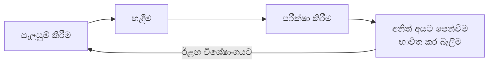
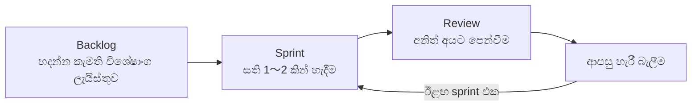

# Agile සංවර්ධනය ගැන

> 🇯🇵 මුල් පිටපත (ජපන් භාෂාවෙන්): [アジャイル開発について.md](<../../../2年生_システム開発実践/後期/2026_10_23/アジャイル開発について.md>) <!-- original-ja-link -->

පසුගිය පාඩමේදී, මුලින්ම කුඩාවට සම්පූර්ණ කරන **MVP** ගැන ඉගෙන ගත්තා.
"කුඩාවට හදලා, භාවිත කර බලා, ටිකෙන් ටික වර්ධනය කිරීම" යන සෑදීමේ ක්‍රමයට නමක් තිබෙනවා. ඒ තමයි **Agile සංවර්ධනය**.
මෙහිදී, බොහෝ කාලයක සිට පවතින **Waterfall සංවර්ධනය** සමඟ සසඳමින් බලමු.

[ස්වාධීන නිර්මාණයට ආපසු යන්න](../2026_10_09/2026_10_09_資料1.md)

---

## 1. කෙටියෙන් කිව්වොත්

| නම | උච්චාරණය | ඉදිරියට යන ආකාරය | කෙටියෙන් |
|------|-------|-------|-----------|
| **Waterfall සංවර්ධනය** | Waterfall (දිය ඇල්ල) | සියල්ල තීරණය කළ පසු, අනුපිළිවෙළින් එක වරකින් හදනවා | සැලැස්මට අනුව හදනවා |
| **Agile සංවර්ධනය** | Agile (වේගවත්) | කුඩාවට හදලා, නැවත නැවත වැඩිදියුණු කරනවා | හදන ගමන් වර්ධනය කරනවා |

---

## 2. Waterfall සංවර්ධනය

**දිය ඇල්ලක ජලය ඉහළ සිට පහළට ගලා යන්නාක් මෙන්**, අදියර එකින් එක අනුපිළිවෙළින් ඉදිරියට යනවා.
පෙර අදියර අවසන් වන තුරු, ඊළඟ අදියරට යන්නේ නැහැ. මූලිකවම, **ආපසු නොයන** බව උපකල්පනය කරනවා.

| හොඳ පැති 👍 | සැලකිලිමත් විය යුතු දේ ⚠️ |
|------------|-----------------|
| මුලින්ම සියල්ල තීරණය කරන නිසා, **කාලසටහන සහ වියදම පැහැදිලිව පෙනෙනවා** | අතරමගදී "මෙහෙම කරනවා නම් හොඳයි" කියා **කියන්න අපහසුයි** |
| අදියර අනුව වගකීම් බෙදා දීම පහසුයි | භාවිත කරන අයට ක්‍රියා කරන දෙයක් බලන්න ලැබෙන්නේ **අවසානයේදීයි** |
| බැංකු, රජයේ කාර්යාල වැනි **වැරදි වලට ඉඩ නොදෙන** පද්ධති සඳහා සුදුසුයි | අවසානයේදී "මම හිතපු දේ නෙමෙයි" කියා වුණොත්, **නැවත කිරීම ඉතා අපහසුයි** |

---

## 3. Agile සංවර්ධනය

**කුඩා විශේෂාංග එකින් එක සඳහා "සැලසුම් කිරීම → හැදීම → පරීක්ෂා කිරීම" නැවත නැවත කරමින්**, app එක ටිකෙන් ටික වර්ධනය කරනවා.
එක් චක්‍රයක් යනු **සති 1〜4 පමණ** කෙටි කාලයකි.

| හොඳ පැති 👍 | සැලකිලිමත් විය යුතු දේ ⚠️ |
|------------|-----------------|
| **මුල් අවධියේදීම ක්‍රියා කරන දෙයක්** බලන්න පුළුවන් | අවසානයේ කොපමණ දුරට හදන්න පුළුවන්ද යන්න **මුලදී පැහැදිලි නැහැ** |
| භාවිත කළ අයගේ අදහස් **වහාම ඊළඟ පියවරට ඇතුළත් කරන්න** පුළුවන් | "මුලින් කොහොම හරි හදලා බලමු" කියා වැඩ කළොත්, **design එක අවුල් වීමට** ඉඩ තිබෙනවා |
| අතරමගදී දිශාව වෙනස් කිරීම පහසුයි | කණ්ඩායම තුළ **නිතර සාකච්ඡා කිරීම** අවශ්‍යයි |

> 💡 **MVP යනු Agile සංවර්ධනයේ "පළමු චක්‍රයයි"**
> MVP එක හදලා, භාවිත කර බලා, තමන්ට වැදගත් විශේෂාංග එකින් එක එකතු කිරීම——
> ස්වාධීන නිර්මාණයේ ඉදිරියට යන ආකාරය, හරියටම Agile සංවර්ධනයයි.

---

## 4. සසඳා බලමු

**"කෑම පිසීම"** උපමාවක් ලෙස ගනිමු.

| | Waterfall | Agile |
|---|---|---|
| ඉදිරියට යන ආකාරය | Course meal එක **සම්පූර්ණයෙන් තීරණය කර**, ආරම්භක කෑමේ සිට අතුරුපස දක්වා අනුපිළිවෙළින් පිස, **අවසානයේ සියල්ල එකවර දෙනවා** | මුලින්ම එක කෑමක් හදලා **රස බලන්න දී**, අදහස් අසා ඊළඟ කෑම තීරණය කරනවා |
| අතරමග වෙනස් කිරීම් | "මාළු නෙමෙයි, මස් හොඳයි" කිව්වොත් ඉතා අපහසුයි | ඊළඟ කෑමේදී වෙනස් කළොත් ඇති |
| සුදුසු අවස්ථා | මංගල උත්සවයක කෑම (මෙනුව මුල සිටම තීරණය කර ඇත) | පවුලේ කෑම (එදින මනෝභාවය අනුව වෙනස් වේ) |

මේ දෙකෙන් එකක්ම නිවැරදියි කියා කියන්න බැහැ. **හදන දේ අනුව සුදුසු ක්‍රමය තෝරා ගන්නවා.**

---

## 5. Scrum — Agile සංවර්ධනයේ ඉදිරියට යන ක්‍රමවලින් එකක්

Agile සංවර්ධනයේ ක්‍රම අතරින් වඩාත්ම ප්‍රසිද්ධ වන්නේ **Scrum** යි. රග්බි ක්‍රීඩාවේදී කණ්ඩායමේ ක්‍රීඩකයන් උරෙන් උර ගැටී එක්වන "scrum" එකෙන් මෙම නම ලැබුණා.

| වචනය | අර්ථය | ස්වාධීන නිර්මාණයේදී නම් |
|-----|------|---------------|
| **Sprint** | එක් චක්‍රයක කාලය (සති 1〜4) | පාඩම් 1〜2 ක කාලය |
| **Product backlog** | හදන්න කැමති විශේෂාංග, **වැදගත්කම අනුව** පෙළගැස්වූ ලැයිස්තුව | MVP ලේඛනයේදී හැදූ "පසුව එකතු කරන විශේෂාංග (හදන අනුපිළිවෙළ)" |
| **Daily scrum** | දිනපතා මිනිත්තු 15 ක් පමණ කෙටි රැස්වීම | පාඩම ආරම්භයේදී "අද කරන දේ" තීරණය කිරීම |
| **Sprint review** | හැදූ දේ පෙන්වා, අදහස් ලබා ගැනීම | යාළුවන්ට හෝ ගුරුවරයාට භාවිත කිරීමට දීම |
| **ආපසු හැරී බැලීම (Retrospective)** | වැඩ කළ ආකාරය ආපසු හැරී බලා, ඊළඟ වතාවට යොදා ගැනීම | පාඩම අවසානයේ "සාර්ථක වූ දේ・ගැටලු වූ දේ" ගැන සිතීම |

> 💡 **GitHub හි backlog එකක් හදන්න පුළුවන්**
> GitHub හි **Issues** වල "හදන්න කැමති විශේෂාංග" එකින් එක ලියාපදිංචි කර, **Projects** හි "කළ යුතු・කරමින් පවතින・අවසන්" ලෙස පෙළගැස්වූ විට, සැබෑ වැඩබිම් වල මෙන්ම backlog එක කළමනාකරණය කළ හැකියි.

---

## 6. වැඩබිම් වල බහුලව භාවිත වන්නේ කුමක්ද?

මෑත කාලයේ web සේවා සහ ජංගම දුරකථන app සංවර්ධනයේදී, **Agile සංවර්ධනය** බහුලව භාවිත වෙනවා.
භාවිත කරන අයගේ ප්‍රතිචාර බලමින්, සතිපතා හෝ දිනපතා වාගේ update කරන නිසයි.

අනෙක් අතට, බැංකු පද්ධති හෝ කර්මාන්තශාලා යන්ත්‍ර ක්‍රියා කරවන පද්ධති වැනි දේවල, අදටත් **Waterfall සංවර්ධනය** භාවිත වෙනවා.
තවද, ප්‍රධාන ගලායාම Waterfall මගින් තීරණය කර, සවිස්තරාත්මක කොටස් Agile ලෙස ඉදිරියට ගෙන යන **ඒකාබද්ධ ක්‍රමයක්** ද තිබෙනවා.

> 💡 **සම්මුඛ පරීක්ෂණයේදී කතා කළ හැකියි**
> "ස්වාධීන නිර්මාණයේදී, මුලින්ම MVP එක හදලා, භාවිත කර බලා විශේෂාංග එකතු කරන **Agile ක්‍රමයට** වැඩ කළා" කියා කිව්වොත්, ඔබ සංවර්ධන ක්‍රියාවලිය තේරුම් ගෙන ඇති බව පෙනී යනවා.

---

## 7. සාරාංශය

- **Waterfall සංවර්ධනය** ＝ සියල්ල තීරණය කළ පසු, අනුපිළිවෙළින් එක වරකින් හදනවා (ආපසු යන්නේ නැහැ)
- **Agile සංවර්ධනය** ＝ කුඩාවට හදලා, භාවිත කර බලා, නැවත නැවත වැඩිදියුණු කරනවා
- **Scrum** යනු Agile සංවර්ධනයේ ඉදිරියට යන ක්‍රමවලින් එකක්. **Sprint** (කෙටි කාල පරිච්ඡේද) නැවත නැවත කරනවා
- **MVP → විශේෂාංග එකතු කිරීම** යන ස්වාධීන නිර්මාණයේ ක්‍රමය, Agile සංවර්ධනයමයි
- කුමක් නිවැරදිද යන්න නොව, **හදන දේ අනුව සුදුසු ක්‍රමය තෝරා ගන්නවා**

[ස්වාධීන නිර්මාණයට ආපසු යන්න](../2026_10_09/2026_10_09_資料1.md)
