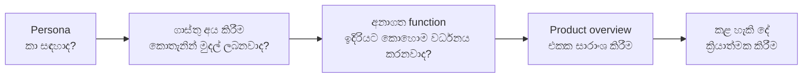
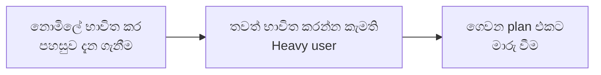
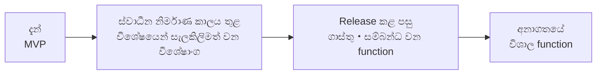
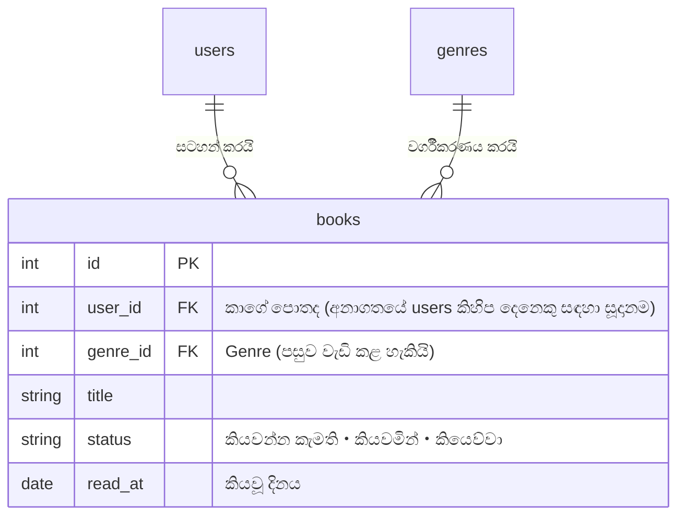
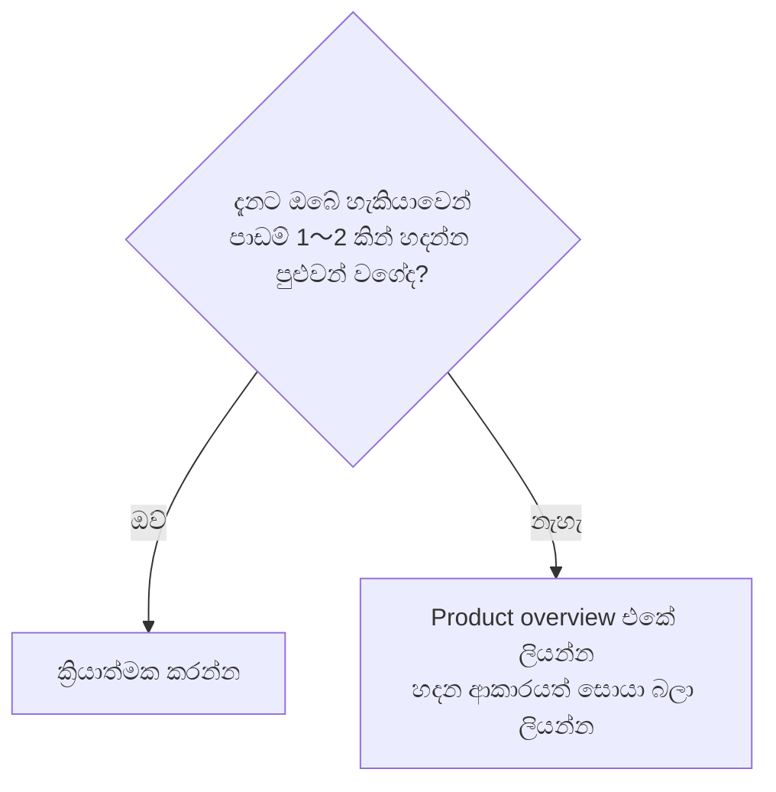

# ස්වාධීන නිර්මාණයේ අනාගතය ගැනත් සිතමින් හදමු

> 🇯🇵 මුල් පිටපත (ජපන් භාෂාවෙන්): [自由制作の将来像も考えて作る.md](<../../../2年生_システム開発実践/後期/2026_10_23/自由制作の将来像も考えて作る.md>) <!-- original-ja-link -->

ස්වාධීන නිර්මාණයේ app එක, "පාඩමේ පැවරුමක්" ලෙස නොව **සැබවින්ම release කරන සේවාවක්** ලෙස සිතා බලමු.
**කවුද භාවිත කරන්නේ (persona)**, **කොතැනින්ද මුදල් ලබා ගන්නේ (ගාස්තු අය කිරීම)**, **ඉදිරියේදී කුමන function එකතු කරනවාද** යන්න ගැන සිතා, ඒවා **Product overview** ලේඛනයක සාරාංශ කරමු.

[ස්වාධීන නිර්මාණයට ආපසු යන්න](../2026_10_09/2026_10_09_資料1.md)

---

## 1. ඇයි අනාගතය ගැන සිතන්නේ?



- **හදන function ගැන ව්‍යාකූල වෙන්නේ නැහැ**: "මේ කෙනාට (persona) මෙය අවශ්‍යද?" යන්නෙන් තීරණය කළ හැකියි
- **සම්මුඛ පරීක්ෂණයේදී කතා කළ හැකියි**: "කාගේ, කුමන ගැටලුවක් විසඳන app එකක්ද, එය කොහොම දිගටම පවත්වාගෙන යන සේවාවක්ද" යන්න දක්වා කතා කළ හැකි නම්, ඔබ **සිතා බලා හැදූ කෙනෙක්** බව පෙනී යනවා
- **සැබෑ සමාගම් වලත් එසේමයි**: සමාගමක app එකක් හදන විට, හදන්න කලින් අනිවාර්යයෙන්ම **සංකල්පය (planning)** ගැන සිතනවා

> 💡 සියල්ල ක්‍රියාත්මක කළ යුතු නැහැ. **සිතූ දේ Product overview එකේ ලියා තැබීම** පමණක් වුවද, portfolio එකක් ලෙස වටිනාකමක් තිබෙනවා.

---

## 2. Persona එකක් සකසමු

### Persona යනු කුමක්ද

**Persona** යනු, app එක භාවිත කරන කෙනා **එක් නිශ්චිත පුද්ගලයෙකු** ලෙස සවිස්තරව තීරණය කළ දෙයකි.
"විසි ගණන් වල අය" වැනි දළ බෙදීමක් නොව, **සැබවින්ම සිටිය හැකි එක් කෙනෙකු** සිතින් මවා ගන්න.

| ✕ දළ වශයෙන් | ◯ Persona |
|----------|----------|
| පොත් වලට කැමති අය | 田中 さくら (තනකා සකුරා; වයස 21・විශ්වවිද්‍යාලයේ 3 වන වසර). විශ්වවිද්‍යාලයට යන දුම්රියේදී මසකට පොත් 3〜4 ක් කියවනවා. කියවූ පොත් වල අන්තර්ගතය ඉක්මනින් අමතක වන නිසා, යාළුවන් නිර්දේශයක් ඇසූ විට උත්තර දෙන්න බැරි වීම ඇගේ ගැටලුවයි |

> 💡 **ඇයි එක් කෙනෙකුට සීමා කරන්නේ?**
> "හැමෝටම" කියා හැදුවොත්, කාටත් **ටිකක් භාවිත කිරීමට අපහසු** app එකක් වීමට ඉඩ තිබෙනවා.
> එක් කෙනෙකුට සීමා කළ විට, "සකුරා නම්, දුම්රියේදී **එක් අතකින්** සටහන් කරන්න කැමති වෙයි" වැනි ලෙස **නිශ්චිතව සිතන්න පුළුවන්**.

### Persona එකේදී තීරණය කරන දේ

| අයිතමය | උදාහරණය (කියවීමේ සටහන් app එක) |
|-----|-----------------|
| නම・වයස・රැකියාව | 田中 さくら (තනකා සකුරා)・වයස 21・විශ්වවිද්‍යාලයේ 3 වන වසර |
| ජීවන රටාව | විශ්වවිද්‍යාලයට යන දුම්රියේදී දිනපතා මිනිත්තු 30 ක් කියවනවා. Smartphone එක සැමවිටම ළඟ තියෙනවා |
| IT දැනුම | SNS බහුලව භාවිත කරනවා. අපහසු සැකසුම් වලට දක්ෂ නැහැ |
| ගැටලුව | කියවූ පොත් වල අන්තර්ගතය ඉක්මනින් අමතක වෙනවා. නිර්දේශයක් ඇසූ විට උත්තර දෙන්න බැහැ |
| ඉලක්කය (කුමක් වෙන්නද කැමති?) | කියවූ පොත් සහ අදහස්, පසුව ඉක්මනින් නැවත බලන්න හැකි වෙන්න ඕන |
| App එක භාවිත කරන අවස්ථාව | දුම්රියේදී කියවා අවසන් වූ වහාම, **smartphone එකෙන්** සටහන් කරනවා |

> ⚠️ **ඔබට පහසු කෙනෙක් ලෙස සකසන්න එපා**
> "දිනපතා app එක විවෘත කර, සියලු function භාවිත කරන කෙනෙක්" ඉන්නේ නැති තරම්.
> **කාර්යබහුල・කම්මැලි・ඉක්මනින් එපා වෙන** වැනි, යථාර්ථවාදී කෙනෙකු ගැන සිතන්න.

---

## 3. කොතැනින් ගාස්තු අය කරනවාද යන්න ගැන සිතමු

### මුදල් ලබා ගන්නා ක්‍රම (ආදායම් ආකෘතිය)

| ආකෘතිය | ක්‍රියා කරන ආකාරය | උදාහරණ |
|-------|------|-----|
| **දැන්වීම්** | App එක නොමිලේ. තිරයේ දැන්වීම් පළ කර, දැන්වීම්කරුවන්ගෙන් මුදල් ලබනවා | YouTube (නොමිලේ ලැබෙන plan එක), ප්‍රවෘත්ති app |
| **එක් වරක් මිලදී ගැනීම** | මුලදී එක් වරක් පමණක් මුදල් ගෙවනවා | ගෙවා ගන්නා ජංගම game, software |
| **Subscription** | මාසිකව・වාර්ෂිකව මුදල් ගෙවනවා | Netflix, Spotify |
| **Freemium** | මූලිකවම **නොමිලේ**. තවත් පහසු function භාවිත කිරීමට කැමති අය පමණක් **ගෙවනවා** | Spotify, Notion, LINE stickers |

පුද්ගලිකව හදන web app එකක් නම්, **freemium** ගැන සිතීම වඩාත්ම පහසුයි.

### "නොමිලේ" සහ "ගෙවිය යුතු" අතර සීමාව අඳින්න

Freemium හි වඩාත්ම වැදගත් දේ වන්නේ, **කොතෙක් දුරට නොමිලේද, කොතැනින් ගෙවිය යුතුද** යන්නයි.



| සිතන ආකාරය | පැහැදිලි කිරීම |
|-------|------|
| **App එකේ "අරමුණ" නොමිලේ තබන්න** | MVP function (වඩාත්ම වැදගත් function) ගෙවිය යුතු නම්, කවුරුවත් භාවිත කිරීම පටන් ගන්නේ නැහැ |
| **වැඩිපුර භාවිත කරන අය මුදල් ගෙවනවා** | "〇 ක් දක්වා නොමිලේ" වැනි ලෙස, **ප්‍රමාණය** අනුව සීමාව අඳින්න |
| **තිබුණොත් පහසු නමුත්, නැතත් ගැටලුවක් නැති දේ** ගෙවිය යුතු කරන්න | බලන්න පහසු graph, දත්ත export කිරීම, design වෙනස් කිරීම ආදිය |
| **Persona එක මුදල් ගෙවීමට හේතුව** ගැන සිතන්න | "සකුරා, කුමක් සඳහා නම් මසකට යෙන් 300 ක් ගෙවයිද?" |

**කියවීමේ සටහන් app එකේ උදාහරණය**

| | නොමිලේ ලැබෙන plan එක | ගෙවන plan එක (මසකට යෙන් 300) |
|---|---|---|
| පොත් ලියාපදිංචිය | **පොත් 50 ක් දක්වා** | අසීමිතයි |
| අදහස් ලිවීම | ◯ | ◯ |
| ලැයිස්තුවෙන් නැවත බැලීම | ◯ | ◯ |
| කියවූ පොත් ගණනේ graph එක | ✕ | ◯ |
| පොත් රාක්කයේ design වෙනස් කිරීම | වර්ග 1 | වර්ග 10 |
| දැන්වීම් | තිබෙනවා | **නැහැ** |

> 💡 **සකුරාගේ උදාහරණයෙන් සිතා බැලුවොත්**
> ශිෂ්‍යාවක් නිසා, විශාල මුදලක් ගෙවන්න බැහැ. නමුත් වසරක් දිගටම භාවිත කර **පොත් 50 ඉක්මවන** විට, සටහන් එකතු වී එය අත්හරින්න බැරි තත්ත්වයට පත් වෙලා.
> ඒ වෙලාවේදී "අසීමිත＋graph" මසකට යෙන් 300 කට ඉදිරිපත් කළොත්, ඇය ගෙවන්න ඉඩ තිබෙනවා.

---

## 4. අනාගත function ගැන සිතමු

### Function කාලය අනුව බෙදන්න

[MVP](../2026_10_16/2026_10_16_資料1.md) හිදී "පසුව එකතු කරන function" ලියා දැක්වූවා. ඒවා **කාලය** අනුව බෙදා පෙළගස්වන්න.
මෙම "කවදා・කුමක් හදනවාද" යන සැලැස්මට **roadmap** කියා කියනවා.



| කාලය | Function උදාහරණ (කියවීමේ සටහන් app එක) |
|-----|-----------------------|
| **දැන් (MVP)** | පොත් ලියාපදිංචිය・අදහස්・ලැයිස්තුව |
| **ස්වාධීන නිර්මාණ කාලය තුළ** | කවරයේ රූපය, ඇගයීම (තරු), සෙවීම |
| **Release කළ පසු** | Login, ගෙවන plan එක, කියවූ පොත් ගණනේ graph එක |
| **අනාගතයේ** | යාළුවන් සමඟ පොත් රාක්කය බෙදා ගැනීම, barcode කියවා පොත් ලියාපදිංචි කිරීම, AI මගින් නිර්දේශිත පොත් යෝජනා කිරීම |

### අදහස් ලබා ගන්නා ආකාරය

- **Persona එකේ එක් දවසක්** සිතින් මවාගෙන, "මෙතැනදීත් භාවිත කළ හැකි නම් පහසුයි" යන අවස්ථා සොයන්න
- **සමාන app** 3 ක් භාවිත කර බලා, "හොඳ පැති" සහ "අපහසු පැති" ලියා දක්වන්න
- **දත්ත එකතු වූ විට** කුමක් කළ හැකිද යන්න ගැන සිතන්න (graph・ranking・නිර්දේශ)
- **වෙනත් අය සමඟ සම්බන්ධ වූ විට** කුමක් කළ හැකිද යන්න ගැන සිතන්න (බෙදා ගැනීම・comment・ranking)

---

## 5. හොඳ design එකක් අනාගතය ගැනත් සිතනවා

### නොකියූ function "අනුමාන" කරන්න

රැකියාවේදී app එකක් හදන විට, පාරිභෝගිකයා "මෙවැනි app එකක් හදලා දෙන්න" කියා ඉල්ලනවා.
නමුත් පාරිභෝගිකයා **අවශ්‍ය සියල්ල කියන්නේ නැහැ**. භාවිත කිරීම පටන් ගත් පසු "මේකත් ඕන" කියා ඉල්ලීම බොහෝ විට සිදු වෙනවා.

**හොඳ design** එකක් යනු, කියූ දේ පමණක් හැදීම නොව,
**"කියලා නැති වුණත්, බොහෝ විට මෙවැනි function එකක් ඉල්ලයි" කියා අනුමාන කර design කිරීමයි**.

> 💡 **උපමාවකින් කිව්වොත් "නිවසක් ඉදි කිරීම"**
> යුවළක් සඳහා නිවසක් ඉදි කරන විට, "අනාගතයේ දරුවෙක් ලැබුණොත් කාමරයක් ඕන කියයි" කියා සිතා,
> **පසුව බිත්තියක් එකතු කර කාමර 2 කට බෙදිය හැකි** විශාල කාමරයක් හදා තැබීම——මෙය අනාගතය ගැන සිතූ design එකකි.
> දැන්ම දරුවන්ගේ කාමරයක් හදන්නේ නැතත්, **පසුව එකතු කිරීමට පහසු ලෙස** තබා ගන්නවා.

### අනුමාන කළ උදාහරණ (කියවීමේ සටහන් app එක)

| දැනට ඉල්ලා ඇති දේ | ඉල්ලීමට ඉඩ ඇති දේ (අනුමානය) | දැන්ම කර තබන design එක |
|------------------|--------------------|-------------------|
| තමන් කියවූ පොත් සටහන් කරන්න ඕන | "පවුලේ අයටත් යාළුවන්ටත් භාවිත කරන්න ඕන" | `books` table එකට, කාගේ පොතද යන්න පෙන්වන `user_id` ඇතුළත් කළ හැකි ආකාරයට තබන්න |
| "කියෙව්වා" කියා සටහන් කරන්න ඕන | "**කියවන්න කැමති පොත්**・**කියවමින් සිටින පොත්** ද වෙන් කරන්න ඕන" | "කියෙව්වා/නොකියෙව්වා" යන විකල්ප 2 (`true` / `false`) නොව, **තත්ත්වය (`status`)** column එකක් ලෙස තබන්න |
| ප්‍රභේද (genre) දාන්න ඕන | "Genre තමන්ම එකතු කරන්න・නම වෙනස් කරන්න ඕන" | Genre අකුරු වලින් කෙලින්ම ලියනවා වෙනුවට, **`genres` table එකකට වෙන් කර** සම්බන්ධ කරන්න |
| අදහස් ලියන්න ඕන | "පසුව අදහස් **නැවත ලියන්න ඕන**" "කවදා කියෙව්වාද දැනගන්න ඕන" | `created_at`・`updated_at` තබා, **කියවූ දිනය (`read_at`)** column එක ගැනත් සිතා තබන්න |



> ⚠️ **අනුමාන කළ function "සියල්ලම හදන්න" අවශ්‍ය නැහැ**
> අනාගතය ගැන සිතන්නේ **design එක (table වල ආකෘතිය සහ code බෙදන ආකාරය)** ගැනයි. Function ම [MVP](../2026_10_16/2026_10_16_資料1.md) හි පරිදි, කුඩාවට හදලා ටිකෙන් ටික එකතු කරනවා.
> "ඉල්ලීමට ඉඩ ඇති දේ" සියල්ල හදන්න පටන් ගත්තොත්, කවදාවත් සම්පූර්ණ වෙන්නේ නැහැ.
> **දැන් හදන්නේ නැහැ. නමුත්, පසුව එකතු කරන විට නැවත හදන්න අවශ්‍ය නොවන ආකාරයට තබා ගන්නවා** ——මෙය තමයි ප්‍රධාන කරුණ.

### අනුමාන කරන විට ඉඟි

- **එක් කෙනෙක් → බොහෝ දෙනෙක්**: දැනට එක් කෙනෙක් භාවිත කරන දෙයක් වුවද, "වෙනත් අයටත් භාවිත කරන්න ඕන" කියා ඉල්ලයිද?
- **විකල්ප 2 → 3 හෝ වැඩි**: "ඔව්/නැහැ" ලෙස හැදූ දෙයකට, "තවත් විකල්පයක් ඕන" කියා ඉල්ලයිද?
- **ස්ථාවර අගයක් → තමන්ම වෙනස් කරන්න ඕන**: Program එකේ ලියූ විකල්ප, "භාවිත කරන කෙනාට එකතු කරන්න・වෙනස් කරන්න ඕන" කියා ඉල්ලයිද?
- **දැනට පමණක් → වාර්තා තබා ගන්න ඕන**: "කවදා වෙනස් වුණාද" "කලින් කොහොමද තිබුණේ" කියා දැනගන්න ඕන කියා ඉල්ලයිද?
- **Persona එක** අනුව සිතන්න: "සකුරා මාස හයක් භාවිත කළොත්, ඊළඟට මොනවද ඕන වෙන්නේ?"

> 💡 **සම්මුඛ පරීක්ෂණයේදී කතා කළ හැකියි**
> "දැනට login function එකක් නැතත්, අනාගතයේ වෙනත් අයටත් භාවිත කළ හැකි වන ලෙස `user_id` ඇතුළත් කළ හැකි table design එකක් හැදුවා" කියා කිව්වොත්,
> ඔබ **ඉදිරිය දැක design කළ හැකි කෙනෙක්** බව පෙනී යනවා. අනුමාන කළ දේ Product overview එකේ roadmap එකේත් ලියා තබන්න.

---

## 6. ක්‍රියාත්මක කරනවාද, Product overview එකේ ලියනවාද

මතකයට ආ function සියල්ල හදන්න අවශ්‍ය නැහැ.
**අපහසු නැත්නම් ක්‍රියාත්මක කරන්න**, **අපහසු වගේ නම් Product overview එකේ ලියන්න**, ලෙස වෙන් කරන්න.



| තීරණය කිරීමේ නිර්ණායක | උදාහරණ |
|-----------|-----|
| **ක්‍රියාත්මක කරන්න** (දැනට ඇති දැනුම යොදා කළ හැකියි) | Column එකක් එකතු කිරීම (ඇගයීම・genre), සෙවීම, පෙළගැස්වීම, "〇 ක් දක්වා" සීමාව පරීක්ෂා කිරීම, ගෙවන plan එකේ **තිරය පමණක්** (මිල ගණන් පිටුව) |
| **Product overview එකේ ලියන්න** (නව තාක්ෂණයක්, හෝ මුදල්・පුද්ගලික තොරතුරු සම්බන්ධ වේ) | සැබෑ ගෙවීම් (credit card), barcode කියවීම, AI නිර්දේශ, smartphone app එකක් බවට පත් කිරීම, බොහෝ දෙනෙක් එකවර භාවිත කරන ක්‍රමය |

> 💡 **"Product overview එකේ ලිවීම" ද විශිෂ්ට ප්‍රතිඵලයකි**
> "ගෙවීම් **Stripe** නම් සේවාව භාවිත කළොත් ක්‍රියාත්මක කළ හැකි වගේ" වැනි ලෙස, **හදන ආකාරය සොයා බලා ලියා තැබුවොත්**,
> "දැනට හදන්න බැරි වුණත්, හදන ආකාරය දන්නවා" කියා සම්මුඛ පරීක්ෂණයේදී කතා කළ හැකියි.

> ⚠️ **සැබෑ ගෙවීම් ක්‍රියාත්මක කරන්න එපා**
> Credit card ගෙවීම් වලදී වැරැද්දක් වුණොත්, **ඇත්තටම මුදල් ගනුදෙනු වෙනවා**. ස්වාධීන නිර්මාණයේදී **Product overview එකේ ලිවීම** දක්වා පමණක් කරන්න.
> ගාස්තු අය කිරීමේ ක්‍රමය අත්හදා බලන්න ඕන නම්, user කෙනෙක් ගෙවන plan එකේද නැද්ද කියන එක **database column එකකින් (`is_premium` වැනි) මාරු කිරීම** දක්වා පමණක් කරන්න.

---

## 7. Product overview එක හදමු

සිතූ දේ, **Product overview** ලේඛනයක සාරාංශ කරන්න.
Product overview යනු, "**කුමන වර්ගයේ product එකක්ද, කා සඳහාද, ඉදිරියට කොහොම වර්ධනය කරනවාද**" යන්න, පළමු වරට බලන කෙනෙකුටත් තේරෙන ලෙස සාරාංශ කළ දෙයකි.
Repository එක තුළ `docs/プロダクト概要.md` හදා ලියා තැබුවොත්, GitHub හි එලෙසම පෙන්විය හැකියි. README එකෙන් එයට link එකක් දමන්න.

### Product overview template එක

```markdown
# 〇〇 (app එකේ නම) Product overview

## 1. කෙටියෙන් කිව්වොත්
〇〇 වැනි අයට, △△ කිරීම සඳහා වූ app එකක්

## 2. Persona
- නම・වයස・රැකියාව:
- ජීවන රටාව:
- IT දැනුම:
- ගැටලුව:
- ඉලක්කය (කුමක් වෙන්නද කැමති?):
- App එක භාවිත කරන අවස්ථාව:

## 3. සමාන app වලින් ඇති වෙනස
| App එක | හොඳ පැති | අපහසු පැති |
|-------|----------|-----------|
|       |          |           |

මෙම app එකටම ආවේණික විශේෂ අදහස්:

## 4. ආදායම් ආකෘතිය (කොතැනින් ගාස්තු අය කරනවාද)
- ආකෘතිය: (Freemium / දැන්වීම් / Subscription / එක් වරක් මිලදී ගැනීම)
- ගෙවන plan එකේ මිල:

| | නොමිලේ ලැබෙන plan එක | ගෙවන plan එක |
|---|---|---|
|   |   |   |

Persona එක මුදල් ගෙවීමට හේතුව:

## 5. Roadmap (අනාගත function)
| කාලය | Function එක | තත්ත්වය |
|-----|------|-----|
| දැන් (MVP) |  | ✅ ක්‍රියාත්මක කර ඇත |
| ස්වාධීන නිර්මාණ කාලය තුළ |  | 🚧 හදමින් පවතී |
| Release කළ පසු |  | 📝 තවම හදා නැත |
| අනාගතයේ |  | 📝 තවම හදා නැත |

## 6. තවම හදා නැති function හදන ආකාරය පිළිබඳ සටහන්
- 〇〇 function එක: △△ නම් සේවාව・තාක්ෂණය භාවිත කළොත් කළ හැකි වගේ
```

### ලියන විට ප්‍රධාන කරුණු

- **Persona → ගාස්තු අය කිරීම → Roadmap** යන සියල්ල **එකිනෙකට සම්බන්ධ වන** ලෙස ලියන්න (Persona එකට අවශ්‍ය function, ගෙවන plan එකේ හෝ roadmap එකේ ඇතුළත් විය යුතුයි)
- තත්ත්වය column එකෙන් (✅ 🚧 📝), **කොතෙක් දුරට ක්‍රියාත්මක කර ඇත්ද** යන්න බැලූ සැණින් තේරෙන ලෙස කරන්න
- එක් වරක් ලියා අවසන් කරනවා නොව, හදන ගමන් **නිතර නැවත ලියන්න** ([Agile සංවර්ධනය](./アジャイル開発について.md) හා සමාන සිතීමේ ක්‍රමය)

---

## 8. සාරාංශය

- ස්වාධීන නිර්මාණයේ app එක, **සැබවින්ම release කරන සේවාවක්** ලෙස සිතන්න
- **Persona** ＝ භාවිත කරන කෙනා **එක් නිශ්චිත පුද්ගලයෙකු** ලෙස තීරණය කිරීම
- ගාස්තු අය කිරීමට **freemium** ගැන සිතීම පහසුයි. **අරමුණේ function නොමිලේ**, **වැඩිපුර භාවිත කරන අයට・තිබුණොත් පහසු function වලට ගාස්තු අය කරන්න** ලෙස
- අනාගත function, **කාලය අනුව බෙදා** roadmap එකක් කරන්න
- **හොඳ design එකක්**, පාරිභෝගිකයා නොකියූ function ද **අනුමාන** කර, **පසුව එකතු කිරීමට පහසු ආකාරයට** තබා ගනී (හදන්නේ ටිකෙන් ටික)
- **අපහසු නැත්නම් ක්‍රියාත්මක කරන්න**, **අපහසු නම් Product overview එකේ ලියන්න** (හදන ආකාරයත් සොයා බලා ලියන්න)
- සැබෑ ගෙවීම් ක්‍රියාත්මක කරන්න එපා. ගාස්තු අය කිරීම **database column එකකින් මාරු කිරීම** දක්වා පමණයි
- Product overview එක `docs/プロダクト概要.md` හි ලියා, README එකෙන් link කරන්න

[ස්වාධීන නිර්මාණයට ආපසු යන්න](../2026_10_09/2026_10_09_資料1.md)
