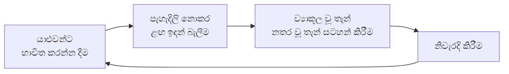

# UI・UX ගැන

> 🇯🇵 මුල් පිටපත (ජපන් භාෂාවෙන්): [UI_UXについて.md](<../../../2年生_システム開発実践/後期/2026_10_30/UI_UXについて.md>) <!-- original-ja-link -->

App ගැන කතා කරන විට, **UI (යූ-අයි)** සහ **UX (යූ-එක්ස්)** යන වචන නිතරම ඇසෙනවා.
මේ දෙකම "භාවිත කරන කෙනා" හා සම්බන්ධ වචන වුවත්, අර්ථය ටිකක් වෙනස්.

[ස්වාධීන නිර්මාණයට ආපසු යන්න](../2026_10_09/2026_10_09_資料1.md)

---

## 1. කෙටියෙන් කිව්වොත්

| නම | සම්පූර්ණ නම | අර්ථය | කෙටියෙන් |
|------|----------|------|-----------|
| **UI** | User Interface (යූසර් ඉන්ටර්ෆේස්) | භාවිත කරන කෙනා **දකින・ස්පර්ශ කරන කොටස** (තිරය・button・අකුරු・වර්ණ) | පෙනුම සහ මෙහෙයවීම |
| **UX** | User Experience (යූසර් එක්ස්පීරියන්ස්) | භාවිත කරන කෙනා **භාවිත කරන විට දැනෙන දේ** (පහසුයි・විනෝදයි・තේරුම් ගැනීමට පහසුයි) | භාවිත කරන විට ලැබෙන අත්දැකීම |

> 💡 **උපමාවකින් කිව්වොත් "අවන්හලක්"**
> - **UI** ＝ මෙනු පත්‍රය・පිඟන්・මේස・අවන්හලේ අභ්‍යන්තර සැරසිලි
> - **UX** ＝ "ඉක්මනින් වාඩි වෙන්න ලැබුණා" "ඇණවුම් කිරීම පහසු වුණා" "රසයි" "ආයෙත් එන්න ඕන" කියා දැනෙන **සමස්ත අත්දැකීම**
>
> මෙනු පත්‍රය ලස්සන (UI හොඳ) වුණත්, කෑම ලැබෙන්න පැයක් ගත වුණොත්, අත්දැකීම (UX) හොඳ නැහැ.

---

## 2. UI සහ UX අතර සම්බන්ධය

UI යනු UX හි **කොටසකි**.
හොඳ UX එකක් හදන්න හොඳ UI එකක් අවශ්‍ය වුණත්, **UI පමණක් හොඳ වුණාට UX හොඳ වෙන්නේ නැහැ**.

```mermaid
graph TB
    subgraph UX භාවිත කරන විට ලැබෙන අත්දැකීම
        UI[UI<br>තිරය・button・වර්ණ]
        A[ක්‍රියා කරන වේගය]
        B[තේරුම් ගැනීමේ පහසුව]
        C[දෝෂයක් ආ විට දැනෙන සුරක්ෂිත බව]
    end
```

| උදාහරණය | UI | UX |
|----|----|----|
| Button එක ලස්සනයි, නමුත් එබුවත් ප්‍රතිචාරයක් නැහැ | ◯ | ✕ |
| පෙනුම සරලයි, නමුත් අවශ්‍ය තොරතුරු වෙත ඉක්මනින් යන්න පුළුවන් | △ | ◯ |
| ඇතුළත් කළ දත්ත, දෝෂයක් නිසා සියල්ල මැකී ගියා | — | ✕✕ |

---

## 3. හොඳ UI එකක ප්‍රධාන කරුණු

### ① ඒකාකාරී කරන්න (ඒකාකාරී බව)

එකම අර්ථය ඇති දේවල්, **එකම පෙනුමෙන්・එකම ස්ථානයේ** තබන්න.

| ✕ හොඳ නැහැ | ◯ හොඳයි |
|----------|-------|
| පිටුව අනුව 「保存」(සුරකින්න) button එකේ වර්ණය හෝ ස්ථානය වෙනස් | සුරකින්න button එක, ඕනෑම පිටුවක **එකම වර්ණයෙන්・එකම ස්ථානයේ** |
| 「登録」(ලියාපදිංචි කරන්න) 「追加」(එකතු කරන්න) 「作成」(සාදන්න) ලෙස, එකම අර්ථය ඇති වචන විසිරී ඇත | වචන **එකකට ඒකාකාරී කරන්න** |

### ② එබිය හැකි දේ, එබිය හැකි බව තේරෙන ලෙස කරන්න

Button සහ link, **බැලූ සැණින් එබිය හැකි බව තේරෙන** පෙනුමකින් හදන්න.
Mouse එක උඩට ගෙන ගිය විට වර්ණය වෙනස් වුණොත් (`hover`), තවත් තේරුම් ගැනීමට පහසු වෙනවා.

### ③ වැදගත් දේ කැපී පෙනෙන ලෙස කරන්න

වඩාත්ම එබීමට අවශ්‍ය button එක (「保存」(සුරකින්න) වැනි) **තද වර්ණයකින්**, අනෙක්වා (「キャンセル」(අවලංගු කරන්න) වැනි) **ලා වර්ණයකින්** කරන්න.
සියල්ල කැපී පෙනුණොත්, **කිසිවක් කැපී පෙනෙන්නේ නැහැ**.

### ④ කියවීමට පහසු කරන්න

- අකුරු සහ පසුබිම් වර්ණ අතර වෙනස (**contrast**) හොඳින් තබන්න (ලා අළු පැහැති අකුරු කියවීමට අපහසුයි)
- අකුරු ඕනෑවට වඩා කුඩා කරන්න එපා
- අංග අතර ප්‍රමාණවත් හිස් ඉඩක් තබා, ඕනෑවට වඩා පුරවන්න එපා

---

## 4. හොඳ UX එකක ප්‍රධාන කරුණු

### ① ප්‍රතිචාරයක් දෙන්න (Feedback)

Button එකක් එබූ විට, **මොකක්ද සිදු වුණේ කියා දන්වන්න**. ප්‍රතිචාරයක් නැත්නම්, භාවිත කරන කෙනා "එබුණාද?" කියා කනස්සල්ලට පත් වී, කිහිප වතාවක් එබීමට ඉඩ තිබෙනවා.

| අවස්ථාව | Feedback උදාහරණ |
|-----|----------------|
| සුරකිමින් පවතින විට | 「保存中…」(සුරකිමින්…) ලෙස පෙන්වීම・button එක එබිය නොහැකි කිරීම |
| සුරැකුණු විට | 「保存しました」(සුරැකුවා) ලෙස පෙන්වීම |
| දෝෂයක් | **මොකක්ද වැරදි, කුමක් කළ යුතුද** යන්න පෙන්වීම |

### ② දෝෂ පණිවිඩ භාවිත කරන්නාට මෘදු කරන්න

| ✕ හොඳ නැහැ | ◯ හොඳයි |
|----------|-------|
| `Error 422` | 「タイトルを入力してください」(මාතෘකාව ඇතුළත් කරන්න) |
| දෝෂයක් ආ විට, ඇතුළත් කළ අන්තර්ගතය සියල්ල මැකී යනවා | ඇතුළත් කළ අන්තර්ගතය **එලෙසම තබා**, දෝෂය ඇති ස්ථානය රතු පාටින් පෙන්වනවා |

### ③ අවලංගු කළ නොහැකි දේ, තහවුරු කරගන්න

**මකා දැමීම** වැනි ආපසු හැරවිය නොහැකි මෙහෙයුම් වලදී, 「本当に削除しますか？」(ඇත්තටම මකා දමනවාද?) කියා තහවුරු කරගන්න.

### ④ අඩු පියවර ගණනකින් අවසන් කරන්න

නිතර භාවිත කරන function, **අඩු click ගණනකින්** කළ හැකි ලෙස කරන්න.
"සටහන් කරන හැම වතාවකම පිටු 3 ක් මාරු වෙන්න ඕන" app එකක්, ටිකෙන් ටික භාවිත නොකර යනවා.

---

## 5. ඔබේ app එක පරීක්ෂා කරන ආකාරය

හොඳම ක්‍රමය වන්නේ, **වෙනත් අයට භාවිත කරන්න දීමයි**.



- හැදූ කෙනා භාවිත කරන ආකාරය දන්නා නිසා, **තේරුම් ගැනීමට අපහසු තැන් ගැන අවබෝධ වෙන්නේ නැහැ**
- භාවිත කරන කෙනා **නතර වූ තැන්・ව්‍යාකූල වූ තැන්** තමයි නිවැරදි කළ යුතු තැන්
- කටින් පැහැදිලි කරන්න ඕන කියා හිතෙනවා නම්, ඒක **තිරයෙන් පණිවිඩය නොලැබෙන** බවට ලකුණකි

---

## 6. සාරාංශය

- **UI** ＝ තිරය・button・වර්ණ වැනි, **දකින・ස්පර්ශ කරන කොටස**
- **UX** ＝ භාවිත කරන විට **දැනෙන දේ・සමස්ත අත්දැකීම**
- UI යනු UX හි කොටසකි. **පෙනුම පමණක් හොඳ වුණාට, හොඳ අත්දැකීමක් වෙන්නේ නැහැ**
- හොඳ UI: **ඒකාකාරී කිරීම・එබිය හැකි බව තේරීම・වැදගත් දේ කැපී පෙනීම・කියවීමට පහසු කිරීම**
- හොඳ UX: **ප්‍රතිචාර දීම・දෝෂ පණිවිඩ මෘදු කිරීම・අවලංගු කළ නොහැකි දේ තහවුරු කිරීම・අඩු පියවර**
- හොඳම පරීක්ෂා කිරීමේ ක්‍රමය, **වෙනත් අයට භාවිත කරන්න දීමයි**

[ස්වාධීන නිර්මාණයට ආපසු යන්න](../2026_10_09/2026_10_09_資料1.md)
