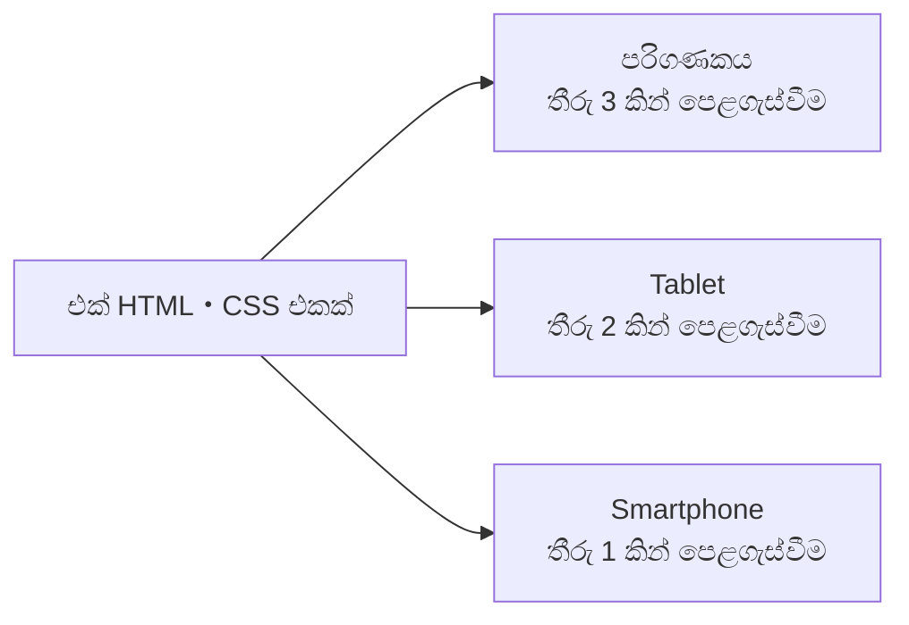
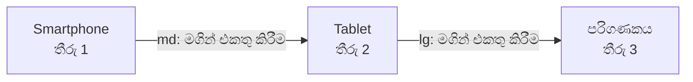
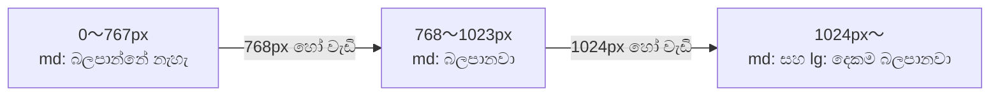
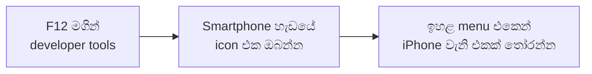

# Responsive design ගැන

> 🇯🇵 මුල් පිටපත (ජපන් භාෂාවෙන්): [レスポンシブデザインについて.md](<../../../2年生_システム開発実践/後期/2026_11_06/レスポンシブデザインについて.md>) <!-- original-ja-link -->

Websites, පරිගණක・tablet・smartphone වැනි **විවිධ ප්‍රමාණයේ තිර** මත බලනවා.
එකම පිටුවක් **ඕනෑම තිරයක පහසුවෙන් බැලිය හැකි ලෙස පෙන්වන** ආකාරයට සෑදීම **responsive design** ලෙස හඳුන්වනවා.

[ස්වාධීන නිර්මාණයට ආපසු යන්න](../2026_10_09/2026_10_09_資料1.md)

---

## 1. Responsive design යනු කුමක්ද

**Responsive** යන්නෙහි අර්ථය "ප්‍රතිචාර දක්වන" යන්නයි.
තිරයේ **පළල** අනුව ප්‍රතිචාර දක්වමින්, layout එක ස්වයංක්‍රීයව මාරු කරනවා.



> 💡 **ඉස්සර "smartphone සඳහා website" වෙනම හැදුවා**
> කලින් කාලයේ, පරිගණක සඳහා පිටුව සහ smartphone සඳහා පිටුව (`m.〇〇.com` වැනි) **වෙන වෙනම** හැදූ අවස්ථා තිබුණා.
> එසේ නම්, නිවැරදි කරන හැම වතාවකම **දෙකම නිවැරදි කිරීමට** සිදු වෙනවා. Responsive design නම්, **එකක් නිවැරදි කළොත් ඇති**.

---

## 2. ඇයි මෙය වැදගත්?

- දැන්, website **smartphone එකෙන් බලන අය ඉතා වැඩියි**
- සමාගම් වල අයත්, ඔබේ portfolio URL එක **smartphone එකෙන් විවෘත කිරීමට** ඉඩ තිබෙනවා
- Smartphone එකෙන් බැලූ විට අකුරු ඕනෑවට වඩා කුඩා නම් හෝ අන්තර්ගතය තිරයෙන් පැත්තට පිටතට ගියොත්, **එපමණකින්ම පිටුව ගැන ඇති වන හැඟීම නරක වෙනවා**

---

## 3. ක්‍රියාකාරිත්වය ① viewport

Smartphone browser එක, කිසිවක් සඳහන් නොකළොත්, **පරිගණක සඳහා වූ පිටුව කුඩා කර** පෙන්වනවා (අකුරු ඉතා කුඩා වෙනවා).
එය වළක්වන්නේ, HTML හි `<head>` තුළ ලියන **viewport** සැකසුමයි.

```html
<meta name="viewport" content="width=device-width, initial-scale=1">
```

| කොටස | අර්ථය |
|-----|------|
| `width=device-width` | පිටුවේ පළල, **එම උපාංගයේ තිරයේ පළලට** ගැලපීම |
| `initial-scale=1` | මුලින්ම **විශාල කිරීමක් හෝ කුඩා කිරීමක් නොකර** (1:1 ප්‍රමාණයෙන්) පෙන්වීම |

> 📝 **Next.js එය ස්වයංක්‍රීයව ඇතුළත් කරනවා**
> Next.js (App Router) හි, මෙම viewport සැකසුම **මුල සිටම ස්වයංක්‍රීයව** ඇතුළත් වෙලා තියෙනවා.
> Laravel Blade භාවිත කර හදන විට, layout file එකේ ඔබම ලියන්න (`laravel new` මගින් හැදූ පිටු වල මුල සිටම ඇතුළත් වෙලා තියෙනවා).

---

## 4. ක්‍රියාකාරිත්වය ② Media query

**Media query** යනු, "තිරයේ පළල 〇〇px හෝ ඊට වැඩි විට පමණක්, මෙම CSS භාවිත කරන්න" කියා සඳහන් කරන ලිවීමේ ක්‍රමයකි.

```css
/* සාමාන්‍යයෙන් (smartphone) තීරු 1 */
.cards {
  display: grid;
  grid-template-columns: 1fr;
}

/* තිරයේ පළල 768px හෝ වැඩි නම් තීරු 2 */
@media (min-width: 768px) {
  .cards {
    grid-template-columns: 1fr 1fr;
  }
}

/* 1024px හෝ වැඩි නම් තීරු 3 */
@media (min-width: 1024px) {
  .cards {
    grid-template-columns: 1fr 1fr 1fr;
  }
}
```

මෙලෙස layout එක මාරු කරන **පළලේ සීමා ලක්ෂ්‍යයට** **breakpoint** කියා කියනවා.

---

## 5. Tailwind CSS වලින් ලිව්වොත්

Tailwind CSS හි, class නාමයට ඉදිරියෙන් `md:` හෝ `lg:` එකතු කිරීමෙන් පමණක්, media query හා සමාන දෙයක් කළ හැකියි (පහත උදාහරණයේ 「カード」 කියන්නේ "කාඩ්පත" යන්නයි).

```html
<div class="grid grid-cols-1 md:grid-cols-2 lg:grid-cols-3 gap-4">
  <div>カード1</div>
  <div>カード2</div>
  <div>カード3</div>
</div>
```

| ලියන ආකාරය | කවදා භාවිත වෙනවාද? |
|-------|------------|
| `grid-cols-1` | **සෑම විටම** (smartphone) |
| `sm:` | පළල **640px හෝ වැඩි** විට |
| `md:grid-cols-2` | පළල **768px හෝ වැඩි** විට (සාමාන්‍යයෙන් tablet තිරයක පළල පමණ) |
| `lg:grid-cols-3` | පළල **1024px හෝ වැඩි** විට (සාමාන්‍යයෙන් පරිගණක තිරයක පළල පමණ) |

---

## 6. Mobile first

ඉහත උදාහරණ දෙකේදීම, **smartphone පෙනුම මුලින්ම ලියා**, තිරය විශාල වූ විට කරන වෙනස්කම් **පසුව එකතු කර** තිබෙනවා.
මෙම සිතීමේ ක්‍රමයට **mobile first** කියා කියනවා.



- කුඩා තිරයේ පෙන්විය හැකි දේ අඩු නිසා, **ඇත්තටම අවශ්‍ය දේ පමණක්** ගැන සිතීමට සිදු වෙනවා
- කුඩා තිරයේ හොඳින් සකස් කළ දෙයක්, විශාල තිරයකට පුළුල් කිරීම **පහසුයි**

> ⚠️ **Tailwind හි `md:` යන්නෙහි අර්ථය "md හෝ ඊට වැඩි"**
> `md:hidden` යනු "tablet එකේ **පමණක්** සඟවන්න" නොව, "768px **හෝ වැඩි** නම් සඟවන්න" යන්නයි.
> Smartphone පෙනුම, `md:` වැනි දේ එකතු නොකළ **සාමාන්‍ය class** වල ලියන්න.

තිරයේ පළල සහ බලපාන class අතර සම්බන්ධය පහත පරිදියි.



---

## 7. Smartphone පෙනුම පරීක්ෂා කරන්න

Smartphone එකක් නැතත්, **browser හි developer tools** මගින් පරීක්ෂා කළ හැකියි.



| බහුලව ඇති ගැටලු | නිවැරදි කරන ආකාරය |
|-----------|------|
| පැත්තට scroll කළ හැකි වෙනවා (පිටතට ගිහින්) | පළල `px` වලින් ස්ථාවර කර ඇති element තිබේදැයි සොයන්න. රූප සඳහා `max-width: 100%` |
| Button කුඩා නිසා එබීමට අපහසුයි | ඇඟිල්ලෙන් එබීමට පහසු ප්‍රමාණයක් (**44px පමණ**) කරන්න |
| වගුව (table) පැත්තට පිටතට යනවා | වගුව පැත්තට scroll කළ හැකි කොටුවක දමන්න, නැත්නම් smartphone එකේදී card ආකාරයට වෙනස් කරන්න |
| අකුරු ඕනෑවට වඩා කුඩායි | ප්‍රධාන පාඨය සඳහා **16px පමණ** ඉලක්කයක් ලෙස ගන්න |

> 💡 Deploy පාඨමාලාවේ අය, Vercel URL එක **ඔබේම smartphone එකෙන් විවෘත කර** පරීක්ෂා කර බලන්න.

---

## 8. සාරාංශය

- **Responsive design** ＝ එකම පිටුවක්, **තිරයේ පළලට ගැලපෙන ලෙස** වෙනස් කර, පහසුවෙන් බැලිය හැකි ආකාරයට සෑදීම
- **Viewport** සැකසුමෙන්, smartphone එකේත් **1:1 ප්‍රමාණයෙන්** පෙන්වනවා (Next.js හි ස්වයංක්‍රීයයි)
- **Media query** මගින්, "〇〇px හෝ වැඩි නම් මෙම CSS" කියා සඳහන් කරනවා. සීමා ලක්ෂ්‍යයට **breakpoint** කියා කියනවා
- Tailwind CSS හි `md:` `lg:` එකතු කිරීම පමණයි
- **Mobile first**: Smartphone පෙනුම මුලින්ම හදලා, විශාල තිර සඳහා වෙනස්කම් එකතු කරනවා
- පරීක්ෂා කිරීම **developer tools** සහ **ඔබේම smartphone එකෙන්**

[ස්වාධීන නිර්මාණයට ආපසු යන්න](../2026_10_09/2026_10_09_資料1.md)
