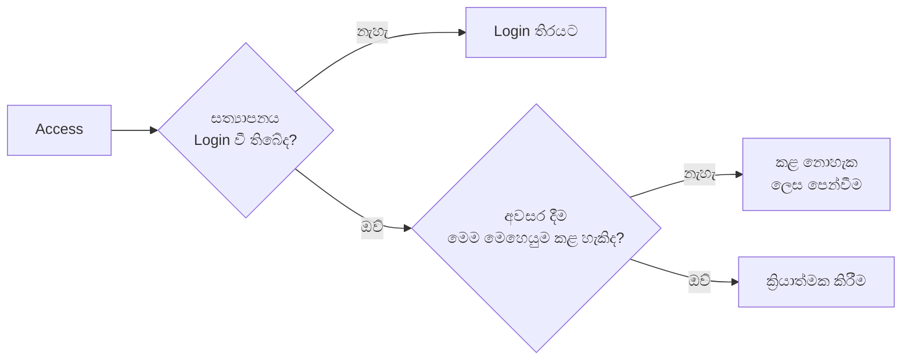
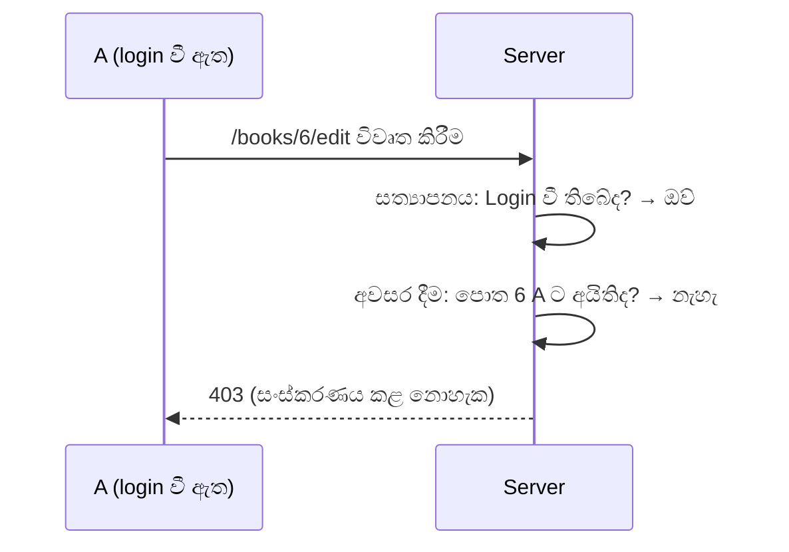
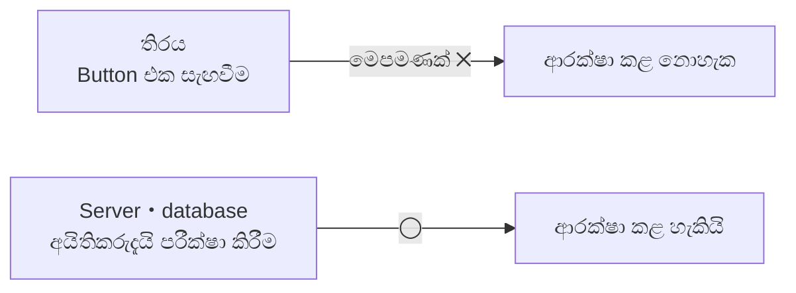

# සත්‍යාපනය (Authentication) සහ අවසර දීම (Authorization) ගැන

> 🇯🇵 මුල් පිටපත (ජපන් භාෂාවෙන්): [認証と認可について.md](<../../../2年生_システム開発実践/後期/2026_11_13/認証と認可について.md>) <!-- original-ja-link -->

Login function එකක් හදන විට, **සත්‍යාපනය (認証)** සහ **අවසර දීම (認可)** යන වචන 2 හමු වෙනවා.
ජපන් භාෂාවෙන් මේ වචන දෙකේ වෙනස kanji එක් අකුරක් පමණක් වුවත්, කරන දේ එකිනෙකට වෙනස්.

[ස්වාධීන නිර්මාණයට ආපසු යන්න](../2026_10_09/2026_10_09_資料1.md)

---

## 1. කෙටියෙන් කිව්වොත්

| නම | ඉංග්‍රීසියෙන් | තහවුරු කරන දේ | කෙටියෙන් |
|------|-----|-----------|-----------|
| **සත්‍යාපනය** | Authentication, කෙටියෙන් **AuthN** | **ඔබ කවුද?** | අනන්‍යතාව තහවුරු කිරීම |
| **අවසර දීම** | Authorization, කෙටියෙන් **AuthZ** | **ඔබට කුමක් කිරීමට අවසර තිබේද?** | අවසරය තහවුරු කිරීම |

> 💡 **උපමාවකින් කිව්වොත් "ප්‍රසංගයක්"**
> - **සත්‍යාපනය** ＝ ඇතුල්වීමේ දොරටුවේදී **ප්‍රවේශ පත්‍රය සහ හැඳුනුම්පත** පෙන්වා, ඔබම බව තහවුරු කර ගැනීම
> - **අවසර දීම** ＝ ප්‍රවේශ පත්‍රයේ වර්ගය අනුව, **ඇතුළු විය හැකි ස්ථාන තීරණය වීම** (සාමාන්‍ය ප්‍රවේශ පත්‍රයක් ඇති අයට, අදාළ අය සඳහා වෙන් කළ ප්‍රදේශයට ඇතුළු විය නොහැක)
>
> ඔබේ අනන්‍යතාව තහවුරු වුණත් (සත්‍යාපනය OK), ඕනෑම තැනකට ඇතුළු වීමට අවසර ලැබෙන්නේ නැහැ (අවසර දීම වෙනම දෙයකි).

---

## 2. අනුපිළිවෙළ "සත්‍යාපනය → අවසර දීම"

**කවුද කියා නොදන්නේ නම්, කුමක් කිරීමට අවසර දිය යුතුද කියාත් තීරණය කරන්න බැහැ.** ඒ නිසා, සැමවිටම සත්‍යාපනය මුලින්ම සිදු වෙනවා.



---

## 3. ඔබේ app එකට ගළපා බලමු

**කියවීමේ සටහන් app එකේ** උදාහරණයෙන් සිතමු.

| අවස්ථාව | සත්‍යාපනයද? අවසර දීමද? | තහවුරු කරන දේ |
|-----|-----------|-----------|
| Email ලිපිනය සහ මුරපදය භාවිත කර login වීම | **සත්‍යාපනය** | ඇත්තටම මේ කෙනාද? |
| Login වී නැති කෙනෙක් 「本を登録する」(පොතක් ලියාපදිංචි කරන්න) පිටුව විවෘත කිරීම | **සත්‍යාපනය** | Login වී තිබේද? → නැත්නම් login තිරයට |
| A, **B ගේ** අදහස් සංස්කරණය කිරීමට උත්සාහ කිරීම | **අවසර දීම** | මෙම පොත ලියාපදිංචි කළේ තමාද? → නැත්නම් කළ නොහැක |
| පරිපාලකට (admin) පමණක්, අන් අයගේ post මකා දැමිය හැකි වීම | **අවසර දීම** | මේ කෙනා පරිපාලකද? |

> ⚠️ **බහුලව සිදුවන වැරැද්ද: සත්‍යාපනය පමණක් කර, අවසර දීම අමතක කිරීම**
> "Login වී සිටින අයට පමණක් සංස්කරණ පිටුව විවෘත කළ හැකියි" යන්න පමණක් නම්, login වී සිටින **ඕනෑම කෙනෙකුට**, URL එකේ අංකය වෙනස් කිරීමෙන් පමණක් **අන් අයගේ දත්ත** සංස්කරණය කළ හැකි වෙනවා.
>
> ```
> /books/5/edit   ← ඔබේ පොත
> /books/6/edit   ← අංකය වෙනස් කළොත්…වෙනත් කෙනෙකුගේ පොතද?
> ```
>
> සංස්කරණය・මකා දැමීම කරන විට, **"මෙම දත්ත login වී සිටින කෙනාටම අයිතිද?"** යන්න අනිවාර්යයෙන්ම පරීක්ෂා කරන්න.

අවසර දීමේ පරීක්ෂාව තිබේ නම්, login වී සිටින කෙනෙකු අන් අයගේ දත්ත සංස්කරණය කිරීමට උත්සාහ කළත්, එය පහත පරිදි වළක්වනවා.



---

## 4. HTTP status code

දෝෂයක් ආ විට ආපසු දෙන status code ද, සත්‍යාපනය සහ අවසර දීම අනුව වෙන් වෙලා තියෙනවා.

| Code | නම | අර්ථය |
|-------|-----|------|
| **401** | Unauthorized | **සත්‍යාපනය** වී නැහැ (login වී නැහැ・කවුද කියා නොදනී) |
| **403** | Forbidden | සත්‍යාපනය වී ඇතත්, **අවසරය** නැහැ (එම මෙහෙයුම තහනම්) |

> 📝 401 හි නම "Unauthorized (අවසර නැති)" වුවත්, එහි අර්ථය **සත්‍යාපනය වී නැත** යන්නයි. නම ව්‍යාකූල නිසා, අර්ථයෙන් මතක තබා ගන්න.

---

## 5. එක් එක් තාක්ෂණයේදී කොහොමද කරන්නේ?

### Laravel හිදී

| | භාවිත කරන දේ | උදාහරණය |
|---|---|---|
| සත්‍යාපනය | `Auth`, middleware `auth` | Login වී නැති අය login තිරයට යොමු කිරීම |
| අවසර දීම | **Policy**, `Gate` | "පොතක් සංස්කරණය කළ හැක්කේ, එය ලියාපදිංචි කළ කෙනාට පමණයි" යන නීතිය ලිවීම |

```php
// routes/web.php: login වී සිටින අයට පමණයි (සත්‍යාපනය)
Route::middleware('auth')->group(function () {
    Route::get('/books/{book}/edit', [BookController::class, 'edit']);
});
```

```php
// BookController: තමාගේ පොතද නැද්ද (අවසර දීම)
public function edit(Book $book)
{
    if ($book->user_id !== Auth::id()) {
        abort(403); // තමාගේ පොත නොවේ නම් 403
    }

    return view('books.edit', compact('book'));
}
```

### Supabase හිදී

| | භාවිත කරන දේ | උදාහරණය |
|---|---|---|
| සත්‍යාපනය | **Supabase Auth** | Email・මුරපදය, හෝ Google ගිණුමෙන් login වීම |
| අවසර දීම | **RLS (Row Level Security / පේළි මට්ටමේ ආරක්ෂාව)** | "`user_id` තමන්ගේ user ID එකට ගැළපෙන පේළි පමණක් බැලීමට・වෙනස් කිරීමට හැකියි" යන නීතිය database එකේ ලිවීම |

> ⚠️ **Supabase හිදී RLS ඉතා වැදගත්**
> Supabase භාවිත කරන විට, browser එකෙන් **කෙලින්ම database එකට access** කරනවා.
> RLS සකසා නැත්නම්, **ඕනෑම කෙනෙකුට සියලු දත්ත බැලීමට හෝ මකා දැමීමට හැකි** තත්ත්වයක් ඇති විය හැකියි.
> Supabase කළමනාකරණ තිරයේ, එක් එක් table එකට RLS **සක්‍රීය (Enabled)** කර තිබේදැයි තහවුරු කරගන්න.

---

## 6. තිරයෙන් සැඟවීම පමණක් අවසර දීමක් නොවේ

"අන් අයගේ පොත් වලට සංස්කරණ button එක නොපෙන්වීම"——මෙය **UI එකේ උපක්‍රමයක්** මිස, **අවසර දීමක් නොවේ**.
Button එක නැතත්, URL එක කෙලින්ම ටයිප් කළොත් හෝ API එක කෙලින්ම කැඳවුවොත් මෙහෙයුම කළ හැකි නිසයි.



**අවසර දීමේ පරීක්ෂාව, අනිවාර්යයෙන්ම server පැත්තේ (Laravel controller, Supabase RLS වැනි) සිදු කරන්න.**

---

## 7. සාරාංශය

- **සත්‍යාපනය** ＝ **ඔබ කවුද?** (අනන්‍යතාව තහවුරු කිරීම・login)
- **අවසර දීම** ＝ **ඔබට කුමක් කිරීමට අවසර තිබේද?** (අවසරය තහවුරු කිරීම)
- අනුපිළිවෙළ **සත්‍යාපනය → අවසර දීම**
- Login වී නැහැ → **401**, login වී ඇතත් තහනම් → **403**
- Laravel හි **auth middleware＋Policy**, Supabase හි **Supabase Auth＋RLS**
- Button සැඟවීම පමණක් ආරක්ෂාවක් නොවේ. **Server පැත්තේ අනිවාර්යයෙන්ම පරීක්ෂා කරන්න**

[ස්වාධීන නිර්මාණයට ආපසු යන්න](../2026_10_09/2026_10_09_資料1.md)
