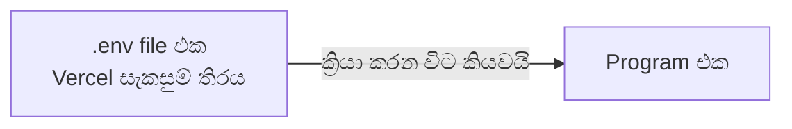
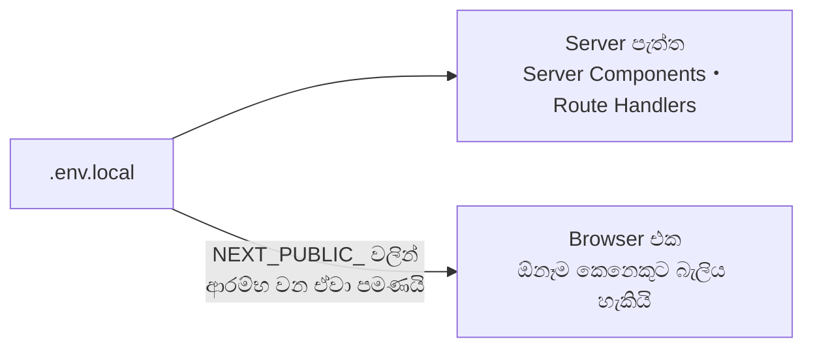
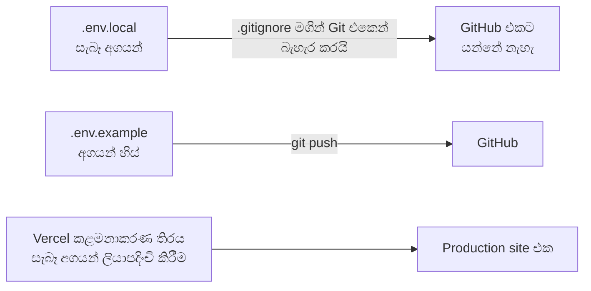
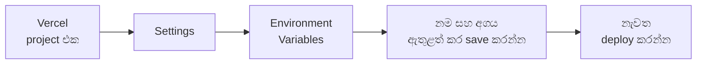

# Environment variables ගැන

> 🇯🇵 මුල් පිටපත (ජපන් භාෂාවෙන්): [環境変数について.md](<../../../2年生_システム開発実践/後期/2026_11_27/環境変数について.md>) <!-- original-ja-link -->

ස්වාධීන නිර්මාණයේ ලේඛන වල, "**API key සහ මුරපද GitHub එකට දමන්න එපා**" "`.env` එකේ ලියන්න" කියා බොහෝ වතාවක් ලියා තිබෙනවා.
මෙම `.env` එකේ ලියන දේ තමයි **environment variables (පරිසර විචල්‍ය)**.
මෙහිදී, environment variable යනු කුමක්ද, ඇයි ඒවා භාවිත කරන්නේ කියා බලමු.

[ස්වාධීන නිර්මාණයට ආපසු යන්න](../2026_10_09/2026_10_09_資料1.md)

---

## 1. Environment variable යනු කුමක්ද

**Environment variable** යනු, program එකේ **පිටතින්** තබා ගන්නා සැකසුම් අගයන්ය.
Program එක, ක්‍රියා කරන විට එම අගයන් **කියවා** භාවිත කරනවා.



| Environment variable වල දමන දේ | උදාහරණ |
|------------------|-----|
| **රහස් අගයන්** | API key, database මුරපදය |
| **ස්ථානය අනුව වෙනස් වන අගයන්** | Database එකේ ස්ථානය (ඔබේ PC එකද production server එකද), API URL එක |

> 💡 **උපමාවකින් කිව්වොත් "නිවසේ යතුර"**
> නිවසේ **සැලැස්ම** (program එක), වෙනත් අයට පෙන්වුවත් ගැටලුවක් නැහැ.
> නමුත්, **යතුර** (මුරපදය) සැලැස්මට අලවන්නේ නැතුව, **වෙනම තබා ගන්නවා** නේද?
> Environment variable යනු, program එකෙන් වෙනම තබා ගන්නා **යතුරක්** වැනි දෙයකි.

---

## 2. ඇයි environment variable භාවිත කරන්නේ?

### ① රහස් අගයන් GitHub එකට නොදැමීමට

API key එක program එකේ **කෙලින්ම ලියා** GitHub හි ප්‍රසිද්ධ කළොත්, **ලෝකයේ ඕනෑම කෙනෙකුට බලන්න පුළුවන්**.

```js
// ✕ භයානකයි: code එකේ කෙලින්ම ලියා ඇත
const apiKey = "sk-abc123xyz...";
```

```js
// ◯ ආරක්ෂිතයි: environment variable එකෙන් කියවයි
const apiKey = process.env.WEATHER_API_KEY;
```

> ⚠️ **GitHub එකට දැමූ key එකක් ඉක්මනින්ම අනිසි ලෙස භාවිත වෙන්න පුළුවන්**
> Public repository වල ඇති key ස්වයංක්‍රීයව සොයන program තිබෙනවා.
> වැරදීමකින් push කළොත්, **commit එක මකා දැමීම පමණක් ප්‍රමාණවත් නැහැ** (history එකේ ඉතිරි වෙලා තියෙනවා).
> වහාම සේවාවේ කළමනාකරණ තිරයේ **key එක අක්‍රීය කර, අලුත් key එකක් නැවත සාදන්න**.

### ② ස්ථානය අනුව අගයන් මාරු කිරීමට

එකම program එක වුවද, **ඔබේ PC එකේ** සහ **production (Vercel වැනි)** හිදී සම්බන්ධ වන තැන වෙනස්.

| | ඔබේ PC එක (development environment) | Production environment |
|---|---|---|
| Database | ඔබේ PC එකේ MySQL | අන්තර්ජාලයේ ඇති database එකක් |
| API URL | `http://localhost:8000` | `https://〇〇.com` |

Program එක **වෙනස් නොකර**, environment variable පමණක් වෙනස් කළොත්, සම්බන්ධ වන තැන මාරු කළ හැකියි.
"**පරිසරය (environment)** අනුව වෙනස් වන **විචල්‍ය (variable)**" නිසා, **environment variable** ලෙස නම් කර තිබෙනවා.

---

## 3. `.env` file එක

Development කරන අතරතුර, `.env` නමැති file එකක environment variable ලියනවා.

### Laravel හිදී (`.env`)

```
APP_NAME=BookApp
DB_HOST=127.0.0.1
DB_DATABASE=laravel
DB_USERNAME=laravel
DB_PASSWORD=password
```

```php
// කියවන විට (config file එක තුළ)
'database' => env('DB_DATABASE'),
```

### Next.js හිදී (`.env.local`)

```
WEATHER_API_KEY=abc123xyz
NEXT_PUBLIC_SUPABASE_URL=https://〇〇.supabase.co
```

```js
// කියවන විට
const apiKey = process.env.WEATHER_API_KEY;
```

> ⚠️ **Next.js හි `NEXT_PUBLIC_` ගැන සැලකිලිමත් වන්න**
> නම `NEXT_PUBLIC_` වලින් ආරම්භ වන environment variable, **browser එකට යවන නිසා, ඕනෑම කෙනෙකුට බලන්න පුළුවන්**.
> **රහස් අගයන් (API key වැනි) සඳහා, `NEXT_PUBLIC_` යොදන්න එපා**.
> `NEXT_PUBLIC_` නැති environment variable, server පැත්තේ (Server Components හෝ Route Handlers) පමණක් භාවිත කළ හැකියි.

අගයන් කොතෙක් දුරට යනවාද යන්න රූපසටහනකින් පෙන්වුවොත් මෙසේය.



> 📝 Supabase හි **URL සහ පොදු key එක (publishable key / anon key)** browser එකේ භාවිත කිරීමට අදහස් කළ ඒවා නිසා `NEXT_PUBLIC_` යෙදුවාට ගැටලුවක් නැහැ.
> ඒ සමඟම, දත්ත ආරක්ෂා කිරීමට **RLS** අනිවාර්යයෙන්ම සකසන්න (→ [සත්‍යාපනය සහ අවසර දීම ගැන](../2026_11_13/認証と認可について.md)).
> අනෙක් අතට, **secret key / service_role key** ඕනෑම දෙයක් කළ හැකි key නිසා, කිසිසේත් `NEXT_PUBLIC_` යොදන්න එපා.

---

## 4. `.env` GitHub එකට නොයන ක්‍රමය

`.env` GitHub එකට නොයන්නේ, එය **`.gitignore`** හි ලියා ඇති නිසයි.

```
# .gitignore
.env
.env*.local
```

`.gitignore` හි ලියා ඇති file, **Git නොසලකා හරින** නිසා, commit වෙන්නේ නැහැ.
Laravel හෝ `create-next-app` මගින් හැදූ project වල, **මුල සිටම ලියා තිබෙනවා**.

### `.env.example` සූදානම් කරන්න

`.env` GitHub එකට නොයන නිසා, වෙනත් අය project එක බැලුවත් **කුමන environment variable අවශ්‍යද** යන්න තේරෙන්නේ නැහැ.
ඒ නිසා, **අගයන් හිස් කළ ආදර්ශයක්** වන `.env.example` හදා GitHub එකට දමනවා.

```
# .env.example (GitHub එකට දමනවා)
WEATHER_API_KEY=
NEXT_PUBLIC_SUPABASE_URL=
```

> 💡 Laravel හි, මුල සිටම `.env.example` තිබෙනවා. Portfolio එකක් ලෙස පෙන්වන විටත්, `.env.example` තිබුණොත් **හොඳින් සකස් කර ඇති** බවක් පෙනෙනවා.

---

## 5. Production (Vercel) හිදී කළමනාකරණ තිරයෙන් සකසන්න

`.env.local` GitHub එකට නොයන නිසා, **Vercel වෙත ළඟා වෙන්නේ නැහැ**.
Production environment variable, Vercel කළමනාකරණ තිරයෙන් සකසනවා.

ඔබේ PC එක・GitHub・Vercel යන එක් එක් තැනේ මොනවා තැබෙනවාද යන්න සාරාංශ කළොත් මෙසේය.



සැකසීමේ පියවර පහත පරිදියි.



> ⚠️ **Environment variable එකතු කළ・වෙනස් කළ පසු, නැවත deploy කරන්න**
> Environment variable කියවන්නේ **deploy කරන විටයි**. සැකසුවා පමණින්, ඒ වෙනස්කම් දැනට ක්‍රියා කරන site එකේ පිළිබිඹු වෙන්නේ නැහැ.

---

## 6. සාරාංශය

- **Environment variable** ＝ program එකේ **පිටතින්** තබා ගන්නා සැකසුම් අගයන්
- භාවිත කිරීමට හේතු, **රහස් අගයන් ආරක්ෂා කිරීම** සහ **පරිසරය අනුව අගයන් මාරු කිරීම**
- Development අතරතුර **`.env`** (Next.js හි `.env.local`) එකේ ලියනවා. **`.gitignore`** නිසා GitHub එකට යන්නේ නැහැ
- අවශ්‍ය environment variable වල ආදර්ශයක් ලෙස **`.env.example`** GitHub එකට දමනවා
- Next.js හි **`NEXT_PUBLIC_`** browser එකේ සම්පූර්ණයෙන්ම පෙනෙනවා. රහස් අගයන් සඳහා යොදන්න එපා
- Production (Vercel) හි **කළමනාකරණ තිරයෙන් සකසා**, **නැවත deploy කරන්න**
- Key එකක් push වුණොත්, **වහාම අක්‍රීය කර නැවත සාදන්න**

[ස්වාධීන නිර්මාණයට ආපසු යන්න](../2026_10_09/2026_10_09_資料1.md)
