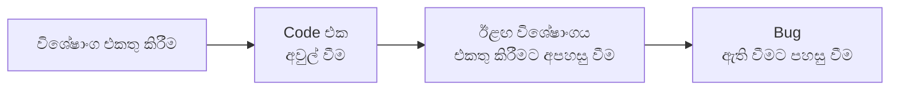
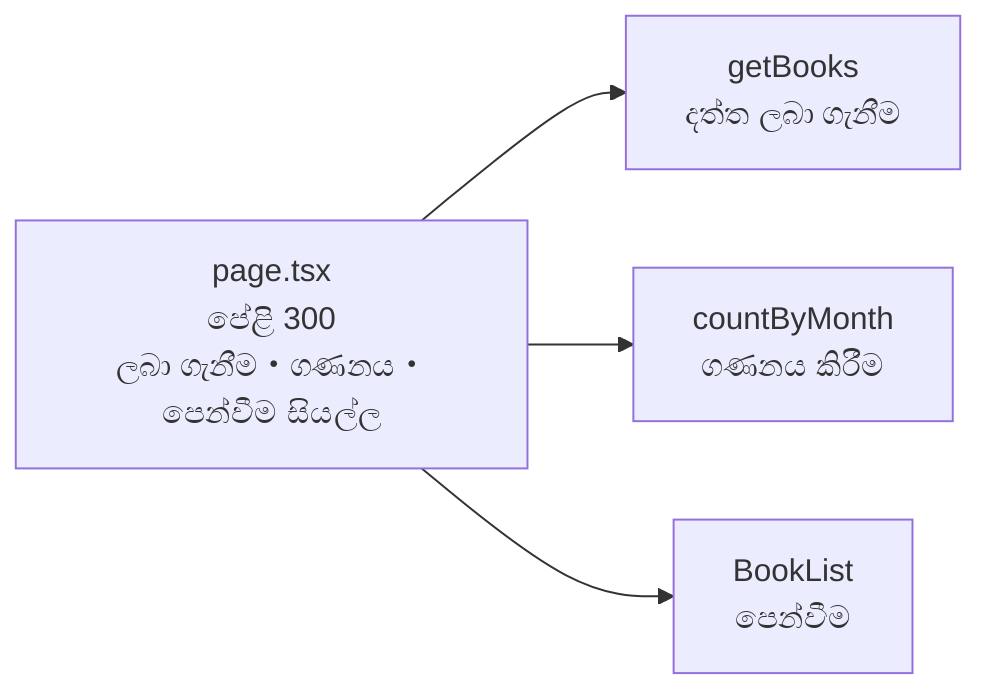
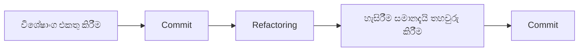

# Refactoring ගැන

> 🇯🇵 මුල් පිටපත (ජපන් භාෂාවෙන්): [リファクタリングについて.md](<../../../2年生_システム開発実践/後期/2026_12_04/リファクタリングについて.md>) <!-- original-ja-link -->

විශේෂාංග එකින් එක එකතු කරගෙන යන විට, code එක දිගු වී, **කොතැන මොනවා ලියා ඇත්දැයි නොතේරෙන** තත්ත්වයට පත් වෙනවා.
එවැනි අවස්ථාවකදී කරන්නේ **refactoring** යි.

[ස්වාධීන නිර්මාණයට ආපසු යන්න](../2026_10_09/2026_10_09_資料1.md)

---

## 1. Refactoring යනු කුමක්ද

**Refactoring** යනු, **app එකේ හැසිරීම වෙනස් නොකර**, code එකේ **අන්තර්ගතය කියවීමට පහසු・නිවැරදි කිරීමට පහසු ලෙස පිළිවෙළට සකස් කිරීමයි**.

| | හැසිරීම (භාවිත කරන කෙනාට පෙනෙන දේ) | Code එකේ අන්තර්ගතය |
|---|---|---|
| විශේෂාංග එකතු කිරීම | **වෙනස් වෙනවා** | වෙනස් වෙනවා |
| Bug නිවැරදි කිරීම | **වෙනස් වෙනවා** (නිවැරදි වෙනවා) | වෙනස් වෙනවා |
| **Refactoring** | **වෙනස් වෙන්නේ නැහැ** | වෙනස් වෙනවා (පිළිවෙළ වෙනවා) |

> 💡 **උපමාවකින් කිව්වොත් "කාමරය පිළිවෙළ කිරීම"**
> කාමරය පිළිවෙළ කළත්, ඔබ සතු දේවල් (කළ හැකි දේ) වෙනස් වෙන්නේ නැහැ.
> නමුත්, කොතැන මොනවා තියෙනවාද කියා තේරෙන නිසා, **ඊළඟ වතාවේ යමක් සොයන විට・අලුත් දෙයක් තබන විට පහසු** වෙනවා.

---

## 2. ඇයි refactoring කරන්නේ?



- Code එක අවුල් නම්, **ඊළඟ විශේෂාංගය එකතු කිරීමට කාලය ගත වෙනවා**
- එකම code එක තැන් ගණනාවක තිබුණොත්, **එක තැනක් නිවැරදි කිරීමට අමතක වී** bug එකක් ඇති වෙනවා
- මාස හයකට පසු ඔබට, දැන් ඔබ ලියූ code එක **බොහෝ දුරට මතක නැති වෙනවා**
- Portfolio එකේදී, සමාගම් වල අය **code එකත් බලනවා**. කියවීමට පහසු code එකක් ඇගයීමට ලක් වෙනවා

---

## 3. මෙවැනි code එකක් refactoring අවශ්‍ය බවට ලකුණකි

අවුල් වූ code වල, බහුලව දකින රටා තිබෙනවා. මෙවැනි රටාවකට **code smell** (ගැටලුවක ලකුණක්) කියා කියනවා.

| ලකුණ | උදාහරණ |
|-------|-----|
| **එකම code එක තැන් ගණනාවක තිබීම** | එකම header එක, සියලු පිටු වලට copy කර ලියා තිබීම |
| **එක් function එකක්・file එකක් ඕනෑවට වඩා දිගු වීම** | `page.tsx` පේළි 300 ක් තිබීම |
| **නම් තේරුම් ගැනීමට අපහසු වීම** | `data`, `tmp`, `a`, `flg` |
| **අර්ථය තේරුම් ගැනීමට අපහසු අංක** | `if (status === 2)` (2 කියන්නේ මොකක්ද?) |
| **භාවිත නොකරන code** | Comment out කර එලෙසම තබා ඇති පරණ code |

---

## 4. බහුලව කරන refactoring

### ① නම් තේරුම් ගැනීමට පහසු කරන්න

```js
// ✕ මොනවා තියෙනවාද කියා තේරෙන්නේ නැහැ
const d = await getData();
const l = d.filter((x) => x.r >= 4);
```

```js
// ◯ නම බැලුවාම තේරෙනවා
const books = await getBooks();
const favoriteBooks = books.filter((book) => book.rating >= 4);
```

මෙය වඩාත්ම පහසු, වඩාත්ම ඵලදායී refactoring එකයි.

### ② එකම code එක එක තැනකට ගොනු කරන්න

පළමු වාරයේ හෝ පළමු වසරේදී ඉගෙන ගත් **කොටස් (component・`@include`)** බවට පත් කිරීමත් refactoring එකකි.

```jsx
// ✕ එකම පෙනුම ඇති card එක, පිටු ගණනාවක ලියා තිබීම
<div className="rounded border p-4">
  <h2 className="font-bold">{book.title}</h2>
  <p>{book.author}</p>
</div>
```

```jsx
// ◯ BookCard නමැති කොටසක් කර, ඕනෑම තැනක භාවිත කරන්න
<BookCard book={book} />
```

මෙසේ කර තිබුණොත්, card එකේ පෙනුම වෙනස් කිරීමට අවශ්‍ය විට, **එක් තැනක් නිවැරදි කළොත් ඇති**.
එකම දේ නැවත නැවත නොකළ යුතුය යන අදහසට **DRY** (Don't Repeat Yourself) කියා කියනවා.

### ③ අර්ථයක් නොපෙනෙන අංක වලට නමක් දෙන්න

```js
// ✕ 2 මගින් කුමක් නිරූපණය කරනවාද කියා තේරෙන්නේ නැහැ
if (book.status === 2) { ... }
```

```js
// ◯ නමක් දෙන්න
const STATUS_FINISHED = 2; // කියවා අවසන්
if (book.status === STATUS_FINISHED) { ... }
```

### ④ දිගු function・file බෙදන්න

එක් function එකක් **විවිධ දේ කරනවා** නම්, කාර්යය අනුව බෙදන්න.



---

## 5. Refactoring හි නීති

### නීතිය ① මුලින්ම commit කරන්න

Refactoring කිරීමට පෙර, **ක්‍රියා කරන තත්ත්වය commit කර** තබන්න.
කැඩී ගියත්, ඉක්මනින් **ආපසු පෙර තත්ත්වයට ගෙන යා හැකියි**.

### නීතිය ② විශේෂාංග එකතු කිරීම සමඟම කරන්න එපා

"විශේෂාංග එකතු කරන ගමන් පිළිවෙළත් කරනවා" නම්, ක්‍රියා නොකළ විට **ඒ දෙකෙන් කුමක් හේතුවදැයි නොතේරී යනවා**.



### නීතිය ③ ටිකෙන් ටික කරන්න

එකවර සියල්ල නිවැරදි කිරීමට උත්සාහ නොකර, **එකක් නිවැරදි කළ පසු තහවුරු කිරීම** නැවත නැවත කරන්න.

### නීතිය ④ අවසන් වූ පසු, හැසිරීම වෙනස් වී නැත්දැයි තහවුරු කරන්න

Refactoring හි නීතිය වන්නේ **හැසිරීම වෙනස් නොකිරීමයි**.
නිවැරදි කළ පසු, **පෙර මෙන්ම ක්‍රියා කරනවාද** යන්න අනිවාර්යයෙන්ම තහවුරු කරන්න.
මෙම තහවුරු කිරීම ස්වයංක්‍රීයව කරන්නේ, ඊළඟ පාඩමේ ඉගෙන ගන්නා **test** යි.

---

## 6. AI ගෙන් refactoring සඳහා උදව් ලබා ගන්න

AI ගෙන් "මෙම code එක කියවීමට පහසු වන ලෙස refactor කරන්න" කියා ඉල්ලුවොත්, පිළිවෙළට සකස් කළ code එකක් ලබා දෙනවා.
කෙසේ වෙතත්, පහත කරුණු ගැන සැලකිලිමත් වන්න.

- **හැසිරීම වෙනස් වී නැත්ද** යන්න ඔබම තහවුරු කරන්න (AI ද වැරදි කළ හැකියි)
- **ඇයි එසේ නිවැරදි කළේ** යන්න තේරුම් ගත් පසු භාවිත කරන්න. පැහැදිලි කළ නොහැකි code එකක් ගැන සම්මුඛ පරීක්ෂණයේදී ඇසුවොත් අපහසුතාවයට පත් වෙනවා
- එකවර බොහෝ දේ ඉල්ලන්නේ නැතුව, **එක් file එකක් බැගින්・එක් function එකක් බැගින්** ඉල්ලන්න

---

## 7. සාරාංශය

- **Refactoring** ＝ **හැසිරීම වෙනස් නොකර**, code එක කියවීමට පහසු・නිවැරදි කිරීමට පහසු ලෙස පිළිවෙළට සකස් කිරීම
- ලකුණු වන්නේ, **එකම code එක තැන් ගණනාවක・ඕනෑවට වඩා දිගු・නම් තේරුම් ගැනීමට අපහසු・අර්ථයක් නොපෙනෙන අංක**
- බහුලව කරන්නේ, **නම් වෙනස් කිරීම・එකම code එක component එකකට ගොනු කිරීම (DRY)・අංක වලට නම් දීම・බෙදීම**
- **මුලින්ම commit කිරීම**・**විශේෂාංග එකතු කිරීම සමඟම නොකිරීම**・**ටිකෙන් ටික**・**හැසිරීම සමානදැයි තහවුරු කිරීම**
- AI භාවිත කරන විටත්, **තේරුම් ගත් පසු** භාවිත කරන්න

[ස්වාධීන නිර්මාණයට ආපසු යන්න](../2026_10_09/2026_10_09_資料1.md)
