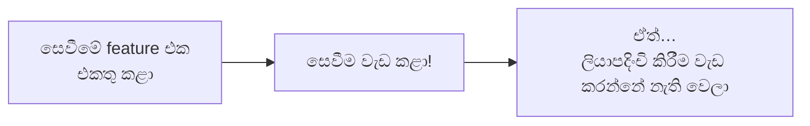
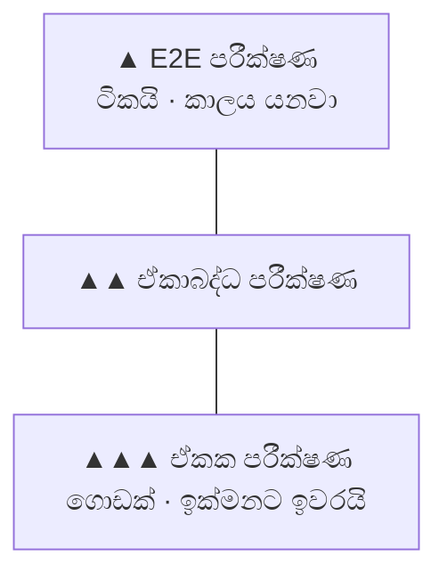

# පරීක්ෂණ (Testing) ගැන

> 🇯🇵 මුල් පිටපත (ජපන් භාෂාවෙන්): [テストについて.md](<../../../2年生_システム開発実践/後期/2026_12_11/テストについて.md>) <!-- original-ja-link -->

ඇප් එකක් හැදුවාට පස්සේ, ඒක **හරියට වැඩ කරනවාද** කියලා බලනවා. මේක තමයි **පරීක්ෂණය (testing)**.
මෙතනදී අපි පරීක්ෂණවල වර්ග සහ පරීක්ෂණ **ස්වයංක්‍රීයව (automatic)** කරන ක්‍රමය ගැන බලමු.

[ස්වාධීන නිර්මාණයට ආපසු යන්න](../2026_10_09/2026_10_09_資料1.md)

---

## 1. පරීක්ෂණය කියන්නේ මොකක්ද

**පරීක්ෂණය (test)** කියන්නේ, ප්‍රෝග්‍රෑම් එක **අපි හිතපු විදියටම වැඩ කරනවාද** කියලා තහවුරු කරගැනීමයි.

ඔයාලත් කෝඩ් ලිව්වාට පස්සේ **බ්‍රවුසරයෙන් තිරය විවෘත කරලා, බටන් ඔබලා** බලනවා නේද.
ඒකත් හොඳ පරීක්ෂණයක්. මිනිස් අතින් කරන නිසා ඒකට **අතින් කරන පරීක්ෂණය (manual test)** කියනවා.

| | අතින් කරන පරීක්ෂණය | ස්වයංක්‍රීය පරීක්ෂණය |
|---|---|---|
| කරන විදිය | මිනිසෙක් තිරය භාවිතා කරලා බලනවා | **පරීක්ෂණ සඳහාම ලියපු ප්‍රෝග්‍රෑම් එකක්** බලනවා |
| කාලය | බලන්න තියෙන දේවල් වැඩි වෙන්න වැඩි වෙන්න **කාලය වැඩියෙන් යනවා** | සිය ගණනක් වුණත් **තත්පර කිහිපයක් සිට මිනිත්තු කිහිපයක්** |
| බලන්න අමතක වීම | වෙනවා | **වෙන්නේ නැහැ** (හැම වෙලාවෙම එකම දේ කරනවා) |

---

## 2. ස්වයංක්‍රීය පරීක්ෂණ වැදගත් ඇයි?

අලුත් feature එකතු කරනකොට, නැත්නම් [refactoring](../2026_12_04/リファクタリングについて.md) කරනකොට, **කලින් හරියට වැඩ කරපු තැනක් කැඩෙන්න** පුළුවන්.
මේකට **regression** (degrade / පසුබෑම) කියනවා.



feature එකක් වැඩි වෙන හැම වෙලාවකම **හැම feature එකක්ම ආයෙත් අතින් බලන එක** හරිම අමාරුයි.
ස්වයංක්‍රීය පරීක්ෂණ තියෙනවා නම්, එක command එකකින් **ඔක්කොම එකපාර ආයෙත් බලන්න පුළුවන්**.

> 💡 **උදාහරණයක් විදියට කිව්වොත් "විභාගයක උත්තර ගළපා බැලීම"**
> "මේ ප්‍රශ්නයේ උත්තරය 〇〇" කියලා **උත්තරය (බලාපොරොත්තු වන ප්‍රතිඵලය)** කලින්ම තීරණය කරලා තිබ්බොත්,
> ඊට පස්සේ කරන්න තියෙන්නේ **ඒ උත්තරයට ගැළපෙනවාද** කියලා යන්ත්‍රයක් වගේ පරීක්ෂා කරන එක විතරයි.

---

## 3. පරීක්ෂණවල වර්ග

පරීක්ෂණ වර්ග කරන්නේ, **කොච්චර විශාල කොටසක් බලනවාද** කියන එක අනුවයි.

| වර්ගය | බලන දේ | උදාහරණය |
|-----|-----------|-----|
| **ඒකක පරීක්ෂණය** (unit test) | **එක function එකක්, එක කොටසක්** හරියට වැඩ කරනවාද | "ශ්‍රේණිගත කිරීම්වල සාමාන්‍යය ගණනය කරන function එකට" `[4, 5, 3]` දුන්නොත් `4` ලැබෙනවාද |
| **ඒකාබද්ධ පරීක්ෂණය** (integration test) | **කොටස් කිහිපයක් එකට එකතු කළාම** හරියට වැඩ කරනවාද | "පොත් ලියාපදිංචි කරන API එක" call කළාම, database එකේ save වෙනවාද |
| **E2E පරීක්ෂණය** (End to End) | **භාවිතා කරන කෙනා වගේම** මුල ඉඳන් අග දක්වා වැඩ කරනවාද | බ්‍රවුසරය ස්වයංක්‍රීයව ක්‍රියාත්මක කරලා, login → පොතක් ලියාපදිංචි කිරීම → ලැයිස්තුවේ පෙන්වනවාද |



පොඩි පරීක්ෂණ (ඒකක පරීක්ෂණ) **වේගවත් සහ ලියන්න ලේසි** නිසා, ඒවා ගොඩක් ලියනවා.
ලොකු පරීක්ෂණ (E2E පරීක්ෂණ) **කාලය වැඩියෙන් යන** නිසා, වැදගත් ක්‍රියාවලි විතරක් තෝරගන්නවා.
මේ හැඩය නිසා, මේකට **පරීක්ෂණ පිරමීඩය (test pyramid)** කියලා කියනවා.

---

## 4. පරීක්ෂණයක් ලියන විදිය බලමු

### ඒකක පරීක්ෂණය (JavaScript · Vitest උදාහරණය)

```js
// average.js: ශ්‍රේණිගත කිරීම්වල සාමාන්‍යය ගණනය කරන function එක
export function average(ratings) {
  if (ratings.length === 0) return 0;
  const total = ratings.reduce((sum, r) => sum + r, 0);
  return total / ratings.length;
}
```

```js
// average.test.js: පරීක්ෂණය
import { expect, test } from "vitest";
import { average } from "./average";

test("平均を計算できる", () => {
  expect(average([4, 5, 3])).toBe(4);
});

test("1つもないときは 0", () => {
  expect(average([])).toBe(0);
});
```

| කොටස | තේරුම |
|-----|------|
| `test("(පරීක්ෂණයේ නම)", ...)` | පරීක්ෂණයේ නම සහ බලන දේ |
| `expect(A).toBe(B)` | **A, B වෙලා තියෙන්න ඕනේ** (බලාපොරොත්තු වන ප්‍රතිඵලය) |

### ඒකාබද්ධ පරීක්ෂණය (Laravel උදාහරණය)

Laravel එකේ මුල ඉඳන්ම පරීක්ෂණ කරන්න අවශ්‍ය පහසුකම් තියෙනවා.

```php
// tests/Feature/BookTest.php
public function test_本を登録できる(): void
{
    $response = $this->post('/books', [
        'title' => 'こころ',
        'author' => '夏目漱石',
    ]);

    $response->assertRedirect('/books');                      // ලැයිස්තුවට ආපසු යනවා
    $this->assertDatabaseHas('books', ['title' => 'こころ']); // DB එකේ save වෙලා තියෙනවා
}
```

```powershell
php artisan test
```

> 📝 Laravel එකේ පරීක්ෂණ ලියන්න **PHPUnit** සහ **Pest** කියලා ක්‍රම 2ක් තියෙනවා. උඩ තියෙන්නේ PHPUnit විදියට ලියපු එකක්. project එක හදනකොට තෝරගත්තේ මොකක්ද කියන එක අනුව ලියන විදිය වෙනස් වෙන නිසා, `tests` folder එක ඇතුළේ තියෙන උදාහරණ බලන්න.

---

## 5. පරීක්ෂණයේ ප්‍රතිඵල

පරීක්ෂණය run කළාම, ප්‍රතිඵල පෙන්වනවා.

| පෙන්වන දේ | තේරුම |
|-----|------|
| ✅ PASS (කොළ) | බලාපොරොත්තු වුණ විදියටම තිබුණා |
| ❌ FAIL (රතු) | බලාපොරොත්තු වුණ දේට වඩා වෙනස් → මොන පරීක්ෂණයේද, මොකක්ද වෙනස් වුණේ කියලා පෙන්වනවා |

> 💡 **CI එකේදී පරීක්ෂණ ස්වයංක්‍රීයව run කරන්න**
> [CI/CD ගැන](../2026_10_09/CICDについて.md) පාඩමේ ඉගෙනගත්ත **GitHub Actions** එකට පරීක්ෂණ command එක දැම්මොත්,
> **push කරන හැම වෙලාවකම ස්වයංක්‍රීයව පරීක්ෂණ** run වෙනවා. කැඩුණු කෝඩ් ගැන ඉක්මනටම දැනගන්න පුළුවන්.

---

## 6. මොනවද පරීක්ෂා කරන්න ඕනේ?

හැම දෙයක්ම පරීක්ෂා කරන්න ඕනේ නැහැ. මුලින්ම, මෙන්න මේ වගේ තැන්වලින් පටන් ගමු.

- **වැදගත්ම feature** (MVP එකේ feature)
- **ගණනය කිරීම් කරන තැන්** (එකතුව, සාමාන්‍යය, දින ගණනය කිරීම වගේ)
- **වැරදි වෙන්න ලේසි තැන්** (දත්ත 0ක් තියෙනකොට, input එක හිස් වෙලා තියෙනකොට, input එක ගොඩක් දිග වෙලා තියෙනකොට)
- **කලින් bug එකක් ආපු තැන්** (ඒ bug එකම ආයෙත් එන්නේ නැති වෙන්න)

> 💡 **portfolio එකේදී ඔයාගේ හැකියාව පෙන්නන්න පුළුවන්**
> ශිෂ්‍යයන්ගේ portfolio වල, පරීක්ෂණත් ලියලා තියෙන අය ගොඩක් නැහැ.
> වැදගත් feature වලට පරීක්ෂණ කිහිපයක් තිබුණත්, "**ගුණාත්මකභාවය ගැන හිතලා වැඩ කරන කෙනෙක්**" කියලා පේනවා.

---

## 7. සාරාංශය

- **පරීක්ෂණය** = ප්‍රෝග්‍රෑම් එක **අපි හිතපු විදියටම වැඩ කරනවාද** කියලා තහවුරු කරගැනීම
- **අතින් කරන පරීක්ෂණයේදී** මිනිසෙක් බලනවා, **ස්වයංක්‍රීය පරීක්ෂණයේදී** ප්‍රෝග්‍රෑම් එකක් බලනවා
- ස්වයංක්‍රීය පරීක්ෂණ තිබුණොත්, feature එකතු කිරීමෙන් හෝ refactoring වලින් **මොනවා හරි කැඩිලාද (regression)** කියලා ඉක්මනට බලන්න පුළුවන්
- වර්ග තමයි **ඒකක පරීක්ෂණ, ඒකාබද්ධ පරීක්ෂණ, E2E පරීක්ෂණ**. පොඩි පරීක්ෂණ වැඩියෙන් (**පරීක්ෂණ පිරමීඩය**)
- `expect(A).toBe(B)` වගේ, **බලාපොරොත්තු වන ප්‍රතිඵලය** එක්ක සසඳනවා
- **GitHub Actions** එක්ක එකතු කළොත්, push කරන හැම වෙලාවකම ස්වයංක්‍රීයව පරීක්ෂණ run වෙනවා

[ස්වාධීන නිර්මාණයට ආපසු යන්න](../2026_10_09/2026_10_09_資料1.md)
