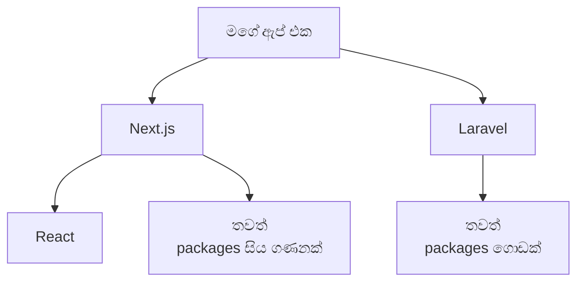
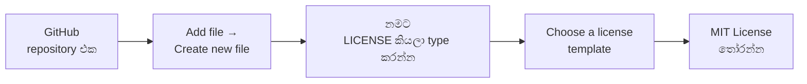

# OSS සහ බලපත්‍ර (License) ගැන

> 🇯🇵 මුල් පිටපත (ජපන් භාෂාවෙන්): [OSSとライセンスについて.md](<../../../2年生_システム開発実践/後期/2026_12_18/OSSとライセンスについて.md>) <!-- original-ja-link -->

ස්වාධීන නිර්මාණයේදී අපි භාවිතා කරන Laravel, Next.js, React, Tailwind CSS කියන ඔක්කොම **නොමිලේ** භාවිතා කරන්න පුළුවන්.
ඒකට හේතුව, මේවා **OSS (විවෘත කේත මෘදුකාංග / Open Source Software)** වීමයි.
මෙතනදී අපි OSS ගැනත්, ඒවා භාවිතා කරනකොට පිළිපදින්න ඕනේ **බලපත්‍ර (license)** ගැනත් බලමු.

[ස්වාධීන නිර්මාණයට ආපසු යන්න](../2026_10_09/2026_10_09_資料1.md)

---

## 1. OSS කියන්නේ මොකක්ද

**OSS (Open Source Software / විවෘත කේත මෘදුකාංග)** කියන්නේ, **source code එක (ප්‍රෝග්‍රෑම් එකේ ඇතුළත) ප්‍රසිද්ධියේ පළ කරලා තියෙන**,
තීරණය කරපු නීති පිළිපැද්දොත් **ඕනම කෙනෙකුට නිදහසේ භාවිතා කරන්න, වෙනස් කරන්න, බෙදාහරින්න පුළුවන්** මෘදුකාංගයි.

| | OSS | OSS නොවන මෘදුකාංග |
|---|---|---|
| Source code | **ප්‍රසිද්ධියේ පළ කරලා තියෙනවා** | පළ කරලා නැහැ (සමාගම ඇතුළේ විතරයි) |
| වෙනස් කිරීම | නීති පිළිපැද්දොත් පුළුවන් | බැහැ |
| උදාහරණ | Laravel, Next.js, React, MySQL, Linux, VS Code එකේ පදනම වෙලා තියෙන කෝඩ් | Windows, Microsoft Office, Photoshop |

> 💡 **උදාහරණයක් විදියට කිව්වොත් "රෙසිපියක් ප්‍රසිද්ධ කිරීම"**
> කෑම රෙසිපියක් අන්තර්ජාලයේ පළ කරලා, "නිදහසේ හදන්න. ඔයාට ඕනේ විදියට වෙනස් කළත් කමක් නැහැ. හැබැයි, **මුල් රෙසිපිය හදපු කෙනාගේ නම සඳහන් කරන්න**" කියනවා —
> මේක තමයි OSS වල අදහස. මේ "හැබැයි 〇〇" කියන කොටස තමයි **බලපත්‍රය (license)**.

---

## 2. අපි වටේ තියෙන OSS

ස්වාධීන නිර්මාණයේ ඇප් එකත්, ඇත්තටම **OSS ගොඩකින් හැදුණු එකක්**.

`npm install` හෝ `composer install` වලින් install කරන දේවල් (`node_modules` හෝ `vendor` ඇතුළේ තියෙන දේවල්) වලින් වැඩි හරියක්ම OSS.
ලෝකය පුරා ඉන්න අය හදපු OSS නිසා, **මුල ඉඳන්ම හැමදේම අපිම හදන්නේ නැතුව** ඇප් හදන්න පුළුවන් වෙලා තියෙනවා.

---

## 3. බලපත්‍රය (License) කියන්නේ මොකක්ද

**බලපත්‍රය (license)** කියන්නේ, "මේ මෘදුකාංගය **භාවිතා කළ හැක්කේ කෙසේද**" කියලා තීරණය කරපු **නීති** යි.
OSS නිදහසේ භාවිතා කරන්න පුළුවන්, ඒත් **ඕනම දෙයක් කරන්න පුළුවන් කියලා නෙවෙයි**. බලපත්‍රයේ ලියලා තියෙන නීති පිළිපදින්න ඕනේ.

### නිතර දකින බලපත්‍ර

| බලපත්‍රය | ලිහිල් බව | නීති (සරලව) | භාවිතා කරන උදාහරණ |
|----------|------|-----------------|-----------|
| **MIT** | ගොඩක් ලිහිල් | **copyright සහ බලපත්‍රයේ පාඨය තියාගත්තොත්**, ඕනම දෙයකට භාවිතා කරන්න පුළුවන් (සල්ලි අය කරන ඇප් එකකට වුණත් OK) | Laravel, Next.js, React, Tailwind CSS |
| **Apache 2.0** | ලිහිල් | MIT වලට බොහෝ දුරට සමානයි. **වෙනස් කළා කියලා සඳහන් කිරීම** වගේ නීති ටිකක් වැඩියි | TypeScript, Kubernetes |
| **GPL** | ටිකක් දැඩියි | GPL කෝඩ් භාවිතා කරපු මෘදුකාංගයක් **බෙදාහරිනවා** නම්, **ඔයාගේ කෝඩ් එකත් GPL යටතේ පළ කරන්න** ඕනේ | Linux, WordPress |

> 📝 **GPL වගේ බලපත්‍රවලට "copyleft" කියලා කියනවා**
> "නිදහසේ භාවිතා කරන්න, හැබැයි ඒක භාවිතා කරලා හදන දේත් **ඒ විදියටම නිදහස්** කරන්න" කියන අදහසයි.
> සමාගමක ඇප් හදනකොට, භාවිතා කරන OSS වල බලපත්‍ර **අනිවාර්යයෙන්ම පරීක්ෂා කරනවා**.

---

## 4. ඔයාගේ ඇප් එකට බලපත්‍රයක් එකතු කරමු

GitHub එකේ පළ කරපු ඔයාගේ repository එකටත් බලපත්‍රයක් එකතු කරන්න පුළුවන්.

> ⚠️ **බලපත්‍රයක් නැත්නම්, අනිත් අයට නිදහසේ භාවිතා කරන්න බැහැ**
> public repository එකක් වුණත්, බලපත්‍රයක් නැත්නම්, **අනිත් අයට කෝඩ් එක භාවිතා කරන්න, වෙනස් කරන්න අවසර දීලා නැහැ** කියන එකයි අදහස් වෙන්නේ.
> "අනිත් අය නිදහසේ භාවිතා කරනවාට කැමතියි" නම් MIT, "බලන්න විතරයි (භාවිතා කරනවාට කැමති නැහැ)" නම් බලපත්‍රයක් නැතුව තියන්න කියලා හිතන්න.

---

## 5. කෝඩ් වලට අමතරවත් "අයිතිවාසිකම්" තියෙනවා

ඇප් එකට දාන **පින්තූර, චිත්‍ර, icons, fonts, සංගීතය** වලටත්, ඒවා හදපු කෙනාගේ **copyright (කර්තෘ අයිතිය)** තියෙනවා.

| ✕ කරන්න එපා | ◯ මෙහෙම කරන්න |
|----------------|----------|
| අන්තර්ජාලයේ search කරලා හොයාගත්ත පින්තූරයක් ඒ විදියටම භාවිතා කිරීම | **නොමිලේ භාවිතා කළ හැකි සම්පත් (free assets)** (භාවිත කොන්දේසි බලන්න) හෝ, ඔයාම හදපු / ගත්ත පින්තූර භාවිතා කරන්න |
| anime හෝ game වල චරිතවල පින්තූර ඇප් එකට දාලා පළ කිරීම | පළ කරන ඇප් එකක භාවිතා කරන්න එපා. භාවිතා කරනවා නම් **නිල මාර්ගෝපදේශ (official guidelines)** පරීක්ෂා කරන්න |
| free assets වල භාවිත කොන්දේසි කියවන්නේ නැතුව භාවිතා කිරීම | "credit (නිර්මාණකරුගේ නම) පෙන්වන්න ඕනේ" වගේ නීති පිළිපදින්න |

> 💡 **icons සහ fonts සඳහා OSS ඒවා පහසුයි**
> icons සඳහා **Heroicons, Lucide**, fonts සඳහා **Google Fonts** වගේ, නොමිලේ පළ කරලා තියෙන ඒවා තියෙනවා.
> බලපත්‍රය පරීක්ෂා කරලා භාවිතා කරන්න.

> ⚠️ **portfolio එකේදී විශේෂයෙන් සැලකිලිමත් වෙන්න**
> portfolio එක කියන්නේ **සමාගම්වල අයට පෙන්නන දෙයක්**. අයිතිවාසිකම්වලට ගරු නොකර භාවිතා කළ පින්තූරයක් ඒකේ තිබුණොත්, ඒකෙන්ම **ඔයා ගැන ඇතිවෙන හැඟීම ගොඩක් නරක් වෙනවා**.

---

## 6. OSS වලට "ආපසු දායක වෙමු"

OSS හදන්නේ ලෝකය පුරා ඉන්න අය, **ස්වේච්ඡාවෙන් හෝ රැකියාවක් විදියට**. භාවිතා කරනවා විතරක් නෙවෙයි, ආපසු දායක වෙන්නත් ක්‍රම තියෙනවා.

| දායක වෙන ක්‍රමය | විස්තරය |
|-----------|------|
| ⭐ **Star** | GitHub එකේ, ඔයා භාවිතා කරන OSS repository එකට star එකක් දෙන්න (ලේසිම ක්‍රමය) |
| 🐛 **Issue** | bug එකක් හම්බුණොත්, Issue එකකින් වාර්තා කරන්න |
| 📝 **Documentation නිවැරදි කිරීම** | විස්තරවල වැරදි හෝ අකුරු වැරදි pull request එකකින් හදන්න |
| 🔧 **කෝඩ් නිවැරදි කිරීම** | bug එකක් නිවැරදි කරන pull request එකක් යවන්න |

OSS එකකට pull request එකක් යවලා ඒක merge වුණු අත්දැකීම, රැකියා සොයනකොටත් **ලොකු වාසියක්** වෙනවා.

---

## 7. සාරාංශය

- **OSS** = source code එක පළ කරලා තියෙන, නීති පිළිපැද්දොත් **ඕනම කෙනෙකුට භාවිතා කරන්න, වෙනස් කරන්න පුළුවන්** මෘදුකාංග
- Laravel, Next.js, React ත් OSS. ඔයාගේ ඇප් එක **OSS ගොඩකින් හැදුණු එකක්**
- **බලපත්‍රය (license)** = භාවිතා කරන්න පුළුවන් කොහොමද කියන නීති. **MIT** (ගොඩක් ලිහිල්), **GPL** (ඔයාගේ කෝඩ් එකත් පළ කරන්න වෙන අවස්ථා තියෙනවා) වගේ
- ඔයාගේ repository එකටත් **LICENSE** file එකක් එකතු කරලා බලපත්‍රයක් දාන්න පුළුවන්
- පින්තූර, icons, fonts, සංගීතය වලටත් **copyright** තියෙනවා. portfolio එකේදී විශේෂයෙන් සැලකිලිමත් වෙන්න
- භාවිතා කරනවා විතරක් නෙවෙයි, **Star, Issue, pull request** වලින් ආපසු දායක වෙන්න පුළුවන්

[ස්වාධීන නිර්මාණයට ආපසු යන්න](../2026_10_09/2026_10_09_資料1.md)
