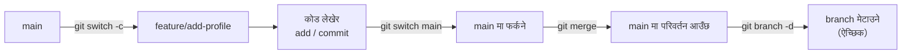
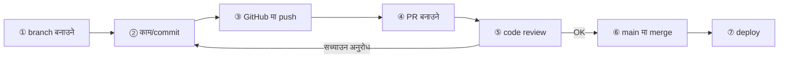
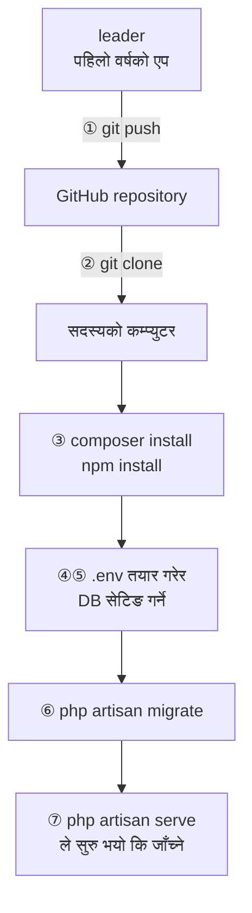

# Git टिम विकासको तयारी

> 🇯🇵 मूल प्रति (जापानी भाषामा): [2026_04_30.md](<../../../2年生_システム開発実践/前期/2026_04_30/2026_04_30.md>) <!-- original-ja-link -->

---

## Git पुनरावलोकन + branch / merge

### आजको लक्ष्य
- पहिलो वर्षमा सिकेको commit/push दोहोर्याउने
- branch को अवधारणा बुझेर प्रयोग गर्न सक्ने
- merge गर्ने तरिका थाहा पाउने

---

### branch भनेको के हो

**branch = कामको "शाखा"। मुख्य कोड नबिगारी नयाँ सुविधा विकास गर्न सकिन्छ**

```
main (production branch)
  │
  ├── feature/login    ← login सुविधा विकास हुँदै
  ├── feature/search   ← search सुविधा विकास हुँदै
  └── bugfix/404-error ← bug सच्याउँदै
```

```bash
# हालको branch हेर्ने
git branch
# → * main (* लागेको नै हालको branch हो)

# नयाँ branch बनाएर त्यसमा जाने
git checkout -b feature/add-profile
# वा (Git 2.23 वा पछिको संस्करणमा)
git switch -c feature/add-profile

# branch को सूची देखाउने
git branch -a   # -a ले remote branch पनि देखाउँछ

# main मा फर्कने
git switch main

# branch मेटाउने
git branch -d feature/add-profile
```

---

### merge — branch जोड्ने

कामका लागि बनाएको branch मा गरेका परिवर्तनलाई अन्त्यमा main मा समावेश गर्नुलाई merge भनिन्छ।



```bash
# ① feature/add-profile branch मा काम गरेर commit गर्ने
git switch feature/add-profile
# ... कोड लेख्ने ...
git add .
git commit -m "プロフィール画面を追加"

# ② main branch मा फर्कने
git switch main

# ③ feature/add-profile का परिवर्तन main मा समावेश गर्ने
git merge feature/add-profile

# ④ merge पछि branch मेटाउने (ऐच्छिक)
git branch -d feature/add-profile
```

---

### conflict (टकराव) को समाधान

```bash
# २ जनाले एउटै लाइन परिवर्तन गरेमा, merge गर्दा conflict हुन्छ
# conflict भएको फाइल खोल्दा...

<<<<<<< HEAD
  echo "Aさんが書いたコード";
=======
  echo "Bさんが書いたコード";
>>>>>>> feature/b-work

# ↑ यसलाई हातैले सही कोडमा सच्याउने
# सच्याएपछि:
git add .
git commit -m "コンフリクトを解消"
```

---

## कक्षा 02: GitHub Flow — PR/code review

### GitHub Flow भनेको के हो

टिममा विकास गर्नका लागि बनाइएका नियमहरू हुन्।

```
① main बाट कामको branch बनाउने
      git switch -c feature/xxxx

② branch मा काम/commit गर्ने
      git add .
      git commit -m "सन्देश"

③ GitHub मा push गर्ने
      git push origin feature/xxxx

④ Pull Request (PR) बनाउने
      → GitHub मा "यो कोड main मा राख्न चाहन्छु" भनेर अनुरोध गर्ने

⑤ टिमका सदस्यहरूले code review गर्ने
      → comment लेख्ने, सच्याउन अनुरोध गर्ने आदि

⑥ समस्या छैन भने main मा merge गर्ने
⑦ deploy (production मा लागू गर्ने)
```

चित्रमा देखाउँदा यस्तो प्रवाह हुन्छ। review मा सच्याउन भनियो भने ② मा फर्केर सच्याएपछि फेरि push गर्नुहोस्।



### Pull Request कसरी लेख्ने

```markdown
## परिवर्तनको विवरण
- profile स्क्रिन थपियो
- प्रयोगकर्ताको नाम/icon देखाउन मिल्ने बनाइयो

## जाँच गरिदिनुपर्ने कुराहरू
- `/profile` मा पहुँच गर्दा सही रूपमा देखिन्छ कि देखिँदैन
- login नगरेको अवस्थामा `/login` मा redirect हुन्छ कि हुँदैन

## स्क्रिनसट
（तस्बिर संलग्न गर्ने）
```

### code review का मुख्य बुँदाहरू

- bug वा logic error छ कि छैन
- सुरक्षा सम्बन्धी समस्या छ कि छैन (XSS, SQL Injection आदि)
- कोड पढ्न सजिलो छ कि छैन
- test लेखिएको छ कि छैन (दोस्रो वर्षमा ऐच्छिक)

---

## कक्षा 03: पहिलो वर्षको एप टिममा चलाउने

### चरणहरू

leader ले GitHub मा राखेको एप सबै सदस्यले आ-आफ्नो कम्प्युटरमा चलाउन सक्ने अवस्थासम्म पुग्ने प्रक्रिया हो।



```bash
# ① टिम leader ले पहिलो वर्षको एप GitHub मा push गर्ने
git init
git remote add origin https://github.com/टिमको-नाम/app.git
git add .
git commit -m "initial commit"
git push -u origin main

# ② टिमका सदस्यहरूले clone गर्ने
git clone https://github.com/टिमको-नाम/app.git
cd app

# ③ dependency हरू इन्स्टल गर्ने
composer install
npm install

# ④ वातावरण सेटिङ
cp .env.example .env
php artisan key:generate

# ⑤ DB को सेटिङ (.env सम्पादन गर्ने)
# DB_DATABASE=app_db
# DB_USERNAME=root
# DB_PASSWORD=

# ⑥ migration
php artisan migrate

# ⑦ सुरु भयो कि जाँच्ने
php artisan serve
```

---

## सारांश

| command | अर्थ |
|---------|------|
| `git switch -c branch-को-नाम` | branch बनाएर त्यसमा जाने |
| `git switch main` | main मा फर्कने |
| `git merge branch-को-नाम` | branch लाई हालको branch मा जोड्ने |
| `git push origin branch-को-नाम` | remote मा branch push गर्ने |
| Pull Request (PR) | GitHub मा कोड merge गर्न अनुरोध गर्ने |
| code review | PR मा comment/सुझाव दिने |
