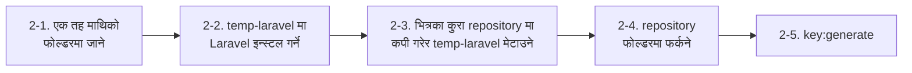
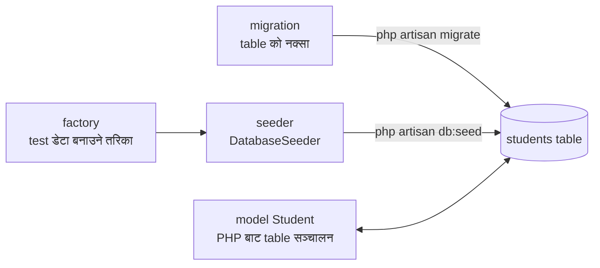

> 🇯🇵 मूल प्रति (जापानी भाषामा): [20260506.md](<../../../2年生_システム開発実践/前期/2026_05_06/20260506.md>) <!-- original-ja-link -->

## Laravel प्रोजेक्टको प्रारम्भिक सेटअप

> **उद्देश्य:** यो कक्षामा प्रयोग गर्ने Laravel प्रोजेक्ट सुरुदेखि बनाएर, API विकास सुरु गर्न सकिने अवस्थामा पुर्‍याउने।

---

### सुरुमा: चाहिने कुराहरू इन्स्टल छन् कि छैनन् जाँच्ने

काम सुरु गर्नुअघि, चाहिने सफ्टवेयर इन्स्टल भएका छन् कि छैनन् जाँच्छौँ।  
terminal खोलेर, तलका command हरू **एक-एक लाइन गरी** चलाउनुहोस्।

---

#### PHP को जाँच

```bash
php --version
```

**OK भएमा:**
```
PHP 8.2.x (cli) ...  ← संस्करण देखियो भने OK
```

**NG भएमा (`command not found` वा `'php' は認識されていません` (पहिचान भएन) देखियो भने):**

PHP इन्स्टल भएको छैन। XAMPP इन्स्टल गर्नुभयो भने PHP र MySQL दुवै एकैसाथ प्रयोग गर्न सकिन्छ।

**Windows को हकमा:**
1. `https://www.apachefriends.org/` मा जानुहोस्
2. "XAMPP for Windows" डाउनलोड गरेर इन्स्टल गर्नुहोस्
3. इन्स्टल गरेपछि, `C:\xampp\php` लाई **environment variable PATH** मा थप्नुहोस्  
   (Start मेनुमा "環境変数" (environment variable) खोज्ने → "システム環境変数の編集" (system environment variable सम्पादन) → "環境変数" (environment variable) → "Path" छानेर "編集" (सम्पादन) → "新規" (नयाँ) बाट `C:\xampp\php` थप्ने)
4. terminal **बन्द गरेर फेरि खोल्नुहोस्**, र फेरि `php --version` चलाउनुहोस्

**Mac को हकमा:**
1. terminal मा तलको command चलाउनुहोस् (Homebrew छ भने)
   ```bash
   brew install php
   ```
2. Homebrew इन्स्टल छैन भने पहिले तलको command चलाउनुहोस्
   ```bash
   /bin/bash -c "$(curl -fsSL https://raw.githubusercontent.com/Homebrew/install/HEAD/install.sh)"
   ```

---

#### Composer को जाँच

```bash
composer --version
```

**OK भएमा:**
```
Composer version 2.x.x ...  ← संस्करण देखियो भने OK
```

**NG भएमा (`command not found` वा `'composer' は認識されていません` (पहिचान भएन) देखियो भने):**

Composer इन्स्टल भएको छैन। तलका चरणअनुसार इन्स्टल गर्नुहोस्।

**Windows को हकमा:**
1. `https://getcomposer.org/download/` मा जानुहोस्
2. "Composer-Setup.exe" डाउनलोड गरेर चलाउनुहोस्
3. इन्स्टल गर्दा PHP कहाँ छ भनेर सोधियो भने `C:\xampp\php\php.exe` तोक्नुहोस्
4. इन्स्टल पूरा भएपछि, terminal **बन्द गरेर फेरि खोल्नुहोस्**, र `composer --version` चलाउनुहोस्

**Mac को हकमा:**
```bash
brew install composer
```

---

#### MySQL को जाँच

```bash
mysql --version
```

**OK भएमा:**
```
mysql  Ver 8.0.x ...  ← संस्करण देखियो भने OK
```

संस्करण देखियो भने, त्यसपछि MySQL **सर्भर** चलिरहेको छ कि छैन जाँच्नुहोस्।

> **ध्यान दिनुहोस् (Mac):** `mysql --version` देखिए पनि, सर्भर इन्स्टल नभएको हुन सक्छ।  
> `mysql-client` (जडान गर्ने टुल मात्र) र `mysql` (सर्भर आफैँ) फरक-फरक कुरा हुन्।  
> तलका चरणअनुसार सर्भर चलिरहेको छ कि छैन अनिवार्य रूपमा जाँच्नुहोस्।

**Mac को हकमा:**
```bash
brew services list | grep mysql
```

| देखिने कुरा | अर्थ |
|------|------|
| `mysql  started` | सर्भर चलिरहेको छ। अर्को चरणमा जान सकिन्छ |
| `mysql  stopped` | सर्भर रोकिएको छ। तलको "सुरु गर्ने" चरणमा जानुहोस् |
| mysql को लाइन देखिँदैन | सर्भर आफैँ इन्स्टल भएको छैन। तलको "इन्स्टल गर्ने" चरणमा जानुहोस् |

**Windows (XAMPP) को हकमा:**  
XAMPP control panel खोलेर, MySQL को छेउमा रहेको "Start" बटन थिच्नुहोस्।  
"Running" देखियो भने सुरु भइसकेको हो।

**MySQL सर्भर stopped भएमा (सुरु गर्ने):**

```bash
# Mac को हकमा
brew services start mysql
```

XAMPP को हकमा control panel को "Start" बटन थिच्नुहोस्।

**MySQL सर्भर आफैँ इन्स्टल नभएमा (Mac):**

```bash
brew install mysql
brew services start mysql
```

> **जडान गर्दाको पासवर्डबारे**  
> `mysql -u root -p` चलाउँदा पासवर्ड सोधिन्छ।  
> Homebrew बाट नयाँ इन्स्टल गरेको हो भने **पासवर्ड हुँदैन**, त्यसैले सिधै Enter थिच्नुहोस्।  
> XAMPP मा पनि सुरुको सेटिङमा **पासवर्ड हुँदैन**।  
> आफैँले पासवर्ड राखेको याद छ भने त्यही पासवर्ड हाल्नुहोस्।

---

**NG भएमा (`command not found` वा `'mysql' は認識されていません` (पहिचान भएन) देखियो भने):**

MySQL इन्स्टल भएको छैन।

**Windows (XAMPP प्रयोग गर्ने हो भने):**
1. XAMPP इन्स्टल भइसकेको छ भने, `C:\xampp\mysql\bin` लाई environment variable PATH मा थप्नुहोस्  
   (PHP थप्दाकै चरणअनुसार, यस पटक `C:\xampp\mysql\bin` थप्नुहोस्)
2. terminal **बन्द गरेर फेरि खोल्नुहोस्**, र `mysql --version` चलाउनुहोस्

**Mac को हकमा:**
```bash
brew install mysql
brew services start mysql
```

---

> **त्यति गर्दा पनि समाधान भएन भने शिक्षकलाई भन्नुहोस्।**  
> संस्करण धेरै पुरानो (PHP 7 श्रृंखला आदि) छ भने पनि शिक्षकसँग सोध्नुहोस्।  
> **PHP 8.1 वा माथि/Composer 2 श्रृंखला/MySQL 8 श्रृंखला** सिफारिस गरिएका संस्करण हुन्।

---

### Step 1｜clone गरेको repository भित्र जाने

तपाईंसँग GitHub बाट clone गरिसकेको repository हुनुपर्छ।  
terminal खोलेर, त्यो फोल्डरभित्र जानुहोस्।

**Windows को हकमा (PowerShell वा Command Prompt):**
```bash
cd C:\Users\（आफ्नो-प्रयोगकर्ता-नाम）\Documents\（repository-को-नाम）
```

**Mac को हकमा:**
```bash
cd ~/Documents/（repository-को-नाम）
```

सही ठाउँमा पुगियो कि जाँच्नुहोस्:
```bash
pwd
```
```
/Users/（आफ्नो-प्रयोगकर्ता-नाम）/Documents/（repository-को-नाम）  ← repository भित्र हुनुहुन्छ भने OK
```

Git repository को रूपमा पहिचान भएको छ कि छैन पनि जाँचौँ:
```bash
git status
```
```
On branch main
nothing to commit, working tree clean  ← यस्तो देखियो भने OK
```

> **`git status` चलाउँदा error आयो भने** (`not a git repository` आदि)  
> repository भित्र पुग्नुभएको छैन। फोल्डरको नाम जाँचेर, फेरि `cd` गर्नुहोस्।

---

### Step 2｜Laravel इन्स्टल गर्ने

clone गरेको फोल्डरमा `git clone` ले आफैँ बनाएको `.git` फोल्डर हुन्छ।  
`composer create-project laravel/laravel .` फोल्डर पूरै खाली नभई चल्दैन, त्यसैले error आउँछ।

```
Project directory "..." is not empty.  ← यो error आउँछ
```

> **`.git` लुकेको (hidden) फोल्डर भएकाले Finder वा Explorer मा देखिँदैन।**  
> terminal मा `ls -a` चलाएर हेर्न सकिन्छ।

त्यसैले, **पहिले अर्कै फोल्डरमा बनाएर त्यसभित्रका कुरा सार्ने** तरिकाले अगाडि बढ्छौँ।



#### 2-1. एक तह माथिको फोल्डरमा जाने

```bash
cd ..
```

जाँच्नुहोस्:
```bash
pwd
```
```
/Users/（आफ्नो-प्रयोगकर्ता-नाम）/Documents  ← repository भन्दा एक तह माथि हुनुहुन्छ भने OK
```

#### 2-2. अस्थायी फोल्डरमा Laravel इन्स्टल गर्ने

```bash
composer create-project laravel/laravel temp-laravel
```

> चलाउन **२-५ मिनेट** लाग्छ। स्क्रिनमा धेरै अक्षरहरू बगिरहन्छन्, पर्खनुहोस्।  
> अन्त्यमा `Application ready!` देखियो भने सफल भयो।

#### 2-3. अस्थायी फोल्डरभित्रका कुरा repository फोल्डरमा सार्ने

**Mac को हकमा:**
```bash
cp -r temp-laravel/. （repository-को-नाम）/
rm -rf temp-laravel
```

**Windows को हकमा (PowerShell):**
```powershell
Copy-Item -Path temp-laravel\* -Destination （repository-को-नाम）\ -Recurse -Force
Copy-Item -Path temp-laravel\.* -Destination （repository-को-नाम）\ -Recurse -Force -ErrorAction SilentlyContinue
Remove-Item -Recurse -Force temp-laravel
```

> **（repository-को-नाम）** भएको ठाउँमा आफ्नो repository को फोल्डरको नाम राख्नुहोस्।

#### 2-4. repository फोल्डरमा फर्कने

```bash
cd （repository-को-नाम）
```

सही ठाउँमा पुगियो कि जाँच्नुहोस्:
```bash
pwd
```
```
/Users/（आफ्नो-प्रयोगकर्ता-नाम）/Documents/（repository-को-नाम）  ← repository भित्र हुनुहुन्छ भने OK
```

`app/` र `routes/` जस्ता फोल्डर बनेका छन् भने सफल भयो:
```bash
ls
```
```
README.md  app  artisan  bootstrap  composer.json  config  database  ...
```

#### 2-5. application key बनाउने

Laravel लाई session र encryption का लागि **application key** (गोप्य key) चाहिन्छ।  
अनिवार्य रूपमा चलाउनुहोस्।

```bash
php artisan key:generate
```

```
   INFO  Application key set successfully.
```

> यो command चलाउँदा, `.env` फाइलको `APP_KEY=` मा मान आफैँ सेट हुन्छ।  
> बिर्सनुभयो भने `MissingAppKeyException` भन्ने error स्क्रिन देखिन्छ।

**error आयो भने: `No APP_KEY variable was found in the .env file`**

`.env` फाइलमा `APP_KEY=` भएको लाइन छैन।  
VSCode मा `.env` खोलेर, फाइलको अन्त्यमा तलको १ लाइन थप्नुहोस्।

```dotenv
APP_KEY=
```

सेभ गरेपछि, फेरि चलाउनुहोस्:

```bash
php artisan key:generate
```

`APP_KEY=` पछि लामो string आफैँ भरियो भने सफल भयो।

**अहिलेसम्मको फोल्डर संरचना (मुख्य कुराहरू मात्र):**

```
（repository-को-नाम）/          ← clone गरेको फोल्डर (= Git repository)
├── app/
│   ├── Http/
│   │   └── Controllers/   ← controller राख्ने ठाउँ
│   └── Models/            ← model राख्ने ठाउँ
├── database/
│   ├── migrations/        ← table परिभाषा राख्ने ठाउँ
│   ├── factories/         ← test डेटा बनाउने सेटिङ
│   └── seeders/           ← test डेटा हाल्ने सेटिङ
├── routes/
│   ├── api.php            ← API को routing (यस पटक मुख्य रूपमा प्रयोग गर्ने)
│   └── web.php            ← Blade को routing (पहिलो वर्षमा प्रयोग गरेको)
└── .env                   ← DB जडान जानकारी आदिको सेटिङ फाइल
```

---

### Step 3｜database तयार गर्ने

#### phpMyAdmin भनेको के हो?

**phpMyAdmin** भनेको MySQL को database लाई ब्राउजरमै सञ्चालन गर्न सकिने व्यवस्थापन टुल हो।  
command नटाइप गरी, स्क्रिनमा क्लिक गरेरै database बनाउन/हेर्न/मेटाउन सकिन्छ।

| वातावरण             | phpMyAdmin खोल्ने तरिका                                                        |
| -------------- | ---------------------------------------------------------------------- |
| Windows (XAMPP) | XAMPP control panel को "Admin" बटन थिच्ने → ब्राउजरमा `http://localhost/phpmyadmin` खुल्छ |
| Mac (XAMPP)     | XAMPP control panel को "Admin" बटन थिच्ने → ब्राउजरमा `http://localhost/phpmyadmin` खुल्छ |
| Mac (Homebrew)  | phpMyAdmin छुट्टै इन्स्टल गर्नुपर्छ (पछि बताइने terminal को तरिका प्रयोग गर्नु सजिलो हुन्छ)                             |

---

#### 3-1. database बनाउने

**Windows को हकमा (XAMPP + phpMyAdmin):**

1. XAMPP control panel मा MySQL लाई "Start" गर्नुहोस्
2. ब्राउजरमा `http://localhost/phpmyadmin` खोल्नुहोस्
3. बायाँतिरको मेनुमा "**新規作成**" (नयाँ बनाउने) मा क्लिक गर्नुहोस्
4. तलका कुरा भरेर "**作成**" (बनाउने) बटन थिच्नुहोस्

   - **database को नाम:** `school_api`
   - **collation:** `utf8mb4_unicode_ci`

**Mac को हकमा (Homebrew):**

phpMyAdmin सेटअप गर्नु नपर्ने, terminal बाट बनाउने तरिकाले अगाडि बढ्छौँ।  
MySQL चलिरहेको छ भनेर जाँचेपछि मात्र चलाउनुहोस्।

```bash
mysql -u root
```
```sql
CREATE DATABASE school_api CHARACTER SET utf8mb4 COLLATE utf8mb4_unicode_ci;
EXIT;
```

> पासवर्ड राख्नुभएको छ भने `mysql -u root -p` टाइप गरेर पासवर्ड हाल्नुहोस्।

#### 3-2. `.env` फाइल सेट गर्ने

VSCode मा प्रोजेक्ट खोलेर, root मै रहेको `.env` फाइल खोल्नुहोस्।

```
（repository-को-नाम）/
└── .env   ← यो खोल्ने
```

> **⚠️ ध्यान दिनुहोस्: फाइलका सबै कुरा मेटाएर नयाँ नलेख्नुहोस्।**  
> `.env` मा पहिले नै `APP_KEY` लगायत धेरै सेटिङ लेखिएका छन्।  
> **DB सम्बन्धी ५ लाइन मात्र खोजेर मान बदल्नुहोस्। अरू लाइनहरू नछुनुहोस्।**

फाइलमा तलतिर scroll गर्दा, यस्ता लाइनहरू भेटिन्छन्।  
यी ५ लाइनको `=` को दायाँपट्टिको भाग मात्र बदल्नुहोस्:

```dotenv
DB_CONNECTION=mysql
DB_HOST=127.0.0.1
DB_PORT=3306
DB_DATABASE=school_api    ← भर्खरै बनाएको DB को नाममा बदल्ने
DB_USERNAME=root           ← MySQL को प्रयोगकर्ता नाम (सामान्यतया root)
DB_PASSWORD=               ← पासवर्ड राख्नुभएको छैन भने खाली नै छोड्ने
```

बदलेपछि **Ctrl+S** (Mac मा **Cmd+S**) थिचेर सेभ गर्नुहोस्।

> **`.env` पासवर्ड लेखिएको सेटिङ फाइल हो।**  
> यो Git मा आफैँ समावेश नहुने गरी मिलाइएको छ, त्यसैले अरूलाई नदेखाउनुहोस्।

---

### Step 4｜model/migration/factory बनाउने

यो कक्षामा **विद्यार्थी (Student)** व्यवस्थापन गर्ने API बनाउँछौँ।  
तलको १ वटा command ले चाहिने सबै फाइल एकैपटक बनाउन सकिन्छ।

```bash
php artisan make:model Student -mf
```

| option | अर्थ                  | बन्ने फाइल                                             |
| ----- | ------------------- | ---------------------------------------------------- |
| (केही नराख्दा)  | model बनाउँछ              | `app/Models/Student.php`                             |
| `-m`  | migration (table परिभाषा) पनि बनाउँछ | `database/migrations/xxxx_create_students_table.php` |
| `-f`  | factory (test डेटा बनाउने) पनि बनाउँछ  | `database/factories/StudentFactory.php`              |

बन्ने ३ वटा फाइल र पछि प्रयोग गर्ने seeder एकअर्कासँग यसरी जोडिएका छन्।



चलाएपछि तल जस्तो देखियो भने सफल भयो:

```
   INFO  Model [app/Models/Student.php] created successfully.
   INFO  Factory [database/factories/StudentFactory.php] created successfully.
   INFO  Migration [database/migrations/2024_xx_xx_create_students_table.php] created successfully.
```

---

### Step 5｜model सम्पादन गर्ने (`$fillable` को सेटिङ)

बनेको `app/Models/Student.php` लाई VSCode मा खोल्नुहोस्।

```
school-api/
└── app/
    └── Models/
        └── Student.php   ← यो खोल्ने
```

फाइल खोल्दा तल जस्तो सामग्री हुन्छ। `$fillable` थप्नुहोस्:

```php
<?php
namespace App\Models;

use Illuminate\Database\Eloquent\Factories\HasFactory;
use Illuminate\Database\Eloquent\Model;

class Student extends Model
{
    use HasFactory;

    // ↓ यो १ लाइन थप्ने
    protected $fillable = ['name', 'email', 'score'];
}
```

> **`$fillable` भनेको के हो?**  
> Laravel को सुरक्षा सुविधा हो। यहाँ लेखिएका column हरू मात्र `create()` र `update()` बाट बदल्न मिल्ने हुन्छ।  
> यो सेट गरिएन भने, पछि API बाट डेटा सेभ गर्दा error आउँछ।

---

### Step 6｜migration फाइल सम्पादन गर्ने

`database/migrations/` फोल्डर VSCode मा खोल्दा, मितिबाट सुरु हुने फाइलहरू लहरै देखिन्छन्।

```
school-api/
└── database/
    └── migrations/
        ├── 0001_01_01_000000_create_users_table.php    ← Laravel ले सुरुदेखि नै तयार गरेको
        ├── 0001_01_01_000001_create_cache_table.php    ← Laravel ले सुरुदेखि नै तयार गरेको
        ├── 0001_01_01_000002_create_jobs_table.php     ← Laravel ले सुरुदेखि नै तयार गरेको
        └── 2024_xx_xx_xxxxxx_create_students_table.php ← ← Step4 मा बनेको (यसलाई सम्पादन गर्ने)
```

**सबैभन्दा तलको `create_students_table.php` खोलेर**, `up()` method भित्रको भाग बदल्नुहोस्:

```php
public function up(): void
{
    Schema::create('students', function (Blueprint $table) {
        $table->id();                              // ID (स्वतः क्रमसँग बढ्ने नम्बर)
        $table->string('name', 100);              // पूरा नाम
        $table->string('email')->unique();         // इमेल ठेगाना (दोहोरिन नमिल्ने)
        $table->integer('score')->default(0);     // अङ्क (सुरुको मान 0)
        $table->timestamps();                      // बनाइएको मिति र समय/अपडेट गरिएको मिति र समय (स्वतः)
    });
}
```

---

### Step 7｜migration चलाएर table बनाउने

```bash
php artisan migrate
```

सफल भयो भने तल जस्तो देखिन्छ:

```
   INFO  Running migrations.

  0001_01_01_000000_create_users_table ................... 21ms DONE
  0001_01_01_000001_create_cache_table ................... 10ms DONE
  0001_01_01_000002_create_jobs_table .................... 10ms DONE
  2024_xx_xx_xxxxxx_create_students_table ............... 15ms DONE
```

table बन्यो कि जाँच्नुहोस्।

**Windows को हकमा (phpMyAdmin):**  
ब्राउजरमा `http://localhost/phpmyadmin` खोलेर, बायाँतिरको `school_api` मा क्लिक गर्दा `students` table देखिनुपर्छ।

**Mac को हकमा (terminal):**
```bash
mysql -u root -e "SHOW TABLES IN school_api;"
```
```
+----------------------+
| Tables_in_school_api |
+----------------------+
| cache                |
| jobs                 |
| migrations           |
| students             |  ← यो देखियो भने OK
| users                |
+----------------------+
```

#### प्रायः आउने error र समाधान

**error 1: DB सँग जडान हुँदैन**
```
SQLSTATE[HY000] [2002] Connection refused
```
→ MySQL चलिरहेको छैन।  
→ **Windows:** XAMPP control panel मा MySQL लाई "Start" गर्नुहोस्।  
→ **Mac:** `brew services start mysql` चलाउनुहोस्।

**error 2: database भेटिँदैन**
```
SQLSTATE[HY000] [1049] Unknown database 'school_api'
```
→ Step3 मा database बनाउनुभएको छैन, वा `.env` मा database को नाम फरक छ।  
→ **Windows:** phpMyAdmin मा database को नाम जाँच्नुहोस्।  
→ **Mac:** `mysql -u root -e "SHOW DATABASES;"` ले database को सूची जाँच्नुहोस्।

**error 3: पासवर्ड मिलेन**
```
SQLSTATE[HY000] [1045] Access denied for user 'root'@'localhost'
```
→ `.env` को `DB_PASSWORD` गलत छ। MySQL को पासवर्ड जाँचेर फेरि लेख्नुहोस्।

---

### Step 8｜test डेटा हाल्ने

API ले काम गर्छ कि गर्दैन जाँच्न प्रयोग गरिने test डेटा तयार गर्छौँ।

#### 8-1. factory सम्पादन गर्ने

`database/factories/StudentFactory.php` खोल्नुहोस्।

```
school-api/
└── database/
    └── factories/
        └── StudentFactory.php   ← यो खोल्ने
```

`definition()` method भित्रको भाग बदल्नुहोस्:

```php
public function definition(): array
{
    return [
        'name'  => $this->faker->name(),                      // random नाम
        'email' => $this->faker->unique()->safeEmail(),        // random इमेल
        'score' => $this->faker->numberBetween(0, 100),        // 0-100 को random अङ्क
    ];
}
```

#### 8-2. seeder सम्पादन गर्ने

`database/seeders/DatabaseSeeder.php` खोलेर, `run()` method मा १ लाइन थप्नुहोस्:

```php
public function run(): void
{
    \App\Models\Student::factory(10)->create(); // विद्यार्थीको डेटा १० वटा बनाउने
}
```

#### 8-3. test डेटा हाल्ने

```bash
php artisan db:seed
```

```
   INFO  Seeding database.
```

डेटा हालियो कि जाँच्नुहोस्।

**Windows को हकमा (phpMyAdmin):**  
`http://localhost/phpmyadmin` खोलेर, `school_api` → `students` मा क्लिक गर्दा १० वटा डेटा देखिन्छन्।

**Mac को हकमा (terminal):**
```bash
mysql -u root -e "SELECT COUNT(*) FROM school_api.students;"
```
```
+----------+
| COUNT(*) |
+----------+
|       10 |  ← 10 देखियो भने OK
+----------+
```

---

### Step 9｜development सर्भर सुरु गर्ने

```bash
php artisan serve
```

```
   INFO  Server running on [http://127.0.0.1:8000].

  Press Ctrl+C to stop the server
```

ब्राउजरमा `http://localhost:8000` मा गएर, "Laravel" को लोगो देखियो भने सफलतापूर्वक सुरु भयो।

> **यो मुख्य स्क्रिन सर्भर चलिरहेको छ भनेर जाँच्ने स्क्रिन मात्र हो।**  
> seeder बाट हालेको डेटा database भित्र छ, यो स्क्रिनमा देखिँदैन।  
> अर्को कक्षामा API endpoint बनाएपछि मात्र डेटा प्राप्त गरेर देखाउन सकिन्छ।

> **सर्भर रोक्न `Ctrl + C` थिच्नुहोस्।**  
> सर्भर चलिरहेको बेला terminal बन्द नगर्नुहोस्।

#### seeder को डेटा सही रूपमा हालिएको छ कि छैन जाँच्न चाहनुहुन्छ भने

**Mac को हकमा (terminal मा जाँच्ने):**

```bash
mysql -u root -e "SELECT id, name, score FROM school_api.students LIMIT 5;"
```

```
+----+------------------+-------+
| id | name             | score |
+----+------------------+-------+
|  1 | Tanaka Taro      |    72 |
|  2 | Yamada Hanako    |    88 |
...
+----+------------------+-------+
```

यसरी random डेटा देखियो भने seeder सफल भएको हो।

**Windows को हकमा (phpMyAdmin मा जाँच्ने):**

`http://localhost/phpmyadmin` खोलेर, `school_api` → `students` मा क्लिक गर्दा, १० वटा डेटा सूचीमा देखिन्छन्।

---

### यहाँसम्मको जाँच सूची

| जाँच्ने कुरा | चेक |
|---------|---------|
| `php --version` / `composer --version` ले संस्करण देखायो | □ |
| `composer create-project` ले प्रोजेक्ट बनाउन सकियो | □ |
| `php artisan key:generate` ले application key बनायो | □ |
| `school_api` database बनायो | □ |
| `.env` मा DB जडान जानकारी सेट गर्यो | □ |
| `app/Models/Student.php` मा `$fillable` थप्यो | □ |
| migration फाइलमा column थप्यो | □ |
| `php artisan migrate` ले `students` table बनाउन सकियो | □ |
| `php artisan db:seed` ले test डेटा १० वटा हाल्यो | □ |
| `php artisan serve` ले सर्भर सुरु भयो, र ब्राउजरमा जाँच्न सकियो | □ |
