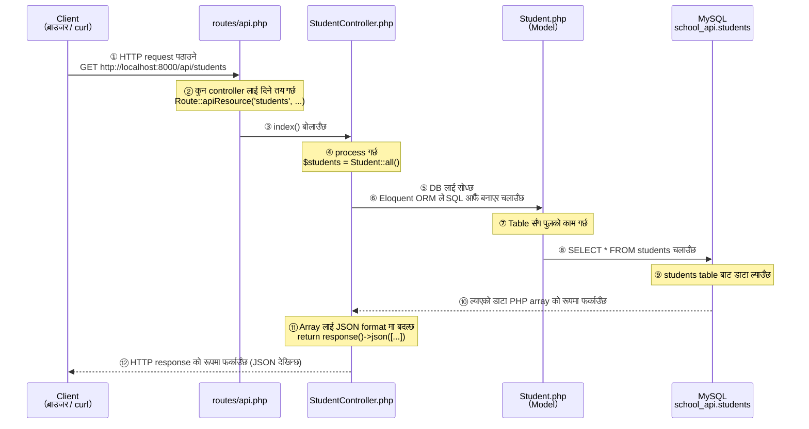
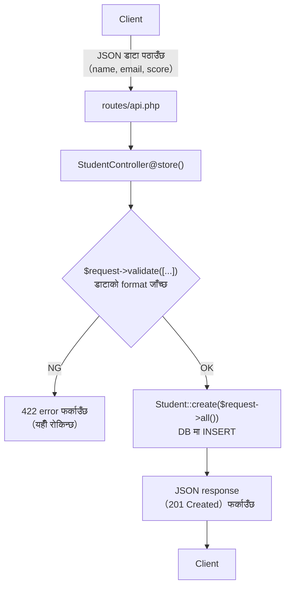

> 🇯🇵 मूल प्रति (जापानी भाषामा): [20260514.md](<../../../2年生_システム開発実践/前期/2026_05_14/20260514.md>) <!-- original-ja-link -->


## Blade एपलाई API मा बदल्ने

### आजको लक्ष्य
- REST API भनेको के हो भनेर बुझाउन सक्ने
- JSON response फर्काउने controller लेख्न सक्ने
- `api.php` को routing बुझ्ने

---

### REST API भनेको के हो

#### "API भनेको के हो?" एक वाक्यमा भन्दा

**API = "डाटा मात्र फर्काउने माध्यम"**

पहिलो वर्षमा, ब्राउजरबाट URL मा पहुँच गर्दा HTML (डिजाइनसहितको पेज) फर्किन्थ्यो।  
API ले पनि उही तरिका प्रयोग गर्छ, तर HTML को सट्टा **डाटा (JSON) मात्र** फर्काउँछ।

```
【Blade एप (पहिलो वर्षमा बनाएको)】
ब्राउजर → GET /students → सर्भर → HTML पेज फर्काउँछ
                                      ↑ टेबल, बटन, डिजाइन सबै समावेश

【REST API (आजदेखि बनाउने)】
ब्राउजर वा अन्य एप → GET /api/students → सर्भर → JSON डाटा मात्र फर्काउँछ
                                                      ↑ डिजाइन छैन, डाटा मात्र
```

> **किन JSON मात्र फर्काउने?**  
> React वा Vue जस्ता frontend ले "आफैँ डिजाइन बनाउँछन्", त्यसैले  
> सर्भरबाट "डाटा मात्र" पठाइदिए पुग्छ।  
> API बनाएपछि "React मा चल्ने एप", "मोबाइल एप" जस्ता धेरै फरक स्क्रिनबाट एउटै डाटा फेरि-फेरि प्रयोग गर्न सकिन्छ।

---

#### JSON कस्तो देखिन्छ?

**JSON (जेसन)** डाटा प्रस्तुत गर्ने एउटा text format हो।  
ब्राउजर र अन्य एपले सजिलै पढ्न सकून् भनेर यसको लेख्ने निश्चित नियम छ।

```json
{
    "status": "ok",
    "data": [
        {
            "id": 1,
            "name": "田中太郎",
            "email": "tanaka@example.com",
            "score": 85
        },
        {
            "id": 2,
            "name": "山田花子",
            "email": "yamada@example.com",
            "score": 72
        }
    ]
}
```

> **हेर्ने मुख्य कुरा:**  
> - `{ }` भित्र "key": "value" को रूपमा लेखिन्छ  
> - `[ ]` list हो (धेरै डाटा एकै ठाउँमा राख्छ)  
> - string लाई `"` भित्र राखिन्छ। संख्यालाई राखिँदैन  
> - अन्तिम item पछि comma `,` राखिँदैन

---

#### REST को सोच: URL र HTTP method को संयोजन

REST API मा "**URL (कहाँ)** × **HTTP method (के गर्ने)**" बाट के काम गर्ने भनेर तय हुन्छ।  
HTTP method भनेको request को प्रकार जनाउने शब्द हो।

| HTTP method | अर्थ | दैनिक कामसँग तुलना गर्दा |
|-------------|------|-------------------|
| `GET`       | ल्याउने | पेज हेर्ने, खोज्ने |
| `POST`      | नयाँ बनाउने | फारम पठाउने |
| `PUT/PATCH` | अपडेट गर्ने | सामग्री बदल्ने |
| `DELETE`    | मेटाउने | मेटाउने बटन थिच्ने |

यो कक्षामा बनाउने विद्यार्थी API को सूची:

| URL                  | Method      | अर्थ   | के गर्छ           |
| -------------------- | --------- | ---- | --------------- |
| `/api/students`      | GET       | सूची ल्याउने | सबै विद्यार्थीको डाटा फर्काउँछ      |
| `/api/students`      | POST      | नयाँ बनाउने | नयाँ विद्यार्थी दर्ता गर्छ      |
| `/api/students/{id}` | GET       | विवरण ल्याउने | तोकिएको एक जना विद्यार्थी फर्काउँछ    |
| `/api/students/{id}` | PUT/PATCH | अपडेट   | तोकिएको विद्यार्थीको जानकारी बदल्छ |
| `/api/students/{id}` | DELETE    | मेटाउने   | तोकिएको विद्यार्थी मेटाउँछ     |

> `{id}` मा संख्या आउँछ। जस्तै `GET /api/students/3` को अर्थ "id 3 भएको विद्यार्थी ल्याउने" हो।

---

### HTTP status code बारे

API को response मा सधैँ **status code** (संख्या) हुन्छ।  
ब्राउजर वा React ले यो संख्या हेरेर "सफल भयो कि असफल" भनेर छुट्याउँछ।

| Code | अर्थ | कहिले प्रयोग हुन्छ |
|-------|------|---------|
| `200 OK` | सफल | ल्याउने, अपडेट, मेटाउने काम सफल हुँदा |
| `201 Created` | बनाउन सफल | POST बाट नयाँ बनाउँदा |
| `404 Not Found` | भेटिएन | तोकिएको id अस्तित्वमा नहुँदा |
| `422 Unprocessable Entity` | Validation error | input मान सही नहुँदा |
| `500 Internal Server Error` | सर्भर error | प्रोग्राममा bug हुँदा |

> जस्तै `GET /api/students/999` मा id=999 भएको विद्यार्थी छैन भने,  
> "404" फर्काएर "भेटिएन" भनेर जानकारी दिइन्छ।

---

### Step 10｜API controller बनाउने

#### 10-1. Controller फाइल बनाउने

टर्मिनलमा तलको command चलाउनुहोस् (`php artisan serve` चलिरहेको टर्मिनलभन्दा **अर्को tab** खोल्नुहोस्)।

```bash
php artisan make:controller Api/StudentController --api
```

**Command को अर्थ:**
- `make:controller` → controller फाइल बनाउँछ
- `Api/StudentController` → `Api` फोल्डरभित्र `StudentController.php` बनाउँछ
- `--api` → API का लागि ५ वटा method पहिल्यै लेखिदिन्छ (`index` `store` `show` `update` `destroy`)

चलाएपछि तलको सन्देश देखियो भने सफल भयो:

```
   INFO  Controller [app/Http/Controllers/Api/StudentController.php] created successfully.
```

बनाइएको फाइल कहाँ छ भनेर जाँच्नुहोस्:

```
(repository को नाम)/
└── app/
    └── Http/
        └── Controllers/
            └── Api/                     ← नयाँ बनाइएको फोल्डर
                └── StudentController.php  ← यो बनाइयो
```

---

#### 10-2. Controller फाइल खोल्ने

VSCode मा `app/Http/Controllers/Api/StudentController.php` खोल्नुहोस्।  
`--api` option बाट बनाइएको फाइलमा सुरुदेखि नै यस्तो सामग्री हुन्छ:

```php
<?php

namespace App\Http\Controllers\Api;

use Illuminate\Http\Request;
use App\Http\Controllers\Controller;

class StudentController extends Controller
{
    public function index()
    {
        //
    }

    public function store(Request $request)
    {
        //
    }

    public function show(string $id)
    {
        //
    }

    public function update(Request $request, string $id)
    {
        //
    }

    public function destroy(string $id)
    {
        //
    }
}
```

> **`namespace` र `use` भनेको के हो?**  
> - `namespace` यो फाइलको "ठेगाना" जस्तै हो। यसले फाइल `Api` फोल्डरभित्र छ भनेर जनाउँछ।  
> - `use` अर्को फाइललाई "बोलाउने घोषणा" हो। `Student` model प्रयोग गर्न पछि थप्नेछौँ।

---

#### 10-3. Controller मा काम (process) लेख्ने

फाइलको सामग्री **सबै** तलको code ले बदल्नुहोस्।  
(Ctrl+A ले सबै select गरेर → paste गर्नुहोस्, वा पुरानो सामग्री मेटाएर लेख्नुहोस्)

```php
<?php

namespace App\Http\Controllers\Api;

use App\Http\Controllers\Controller;
use App\Models\Student;           // ← Student model प्रयोग गर्न मिल्ने बनाउँछ
use Illuminate\Http\Request;

class StudentController extends Controller
{
    // -------------------------------------------------------
    // GET /api/students  → सबै विद्यार्थीको सूची फर्काउँछ
    // -------------------------------------------------------
    public function index()
    {
        $students = Student::all();  // database बाट सबै record ल्याउँछ

        return response()->json([
            'status' => 'ok',
            'data'   => $students,   // ल्याएको डाटा JSON मा राखेर फर्काउँछ
        ]);
    }

    // -------------------------------------------------------
    // POST /api/students  → नयाँ विद्यार्थी दर्ता गर्छ
    // -------------------------------------------------------
    public function store(Request $request)
    {
        // Validation: पठाइएको डाटाको format जाँच्छ
        $request->validate([
            'name'  => 'required|max:100',          // अनिवार्य, १०० अक्षरभित्र
            'email' => 'required|email|unique:students', // अनिवार्य, email format, दोहोरिन नहुने
            'score' => 'required|integer|min:0|max:100', // अनिवार्य, पूर्णांक, ० देखि १०० सम्म
        ]);

        $student = Student::create($request->all()); // DB मा save गर्छ

        // 201 Created (बनाउन सफल) status code सहित फर्काउँछ
        return response()->json([
            'status' => 'ok',
            'data'   => $student,
        ], 201);
    }

    // -------------------------------------------------------
    // GET /api/students/{id}  → id ले तोकिएको एक जना फर्काउँछ
    // -------------------------------------------------------
    public function show($id)
    {
        $student = Student::find($id); // id बाट एउटा record खोज्छ

        if (!$student) {
            // भेटिएन भने → 404 Not Found फर्काउँछ
            return response()->json([
                'status'  => 'error',
                'message' => 'Student not found',
            ], 404);
        }

        return response()->json([
            'status' => 'ok',
            'data'   => $student,
        ]);
    }

    // -------------------------------------------------------
    // PUT /api/students/{id}  → id ले तोकिएको विद्यार्थी अपडेट गर्छ
    // -------------------------------------------------------
    public function update(Request $request, $id)
    {
        $student = Student::findOrFail($id); // भेटिएन भने आफैँ 404 फर्काउँछ

        $request->validate([
            'name'  => 'sometimes|max:100',          // sometimes = पठाइएको बेला मात्र जाँच्छ
            'score' => 'sometimes|integer|min:0|max:100',
        ]);

        $student->update($request->all()); // DB अपडेट गर्छ

        return response()->json([
            'status' => 'ok',
            'data'   => $student,
        ]);
    }

    // -------------------------------------------------------
    // DELETE /api/students/{id}  → id ले तोकिएको विद्यार्थी मेटाउँछ
    // -------------------------------------------------------
    public function destroy($id)
    {
        Student::findOrFail($id)->delete(); // खोजेर मेटाउँछ

        return response()->json([
            'status'  => 'ok',
            'message' => 'Deleted',
        ]);
    }
}
```

**बदलिसकेपछि Ctrl+S (Mac मा Cmd+S) थिचेर save गर्नुहोस्।**

---

#### हरेक method को भूमिकाको सारांश

| Method को नाम | सम्बन्धित URL | के गर्छ |
|-----------|------------|---------|
| `index()` | GET /api/students | सबै record ल्याएर JSON मा फर्काउँछ |
| `store()` | POST /api/students | Validation → DB मा save → 201 सहित फर्काउँछ |
| `show($id)` | GET /api/students/{id} | एउटा record खोज्छ → नभए 404 → JSON मा फर्काउँछ |
| `update($request, $id)` | PUT /api/students/{id} | एउटा record खोज्छ → Validation → DB अपडेट |
| `destroy($id)` | DELETE /api/students/{id} | एउटा record खोज्छ → मेटाउँछ |

---

### Step 11｜API routing सक्रिय गर्ने

Controller बनाएर मात्र URL र controller जोडिँदैनन्।  
"यो URL मा पहुँच गर्दा यो method बोलाउने" भन्ने **routing** सेट गर्नुपर्छ।

#### 11-1. `routes/api.php` बनाउने

> **⚠️ Laravel 11 देखि `routes/api.php` सुरुमा हुँदैन।**  
> तलको command चलाएपछि मात्र बन्छ।

```bash
php artisan install:api
```

चलाउँदा बीचमा २ पटक पुष्टि गर्न सोधिन्छ। दुवैमा `yes` (वा Enter key) थिचेर अगाडि बढ्नुहोस्।

---

**【पुष्टि 1】Migration चलाउने कि नचलाउने?**

```
   INFO  Published API routes file.

 One new database migration has been published. Would you like to run all pending database migrations? (yes/no) [yes]:
 > yes
```

> `routes/api.php` बनेपछि, migration अहिल्यै चलाउने कि भनेर सोधिन्छ।  
> `yes` वा Enter थिचेर अगाडि बढ्नुहोस्।

---

**【पुष्टि 2】Production वातावरणमा चलाउने पुष्टि**

```
                                                                    
                         APPLICATION IN PRODUCTION.                 
                                                                    

 ┌ Are you sure you want to run this command? ──────────────────┐
 │ Yes                                                          │
 └──────────────────────────────────────────────────────────────┘
```

> **"APPLICATION IN PRODUCTION (यो production वातावरण हो)" देखेर अचम्म लाग्न सक्छ, तर चिन्ता गर्नुपर्दैन।**  
> यो "साँच्चै चलाउने हो?" भनेर Laravel ले गर्ने सुरक्षा पुष्टि हो।  
> "Yes" छानेर अगाडि बढ्नुहोस्।

---

**Migration चल्छ**

```
   INFO  Running migrations.

  2026_xx_xx_xxxxxx_create_personal_access_tokens_table .......... DONE
```

> `personal_access_tokens` (personal access token) table बन्छ।  
> यो **Sanctum ले authentication को token save गर्ने table** हो।  
> कक्षा 07 मा authentication सुविधा बनाउँदा प्रयोग हुन्छ। अहिलेलाई "आफैँ बन्यो" भनेर मात्र सम्झे पुग्छ।

---

**अन्तिममा यो सन्देश देखियो भने सफल:**

```
   INFO  API scaffolding installed. Please add the [Laravel\Sanctum\HasApiTokens] trait to your User model.
```

> अन्तिमको `Please add the [Laravel\Sanctum\HasApiTokens] trait...` भनेको  
> "User model मा setting थप्नुहोस्" भन्ने निर्देशन हो, तर **यो कक्षा 07 मा गर्नेछौँ। अहिले बेवास्ता गरे हुन्छ।**

---

यो command ले गरेका कामहरू:
- `routes/api.php` फाइल बनाउने
- `bootstrap/app.php` मा API routing दर्ता गर्ने
- Laravel Sanctum (कक्षा 07 मा प्रयोग हुने authentication package) install गर्ने
- `personal_access_tokens` table को migration चलाउने

चलाएपछिको फोल्डर संरचना:

```
(repository को नाम)/
└── routes/
    ├── api.php   ← यो बन्यो (API को routing)
    └── web.php   ← यो Blade का लागि (यसपटक नछुने)
```

> **`api.php` र `web.php` को फरक**  
> - `web.php` … HTML फर्काउने route लेखिन्छ  
> - `api.php` … JSON फर्काउने API का लागि। URL को सुरुमा `/api/` आफैँ थपिन्छ

#### 11-2. Route थप्ने

VSCode मा `routes/api.php` खोल्नुहोस्। सुरुमा लगभग खाली हुन्छ। तल जस्तै बदल्नुहोस्:

```php
<?php

use Illuminate\Support\Facades\Route;
use App\Http\Controllers\Api\StudentController;  // ← यो line थप्नुहोस्

Route::apiResource('students', StudentController::class);
// ↑ यो एक लाइनले मात्र ५ वटा route आफैँ दर्ता गर्छ
```

**बदलिसकेपछि Ctrl+S (Mac मा Cmd+S) थिचेर save गर्नुहोस्।**

---

#### `Route::apiResource` ले दर्ता गर्ने route हेर्ने

`Route::apiResource('students', StudentController::class)` ले तलका ५ वटा route **एक line मै** एकैपटक दर्ता गर्छ।

जाँच्ने command:

```bash
php artisan route:list --path=api/students
```

```
  GET|HEAD   api/students ............. students.index  › Api\StudentController@index
  POST       api/students ............. students.store  › Api\StudentController@store
  GET|HEAD   api/students/{student} ... students.show   › Api\StudentController@show
  PUT|PATCH  api/students/{student} ... students.update › Api\StudentController@update
  DELETE     api/students/{student} ... students.destroy› Api\StudentController@destroy
```

> यिनलाई एक-एक गरी हातले लेख्दा ५ line हुन्छ, तर `apiResource` प्रयोग गर्दा एक line मै पुग्छ।

---

### Step 12｜ब्राउजरमा API ले काम गरेको जाँच्ने

Development server चलिरहेको छैन भने चलाउनुहोस्:

```bash
php artisan serve
```

#### 12-1. सूची ल्याउने (GET /api/students) ब्राउजरमा जाँच्ने

ब्राउजरमा तलको URL मा पहुँच गर्नुहोस्:

```
http://localhost:8000/api/students
```

तल जस्तो JSON देखियो भने सफल भयो:

```json
{
    "status": "ok",
    "data": [
        {
            "id": 1,
            "name": "Tanaka Taro",
            "email": "tanaka@example.com",
            "score": 72,
            "created_at": "2024-xx-xx ...",
            "updated_at": "2024-xx-xx ..."
        },
        ...
    ]
}
```

> **JSON नदेखिई error आयो भने तलका कुरा जाँच्नुहोस्।**

**प्रायः आउने error र समाधान:**

| Error | कारण | समाधान |
|-----------|------|-------|
| `Class "App\Http\Controllers\Api\StudentController" not found` | use गलत तरिकाले लेखिएको | `api.php` को `use` line जाँच्नुहोस् |
| `SQLSTATE[HY000] [2002] Connection refused` | MySQL चलिरहेको छैन | MySQL चलाउनुहोस् (XAMPP or `brew services start mysql`) |
| खाली पेज, 500 error | PHP को syntax error | `.storage/logs/laravel.log` खोलेर error हेर्नुहोस् |
| `{"message":""}` मात्र देखिन्छ | Route भेटियो तर process मा error भयो | Controller को सामग्री जाँच्नुहोस् |

---

#### 12-2. एउटा record ल्याउने (GET /api/students/{id}) ब्राउजरमा जाँच्ने

ब्राउजरमा तलको URL मा पहुँच गर्नुहोस् (id को संख्या आफ्नो database मा भएको अनुसार मिलाउनुहोस्):

```
http://localhost:8000/api/students/1
```

```json
{
    "status": "ok",
    "data": {
        "id": 1,
        "name": "Tanaka Taro",
        "email": "tanaka@example.com",
        "score": 72,
        "created_at": "2024-xx-xx ...",
        "updated_at": "2024-xx-xx ..."
    }
}
```

अस्तित्वमा नभएको id मा पहुँच गर्दा:

```
http://localhost:8000/api/students/999
```

```json
{
    "status": "error",
    "message": "Student not found"
}
```

यस्तो देखियो भने सही काम गरिरहेको छ।

---

#### 12-3. POST, PUT, DELETE लाई curl command बाट जाँच्ने

ब्राउजरको address bar बाट GET request मात्र पठाउन सकिन्छ।  
POST (नयाँ बनाउने), PUT (अपडेट), DELETE (मेटाउने) लाई **curl (कर्ल)** भन्ने command प्रयोग गरेर जाँचिन्छ।

> **curl भनेको के हो?**  
> टर्मिनलबाट HTTP request पठाउने command हो। Mac र Windows दुवैमा सुरुदेखि नै हुन्छ।  
> `php artisan serve` चलिरहेको टर्मिनलभन्दा **अर्को tab** मा चलाउनुहोस्।

---

**curl command का option कसरी पढ्ने:**

| Option | अर्थ |
|-----------|------|
| `-X POST` | HTTP method तोक्छ (POST / PUT / DELETE आदि) |
| `-H "Content-Type: application/json"` | "JSON पठाउँदैछु" भन्ने घोषणा |
| `-d '{...}'` | पठाउने डाटा (JSON format मा) |

---

**① नयाँ बनाउने (POST /api/students)**

**Mac को हकमा:**
```bash
curl -X POST http://localhost:8000/api/students \
  -H "Content-Type: application/json" \
  -d '{"name": "新しい生徒", "email": "new@example.com", "score": 90}'
```

**Windows (Command Prompt) को हकमा:**
```cmd
curl -X POST http://localhost:8000/api/students -H "Content-Type: application/json" -d "{\"name\": \"新しい生徒\", \"email\": \"new@example.com\", \"score\": 90}"
```

> Windows मा `"` लाई `\"` गरेर escape गर्नुपर्छ।

सफल भएको बेलाको response (status code `201 Created`):

```json
{"status":"ok","data":{"id":11,"name":"新しい生徒","email":"new@example.com","score":90,...}}
```

---

**② अपडेट (PUT /api/students/{id})**

id `1` भएको विद्यार्थीको score `95` मा बदल्ने उदाहरण:

**Mac को हकमा:**
```bash
curl -X PUT http://localhost:8000/api/students/1 \
  -H "Content-Type: application/json" \
  -d '{"score": 95}'
```

**Windows (Command Prompt) को हकमा:**
```cmd
curl -X PUT http://localhost:8000/api/students/1 -H "Content-Type: application/json" -d "{\"score\": 95}"
```

सफल भएको बेलाको response (status code `200 OK`):

```json
{"status":"ok","data":{"id":1,"name":"Tanaka Taro","email":"tanaka@example.com","score":95,...}}
```

---

**③ मेटाउने (DELETE /api/students/{id})**

id `1` भएको विद्यार्थी मेटाउने उदाहरण:

**Mac को हकमा:**
```bash
curl -X DELETE http://localhost:8000/api/students/1
```

**Windows (Command Prompt) को हकमा:**
```cmd
curl -X DELETE http://localhost:8000/api/students/1
```

सफल भएको बेलाको response (status code `200 OK`):

```json
{"status":"ok","message":"Deleted"}
```

---

**मेटाएपछि सूची हेर्नुहोस्, संख्या घटेको छ भने सफल भयो:**

```bash
curl http://localhost:8000/api/students
```

---

### Request कुन-कुन फाइल हुँदै जान्छ

`GET /api/students` ब्राउजर वा curl बाट पठाउँदा, भित्र कुन फाइलहरू क्रमैसँग चल्छन् भनेर हेरौँ।

---

#### पूरा प्रवाहको चित्र

माथिबाट तलतिर समयको क्रम देखाइएको छ। सिङ्गो रेखाको तीरले "जाने (request)" र थोप्लायुक्त रेखाको तीरले "फर्कने (response)" जनाउँछ।



---

#### हरेक फाइलको भूमिकाको सारांश

| फाइल | भूमिका | जिम्मा लिने step |
|---------|------|---------------|
| `routes/api.php` | "कुन URL → कुन controller" भनेर जोड्छ | ② |
| `app/Http/Controllers/Api/StudentController.php` | Request लिन्छ, process गर्छ, response फर्काउँछ | ④⑥⑪ |
| `app/Models/Student.php` | DB को table र PHP code बीच पुलको काम गर्छ | ⑦ |
| `Database (MySQL)` | डाटा साँच्चै save र खोज्ने काम गर्छ | ⑨ |

---

#### Eloquent ORM भनेको के हो (⑥⑦ को थप व्याख्या)

`Student::all()` लेख्दा मात्रै पनि Laravel ले आफैँ `SELECT * FROM students;` भन्ने SQL बनाएर चलाइदिन्छ।  
यो व्यवस्थालाई **Eloquent ORM (इलोक्वेन्ट)** भनिन्छ।

```php
// PHP मा लेख्ने कुरा        →  साँच्चै चल्ने SQL
Student::all()           →  SELECT * FROM students;
Student::find(1)         →  SELECT * FROM students WHERE id = 1 LIMIT 1;
Student::create([...])   →  INSERT INTO students (...) VALUES (...);
$student->update([...])  →  UPDATE students SET ... WHERE id = ?;
$student->delete()       →  DELETE FROM students WHERE id = ?;
```

> **SQL सिधै लेख्नु नपर्नु** ORM को फाइदा हो।  
> Model को class नाम (`Student`) आफैँ table नाम (`students`) सँग मेल खान्छ।

---

#### POST गर्दाको प्रवाहमा के फरक छ

`POST /api/students` (नयाँ बनाउने) मा पनि आधारभूत प्रवाह उस्तै हो, तर बीचमा **validation** थपिन्छ।



---

### यहाँसम्मको जाँच सूची

| जाँच्ने कुरा | Check |
|---------|---------|
| REST API भनेको "डाटा मात्र फर्काउने व्यवस्था" हो भनेर बुझाउन सक्छु | □ |
| JSON लेख्ने आधारभूत तरिका (`{}` `[]` `"key": "value"`) थाहा छ | □ |
| `php artisan make:controller Api/StudentController --api` चलाएँ | □ |
| `StudentController.php` मा ५ वटा method को code लेखेँ | □ |
| `php artisan install:api` चलाएर `routes/api.php` बनाएँ | □ |
| `routes/api.php` मा `Route::apiResource` थपेँ | □ |
| `php artisan route:list` मा ५ वटा route देखिए | □ |
| ब्राउजरमा `http://localhost:8000/api/students` मा पहुँच गर्दा JSON फर्कियो | □ |
| `http://localhost:8000/api/students/1` मा एउटा record को JSON फर्कियो | □ |
| `http://localhost:8000/api/students/999` मा 404 error को JSON फर्कियो | □ |
