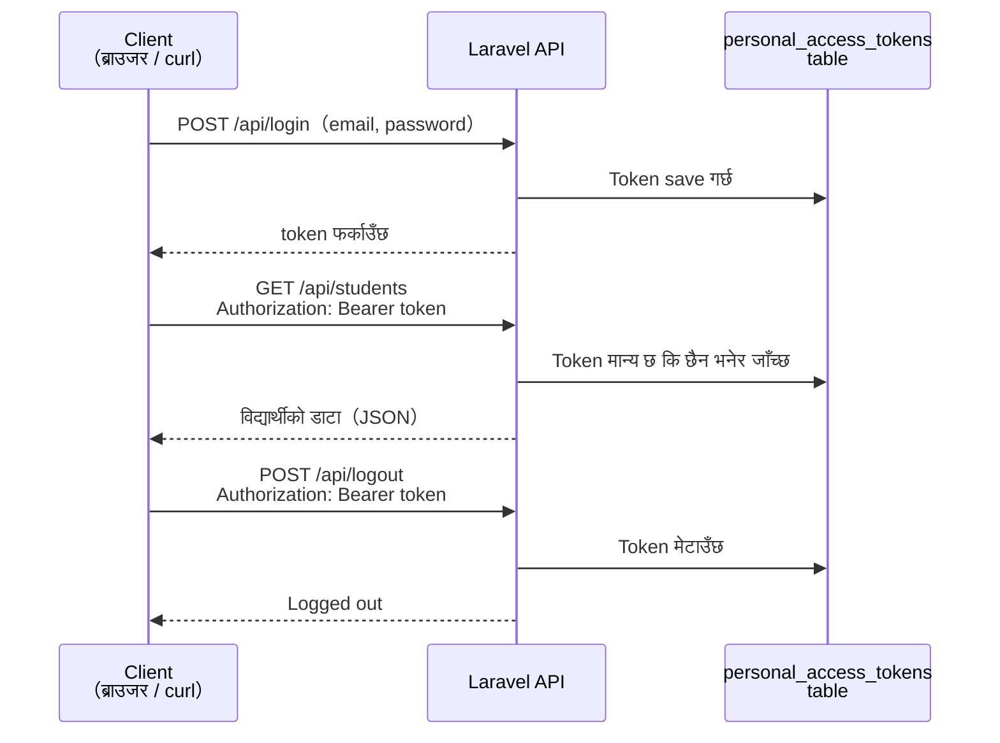
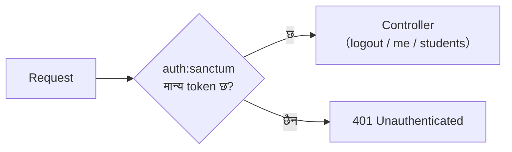

# Laravel लाई REST API मा बदल्ने

> 🇯🇵 मूल प्रति (जापानी भाषामा): [20260521.md](<../../../2年生_システム開発実践/前期/2026_05_21/20260521.md>) <!-- original-ja-link -->

---

## कक्षा 05: Resource controller बाट CRUD API व्यवस्थित गर्ने

### API Resource — response को ढाँचा मिलाउने

```bash
php artisan make:resource StudentResource
```

```php
// app/Http/Resources/StudentResource.php
class StudentResource extends JsonResource
{
    public function toArray(Request $request): array
    {
        return [
            'id'         => $this->id,
            'name'       => $this->name,
            'email'      => $this->email,
            'score'      => $this->score,
            'evaluation' => $this->score >= 80 ? 'A' : 'B',  // हिसाब गरेको मान पनि थप्न सकिन्छ
            'created_at' => $this->created_at->format('Y/m/d'),
            // नचाहिने field (password आदि) समावेश गर्दैन
        ];
    }
}
```

**Controller मा प्रयोग गर्ने:**

```php
use App\Http\Resources\StudentResource;
use App\Http\Resources\StudentCollection;

public function index()
{
    $students = Student::all();
    return StudentResource::collection($students);
    // → सबै record लाई Resource मा wrap गरेर फर्काउँछ
}

public function show($id)
{
    return new StudentResource(Student::findOrFail($id));
}
```

---

## कक्षा 06: API response को ढाँचा एकरूप बनाउने

### API response को ढाँचासम्बन्धी best practice

```json
// सफल हुँदा
{
    "status": "ok",
    "data": { ... }
}

// Error हुँदा
{
    "status": "error",
    "message": "Not found",
    "errors": {
        "email": ["このメールアドレスは既に使われています"]
    }
}
```

---

## कक्षा 07: Sanctum बाट token authentication

### Sanctum भनेको के हो

Laravel को **API authentication package** हो।  
Token (एक किसिमको गोप्य शब्द) प्रयोग गरेर login अवस्था व्यवस्थापन गर्छ।

Login देखि logout सम्मको प्रक्रिया तल देखाइएअनुसार हुन्छ।



```bash
composer require laravel/sanctum
php artisan vendor:publish --provider="Laravel\Sanctum\SanctumServiceProvider"
php artisan migrate
```

**Authentication API बनाउने:**

```php
// app/Http/Controllers/Api/AuthController.php
class AuthController extends Controller
{
    // POST /api/login
    public function login(Request $request)
    {
        $request->validate([
            'email'    => 'required|email',
            'password' => 'required',
        ]);
        
        // Email र password जाँच्छ
        if (!Auth::attempt($request->only('email', 'password'))) {
            return response()->json([
                'status'  => 'error',
                'message' => 'メールアドレスまたはパスワードが違います',
            ], 401);
        }
        
        $user = Auth::user();
        
        // Token जारी गर्छ
        $token = $user->createToken('api-token')->plainTextToken;
        
        return response()->json([
            'status' => 'ok',
            'token'  => $token,
            'user'   => $user,
        ]);
    }
    
    // POST /api/logout
    public function logout(Request $request)
    {
        // हालको token मेटाउँछ
        $request->user()->currentAccessToken()->delete();
        
        return response()->json(['status' => 'ok', 'message' => 'Logged out']);
    }
    
    // GET /api/me
    public function me(Request $request)
    {
        return response()->json(['status' => 'ok', 'user' => $request->user()]);
    }
}
```

---

## कक्षा 08: Authentication middleware र अनुमति (permission) व्यवस्थापन

`auth:sanctum` middleware भनेको controller भन्दा अगाडि "token छ कि छैन" भनेर जाँच्ने ढोकाको पाले हो।



```php
// routes/api.php

// Authentication नचाहिने route
Route::post('/login', [AuthController::class, 'login']);
Route::post('/register', [AuthController::class, 'register']);

// Authentication चाहिने route (auth:sanctum)
Route::middleware('auth:sanctum')->group(function () {
    Route::post('/logout', [AuthController::class, 'logout']);
    Route::get('/me', [AuthController::class, 'me']);
    Route::apiResource('students', StudentController::class);
});
```

**API test गर्ने तरिका (curl command):**

```bash
# Login
curl -X POST http://localhost:8000/api/login \
  -H "Content-Type: application/json" \
  -d '{"email":"test@example.com","password":"password"}'
# → {"token": "1|abc123..."}

# Authentication चाहिने API लाई request पठाउने
curl http://localhost:8000/api/students \
  -H "Authorization: Bearer 1|abc123..."
```

---

## सारांश

| अवधारणा | Blade (पहिलो वर्ष) | API (दोस्रो वर्ष) |
|------|-------------|------------|
| Response | HTML（view） | JSON（response()->json()） |
| Routing | routes/web.php | routes/api.php |
| Authentication | Session | Sanctum token |
| स्क्रिन | Blade ले फर्काउँछ | Frontend ले बनाउँछ |
