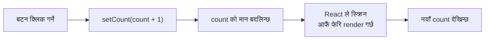
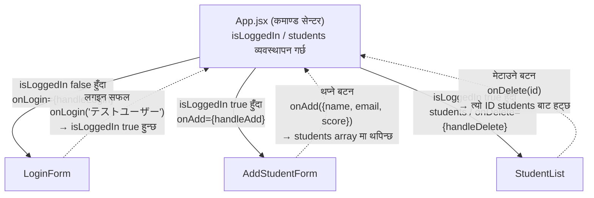

# कक्षा 16｜React आधारभूत — कम्पोनेन्ट, JSX, props, useState

> 🇯🇵 मूल प्रति (जापानी भाषामा): [2026_06_11.md](<../../../2年生_システム開発実践/前期/2026_06_11/2026_06_11.md>) <!-- original-ja-link -->

## आजको लक्ष्य
- JSX कसरी लेख्ने भनेर बुझ्न सक्ने
- कम्पोनेन्ट बनाएर प्रयोग गर्न सक्ने
- `props` बाट डाटा पठाउन सक्ने
- `useState` बाट state व्यवस्थापन गर्न सक्ने

> **यो कक्षाको भूमिका：** अर्को कक्षाको Next.js को "जग" को रूपमा सिक्छौं।  
> "JSX भनेको के हो, र किन कम्पोनेन्टमा छुट्याउने" भन्ने कुरा बुझ्नु नै लक्ष्य हो।

---

## 0. React वातावरण तयार गर्ने (सुरुमा एक पटक मात्र!)

### 0-1. Node.js इन्स्टल भएको छ कि छैन जाँच्ने

सबैभन्दा पहिले **Node.js** इन्स्टल भएको छ कि छैन जाँच्छौं।  
टर्मिनल (VSCode को टर्मिनल) मा तलको कमाण्ड चलाउनुहोस्।

```bash
node -v
```

भर्सन देखियो भने ठिक छ (उदाहरण: `v20.11.0`)।  
`command not found` आयो भने पहिले Node.js इन्स्टल गर्नुहोस्।

> **Node.js इन्स्टल गर्ने：** https://nodejs.org/ बाट **LTS संस्करण** (सिफारिस गरिएको संस्करण) डाउनलोड गर्नुहोस्

---

### 0-2. React प्रोजेक्ट बनाउने (Vite प्रयोग गरेर)

टर्मिनलमा **प्रोजेक्ट बनाउन चाहेको फोल्डर** मा गएर तलको कमाण्ड चलाउनुहोस्।

```bash
npm create vite@latest my-app -- --template react
```

> `my-app` भन्ने भाग प्रोजेक्टको नाम हो। मन परेको नाममा बदल्न सकिन्छ (उदाहरण: `react-practice`)

चलाएपछि तलको जस्तो सन्देश आउँछ, Enter थिचेर अगाडि बढ्नुहोस्।

```
✔ Select a framework: › React
✔ Select a variant: › JavaScript
```

---

### 0-3. चाहिने प्याकेजहरू इन्स्टल गरेर सुरु गर्ने

प्रोजेक्ट बनाइसकेपछि, तलको क्रममा कमाण्डहरू चलाउनुहोस्।

```bash
# ① बनाएको फोल्डरमा जाने
cd my-app

# ② चाहिने प्याकेजहरू एकैपटक इन्स्टल गर्ने
npm install

# ③ डेभलपमेन्ट सर्भर सुरु गर्ने
npm run dev
```

टर्मिनलमा तलको जस्तो देखियो भने सफल भयो!

```
  VITE v5.x.x  ready in xxx ms

  ➜  Local:   http://localhost:5173/
```

ब्राउजरमा `http://localhost:5173/` खोल्दा React को नमुना स्क्रिन देखिन्छ।

> **सर्भर रोक्न：** टर्मिनलमा `Ctrl + C` थिच्नुहोस्

---

### 0-4. फोल्डर संरचना हेरौं

```
my-app/
├── public/          # तस्बिर जस्ता static फाइलहरू राख्ने ठाउँ
├── src/             # ← मुख्य रूपमा यहीँ सम्पादन गर्ने!
│   ├── App.jsx      # मुख्य कम्पोनेन्ट (सबैभन्दा पहिले सम्पादन गर्ने फाइल)
│   ├── App.css      # App.jsx को स्टाइल
│   ├── main.jsx     # एप सुरु हुने ठाउँ (सामान्यतया नछुने)
│   └── index.css    # पूरै एपको स्टाइल
├── index.html       # एपको HTML टेम्प्लेट
└── package.json     # प्रोजेक्टको सेटिङ र प्रयोग गर्ने प्याकेजहरूको सूची
```

**सुरुमा `src/App.jsx` मात्र सम्पादन गरे पुग्छ!**

---

### 0-5. App.jsx बदलेर हेरौं

`src/App.jsx` खोलेर, भित्रको सबै मेटाएर तलको कोडमा बदलेर हेरौं।

```jsx
function App() {
  return (
    <div>
      <h1>はじめての React！</h1>
      <p>環境構築できました！</p>
    </div>
  );
}

export default App;
```

सेभ गर्नेबित्तिकै ब्राउजर आफैं अपडेट हुन्छ (हट रिलोड)।  
"はじめての React！" (पहिलो React!) देखियो भने तयारी पूरा भयो!

---

## 1. React भनेको के हो

**React = UI लाई "कम्पोनेन्ट (पार्टपुर्जा)" बाट बनाउने JavaScript लाइब्रेरी**

```
पहिलेको HTML + JavaScript：
  <div id="app"></div>
  document.getElementById("app").innerHTML = "...";
  → पेज बढ्दै गएपछि व्यवस्थापन गर्न गाह्रो

React：
  <Button label="送信" />  ← फेरि प्रयोग गर्न सकिने पार्टपुर्जा
  <Card title="タイトル" body="内容" />
  → पार्टपुर्जाहरू जोडेर पेज बनाउने
```

---

## 2. JSX — JavaScript भित्र HTML लेख्ने

> **कहिले प्रयोग गर्ने？** HTML मात्रले भेरिएबलको मान सिधै लेख्न सकिँदैन। JSX प्रयोग गरे `{भेरिएबलको नाम}` लेखेर तुरुन्तै मान राख्न सकिन्छ। प्रयोगकर्ताको नाम, मिति, हिसाबको नतिजा जस्ता "परिवर्तन हुने मान" देखाउनुपर्दा प्रयोग गर्छौं।  
> **जाँच्ने कुरा：** `namae` लाई आफ्नै नाममा बदलेर सेभ गर्नुहोस् → स्क्रिन आफैं अपडेट हुन्छ कि जाँच्नुहोस्। `{1 + 1}` ले `2` देखाउँछ कि जाँच्नुहोस्।

```jsx
// ▼ src/App.jsx मा लेखेर हेरौं (फाइलभित्रको सबै मेटाएर तलको कोडमा बदल्ने)

// JSX = JavaScript + XML (HTML जस्तो लेखाइ)

// सामान्य फङ्सन (कम्पोनेन्ट)
function Hello() {
  // JSX लाई return गर्ने
  return (
    <div>
      <h1>こんにちは！</h1>
      <p>React を始めよう</p>
    </div>
  );
}

// JavaScript का expression हरू {} भित्र राख्ने
function Greeting() {
  const namae = "田中太郎";
  const today = new Date().toLocaleDateString("ja-JP");
  
  return (
    <div>
      <h1>こんにちは、{namae}さん！</h1>
      <p>今日は {today} です</p>
      <p>1 + 1 = {1 + 1}</p>
    </div>
  );
}

export default Greeting;
```

**JSX मा ध्यान दिनुपर्ने कुराहरू：**

> **कहिले प्रयोग गर्ने？** JSX लेख्दा एरर आयो भने, धेरैजसो यी 3 वटा नियम पालना नगरेको हुन सक्छ। रातो एरर देखियो भने यहाँ फर्केर जाँचौं।

```jsx
// ▼ लेखाइको सन्दर्भ नोट (यो एक्लै चल्दैन, पढेर सम्झौं)

// ① class को सट्टा className (class JS को आरक्षित शब्द हो)
<div className="container">

// ② सबै एलिमेन्ट बन्द गर्ने
<input type="text" />  // आफैं बन्द हुने ट्याग

// ③ धेरै एलिमेन्टलाई 1 वटा parent ले घेर्ने
return (
  <div>
    <h1>タイトル</h1>
    <p>内容</p>
  </div>
);
// अथवा Fragment（<></>) प्रयोग गर्ने
return (
  <>
    <h1>タイトル</h1>
    <p>内容</p>
  </>
);
```

---

## 3. props — कम्पोनेन्टलाई डाटा पठाउने

> **कहिले प्रयोग गर्ने？** एउटै डिजाइनमा "डाटा मात्र फरक" भएका कार्ड वा पङ्क्तिहरू धेरै देखाउनुपर्दा। कम्पोनेन्ट 1 पटक लेखेपछि, पठाउने डाटा मात्र बदलेर जति पटक पनि फेरि प्रयोग गर्न सकिन्छ।  
> **जाँच्ने कुरा：** `passed={false}` भएको StudentCard को पृष्ठभूमि रङ सुन्तला खालको हुन्छ कि जाँच्नुहोस्। चौथो `<StudentCard>` आफैं थपेर हेरौं।

```jsx
// ▼ src/App.jsx मा लेखेर हेरौं (फाइलभित्रको सबै मेटाएर तलको कोडमा बदल्ने)

// props = कम्पोनेन्टको "argument"

// कम्पोनेन्ट परिभाषा (props लिने)
function StudentCard({ name, score, passed }) {
  return (
    <div style={{
      border: "1px solid #ddd",
      padding: "16px",
      margin: "8px",
      backgroundColor: passed ? "#e3f2fd" : "#fbe9e7"
    }}>
      <h3>{name}</h3>
      <p>点数: {score}点</p>
      <span>{passed ? "✅ 合格" : "❌ 不合格"}</span>
    </div>
  );
}

// प्रयोग गर्ने तरिका (parent कम्पोनेन्ट)
function App() {
  return (
    <div>
      <StudentCard name="田中太郎" score={85} passed={true} />
      <StudentCard name="鈴木花子" score={45} passed={false} />
      <StudentCard name="山田次郎" score={91} passed={true} />
    </div>
  );
}

export default App;
```

---

## 4. useState — state को व्यवस्थापन

> **कहिले प्रयोग गर्ने？** बटन क्लिक, इनपुट, छनोट जस्ता "प्रयोगकर्ताको कामले बदलिने मान" लाई तुरुन्तै स्क्रिनमा देखाउनुपर्दा। `count` जस्तो "बदलिने मान" लाई सधैं `useState` बाट व्यवस्थापन गर्नुपर्छ। सामान्य भेरिएबल (`let count = 0`) ले स्क्रिन अपडेट हुँदैन।  
> **जाँच्ने कुरा：** `+1` लाई 5 पटक थिच्दा अङ्क बढ्छ कि जाँच्नुहोस्। `リセット` (रिसेट) थिच्दा 0 मा फर्किन्छ कि जाँच्नुहोस्। पेज रिलोड नहुने कुरा पनि जाँच्नुहोस्।

```jsx
// ▼ src/App.jsx मा लेखेर हेरौं (फाइलभित्रको सबै मेटाएर तलको कोडमा बदल्ने)
import { useState } from "react";

function Counter() {
  // useState(सुरुको मान) → [अहिलेको मान, मान बदल्ने फङ्सन]
  const [count, setCount] = useState(0);
  
  return (
    <div>
      <p>カウント: {count}</p>
      
      {/* बटन थिच्दा हरेक पटक count बढ्छ */}
      <button onClick={() => setCount(count + 1)}>+1</button>
      <button onClick={() => setCount(count - 1)}>-1</button>
      <button onClick={() => setCount(0)}>リセット</button>
    </div>
  );
}

export default Counter;
```

`setCount` बोलाउँदा React ले स्क्रिन फेरि बनाउँछ, यो प्रक्रियालाई चित्रमा देखाउँदा यस्तो हुन्छ।



---

## 5. सूची render गर्ने

> **कहिले प्रयोग गर्ने？** सामानको सूची, विद्यार्थीको सूची, कमेन्ट खण्ड जस्ता "array को डाटा दोहोर्याएर देखाउनुपर्दा" सधैं प्रयोग हुने तरिका। डाटा बढ्यो भने देखिने कुरा पनि आफैं बढ्छ।  
> **जाँच्ने कुरा：** `students` array मा चौथो विद्यार्थी थपेर हेरौं → `<li>` आफैं बढ्छ कि जाँच्नुहोस्। `key={student.id}` मेटाउँदा ब्राउजरको कन्सोल (F12) मा चेतावनी आउँछ कि त्यो पनि जाँचेर हेरौं।

```jsx
// ▼ src/App.jsx मा लेखेर हेरौं (फाइलभित्रको सबै मेटाएर तलको कोडमा बदल्ने)
function StudentList() {
  const students = [
    { id: 1, name: "田中太郎", score: 85 },
    { id: 2, name: "鈴木花子", score: 72 },
    { id: 3, name: "山田次郎", score: 91 },
  ];
  
  return (
    <ul>
      {/* array को map बाट एलिमेन्ट बनाउने */}
      {/* key चाहिँ React ले फरक पत्ता लगाउन चाहिन्छ (loop भित्र सधैं राख्ने) */}
      {students.map((student) => (
        <li key={student.id}>
          {student.name} - {student.score}点
        </li>
      ))}
    </ul>
  );
}

export default StudentList;
```

---

## 6. फर्म र इभेन्ट

> **कहिले प्रयोग गर्ने？** खोज, लगइन वा डाटा इनपुट जस्ता अवस्थामा प्रयोगकर्ताले प्रविष्ट गरेको मान लिएर प्रशोधन गर्नुपर्दा। `onChange` ले इनपुट परिवर्तन हुँदा हरेक पटक state अपडेट गर्छ, र `onSubmit` ले बटन थिच्दा आवश्यक प्रक्रिया गर्छ।  
> **जाँच्ने कुरा：** केही लेखेर "検索" (खोज) थिच्दा नतिजाको टेक्स्ट देखिन्छ कि जाँच्नुहोस्। `e.preventDefault()` लाई कमेन्ट आउट (`//` लगाउने) गरेर, submit गर्दा पेज रिलोड हुन्छ कि त्यो पनि जाँचेर हेरौं।

```jsx
// ▼ src/App.jsx मा लेखेर हेरौं (फाइलभित्रको सबै मेटाएर तलको कोडमा बदल्ने)
import { useState } from "react";

function SearchForm() {
  const [query, setQuery] = useState("");
  const [result, setResult] = useState(null);
  
  function handleSubmit(e) {
    e.preventDefault();  // पेज रिलोड हुनबाट रोक्ने
    setResult(`"${query}" を検索しました`);
  }
  
  return (
    <form onSubmit={handleSubmit}>
      <input
        type="text"
        value={query}
        onChange={(e) => setQuery(e.target.value)}
        // onChange = इनपुट परिवर्तन हुँदा हरेक पटक setQuery ले state अपडेट गर्ने
        placeholder="検索キーワード"
      />
      <button type="submit">検索</button>
      {result && <p>{result}</p>}
    </form>
  );
}

export default SearchForm;
```

---

## 7. व्यावहारिक अभ्यास — Mock डाटाबाट विद्यार्थी व्यवस्थापन एप बनाऔं

अहिलेसम्म सिकेका JSX, कम्पोनेन्ट, props, useState सबै प्रयोग गरेर,  
**"विद्यार्थी व्यवस्थापन एप"** बनाउँछौं।

> **Mock भनेको के हो？**  
> साँचो API को सट्टा, कोडभित्रै लेखिएको डाटा प्रयोग गर्नु हो।  
> यो "API बिना स्क्रिन बनाउने अभ्यास" हो।  
> अर्को कक्षामा (Next.js) यही स्क्रिनलाई साँचो API सँग जोड्छौं।

---

### 7-1. तयार भएपछिको रूप

```
【लगइन अघि】
┌──────────────────────────┐
│  लगइन                    │
│                          │
│  [इमेल ठेगाना          ] │
│  [पासवर्ड              ] │
│  [    लगइन             ] │
│                          │
│  ※ test@example.com     │
│     / password           │
└──────────────────────────┘

【लगइन पछि】
┌──────────────────────────────────────────────────┐
│ विद्यार्थी व्यवस्थापन एप (React Mock संस्करण) ● लगइन भएको  [लगआउट] │
├──────────────────────────────────────────────────┤
│ नयाँ थप्ने                                        │
│ [नाम] [इमेल ठेगाना] [अङ्क] [थप्ने]                 │
├──────────────────────────────────────────────────┤
│ विद्यार्थी सूची (3 जना)                            │
│ ID │ नाम      │ इमेल                │ अङ्क │      │
│  1 │ 田中太郎 │ tanaka@example.com │  85  │ मेटाउने │
│  2 │ 山田花子 │ yamada@example.com │  72  │ मेटाउने │
└──────────────────────────────────────────────────┘
```

---

### 7-2. फाइल संरचना

`src/` भित्र `components/` फोल्डर बनाएर, कम्पोनेन्टहरू छुट्याउँछौं।

```
src/
├── App.jsx                      ← मुख्य (state सबै एकै ठाउँमा व्यवस्थापन)
├── components/
│   ├── LoginForm.jsx            ← लगइन फर्म
│   ├── StudentList.jsx          ← विद्यार्थी सूचीको तालिका
│   └── AddStudentForm.jsx       ← विद्यार्थी थप्ने फर्म
└── main.jsx                     ← नछुने
```

VSCode मा `src/` फोल्डरमा राइट क्लिक → `New Folder` → `components` लेखेर Enter थिच्नुहोस्।

---

### 7-3. Step 1｜LoginForm.jsx बनाउने

`src/components/LoginForm.jsx` नयाँ बनाएर, तलको कोड कपी गरेर पेस्ट गर्नुहोस्।

```jsx
import { useState } from "react";

// mock का लागि निश्चित लगइन जानकारी (साँचो API को सट्टा)
const MOCK_EMAIL = "test@example.com";
const MOCK_PASSWORD = "password";
const MOCK_NAME = "テストユーザー";

// onLogin = लगइन सफल हुँदा बोलाउने फङ्सन (App.jsx बाट प्राप्त हुन्छ)
function LoginForm({ onLogin }) {
  const [email, setEmail] = useState("test@example.com");
  const [password, setPassword] = useState("password");
  const [error, setError] = useState("");

  function handleSubmit(e) {
    e.preventDefault(); // पेज रिलोड हुनबाट रोक्ने

    // इनपुट मान mock जानकारीसँग मिल्यो भने लगइन सफल
    if (email === MOCK_EMAIL && password === MOCK_PASSWORD) {
      onLogin(MOCK_NAME); // parent कम्पोनेन्टलाई प्रयोगकर्ताको नाम पठाउने
    } else {
      setError("メールアドレスまたはパスワードが違います");
    }
  }

  return (
    <div style={{
      maxWidth: "400px", margin: "80px auto",
      background: "white", padding: "32px",
      borderRadius: "8px", boxShadow: "0 2px 8px rgba(0,0,0,0.1)"
    }}>
      <h2 style={{ marginBottom: "24px", textAlign: "center" }}>ログイン</h2>

      <form onSubmit={handleSubmit}>
        <div style={{ marginBottom: "16px" }}>
          <label style={{ display: "block", marginBottom: "6px", fontWeight: "bold" }}>
            メールアドレス
          </label>
          <input
            type="email"
            value={email}
            onChange={(e) => setEmail(e.target.value)}
            style={{ width: "100%", padding: "10px", border: "1px solid #ccc", borderRadius: "6px", fontSize: "1em", boxSizing: "border-box" }}
          />
        </div>

        <div style={{ marginBottom: "16px" }}>
          <label style={{ display: "block", marginBottom: "6px", fontWeight: "bold" }}>
            パスワード
          </label>
          <input
            type="password"
            value={password}
            onChange={(e) => setPassword(e.target.value)}
            style={{ width: "100%", padding: "10px", border: "1px solid #ccc", borderRadius: "6px", fontSize: "1em", boxSizing: "border-box" }}
          />
        </div>

        {/* error खाली नभएको बेला मात्र एरर देखाउने */}
        {error && (
          <p style={{ color: "#D32F2F", fontSize: "0.9em", marginBottom: "12px" }}>
            {error}
          </p>
        )}

        <button
          type="submit"
          style={{ width: "100%", padding: "12px", background: "#1976D2", color: "white", border: "none", borderRadius: "6px", fontSize: "1em", fontWeight: "bold", cursor: "pointer" }}
        >
          ログイン
        </button>
      </form>

      <p style={{ marginTop: "16px", fontSize: "0.85em", color: "#888", textAlign: "center" }}>
        ※ Mock用: test@example.com / password
      </p>
    </div>
  );
}

export default LoginForm;
```

---

### 7-4. Step 2｜StudentList.jsx बनाउने

`src/components/StudentList.jsx` नयाँ बनाएर, तलको कोड कपी गरेर पेस्ट गर्नुहोस्।

```jsx
// StudentList: विद्यार्थी सूचीको पूरै तालिका
// students = विद्यार्थी डाटाको array (parent बाट आउँछ)
// onDelete = मेटाउने बटन थिच्दा बोलाउने फङ्सन (parent बाट आउँछ)
function StudentList({ students, onDelete }) {
  return (
    <div style={{ background: "white", borderRadius: "8px", padding: "24px", boxShadow: "0 2px 8px rgba(0,0,0,0.05)" }}>
      <h2 style={{ marginBottom: "16px", fontSize: "1.1em" }}>
        生徒一覧
        <span style={{ color: "#888", fontWeight: "normal", fontSize: "0.85em" }}>
          （{students.length}件）
        </span>
      </h2>

      {/* विद्यार्थी 0 जना हुँदा "दर्ता छैन" सन्देश देखाउने */}
      {students.length === 0 ? (
        <p style={{ color: "#888", textAlign: "center", padding: "24px" }}>
          生徒が登録されていません
        </p>
      ) : (
        <table style={{ width: "100%", borderCollapse: "collapse" }}>
          <thead>
            <tr style={{ background: "#f5f5f5" }}>
              <th style={thStyle}>ID</th>
              <th style={thStyle}>名前</th>
              <th style={thStyle}>メール</th>
              <th style={thStyle}>点数</th>
              <th style={thStyle}></th>
            </tr>
          </thead>
          <tbody>
            {/* array का हरेक विद्यार्थीलाई StudentRow कम्पोनेन्टबाट देखाउने */}
            {students.map((student) => (
              <StudentRow
                key={student.id}
                student={student}
                onDelete={onDelete}
              />
            ))}
          </tbody>
        </table>
      )}
    </div>
  );
}

// StudentRow: तालिकाको 1 पङ्क्ति
function StudentRow({ student, onDelete }) {
  function handleDelete() {
    // पुष्टि गर्ने डायलग देखाएर मात्र मेटाउने
    if (window.confirm(`${student.name} を削除しますか？`)) {
      onDelete(student.id); // parent लाई "यो ID मेटाइदेऊ" भनेर भन्ने
    }
  }

  return (
    <tr style={{ borderBottom: "1px solid #eee" }}>
      <td style={tdStyle}>{student.id}</td>
      <td style={tdStyle}>{student.name}</td>
      <td style={tdStyle}>{student.email}</td>
      <td style={tdStyle}>{student.score}</td>
      <td style={tdStyle}>
        <button
          onClick={handleDelete}
          style={{ background: "#D32F2F", color: "white", border: "none", borderRadius: "4px", padding: "4px 12px", cursor: "pointer", fontSize: "0.85em" }}
        >
          削除
        </button>
      </td>
    </tr>
  );
}

// स्टाइल constant (बारम्बार प्रयोग हुने style एकै ठाउँमा राख्ने)
const thStyle = { padding: "10px 16px", textAlign: "left", fontWeight: "bold", fontSize: "0.9em" };
const tdStyle = { padding: "12px 16px", fontSize: "0.95em" };

export default StudentList;
```

---

### 7-5. Step 3｜AddStudentForm.jsx बनाउने

`src/components/AddStudentForm.jsx` नयाँ बनाएर, तलको कोड कपी गरेर पेस्ट गर्नुहोस्।

```jsx
import { useState } from "react";

// onAdd = थप्ने बटन थिच्दा बोलाउने फङ्सन (parent बाट आउँछ)
function AddStudentForm({ onAdd }) {
  const [name, setName] = useState("");
  const [email, setEmail] = useState("");
  const [score, setScore] = useState("");
  const [error, setError] = useState("");

  function handleSubmit(e) {
    e.preventDefault();
    setError(""); // एरर रिसेट गर्ने

    // भ्यालिडेसन (इनपुट जाँच)
    if (!name || !email || !score) {
      setError("すべての項目を入力してください");
      return;
    }
    if (Number(score) < 0 || Number(score) > 100) {
      setError("点数は0〜100の数値を入力してください");
      return;
    }

    // parent कम्पोनेन्टलाई नयाँ विद्यार्थीको डाटा पठाउने
    onAdd({ name, email, score: Number(score) });

    // फर्म रिसेट गर्ने
    setName("");
    setEmail("");
    setScore("");
  }

  return (
    <div style={{ background: "white", borderRadius: "8px", padding: "24px", boxShadow: "0 2px 8px rgba(0,0,0,0.05)", marginBottom: "24px" }}>
      <h2 style={{ marginBottom: "16px", fontSize: "1.1em" }}>新規追加</h2>

      <form onSubmit={handleSubmit} style={{ display: "flex", gap: "12px", alignItems: "flex-end", flexWrap: "wrap" }}>
        <div>
          <label style={labelStyle}>名前</label>
          <input
            type="text"
            value={name}
            onChange={(e) => setName(e.target.value)}
            placeholder="田中太郎"
            style={inputStyle}
          />
        </div>
        <div>
          <label style={labelStyle}>メールアドレス</label>
          <input
            type="email"
            value={email}
            onChange={(e) => setEmail(e.target.value)}
            placeholder="tanaka@example.com"
            style={inputStyle}
          />
        </div>
        <div>
          <label style={labelStyle}>点数</label>
          <input
            type="number"
            value={score}
            onChange={(e) => setScore(e.target.value)}
            placeholder="85"
            min="0"
            max="100"
            style={{ ...inputStyle, width: "80px" }}
          />
        </div>
        <button
          type="submit"
          style={{ padding: "10px 20px", background: "#1976D2", color: "white", border: "none", borderRadius: "6px", fontWeight: "bold", cursor: "pointer", fontSize: "0.95em" }}
        >
          追加
        </button>
      </form>

      {error && (
        <p style={{ color: "#D32F2F", marginTop: "10px", fontSize: "0.9em" }}>{error}</p>
      )}
    </div>
  );
}

const labelStyle = { display: "block", marginBottom: "4px", fontSize: "0.85em", fontWeight: "bold" };
const inputStyle = { padding: "9px 12px", border: "1px solid #ccc", borderRadius: "6px", fontSize: "0.95em", width: "180px" };

export default AddStudentForm;
```

---

### 7-6. Step 4｜App.jsx मा सबै जोड्ने

`src/App.jsx` खोलेर, **भित्रको सबै मेटाएर** तलको कोडमा बदल्नुहोस्।

```jsx
import { useState } from "react";
import LoginForm from "./components/LoginForm";
import StudentList from "./components/StudentList";
import AddStudentForm from "./components/AddStudentForm";

// सुरुदेखि नै देखाउने mock डाटा
const INITIAL_STUDENTS = [
  { id: 1, name: "田中太郎", email: "tanaka@example.com", score: 85 },
  { id: 2, name: "山田花子", email: "yamada@example.com", score: 72 },
  { id: 3, name: "山田次郎", email: "jiro@example.com", score: 91 },
];

function App() {
  // लगइन state व्यवस्थापन गर्ने
  const [isLoggedIn, setIsLoggedIn] = useState(false);
  const [userName, setUserName] = useState("");

  // विद्यार्थी सूची व्यवस्थापन गर्ने
  const [students, setStudents] = useState(INITIAL_STUDENTS);
  const [nextId, setNextId] = useState(4); // अर्को थपिने विद्यार्थीको ID

  // लगइन सफल हुँदा: LoginForm बाट बोलाइन्छ
  function handleLogin(name) {
    setIsLoggedIn(true);
    setUserName(name);
  }

  // लगआउट गर्दा
  function handleLogout() {
    setIsLoggedIn(false);
    setUserName("");
  }

  // विद्यार्थी थप्ने: AddStudentForm बाट बोलाइन्छ
  function handleAdd(newStudent) {
    setStudents([...students, { ...newStudent, id: nextId }]);
    setNextId(nextId + 1);
  }

  // विद्यार्थी मेटाउने: StudentList बाट बोलाइन्छ
  function handleDelete(id) {
    setStudents(students.filter((s) => s.id !== id));
  }

  return (
    <div style={{ background: "#f4f6f8", minHeight: "100vh" }}>

      {/* हेडर */}
      <header style={{
        background: "#1565C0", color: "white",
        padding: "16px 32px",
        display: "flex", alignItems: "center"
      }}>
        <h1 style={{ fontSize: "1.2em" }}>生徒管理アプリ（React Mock版）</h1>

        {/* लगइन भएको बेला मात्र हेडरको दायाँपट्टि प्रयोगकर्ताको नाम र लगआउट बटन देखाउने */}
        {isLoggedIn && (
          <div style={{ marginLeft: "auto", display: "flex", alignItems: "center", gap: "12px" }}>
            <span style={{ fontSize: "0.9em" }}>● ログイン中：{userName}</span>
            <button
              onClick={handleLogout}
              style={{ background: "#D32F2F", color: "white", border: "none", borderRadius: "6px", padding: "6px 14px", cursor: "pointer" }}
            >
              ログアウト
            </button>
          </div>
        )}
      </header>

      {/* मुख्य सामग्री */}
      <main style={{ padding: "32px", maxWidth: "900px", margin: "0 auto" }}>
        {/* isLoggedIn true भए विद्यार्थी व्यवस्थापन स्क्रिन, false भए लगइन स्क्रिन */}
        {isLoggedIn ? (
          <>
            <AddStudentForm onAdd={handleAdd} />
            <StudentList students={students} onDelete={handleDelete} />
          </>
        ) : (
          <LoginForm onLogin={handleLogin} />
        )}
      </main>

    </div>
  );
}

export default App;
```

---

### 7-7. चलाएर जाँच्ने

डेभलपमेन्ट सर्भर सुरु गरेर ब्राउजरमा जाँच्छौं।

```bash
npm run dev
```

`http://localhost:5173/` मा गएर, तलका कुराहरू क्रमैसँग चलाएर हेर्नुहोस्।

| जाँच्ने कुरा | गर्ने काम | अपेक्षित नतिजा |
|---------|------|------------|
| लगइन अघिको स्क्रिन | पेज खोल्ने | लगइन फर्म देखिन्छ |
| लगइन सफल | `test@example.com` / `password` बाट लगइन गर्ने | हेडरमा "ログイン中" (लगइन भएको) र विद्यार्थी सूची देखिन्छ |
| लगइन असफल | पासवर्ड बदलेर लगइन गर्ने | एरर सन्देश देखिन्छ |
| विद्यार्थी थप्ने | फर्ममा भरेर "追加" (थप्ने) थिच्ने | तालिकामा नयाँ पङ्क्ति थपिन्छ |
| विद्यार्थी मेटाउने | "削除" (मेटाउने) बटन थिच्ने | पुष्टि गर्ने डायलग → OK थिचेपछि पङ्क्ति हराउँछ |
| 0 जना हुँदा | सबैलाई मेटाउने | "生徒が登録されていません" (कुनै विद्यार्थी दर्ता भएका छैनन्) देखिन्छ |
| लगआउट | "ログアウト" (लगआउट) बटन थिच्ने | लगइन फर्ममा फर्किन्छ |

---

### 7-8. कोडको प्रवाह मिलाएर बुझौं

तलको चित्रमा ठोस रेखाले "parent → child लाई props पठाउने" प्रवाह, र थोप्ला रेखाले "child ले parent को फङ्सन बोलाएर state बदल्ने" प्रवाह देखाउँछ।



> **मुख्य कुरा：** डाटा (state) लाई `App.jsx` ले एकै ठाउँमा व्यवस्थापन गर्छ,  
> र child कम्पोनेन्टलाई "डाटा" र "चलाउने फङ्सन" props बाट पठाउनु React को आधारभूत ढाँचा हो।

---

### 7-9. Next.js सँगको फरक (अर्को कक्षाको पूर्वतयारी)

| | React (यो पटक) | Next.js (अर्को पटक) |
|--|--|--|
| डाटा ल्याउने | कोडभित्रको Mock array | `fetch('/api/students')` प्रयोग गरेर Laravel API बाट ल्याउने |
| लगइन | निश्चित मानसँग मिलाउने | `POST /api/login` बाट टोकन लिने |
| मेटाउने | array लाई filter गरेर अपडेट गर्ने | `DELETE /api/students/{id}` बोलाएर फेरि ल्याउने |
| स्क्रिनको रूप | **पूरै उस्तै** | **पूरै उस्तै** |

अर्को पटक **यो पटक बनाएको स्क्रिन जस्ताको तस्तै प्रयोग गरेर**, डाटा ल्याउने भाग मात्र API सँग जोड्छौं।

---

## सारांश

| अवधारणा | व्याख्या |
|------|------|
| कम्पोनेन्ट | UI को फेरि प्रयोग गर्न सकिने पार्टपुर्जा। फङ्सनबाट परिभाषित गरिन्छ |
| JSX | JavaScript भित्र HTML जस्तो लेखाइबाट UI लेख्ने |
| props | parent बाट child कम्पोनेन्टलाई डाटा पठाउने |
| useState | कम्पोनेन्टभित्रको state व्यवस्थापन गर्ने |
| key | सूची देखाउँदा हरेक एलिमेन्ट छुट्याउन प्रयोग हुने attribute |

---

## अर्को कक्षा (कक्षा 17) को जानकारी

Next.js को परिचय हो।  
React को ज्ञान प्रयोग गर्दै, App Router, पेज संरचना, फाइलमा आधारित routing सिक्छौं।
